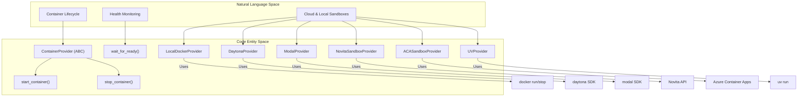
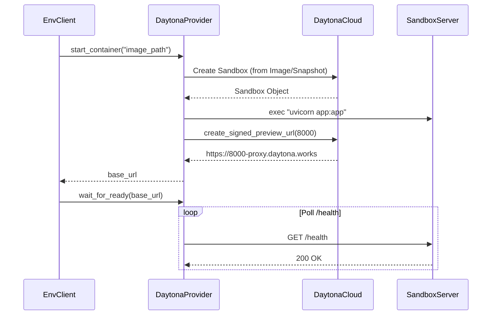
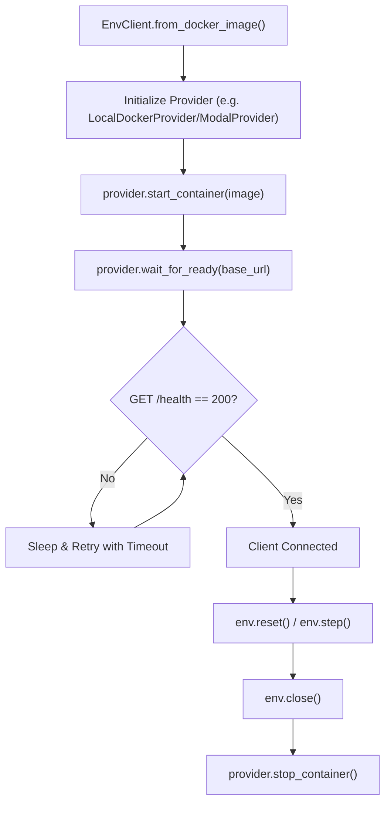

<!-- source: DeepWiki mcp.deepwiki.com · repo huggingface/OpenEnv · page 2.5 Container Providers and Runtime · fetched 2026-10-26 -->

# Container Providers and Runtime

Relevant source files

The following files were used as context for generating this wiki page:

- [examples/daytona_tbench2_concurrent.py](examples/daytona_tbench2_concurrent.py)
- [examples/daytona_tbench2_simple.py](examples/daytona_tbench2_simple.py)
- [examples/novita_echo_env.py](examples/novita_echo_env.py)
- [examples/novita_tbench2_e2e_eval.py](examples/novita_tbench2_e2e_eval.py)
- [examples/novita_tbench2_simple.py](examples/novita_tbench2_simple.py)
- [src/openenv/core/containers/runtime/__init__.py](src/openenv/core/containers/runtime/__init__.py)
- [src/openenv/core/containers/runtime/_server_config.py](src/openenv/core/containers/runtime/_server_config.py)
- [src/openenv/core/containers/runtime/aca_provider.py](src/openenv/core/containers/runtime/aca_provider.py)
- [src/openenv/core/containers/runtime/daytona_provider.py](src/openenv/core/containers/runtime/daytona_provider.py)
- [src/openenv/core/containers/runtime/modal_provider.py](src/openenv/core/containers/runtime/modal_provider.py)
- [src/openenv/core/containers/runtime/novita_provider.py](src/openenv/core/containers/runtime/novita_provider.py)
- [src/openenv/core/containers/runtime/providers.py](src/openenv/core/containers/runtime/providers.py)
- [src/openenv/core/containers/runtime/uv_provider.py](src/openenv/core/containers/runtime/uv_provider.py)
- [src/openenv/core/sync_client.py](src/openenv/core/sync_client.py)
- [tests/scripts/test_novita_examples_release_sandbox.py](tests/scripts/test_novita_examples_release_sandbox.py)
- [tests/test_core/test_aca_provider.py](tests/test_core/test_aca_provider.py)
- [tests/test_core/test_daytona_provider.py](tests/test_core/test_daytona_provider.py)
- [tests/test_core/test_modal_provider.py](tests/test_core/test_modal_provider.py)
- [tests/test_core/test_novita_provider.py](tests/test_core/test_novita_provider.py)
- [tests/test_core/test_uv_provider.py](tests/test_core/test_uv_provider.py)

Container providers in OpenEnv abstract the lifecycle management of environment servers. They allow the `EnvClient` and runtime harnesses to programmatically start, monitor, and stop the infrastructure required to run an environment, whether that infrastructure is a local Docker container, a cloud sandbox, a serverless provider, or a local process.

Sources: `[src/openenv/core/containers/runtime/providers.py:1-40]`, `[src/openenv/core/containers/runtime/daytona_provider.py:1-30]`, `[src/openenv/core/containers/runtime/modal_provider.py:1-25]`

---

## Pluggable Provider Interface

The `ContainerProvider` is an abstract base class defined in `[src/openenv/core/containers/runtime/providers.py:18-118]()`. It defines the pluggable contract for any backend hosting an OpenEnv server.

### Key Lifecycle Methods
- `start_container(image, port, env_vars, **kwargs)`: Launches the environment and returns the base URL (e.g., `http://localhost:8000` or an encrypted https tunnel) `[src/openenv/core/containers/runtime/providers.py:43-72]()`.
- `wait_for_ready(base_url, timeout_s)`: Polls the environment's health or readiness endpoint until it responds successfully, ensuring the server is ready for interaction `[src/openenv/core/containers/runtime/providers.py:84-99]()`.
- `stop_container()`: Tears down the environment and cleans up associated resources `[src/openenv/core/containers/runtime/providers.py:74-81]()`.
- `close()`: Releases provider-held SDK clients or resources `[src/openenv/core/containers/runtime/providers.py:101-110]()`.

### Runtime Abstraction Overview

**Provider System Mapping**

Sources: `[src/openenv/core/containers/runtime/providers.py:18-118]`, `[src/openenv/core/containers/runtime/daytona_provider.py:20-85]`, `[src/openenv/core/containers/runtime/modal_provider.py:137-172]`, `[src/openenv/core/containers/runtime/uv_provider.py:125-154]`

---

## LocalDockerProvider

The `LocalDockerProvider` manages containers on the local machine using the Docker CLI. It serves as the primary provider for local development, unit testing, and offline evaluation.

- **Port Management**: If no port is specified, it discovers an available port on the host machine `[src/openenv/core/containers/runtime/providers.py:168-190]()`.
- **Container Mapping**: It maps the internal server port (`8000`) to the allocated host port `[src/openenv/core/containers/runtime/providers.py:195-204]()`.
- **Process Execution**: It uses `subprocess` to execute `docker run -d`, `docker stop`, and `docker rm` commands `[src/openenv/core/containers/runtime/providers.py:184-232]()`.

Sources: `[src/openenv/core/containers/runtime/providers.py:120-232]`

---

## DaytonaProvider

The `DaytonaProvider` executes environments inside Daytona cloud sandboxes, facilitating horizontally scaled evaluations and remote training workloads.

- **Dynamic Command Discovery**: Automatically discovers server startup commands by inspecting `openenv.yaml` inside the sandbox `[src/openenv/core/containers/runtime/daytona_provider.py:86-117]()`.
- **Dockerfile and Snapshot Support**: Extracts `CMD` instructions from Dockerfiles or boots directly from pre-built Daytona snapshots using the `snapshot:` prefix `[src/openenv/core/containers/runtime/daytona_provider.py:154-187]()`.
- **Signed Preview URLs**: Generates secure authenticated preview URLs for sandbox ports `[src/openenv/core/containers/runtime/daytona_provider.py:34-40]()`.

**Daytona Lifecycle Flow**

Sources: `[src/openenv/core/containers/runtime/daytona_provider.py:20-85]`, `[src/openenv/core/containers/runtime/daytona_provider.py:86-170]`, `[tests/test_core/test_daytona_provider.py:148-180]`

---

## ModalProvider

The `ModalProvider` runs OpenEnv environments inside Modal sandboxes, booting servers within secure ephemeral containers exposed over encrypted tunnels (`https://` / `wss://`).

- **Adapter Architecture**: Communicates via `_DefaultModalAdapter` to isolate direct SDK calls and support experimental Sandbox v2 APIs (`use_sandbox_v2=True`) `[src/openenv/core/containers/runtime/modal_provider.py:57-136]()`.
- **Security Invariant Enforcement**: Enforces HTTPS/WSS transport (`_require_secure_url`) to guarantee encrypted client-server traffic, treating tunnel URLs as secure bearer tokens `[src/openenv/core/containers/runtime/modal_provider.py:40-55]()`.
- **Resource Capping**: Configures CPU and memory request limits (`_DEFAULT_CPU_REQUEST`, `_DEFAULT_MEMORY_REQUEST`) to bound resource consumption `[src/openenv/core/containers/runtime/modal_provider.py:32-38]()`.

Sources: `[src/openenv/core/containers/runtime/modal_provider.py:1-172]`, `[tests/test_core/test_modal_provider.py:1-135]`

---

## NovitaProvider

The `NovitaSandboxProvider` targets Novita AI sandbox infrastructure for launching remote server instances and pre-built environment templates.

- **Template Management**: Translates Dockerfiles into remote Novita templates on initial startup, caching references for subsequent faster boots `[examples/novita_tbench2_simple.py:25-30]()`.
- **Remote Execution**: Manages container lifecycles through Novita's REST API, returning base URLs for client connectivity `[examples/novita_tbench2_simple.py:33-53]()`.

Sources: `[src/openenv/core/containers/runtime/novita_provider.py:1-120]`, `[examples/novita_tbench2_simple.py:1-55]`

---

## ACAProvider and HF Sandbox

The `ACASandboxProvider` integrates with Azure Container Apps (ACA) for enterprise and cloud-native deployments, managing container replicas and ingress routing. In parallel, Hugging Face Spaces / HF Sandbox integrations leverage containerized Spaces and Hugging Face Hub backends to host interactive environments with zero local setup.

Sources: `[src/openenv/core/containers/runtime/aca_provider.py:1-100]`

---

## UVProvider

The `UVProvider` is a lightweight `RuntimeProvider` that bypasses containerization entirely, executing the environment server as a local process managed by the `uv` package manager `[src/openenv/core/containers/runtime/uv_provider.py:125-154]()`.

- **Git Project Clones**: Supports `git+<url>` specifications by cloning remote repositories into temporary directories with configurable timeouts before launching `[src/openenv/core/containers/runtime/uv_provider.py:29-62]`, `[src/openenv/core/containers/runtime/uv_provider.py:169-173]()`.
- **Health Polling**: Continuously polls health check endpoints using exponential backoff to detect server readiness without busy-spinning CPU cores `[src/openenv/core/containers/runtime/uv_provider.py:103-123]()`.

Sources: `[src/openenv/core/containers/runtime/uv_provider.py:1-180]`, `[tests/test_core/test_uv_provider.py:26-80]`

---

## Container Lifecycle & Health Monitoring Summary

When initialized via `EnvClient`, container providers automate the complete environment lifecycle from provisioning to tear-down.

| Provider | Backend / Platform | Isolation Level | Startup Characteristic |
| :--- | :--- | :--- | :--- |
| **LocalDockerProvider** | Local Docker Engine | High (Container) | Medium (Image dependent) |
| **DaytonaProvider** | Daytona Cloud SDK | High (Cloud Sandbox) | Provisioning + Exec setup |
| **ModalProvider** | Modal Sandboxes | High (Encrypted Tunnel) | Fast tunnel allocation |
| **NovitaSandboxProvider** | Novita AI APIs | High (Remote Sandbox) | Template build / cache |
| **ACASandboxProvider** | Azure Container Apps | High (Cloud Replica) | Enterprise scale-out |
| **UVProvider** | Local Process (`uv`) | Low (Shared Host OS) | Instant (`uv run`) |

**Container Runtime Sequence**

Sources: `[src/openenv/core/containers/runtime/providers.py:43-99]`, `[src/openenv/core/containers/runtime/modal_provider.py:137-166]`, `[src/openenv/core/containers/runtime/uv_provider.py:103-154]`

---

