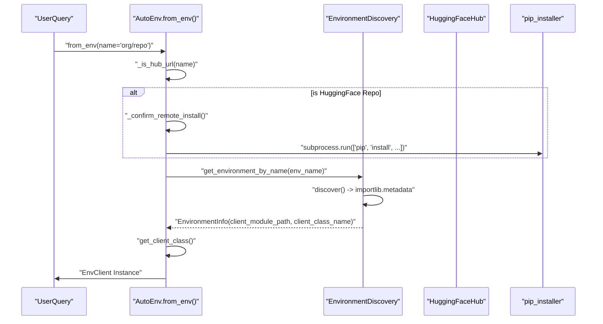
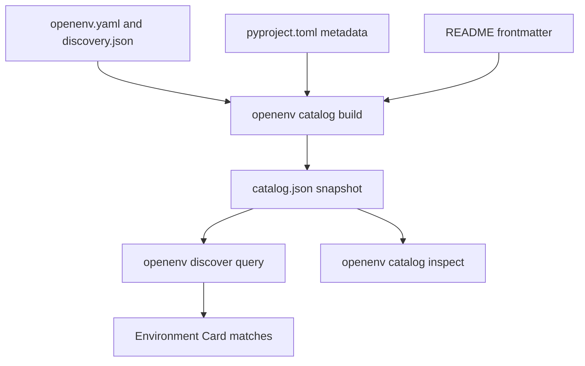

<!-- source: DeepWiki mcp.deepwiki.com · repo huggingface/OpenEnv · page 2.6 AutoEnv, Discovery, and Catalog · fetched 2026-10-26 -->

# AutoEnv, Discovery, and Catalog

<details>
<summary>Relevant source files</summary>

The following files were used as context for generating this wiki page:

- [.gitignore](.gitignore)
- [docs/source/environments/openapp.md](docs/source/environments/openapp.md)
- [docs/source/guides/catalog-discovery.md](docs/source/guides/catalog-discovery.md)
- [docs/source/guides/harbor-provider-qualification.md](docs/source/guides/harbor-provider-qualification.md)
- [envs/agent_world_model_env/openenv.yaml](envs/agent_world_model_env/openenv.yaml)
- [envs/carla_env/openenv.yaml](envs/carla_env/openenv.yaml)
- [envs/chess_env/openenv.yaml](envs/chess_env/openenv.yaml)
- [envs/finqa_env/openenv.yaml](envs/finqa_env/openenv.yaml)
- [envs/grid_world_env/openenv.yaml](envs/grid_world_env/openenv.yaml)
- [envs/openapp_env/README.md](envs/openapp_env/README.md)
- [envs/pelican_svg_env/openenv.yaml](envs/pelican_svg_env/openenv.yaml)
- [envs/wildfire_env/openenv.yaml](envs/wildfire_env/openenv.yaml)
- [rfcs/011-ard-catalog-discovery.md](rfcs/011-ard-catalog-discovery.md)
- [src/openenv/auto/_discovery.py](src/openenv/auto/_discovery.py)
- [src/openenv/auto/auto_action.py](src/openenv/auto/auto_action.py)
- [src/openenv/discovery/models.py](src/openenv/discovery/models.py)
- [src/openenv/discovery/schemas/0.1-draft/catalog.schema.json](src/openenv/discovery/schemas/0.1-draft/catalog.schema.json)
- [src/openenv/discovery/schemas/0.1-draft/declaration.schema.json](src/openenv/discovery/schemas/0.1-draft/declaration.schema.json)
- [src/openenv/discovery/schemas/0.1-draft/environment-card.schema.json](src/openenv/discovery/schemas/0.1-draft/environment-card.schema.json)
- [tests/discovery/test_catalog_contract.py](tests/discovery/test_catalog_contract.py)
- [tests/envs/test_discovery.py](tests/envs/test_discovery.py)
- [tests/envs/test_manifest_app_targets.py](tests/envs/test_manifest_app_targets.py)

</details>


The Auto-Discovery system provides a HuggingFace-style factory pattern for OpenEnv, enabling seamless interaction with environments without requiring manual module imports or prior knowledge of the internal directory structure. It manages the lifecycle of environment discovery from local packages, the HuggingFace Hub, remote HuggingFace Spaces, and ARD-backed (Agentic Resource Discovery) metadata catalogs defined under RFC 011.

## Overview and Scope

The system is centered around primary factory classes and discovery subsystems:
*   **`AutoEnv`**: Automatically resolves, installs, and instantiates `EnvClient` (or its derivatives) [src/openenv/auto/auto_env.py:120-147]().
*   **`AutoAction`**: Automatically retrieves the correct `Action` class for a given environment name [src/openenv/auto/auto_action.py:44-73]().
*   **`EnvironmentDiscovery`**: Scans installed packages via `importlib.metadata` and parses manifests [src/openenv/auto/_discovery.py:11-18]().
*   **Catalog Discovery (`openenv catalog`)**: Enforces the RFC 011 contract for metadata-only task and environment search without package execution [docs/source/guides/catalog-discovery.md:1-4]().

### Data Flow: Environment Resolution

The following diagram illustrates the process of resolving an environment name to a functional client, bridging natural language requests to code entities (`AutoEnv`, `EnvironmentDiscovery`, `importlib`).

**Environment Discovery and Instantiation Flow**

Sources: [src/openenv/auto/auto_env.py:156-200](), [src/openenv/auto/_discovery.py:11-18](), [src/openenv/auto/auto_action.py:82-128]()

---

## Environment Discovery and Manifests

OpenEnv environments are identified by the `openenv-` prefix in their package names. The `EnvironmentDiscovery` class uses `importlib.metadata` to find these packages [src/openenv/auto/_discovery.py:20-22]().

### The `openenv.yaml` Manifest and `discovery.json`
Each environment package must include an `openenv.yaml` file. This manifest defines the relationship between the environment name and the code entities [src/openenv/auto/_discovery.py:52-54](). Additionally, optional `discovery.json` files provide extra metadata for catalog indexing [docs/source/guides/catalog-discovery.md:36-39]().

| Field | Description |
| :--- | :--- |
| `name` | The unique environment name (e.g., `coding_env`) [src/openenv/auto/_discovery.py:41-53]() |
| `client_module_path` | Python path to the client (e.g., `coding_env.client`) [src/openenv/auto/_discovery.py:41-53]() |
| `client_class_name` | The class name for the environment client [src/openenv/auto/_discovery.py:41-53]() |
| `action_class_name` | The class name for actions [src/openenv/auto/_discovery.py:41-53]() |
| `default_image` | The default Docker image for this environment [src/openenv/auto/_discovery.py:41-53]() |

### Discovery Implementation
The `EnvironmentDiscovery` class performs a scan and caches results in `_cache` to ensure performance during repeated lookups [src/openenv/auto/_discovery.py:13-14]().

**Code Entity Mapping: Discovery to Classes**
```mermaid
classDiagram
    class EnvironmentInfo {
        +str env_key
        +str package_name
        +str client_module_path
        +str client_class_name
        +get_client_class()
        +get_action_class()
        +get_observation_class()
    }
    class EnvironmentDiscovery {
        -dict _cache
        +discover()
        +get_environment_by_name(name)
    }
    class AutoEnv {
        +from_env(name)
        +_ensure_package_from_hub(name)
    }
    
    AutoEnv ..> EnvironmentDiscovery : "calls get_environment_by_name"
    EnvironmentDiscovery ..> EnvironmentInfo : "returns instances"
    EnvironmentInfo ..> "importlib" : "uses importlib.import_module"
```
Sources: [src/openenv/auto/_discovery.py:36-68](), [src/openenv/auto/_discovery.py:69-92](), [src/openenv/auto/auto_env.py:120-147]()

Sources: [src/openenv/auto/_discovery.py:11-92](), [docs/source/guides/catalog-discovery.md:36-55]()

---

## Catalog Contract and ARD-Backed Discovery (RFC 011)

Under [RFC 011](https://github.com/huggingface/OpenEnv/blob/main/rfcs/011-ard-catalog-discovery.md), OpenEnv supports metadata-only environment discovery via `openenv catalog` and `openenv discover` [docs/source/guides/catalog-discovery.md:1-4](). This system inspects committed metadata without importing packages, pulling Docker images, or running candidate environments [docs/source/guides/catalog-discovery.md:1-4]().

### Building Catalogs and Searching
Catalogs are generated from repository roots containing tracked `openenv.yaml` files [docs/source/guides/catalog-discovery.md:10-18](). The build process reads manifests, `pyproject.toml`, README front matter, and optional `discovery.json` files to produce structured records [docs/source/guides/catalog-discovery.md:20-21]().

**Catalog Building and Discovery Pipeline**

Sources: [docs/source/guides/catalog-discovery.md:10-34](), [rfcs/011-ard-catalog-discovery.md:100-123]()

### Schemas and Contracts
The discovery schemas (`src/openenv/discovery/schemas/0.1-draft/`) define rigorous validation contracts for `environment-card.schema.json`, `catalog.schema.json`, and `declaration.schema.json`. Search ranking uses case-insensitive token overlap over descriptions, names, tags, capabilities, and representative queries [docs/source/guides/catalog-discovery.md:32-33]().

Sources: [docs/source/guides/catalog-discovery.md:1-132](), [rfcs/011-ard-catalog-discovery.md:1-139]()

---

## HuggingFace Hub Integration and Security

OpenEnv supports two modes of HuggingFace integration:
1.  **Package Installation**: Installing an environment package directly from a Space/Repo using `pip install git+...` [src/openenv/auto/auto_env.py:375-390]().
2.  **Remote Connection**: Connecting to a running HuggingFace Space via its resolved URL [src/openenv/auto/auto_env.py:157-182]().

### Security and `OPENENV_TRUST_REMOTE_CODE`
Since `AutoEnv` can trigger `pip install` on remote repositories, a security mechanism is enforced. By default, the system prompts the user for confirmation before executing remote code [src/openenv/auto/auto_env.py:77-118]().

*   **Interactive Mode**: Users are prompted with a "SECURITY WARNING" in the terminal [src/openenv/auto/auto_env.py:102-111]().
*   **Non-Interactive/CI**: Users must set the environment variable `OPENENV_TRUST_REMOTE_CODE=1` to bypass the prompt [src/openenv/auto/auto_env.py:89-92]().

### Space URL Resolution
The method `AutoEnv._resolve_space_url(repo_id)` transforms a repository ID (e.g., `org/name`) into a standard HuggingFace Space URL (e.g., `https://org-name.hf.space`) to facilitate HTTP/WebSocket connections [src/openenv/auto/auto_env.py:157-182]().

Sources: [src/openenv/auto/auto_env.py:56-118](), [src/openenv/auto/auto_env.py:157-190](), [src/openenv/auto/auto_env.py:375-390]()

---

## AutoAction Factory Pattern

The `AutoAction` class provides a parallel interface for retrieving action classes. This is critical for agentic loops where the agent needs to know the schema of the action it is about to take [src/openenv/auto/auto_action.py:44-73]().

### Key Method: `from_env(name, skip_install=False)`
*   If `skip_install=True`, it returns a `GenericAction` (dictionary-based) to avoid remote code execution [src/openenv/auto/auto_action.py:129-138]().
*   If `skip_install=False`, it ensures the package is installed and uses `EnvironmentInfo.get_action_class()` to return the typed action class [src/openenv/auto/auto_action.py:175-177]().

| Function / Class | File Path | Description |
| :--- | :--- | :--- |
| `_is_hub_url` | [src/openenv/auto/_discovery.py:170-190]() | Determines if a string is a local name or a HF Repo ID. |
| `get_discovery` | [src/openenv/auto/_discovery.py:410-418]() | Singleton accessor for the discovery system. |
| `_normalize_env_name` | [src/openenv/auto/_discovery.py:142-168]() | Standardizes names like `echo` to `echo_env`. |
| `AutoAction.from_env` | [src/openenv/auto/auto_action.py:79-138]() | Factory method to retrieve typed or generic action classes. |

Sources: [src/openenv/auto/auto_action.py:79-177](), [src/openenv/auto/_discovery.py:142-190](), [src/openenv/auto/_discovery.py:410-418]()

---

