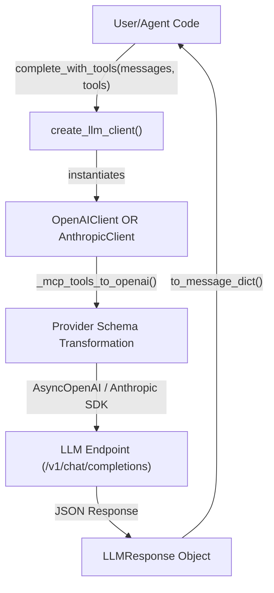
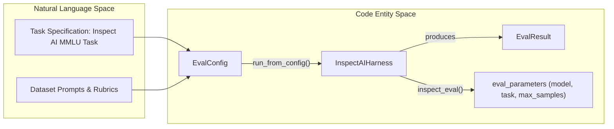
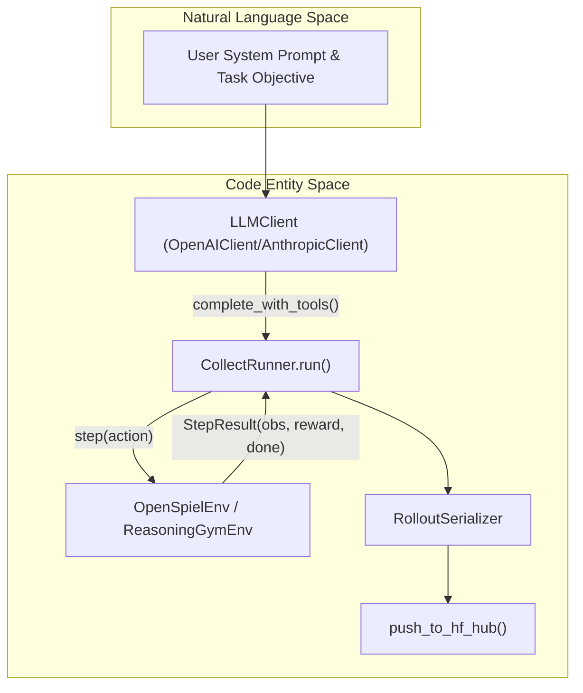

<!-- source: DeepWiki mcp.deepwiki.com · repo huggingface/OpenEnv · page 2.8 LLM Client and Evaluation Harnesses · fetched 2026-10-26 -->

# LLM Client and Evaluation Harnesses

Relevant source files

The following files were used as context for generating this wiki page:

- [envs/calendar_env/client.py](envs/calendar_env/client.py)
- [examples/ttt_collect_with_llm.py](examples/ttt_collect_with_llm.py)
- [src/openenv/cli/commands/collect.py](src/openenv/cli/commands/collect.py)
- [src/openenv/core/evals/__init__.py](src/openenv/core/evals/__init__.py)
- [src/openenv/core/evals/base.py](src/openenv/core/evals/base.py)
- [src/openenv/core/evals/inspect_harness.py](src/openenv/core/evals/inspect_harness.py)
- [src/openenv/core/evals/types.py](src/openenv/core/evals/types.py)
- [src/openenv/core/llm_client.py](src/openenv/core/llm_client.py)
- [tests/core/test_evals/__init__.py](tests/core/test_evals/__init__.py)
- [tests/core/test_evals/test_eval_harness.py](tests/core/test_evals/test_eval_harness.py)
- [tests/core/test_evals/test_eval_types.py](tests/core/test_evals/test_eval_types.py)
- [tests/core/test_evals/test_inspect_harness.py](tests/core/test_evals/test_inspect_harness.py)
- [tests/core/test_llm_client.py](tests/core/test_llm_client.py)
- [tests/test_cli/test_collect.py](tests/test_cli/test_collect.py)

This page covers the LLM interaction layer and evaluation infrastructure of OpenEnv. It details how the framework abstracts different model providers, transforms Model Context Protocol (MCP) tool schemas into provider-specific formats, and integrates with external evaluation frameworks like Inspect AI.

Sources: [src/openenv/core/llm_client.py:3-23](), [src/openenv/core/evals/inspect_harness.py:3-6]()

---

## LLM Client Abstraction and Factory

OpenEnv provides a unified interface for interacting with Large Language Models (LLMs) through the `LLMClient` abstract base class [src/openenv/core/llm_client.py:139-152](). This abstraction decouples agentic harnesses and data collection pipelines from specific model APIs, supporting OpenAI, Anthropic, and arbitrary OpenAI-compatible endpoints (vLLM, TGI, Ollama, HuggingFace Inference API, etc.) [src/openenv/core/llm_client.py:3-8]().

### Key Classes and Factory Functions

*   **`LLMClient`**: Abstract base class defining `complete()` for text generation and `complete_with_tools()` for tool-calling loops [src/openenv/core/llm_client.py:139-187]().
*   **`OpenAIClient`**: Concrete implementation utilizing `AsyncOpenAI` for OpenAI-compatible endpoints, handling endpoint normalization, system prompts, and tool translations.
*   **`AnthropicClient`**: Native implementation for the Anthropic Messages API.
*   **`create_llm_client`**: Factory function that inspects the provider string and returns the corresponding client instance.

### Diagram: LLM Client Request Flow

Sources: [src/openenv/core/llm_client.py:10-22](), [src/openenv/core/llm_client.py:139-187]()

---

## MCP-to-Provider Schema Transformation

OpenEnv environments expose tools using the Model Context Protocol (MCP). Because upstream model APIs require proprietary function-calling JSON schemas, `LLMClient` and its internal helpers convert MCP tool definitions into provider-native formats [src/openenv/core/llm_client.py:179-183]().

1.  **`_clean_mcp_schema`**: Strips MCP-specific metadata (such as `mcp_kind`) from JSON parameter schemas to prevent downstream validation failures.
2.  **`_mcp_tools_to_openai`**: Translates MCP tool definitions into OpenAI's `function` format.
3.  **`_mcp_tools_to_anthropic`**: Translates MCP tool definitions into Anthropic's tool schema format.

Sources: [src/openenv/core/llm_client.py:13-14](), [src/openenv/core/llm_client.py:179-183]()

---

## Evaluation Harnesses (`EvalHarness` and `InspectAIHarness`)

The evaluation subsystem standardizes model performance assessment across environments via the `EvalHarness` abstract base class [src/openenv/core/evals/base.py:11-36]() and `EvalConfig`/`EvalResult` Pydantic models [src/openenv/core/evals/types.py:10-36]().

### Inspect AI Integration

OpenEnv integrates with the UK AI Safety Institute's `inspect-ai` package through `InspectAIHarness` [src/openenv/core/evals/inspect_harness.py:27-56](). It defers all `inspect_ai` imports to `run()` so the class remains importable even when `inspect-ai` is not installed [src/openenv/core/evals/inspect_harness.py:27-32]().

*   **`InspectAIHarness.run()`**: Extracts evaluation parameters, invokes `inspect_ai.eval()`, and checks that the returned log status is successful [src/openenv/core/evals/inspect_harness.py:65-120]().
*   **Result Extraction**: Flattens complex `EvalLog` score structures into a clean metric-to-value dictionary [src/openenv/core/evals/inspect_harness.py:140-160]().

### Diagram: Evaluation Natural Language to Code Entity Space

Sources: [src/openenv/core/evals/base.py:11-53](), [src/openenv/core/evals/inspect_harness.py:27-120](), [src/openenv/core/evals/types.py:10-36]()

---

## Data Collection and Teacher Pipeline

For Supervised Fine-Tuning (SFT) and offline reinforcement learning, OpenEnv provides data collection utilities via `CollectRunner`, `RolloutSerializer`, and MCP harness adapters [src/openenv/core/harness/collect.py:20-27]().

### Diagram: Data Collection and Rollout Flow

Sources: [src/openenv/core/harness/collect.py:20-27](), [src/openenv/cli/commands/collect.py:139-178](), [examples/ttt_collect_with_llm.py:82-104]()

---

## Summary Table of Client Parameters

| Parameter | Type | Default | Client Support | Description |
| :--- | :--- | :--- | :--- | :--- |
| `temperature` | `float` | `0.0` | All | Sampling temperature for the model generation. |
| `max_tokens` | `int` | `256` | All | Maximum tokens to generate in response. |
| `system_prompt` | `str` | `None` | All | Persistent instructions prepended to message histories. |
| `api_key` | `str` | `not-needed` | All | Authentication token for hosted providers. |

Sources: [src/openenv/core/llm_client.py:139-187]()

---

