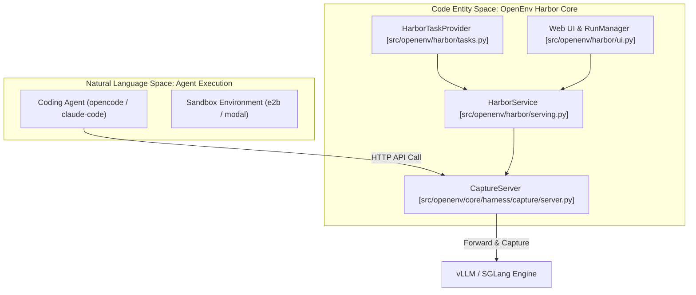
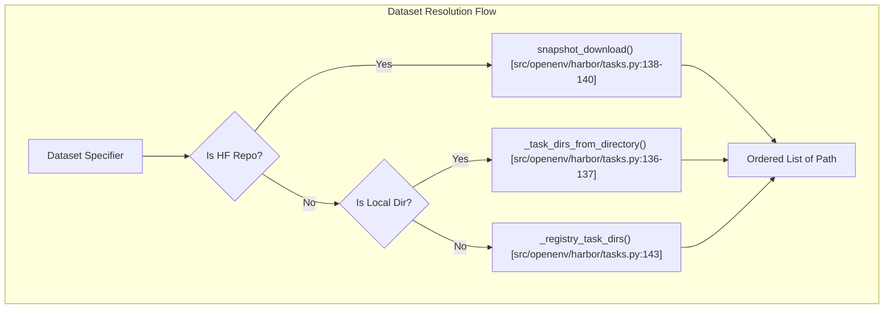

<!-- source: DeepWiki mcp.deepwiki.com · repo huggingface/OpenEnv · page 2.9 Harbor (Black-Box Agent Harness Platform) · fetched 2026-10-26 -->

# Harbor (Black-Box Agent Harness Platform)

Relevant source files

The following files were used as context for generating this wiki page:

- [docs/source/environments/harbor.md](docs/source/environments/harbor.md)
- [envs/harbor_env/README.md](envs/harbor_env/README.md)
- [src/openenv/cli/commands/harbor.py](src/openenv/cli/commands/harbor.py)
- [src/openenv/core/harness/capture/server.py](src/openenv/core/harness/capture/server.py)
- [src/openenv/harbor/runner.py](src/openenv/harbor/runner.py)
- [src/openenv/harbor/serving.py](src/openenv/harbor/serving.py)
- [src/openenv/harbor/tasks.py](src/openenv/harbor/tasks.py)
- [src/openenv/harbor/ui.py](src/openenv/harbor/ui.py)
- [src/openenv/harbor/ui_assets/run_card.js](src/openenv/harbor/ui_assets/run_card.js)
- [src/openenv/harbor/ui_assets/task_browser.js](src/openenv/harbor/ui_assets/task_browser.js)
- [src/openenv/harbor/ui_data.py](src/openenv/harbor/ui_data.py)
- [src/openenv/harbor/ui_pages.py](src/openenv/harbor/ui_pages.py)
- [src/openenv/harbor/ui_runs.py](src/openenv/harbor/ui_runs.py)
- [src/openenv/harbor/ui_settings.py](src/openenv/harbor/ui_settings.py)
- [src/openenv/harbor/ui_trace.py](src/openenv/harbor/ui_trace.py)
- [tests/envs/test_harbor_capture_server.py](tests/envs/test_harbor_capture_server.py)
- [tests/envs/test_harbor_per_session_engine.py](tests/envs/test_harbor_per_session_engine.py)
- [tests/envs/test_harbor_runner_lifecycle.py](tests/envs/test_harbor_runner_lifecycle.py)
- [tests/envs/test_harbor_tasks_and_dialects.py](tests/envs/test_harbor_tasks_and_dialects.py)
- [tests/envs/test_harbor_ui_training_contract.py](tests/envs/test_harbor_ui_training_contract.py)

## Purpose and Scope

The Harbor subsystem (`src/openenv/harbor` and `envs/harbor_env`) provides a black-box agent harness platform within OpenEnv. It enables training and evaluating a single policy against multiple coding-agent harnesses (such as Claude Code, OpenCode, and Codex) running inside isolated sandboxes (such as E2B, Modal, and Docker) while capturing exact token-level supervision (token IDs, per-token logps, and loss masks) along with task rewards [docs/source/environments/harbor.md:4-39](). 

As a PARENT page, this document provides a high-level architectural overview of the Harbor platform. Detailed technical deep dives are covered in the child pages:
- **[Capture Proxy and Training Traces](#2.9.1)** — Deep dive into the OpenAI-compatible `CaptureServer`, upstream request forwarding, capture graphs, training contract export, and trace validation.
- **[Harbor UI, Serving, and CLI](#2.9.2)** — Covers `HarborService`, `serve_harbor`, the Gradio-based web interface, `RunManager`/`RunStore` quotas, and the `openenv harbor` CLI command suite.

---

## Architectural Overview

Harbor decouples coding agents from inference engines by introducing a transparent, OpenAI-compatible proxy between the sandbox environment and the upstream model endpoint. The agent remains a black-box CLI tool executing inside a sandbox; its API base URL points to the capture proxy, and its API key acts as the rollout session identifier [docs/source/environments/harbor.md:123-152]().

*Diagram 1: Bridging agent execution in sandboxes to OpenEnv code entities.*

Sources: `docs/source/environments/harbor.md:123-152]`, `[src/openenv/harbor/serving.py:52-101]`, `[src/openenv/harbor/tasks.py:1-22]`, `[src/openenv/core/harness/capture/server.py:1-35]()`

---

## Task Discovery and Dataset Management

Harbor tasks are discovered and loaded through `HarborTaskProvider`, which implements OpenEnv's `TaskProvider` interface [src/openenv/harbor/tasks.py:1-6](). It supports three dataset sources:
1. **Hugging Face Dataset Repositories**: Downloaded via `snapshot_download` and structured under `tasks/<name>/` [src/openenv/harbor/tasks.py:13-21]().
2. **Local Directories**: Filesystem paths containing task specifications.
3. **Harbor Registry Packages**: Versioned packages referenced via `name@version` [src/openenv/harbor/tasks.py:16-17]().

To maintain latency requirements for the Task API, discovery avoids eagerly validating every file inside thousands of task directories, deferring validation to the rollout phase [src/openenv/harbor/tasks.py:49-61]().

*Diagram 2: Task resolution pipeline from dataset specifiers to task directory lists.*

Sources: `[src/openenv/harbor/tasks.py:1-154]()`

---

## The Intercept and Black-Box Agent Harnesses

The capture subsystem intercepts model requests originating from coding agents. Rather than tokenizing prompts locally—which risks tokenization drift from the inference engine—Harbor relies on the upstream engine's tokenization outputs (`prompt_token_ids`, `completion_token_ids`, and `per_token_logps`) [src/openenv/core/harness/capture/server.py:18-22]().

```mermaid
graph TD
    subgraph "Capture & Transform Pipeline"
    Req["Incoming Agent Request"] --> Detect["detect() [src/openenv/core/harness/capture/detection.py]"]
    Detect --> Transform["TransformManager [src/openenv/harbor/serving.py]"]
    Transform --> UpstreamClient["InferenceClient [src/openenv/core/harness/capture/upstream.py]"]
    UpstreamClient --> Engine["vLLM / Upstream Engine"]
    Engine --> Capture["CaptureServer [src/openenv/core/harness/capture/server.py]"]
    Capture --> Graph["TurnNode Graph [src/openenv/core/harness/capture/graph.py]"]
    end
```

*Diagram 3: Request transformation, forwarding, and graph construction entities.*

Sources: `[src/openenv/core/harness/capture/server.py:1-76]`, `[src/openenv/harbor/serving.py:52-101]()`

---

## Child Page References

For granular technical details, implementation specifics, and API contracts, refer to the following child pages:
- **Capture Proxy and Training Traces**: See section [Capture Proxy and Training Traces](#2.9.1) for details on `CaptureServer`, request normalization across 4 wire dialects, token-prefix graph linking (`TurnNode`), the `TrainingTrace` data contract, and strict trace validation.
- **Harbor UI, Serving, and CLI**: See section [Harbor UI, Serving, and CLI](#2.9.2) for details on `HarborService`, `serve_harbor`, the multi-tab Gradio UI (`ui.py`, `ui_runs.py`), `RunStore` persistence quotas, and the `openenv harbor` CLI command group (`info`, `rollout`, `serve`, `push`).

---

