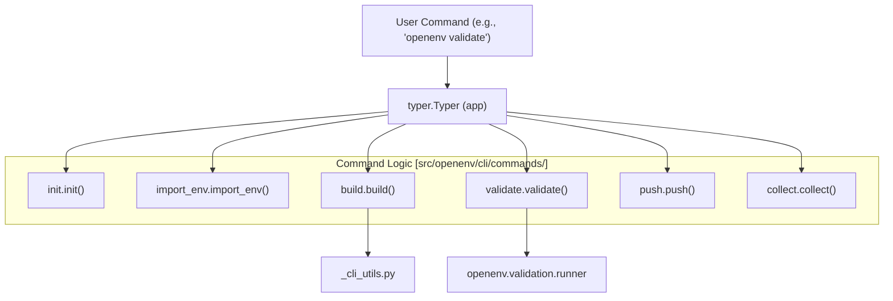
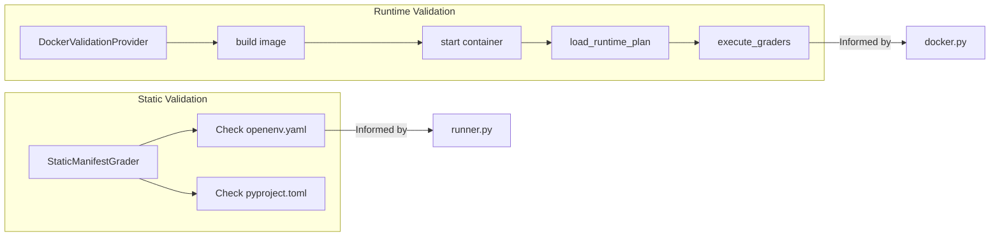

<!-- source: DeepWiki mcp.deepwiki.com · repo huggingface/OpenEnv · page 3 CLI Reference · fetched 2026-10-26 -->

# CLI Reference

Relevant source files

The following files were used as context for generating this wiki page:

- [docs/source/reference/cli.md](docs/source/reference/cli.md)
- [src/openenv/auto/__init__.py](src/openenv/auto/__init__.py)
- [src/openenv/cli/__main__.py](src/openenv/cli/__main__.py)
- [src/openenv/cli/commands/init.py](src/openenv/cli/commands/init.py)
- [src/openenv/cli/templates/openenv_env/README.md](src/openenv/cli/templates/openenv_env/README.md)
- [src/openenv/cli/templates/openenv_env/__init__.py](src/openenv/cli/templates/openenv_env/__init__.py)
- [src/openenv/cli/templates/openenv_env/client.py](src/openenv/cli/templates/openenv_env/client.py)
- [src/openenv/cli/templates/openenv_env/server/app.py](src/openenv/cli/templates/openenv_env/server/app.py)
- [src/openenv/core/generic_client.py](src/openenv/core/generic_client.py)
- [src/openenv/validation/graders/__init__.py](src/openenv/validation/graders/__init__.py)
- [src/openenv/validation/graders/runtime/__init__.py](src/openenv/validation/graders/runtime/__init__.py)
- [src/openenv/validation/graders/runtime/network.py](src/openenv/validation/graders/runtime/network.py)
- [src/openenv/validation/providers/_netns.py](src/openenv/validation/providers/_netns.py)
- [src/openenv/validation/providers/docker.py](src/openenv/validation/providers/docker.py)
- [src/openenv/validation/runner.py](src/openenv/validation/runner.py)
- [src/openenv/validation/runtime/contracts.py](src/openenv/validation/runtime/contracts.py)
- [tests/test_validation/integration/test_docker_lifecycle.py](tests/test_validation/integration/test_docker_lifecycle.py)
- [tests/test_validation/integration/test_docker_network.py](tests/test_validation/integration/test_docker_network.py)
- [tests/test_validation/integration/test_runtime_cli.py](tests/test_validation/integration/test_runtime_cli.py)
- [tests/test_validation/test_docker_provider.py](tests/test_validation/test_docker_provider.py)
- [tests/test_validation/test_runner.py](tests/test_validation/test_runner.py)
- [tests/validation_runtime/README.md](tests/validation_runtime/README.md)
- [tests/validation_runtime/acceptance.json](tests/validation_runtime/acceptance.json)

The `openenv` command-line tool is the primary interface for managing the lifecycle of agentic execution environments. It provides utilities for scaffolding new environments, validating them against deployment standards, building containerized versions, and deploying to platforms like Hugging Face Spaces.

The CLI is built using the `typer` library and follows a modular command structure [src/openenv/cli/__main__.py:16-33]().

## Command Overview

The CLI organizes functionality into several top-level commands, each targeting a specific phase of the environment development and deployment pipeline.

| Command | Function | Key Code Entity |
| :--- | :--- | :--- |
| `init` | Scaffolds a new environment from templates. | `openenv.cli.commands.init` |
| `import` | Imports third-party sources into an OpenEnv wrapper package. | `openenv.cli.commands.import_env` |
| `validate` | Performs static and runtime API checks. | `openenv.cli.commands.validate` |
| `build` | Prepares Docker contexts and builds images. | `openenv.cli.commands.build` |
| `push` | Deploys environments to HF Spaces or registries. | `openenv.cli.commands.push` |
| `serve` | Runs the environment server locally. | `openenv.cli.commands.serve` |
| `fork` | Duplicates existing HF Space environments. | `openenv.cli.commands.fork` |
| `collect` | Executes rollouts to gather agentic trajectories. | `openenv.cli.commands.collect` |
| `skills` | Installs CLI skill definitions for AI assistants. | `openenv.cli.commands.skills` |
| `harbor` | Runs Harbor tasks with token-level capture. | `openenv.cli.commands.harbor` |

**Sources:** [src/openenv/cli/__main__.py:35-72](), [docs/source/reference/cli.md:5-130]()

## Natural Language to Code Mapping

The following diagrams bridge the gap between high-level CLI concepts and the underlying code implementation.

### CLI Command Dispatch Architecture
This diagram shows how the `typer` application in `__main__.py` routes user input to specific command modules.

**Sources:** [src/openenv/cli/__main__.py:17-72](), [src/openenv/cli/commands/validate.py:108-108]()

### Validation Logic Flow
The validation system distinguishes between static filesystem verification and bounded runtime container probes.

**Sources:** [src/openenv/validation/runner.py:89-98](), [src/openenv/validation/providers/docker.py:1-6]()

## Environment Initialization and Validation

The `init`, `import`, and `validate` commands ensure that environments adhere to the OpenEnv specification. Initialization creates the necessary directory structure (including `models.py`, `client.py`, and `server/app.py`), while validation checks for both structural integrity and runtime compliance.

Validation is split into levels managed by the validation runner package [src/openenv/validation/runner.py:1-32]():
1. **Static Checks**: Inspects manifest properties and package layout without starting a container [src/openenv/validation/graders/static.py]().
2. **Runtime Checks**: Builds an immutable image via `DockerValidationProvider`, launches a hardened container, and executes a bounded JSON replay plan over WebSocket sessions [src/openenv/validation/providers/docker.py:1-6](), [src/openenv/validation/runtime/contracts.py:86-117]().

For details, see [Environment Initialization and Validation](#3.1).

**Sources:** [src/openenv/validation/runner.py:122-178](), [docs/source/reference/cli.md:36-108]()

## Building and Deploying Environments

The `build`, `push`, and `fork` commands handle the containerization, packaging, and distribution of environments across registries and Hugging Face Spaces.

The `build` command prepares Docker contexts, handles dependency pinning, and packages environments for local or remote execution. The `push` command stages environments for deployment to Hugging Face Spaces, injecting required metadata and README frontmatter [src/openenv/cli/templates/openenv_env/README.md:1-12]().

For details, see [Building and Deploying Environments](#3.2).

**Sources:** [docs/source/reference/cli.md:32-35](), [src/openenv/cli/commands/push.py]()

---

