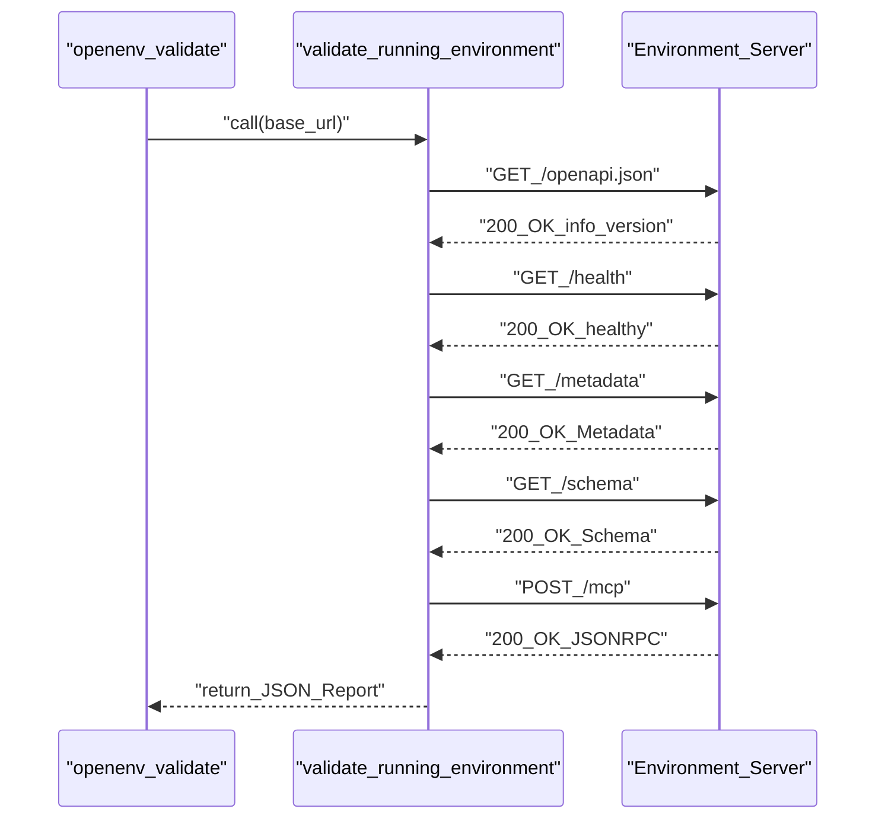
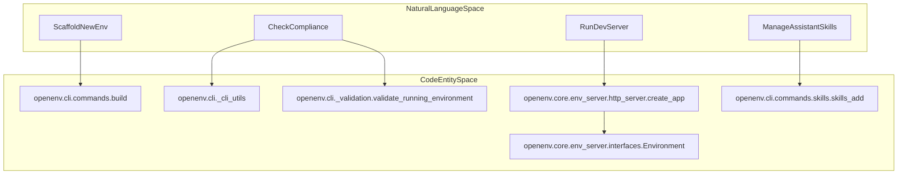

<!-- source: DeepWiki mcp.deepwiki.com · repo huggingface/OpenEnv · page 3.1 Environment Initialization and Validation · fetched 2026-10-26 -->

# Environment Initialization and Validation

Relevant source files

The following files were used as context for generating this wiki page:

- [.claude/skills/generate-openenv-env/SKILL.md](.claude/skills/generate-openenv-env/SKILL.md)
- [.claude/skills/generate-openenv-env/assets/openenv_env_template/openenv.yaml](.claude/skills/generate-openenv-env/assets/openenv_env_template/openenv.yaml)
- [.claude/skills/generate-openenv-env/assets/openenv_env_template/server/__ENV_NAME___environment.py](.claude/skills/generate-openenv-env/assets/openenv_env_template/server/__ENV_NAME___environment.py)
- [.claude/skills/generate-openenv-env/references/env-generation-checklist.md](.claude/skills/generate-openenv-env/references/env-generation-checklist.md)
- [.claude/skills/generate-openenv-env/references/openenv-docs-environment-builder.md](.claude/skills/generate-openenv-env/references/openenv-docs-environment-builder.md)
- [src/openenv/cli/_validation.py](src/openenv/cli/_validation.py)
- [src/openenv/cli/commands/build.py](src/openenv/cli/commands/build.py)
- [src/openenv/cli/commands/skills.py](src/openenv/cli/commands/skills.py)
- [src/openenv/cli/commands/validate.py](src/openenv/cli/commands/validate.py)
- [src/openenv/cli/templates/openenv_env/openenv.yaml](src/openenv/cli/templates/openenv_env/openenv.yaml)
- [src/openenv/cli/templates/openenv_env/server/__ENV_NAME___environment.py](src/openenv/cli/templates/openenv_env/server/__ENV_NAME___environment.py)
- [tests/test_cli/test_build.py](tests/test_cli/test_build.py)
- [tests/test_cli/test_skills.py](tests/test_cli/test_skills.py)
- [tests/test_cli/test_validate.py](tests/test_cli/test_validate.py)

This section covers the tools and processes for creating, verifying, and serving OpenEnv environments. The framework provides a standardized scaffolding system via `openenv init`, a multi-mode validation suite via `openenv validate` (supporting both static filesystem checks and runtime API probes), a local development server via `openenv serve`, and CLI assistant skill management via `openenv skills`.

---

## Environment Initialization

The `openenv init` command generates a standardized environment structure from built-in templates [.claude/skills/generate-openenv-env/references/openenv-docs-environment-builder.md:30-41](). This scaffolding ensures that new environments are compatible with the OpenEnv ecosystem, including Docker deployment, Hugging Face Spaces integration, and the Model Context Protocol (MCP).

### Scaffolding Structure
A newly initialized environment contains the following key components:

| File | Purpose |
| :--- | :--- |
| `openenv.yaml` | The manifest file defining metadata, runtime, and entry points [.claude/skills/generate-openenv-env/references/openenv-docs-environment-builder.md:40-41](). |
| `models.py` | Pydantic models for `Action` and `Observation` [.claude/skills/generate-openenv-env/references/openenv-docs-environment-builder.md:65-81](). |
| `client.py` | A specialized `EnvClient` for high-level interaction [.claude/skills/generate-openenv-env/references/openenv-docs-environment-builder.md:152-183](). |
| `server/app.py` | The FastAPI entry point using `create_app` [.claude/skills/generate-openenv-env/references/openenv-docs-environment-builder.md:115-127](). |
| `server/<name>_environment.py` | The core logic inheriting from `Environment` [src/openenv/cli/templates/openenv_env/server/__ENV_NAME___environment.py:22-43](). |
| `pyproject.toml` | Dependency management (uv-compatible) [.claude/skills/generate-openenv-env/references/openenv-docs-environment-builder.md:40-41](). |

### Template Implementation
The initialization process uses placeholders (e.g., `__ENV_NAME__`, `__ENV_CLASS_NAME__`) that are replaced during the `init` command execution. For instance, the template for `server/<name>_environment.py` configures the lifecycle methods (`reset`, `step`, and the `state` property) inheriting from `Environment` [src/openenv/cli/templates/openenv_env/server/__ENV_NAME___environment.py:45-114]().

**Sources:**
- [.claude/skills/generate-openenv-env/references/openenv-docs-environment-builder.md:30-183]()
- [src/openenv/cli/templates/openenv_env/server/__ENV_NAME___environment.py:22-114]()

---

## Environment Validation

Validation is split into distinct levels: **static structure checks** (verifying local configuration files and package layout) and **runtime validation** (probing a live HTTP/WebSocket server) [src/openenv/cli/commands/validate.py:50-54]().

### 1. Static Structure Validation
The static validation subsystem checks filesystem contracts, mandatory manifest fields (`openenv.yaml`), and dependency declarations. It uses policy enforcement engines to evaluate compliance up to requested thresholds (`Level.STATIC`, `Level.RUNTIME`, `Level.SEMANTIC`) [src/openenv/cli/commands/validate.py:111-171]().

### 2. Runtime Validation
The `validate_running_environment` function performs a suite of HTTP checks against a live target URL [src/openenv/cli/_validation.py:99-120](). It produces a JSON report containing criteria-based results used in CI/CD pipelines [tests/test_cli/test_validate.py:106-113]().

#### Runtime Data Flow
The following diagram illustrates how the `validate` command interacts with a running environment to verify compliance with the `openenv-http` standard.

**Diagram: Runtime Validation Sequence**

**Sources:**
- [src/openenv/cli/_validation.py:99-204]()
- [src/openenv/cli/commands/validate.py:111-171]()
- [tests/test_cli/test_validate.py:61-113]()

---

## Local Development Server and Skills

The `openenv serve` command provides a local development runner leveraging FastAPI and Uvicorn. Furthermore, the framework includes `openenv skills` to install and manage CLI skills for AI assistants (such as Claude, Codex, Cursor, and OpenCode) [src/openenv/cli/commands/skills.py:47-60]() via `SKILL.md` generation [src/openenv/cli/commands/skills.py:66-76]() and symlink management [src/openenv/cli/commands/skills.py:111-128]().

### Concurrency and Session Management
The server supports multiple execution modes based on the `SUPPORTS_CONCURRENT_SESSIONS` property defined in the environment implementation [src/openenv/cli/templates/openenv_env/server/__ENV_NAME___environment.py:43-43]().

**Diagram: Initialization to Code Entity Mapping**

**Sources:**
- [src/openenv/cli/commands/skills.py:47-128]()
- [src/openenv/cli/_validation.py:99-120]()
- [src/openenv/cli/templates/openenv_env/server/__ENV_NAME___environment.py:43-43]()

---

## Building Environments

The `openenv build` command manages Docker image creation, handling context detection through `_detect_build_context` [src/openenv/cli/commands/build.py:43-74]().

### Build Context Detection
- **Standalone:** The environment is an independent package. The build context points directly to the environment directory [src/openenv/cli/commands/build.py:43-67]().
- **In-Repo:** The environment resides within the `envs/` directory of the OpenEnv source tree. The build context shifts to the repository root to allow bundling `openenv` core sources [src/openenv/cli/commands/build.py:34-41]().

**Sources:**
- [src/openenv/cli/commands/build.py:43-74]()
- [src/openenv/cli/commands/build.py:123-153]()

---

