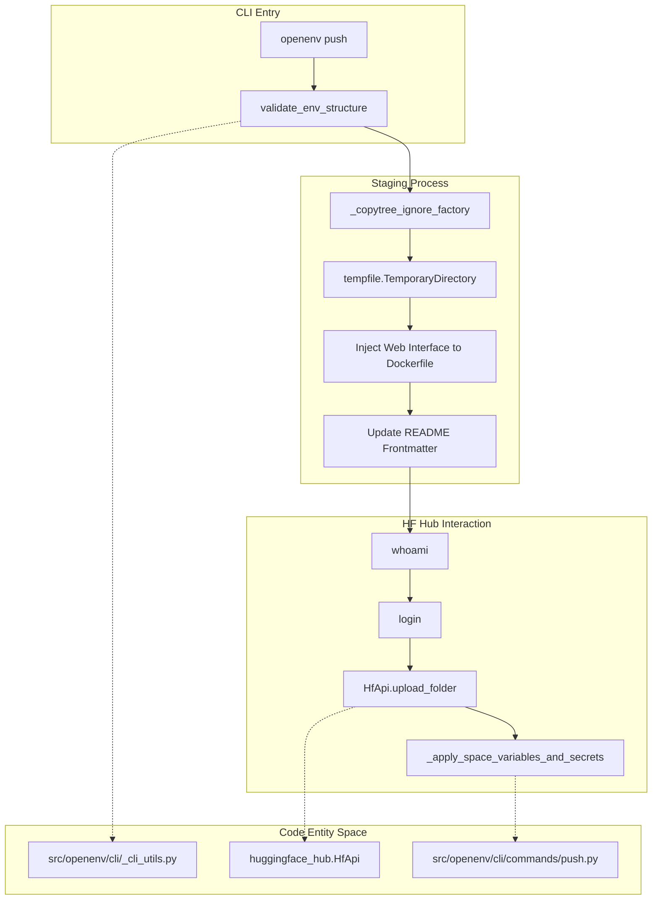

<!-- source: DeepWiki mcp.deepwiki.com · repo huggingface/OpenEnv · page 3.2 Building and Deploying Environments · fetched 2026-10-26 -->

# Building and Deploying Environments

<details>
<summary>Relevant source files</summary>

The following files were used as context for generating this wiki page:

- [.claude/skills/deploy-hf/SKILL.md](.claude/skills/deploy-hf/SKILL.md)
- [docs/source/getting_started/environment-builder.md](docs/source/getting_started/environment-builder.md)
- [docs/source/guides/concepts.md](docs/source/guides/concepts.md)
- [docs/source/guides/first-environment.md](docs/source/guides/first-environment.md)
- [src/openenv/cli/_cli_utils.py](src/openenv/cli/_cli_utils.py)
- [src/openenv/cli/_validation.py](src/openenv/cli/_validation.py)
- [src/openenv/cli/commands/build.py](src/openenv/cli/commands/build.py)
- [src/openenv/cli/commands/fork.py](src/openenv/cli/commands/fork.py)
- [src/openenv/cli/commands/push.py](src/openenv/cli/commands/push.py)
- [src/openenv/cli/commands/validate.py](src/openenv/cli/commands/validate.py)
- [tests/test_cli/test_build.py](tests/test_cli/test_build.py)
- [tests/test_cli/test_fork.py](tests/test_cli/test_fork.py)
- [tests/test_cli/test_init.py](tests/test_cli/test_init.py)
- [tests/test_cli/test_main.py](tests/test_cli/test_main.py)
- [tests/test_cli/test_push.py](tests/test_cli/test_push.py)
- [tests/test_cli/test_validate.py](tests/test_cli/test_validate.py)

</details>


This section covers the lifecycle of OpenEnv environments from local development to production deployment on Hugging Face Spaces. The framework provides a set of CLI commands and CI/CD workflows to automate Docker image preparation, dependency pinning, and environment duplication.

## Docker Build System

The `openenv build` command prepares a Docker context for an environment and executes the build process. It distinguishes between two primary directory structures: **standalone** and **in-repo**.

### Build Context Detection
The function `_detect_build_context` in `src/openenv/cli/commands/build.py` determines the build mode by searching for a `.git` directory and checking if the environment resides under an `envs/` subdirectory [src/openenv/cli/commands/build.py:43-74]().

| Mode | Trigger | Context Root |
| :--- | :--- | :--- |
| **Standalone** | Environment outside a git repo or no `envs/` parent | The environment directory itself [src/openenv/cli/commands/build.py:66-67]() |
| **In-Repo** | Environment located inside `envs/` of the OpenEnv repo | The repository root [src/openenv/cli/commands/build.py:69-70]() |

### Preparation Pipeline
1. **Standalone Build**: The environment is copied to a temporary directory via `_prepare_standalone_build`. The `pyproject.toml` is scanned to ensure it contains an `openenv` dependency [src/openenv/cli/commands/build.py:76-121]().
2. **In-Repo Build**: Prepared via `_prepare_inrepo_build`. To facilitate development of core features alongside environments, the `openenv` core package (from `src/openenv`) is copied into the build context. The environment's `pyproject.toml` is dynamically rewritten to use this local copy via `openenv @ file:///app/env/openenv` [src/openenv/cli/commands/build.py:123-191]().

### Image Hierarchy
OpenEnv utilizes a two-tier Docker image strategy defined in `.github/workflows/docker-build.yml`:
*   **Base Image**: Built from `src/openenv/core/containers/images/Dockerfile`. It contains the core dependencies and system libraries [.github/workflows/docker-build.yml:18-58]().
*   **Environment Images**: Built using the base image as a layer. They include environment-specific logic (e.g., `chat-env`, `coding-env`) and are built in a matrix strategy [.github/workflows/docker-build.yml:60-154]().

**Sources:** `src/openenv/cli/commands/build.py`, `.github/workflows/docker-build.yml`

## Deploying to Hugging Face Spaces

The `openenv push` command automates the deployment of environments to Hugging Face (HF) Spaces. This process involves staging the files, injecting metadata, and handling authentication.

### Deployment Logic Flow
The following diagram illustrates the data flow from a local environment directory to a live HF Space via the `push` command, mapping natural language concepts to concrete code entities.

**Local to HF Spaces Deployment Flow**

**Sources:** `src/openenv/cli/commands/push.py:22-218()`, `src/openenv/cli/_cli_utils.py:30-92()`

### Key Deployment Features
*   **Dockerfile Injection**: The CLI automatically ensures that `ENABLE_WEB_INTERFACE=1` is present in the Dockerfile to enable the Gradio UI upon deployment [tests/test_cli/test_push.py:183-207]().
*   **README Metadata**: It injects required HF Space frontmatter (e.g., `sdk: docker`, `app_port: 8000`) into the `README.md` to ensure the Space is correctly recognized by the Hub [tests/test_cli/test_push.py:64-73]().
*   **Ignore Patterns**: Uses `_path_matches_pattern` and `_load_ignore_patterns` to filter out local artifacts like `__pycache__`, `.git`, and user-specified excludes via `--exclude` [src/openenv/cli/commands/push.py:83-184]().
*   **Secrets & Variables**: Supports setting Space-level environment variables and secrets idempotently using `api.add_space_variable` and `api.add_space_secret` [src/openenv/cli/commands/push.py:56-81]().

### Staging Pipeline (CI/CD)
For bulk deployments, the script `scripts/prepare_hf_deployment.sh` provides a staging pipeline that pins OpenEnv git references in `pyproject.toml` to specific release versions and coordinates with `manage_hf_collection.py` to update versioned HF collections.

**Sources:** `src/openenv/cli/commands/push.py`, `scripts/prepare_hf_deployment.sh`, `.github/workflows/deploy-hf-env.yml`

## Environment Forking

The `openenv fork` command (implemented in `src/openenv/cli/commands/fork.py`) allows users to duplicate existing OpenEnv Spaces to their own accounts.

### Implementation Details
The command wraps the `huggingface_hub.HfApi.duplicate_space` method [src/openenv/cli/commands/fork.py:126-152](). It handles:
*   **Authentication**: Ensures the user is logged in via `_ensure_hf_authenticated` [src/openenv/cli/commands/fork.py:33-56]().
*   **Hardware Selection**: Allows requesting specific hardware (e.g., `t4-medium`) during the fork, defaulting to `cpu-basic` [src/openenv/cli/commands/fork.py:95-142]().
*   **Configuration**: Supports overriding environment variables and secrets during the duplication process via `_parse_key_value` [src/openenv/cli/commands/fork.py:19-30]() and `duplicate_space` parameters [src/openenv/cli/commands/fork.py:133-140]().

**Forking Logic Entity Mapping**
```mermaid
graph LR
    subgraph "CLI Command"
        CMD["openenv fork"]
    end

    subgraph "Logic Implementation"
        AUTH["_ensure_hf_authenticated"]
        PARSE["_parse_key_value"]
        EXEC["duplicate_space"]
    end

    subgraph "Code Entity Space"
        CMD --> AUTH
        CMD --> PARSE
        CMD --> EXEC
        AUTH -.-> "whoami"
        EXEC -.-> "HfApi"
    end
```
**Sources:** `src/openenv/cli/commands/fork.py:33-152()`

## Validation and Readiness

Before building or pushing, the `openenv validate` command checks the environment's structural integrity.

### Validation Levels
1.  **Static Structure**: Checks for mandatory files: `openenv.yaml`, `pyproject.toml`, `models.py`, `client.py`, and `server/app.py` [src/openenv/cli/_cli_utils.py:30-92]().
2.  **Runtime Compliance**: When a URL is provided, `validate_running_environment` performs a live check against the server's `/health` and `/openapi.json` endpoints to ensure API contract compliance [src/openenv/cli/_validation.py:99-212]().

| Check | Target | Logic Source |
| :--- | :--- | :--- |
| **Local Path** | `openenv.yaml` existence | `src/openenv/cli/_cli_utils.py:48-58` |
| **API Contract** | `GET /openapi.json` | `src/openenv/cli/_validation.py:126-185` |
| **Health Check** | `GET /health` | `src/openenv/cli/_validation.py:191-212` |

**Sources:** `src/openenv/cli/commands/validate.py`, `src/openenv/cli/_validation.py`, `src/openenv/cli/_cli_utils.py`

---

