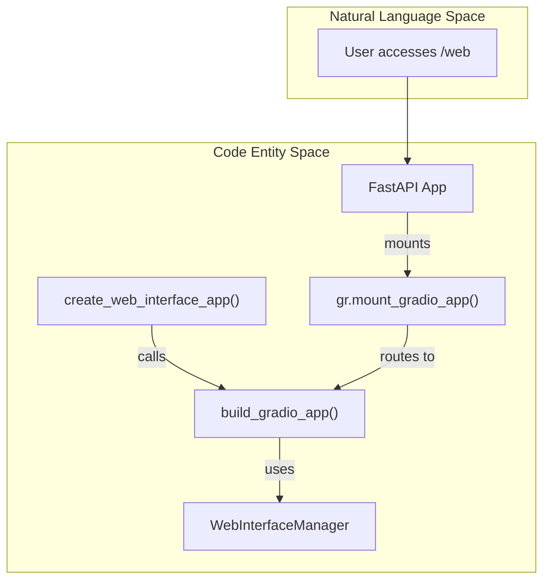
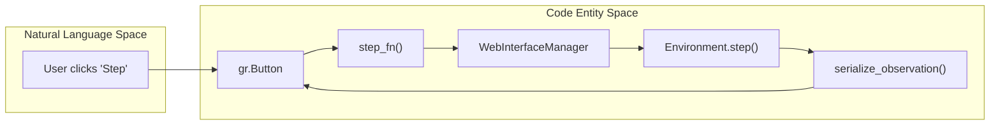

<!-- source: DeepWiki mcp.deepwiki.com · repo huggingface/OpenEnv · page 4 Web Interface · fetched 2026-10-26 -->

# Web Interface

Relevant source files

The following files were used as context for generating this wiki page:

- [envs/openspiel_env/server/openspiel_environment.py](envs/openspiel_env/server/openspiel_environment.py)
- [envs/textarena_env/server/gradio_ui.py](envs/textarena_env/server/gradio_ui.py)
- [src/openenv/core/env_server/gradio_theme.py](src/openenv/core/env_server/gradio_theme.py)
- [src/openenv/core/env_server/gradio_ui.py](src/openenv/core/env_server/gradio_ui.py)
- [src/openenv/core/env_server/web_interface.py](src/openenv/core/env_server/web_interface.py)
- [tests/core/test_web_interface_layout.py](tests/core/test_web_interface_layout.py)
- [tests/core/test_web_interface_playground.py](tests/core/test_web_interface_playground.py)
- [tests/core/test_web_interface_quick_start.py](tests/core/test_web_interface_quick_start.py)

The OpenEnv Web Interface provides an optional, interactive Gradio-based dashboard for interacting with agentic environments. It allows developers and researchers to manually `reset`, `step`, and inspect the `state` of an environment without writing code. The interface is designed to be embedded directly into the environment server and is commonly used when hosting environments on Hugging Face Spaces.

## Overview

The web interface is enabled via the `ENABLE_WEB_INTERFACE` environment variable or the `--enable-interface` flag during CLI operations like `openenv push` [src/openenv/core/env_server/web_interface.py:6-9](). When active, the server mounts a Gradio application at the `/web` endpoint [src/openenv/core/env_server/gradio_ui.py:6-9]().

### Core Components and Workflow

The system bridges the gap between the Pythonic environment logic and a visual UI through a specialized manager and a set of UI builders.

| Component | Responsibility |
| :--- | :--- |
| `WebInterfaceManager` | Orchestrates interactions between the Gradio UI and the underlying `Environment` instance [src/openenv/core/env_server/web_interface.py:29-32](). |
| `build_gradio_app` | The default factory function that constructs the standard two-pane layout [src/openenv/core/env_server/gradio_ui.py:19-20](). |
| `OPENENV_GRADIO_THEME` | A unified terminal-style theme ensuring a consistent look across all environments [src/openenv/core/env_server/gradio_theme.py:37-44](). |

**Sources:** [src/openenv/core/env_server/web_interface.py:6-32](), [src/openenv/core/env_server/gradio_ui.py:6-20](), [src/openenv/core/env_server/gradio_theme.py:37-44]()

## System Topology: Natural Language to Code Entities

The following diagrams illustrate how the abstract concept of "Web Interaction" maps to specific code entities within the `openenv.core.env_server` package.

### Interface Mounting and Routing
This diagram shows how the FastAPI app integrates the Gradio UI.

**Sources:** [src/openenv/core/env_server/web_interface.py:6-32](), [src/openenv/core/env_server/gradio_ui.py:6-20]()

### Action Execution Flow
This diagram tracks how a UI button click (Natural Language) triggers internal state changes (Code Entities).

**Sources:** [src/openenv/core/env_server/gradio_ui.py:6-20](), [src/openenv/core/env_server/web_interface.py:29-32]()

## Core Gradio Web Interface

The default interface provides a split-view layout. The left panel contains documentation (`README`) and a dynamically generated "Quick Start" guide [src/openenv/core/env_server/web_interface.py:89-100](). The right panel serves as the "Playground," featuring observation displays, dynamic action forms, and state inspection [src/openenv/core/env_server/gradio_ui.py:6-10]().

For details, see [Core Gradio Web Interface](#4.1).

**Sources:** [src/openenv/core/env_server/web_interface.py:89-100](), [src/openenv/core/env_server/gradio_ui.py:6-10]()

## Custom Environment Web UIs

Environments can provide specialized visualizations by overriding the default UI builder or implementing custom rendering hooks. This is useful for complex state representations that are difficult to parse in raw text or JSON.

Examples of custom implementations include TextArena wordle/sudoku previews, REPL control panels, and grid-based environment renderers [envs/textarena_env/server/gradio_ui.py:17-52]().

For details, see [Custom Environment Web UIs](#4.2).

**Sources:** [envs/textarena_env/server/gradio_ui.py:17-52]()

---

