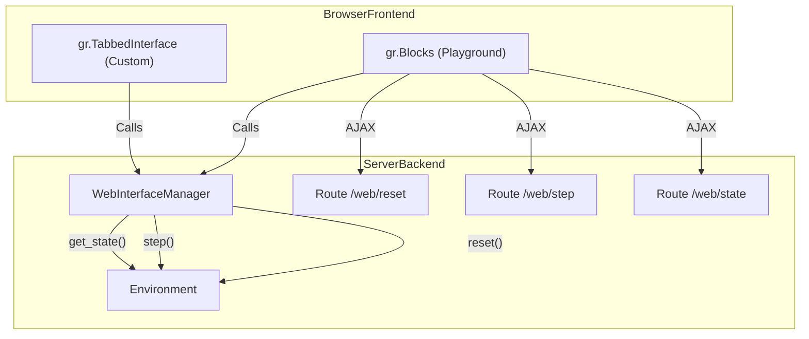
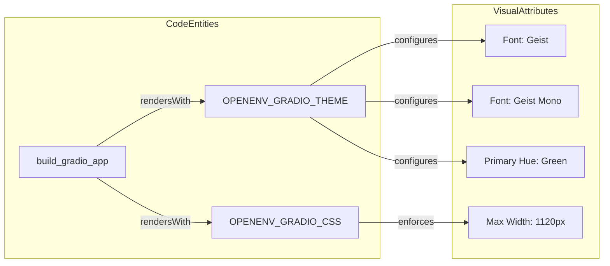

<!-- source: DeepWiki mcp.deepwiki.com · repo huggingface/OpenEnv · page 4.1 Core Gradio Web Interface · fetched 2026-10-26 -->

# Core Gradio Web Interface

Relevant source files

The following files were used as context for generating this wiki page:

- [envs/openspiel_env/server/openspiel_environment.py](envs/openspiel_env/server/openspiel_environment.py)
- [envs/textarena_env/server/gradio_ui.py](envs/textarena_env/server/gradio_ui.py)
- [src/openenv/core/env_server/gradio_theme.py](src/openenv/core/env_server/gradio_theme.py)
- [src/openenv/core/env_server/gradio_ui.py](src/openenv/core/env_server/gradio_ui.py)
- [src/openenv/core/env_server/web_interface.py](src/openenv/core/env_server/web_interface.py)
- [tests/core/test_web_interface_layout.py](tests/core/test_web_interface_layout.py)
- [tests/core/test_web_interface_playground.py](tests/core/test_web_interface_playground.py)
- [tests/core/test_web_interface_quick_start.py](tests/core/test_web_interface_quick_start.py)

The Core Gradio Web Interface provides a standard, user-friendly playground for interacting with OpenEnv environments. It is built using [Gradio](https://www.gradio.app/) and is automatically served at the `/web` endpoint when the `ENABLE_WEB_INTERFACE` flag or environment variable is active [src/openenv/core/env_server/web_interface.py:3-9](). This interface allows developers and researchers to manually `reset`, `step`, and inspect the `state` of an environment without writing client-side code.

Sources: [src/openenv/core/env_server/web_interface.py:3-9]()

---

## System Architecture and Data Flow

The web interface is integrated into the `HTTPEnvServer` lifecycle. When the server is created via `create_app` / `create_web_interface_app`, it mounts a Gradio application that communicates with the environment instance through a `WebInterfaceManager` [src/openenv/core/env_server/web_interface.py:6-8]().

### Component Interaction Diagram

The following diagram illustrates how the Gradio frontend interacts with the underlying Environment server entities.

**Web Interface Communication Topology**

Sources: [src/openenv/core/env_server/web_interface.py:6-23](), [src/openenv/core/env_server/gradio_ui.py:4-10]()

---

## Key Classes and Functions

### WebInterfaceManager
The `WebInterfaceManager` class acts as the bridge between the asynchronous Gradio event loop and the environment's core methods. It handles:
*   **Session State**: Maintaining the active environment instance for the UI session.
*   **Action Preprocessing**: Deserializing JSON inputs from the Gradio form into the environment's specific `Action` class [src/openenv/core/env_server/web_interface.py:30-32]().
*   **Observation Serialization**: Converting environment results into JSON-serializable dictionaries for display via `serialize_observation` [src/openenv/core/env_server/web_interface.py:30-32]().

### build_gradio_app
Defined in `src/openenv/core/env_server/gradio_ui.py`, this function constructs the standard "Playground" layout using `gr.Blocks`. It dynamically generates input forms based on the `action_fields` extracted from the environment's `Action` Pydantic model [src/openenv/core/env_server/gradio_ui.py:71-92]().

### create_web_interface_app
The primary entry point for initializing the UI. It determines if the environment is a chat-style environment or a structured action environment, applies the Gradio theme and custom CSS, and mounts the application onto the FastAPI server [src/openenv/core/env_server/web_interface.py:6-8]().

Sources: [src/openenv/core/env_server/web_interface.py:21-32](), [src/openenv/core/env_server/gradio_ui.py:71-92]()

---

## Default Playground Layout and Interaction

The default interface uses a responsive two-pane layout designed for technical debugging and quick experimentation [src/openenv/core/env_server/gradio_ui.py:71-92]().

| Component | Content and Functionality |
| :--- | :--- |
| **Left Pane** | **Quick Start (`get_quick_start_markdown`)**: Auto-generated Python snippets for `EnvClient` usage tailored to the specific environment [src/openenv/core/env_server/web_interface.py:89-100]().   **README**: Rendered Markdown from the environment's documentation [src/openenv/core/env_server/gradio_ui.py:46-49](). |
| **Right Pane** | **Observation Display (`_result_html`)**: Formatted observation view showing rewards, done status, step counts, and output text or fields [src/openenv/core/env_server/gradio_ui.py:131-165]().   **Action Form**: Dynamic inputs (Text, Number, Dropdown, Radio) derived from the `Action` schema [src/openenv/core/env_server/gradio_ui.py:71-92]().   **Episode Log (`_episode_html`)**: Tracks step history, action payloads, and execution results within the current session [src/openenv/core/env_server/gradio_ui.py:172-185](). |

Sources: [src/openenv/core/env_server/web_interface.py:89-100](), [src/openenv/core/env_server/gradio_ui.py:46-185]()

---

## Implementation Details and Theming

### Action Field Extraction and Array Folding
The system inspects Pydantic `Action` models to build input controls [tests/core/test_web_interface_playground.py:102-104](). Large observation arrays (such as image screens or game matrices exceeding 64 elements) are automatically folded into their shape dimensions via `_folded` to maintain page responsiveness [src/openenv/core/env_server/gradio_ui.py:91-105]().

### Theming and CSS
OpenEnv uses a unified terminal-style theme defined in `OPENENV_GRADIO_THEME` and styled via `OPENENV_GRADIO_CSS`. It features a high-contrast monochromatic palette with green accents (`#1a7f37` / `#238636`) and zero-radius borders [src/openenv/core/env_server/gradio_theme.py:9-90]().

**Theme Entity Association**

Sources: [src/openenv/core/env_server/gradio_theme.py:9-90](), [src/openenv/core/env_server/gradio_ui.py:71-92]()

---

## Extension via `gradio_builder`

Environment authors can provide a custom `gradio_builder` callable to `create_web_interface_app` [tests/core/test_web_interface_layout.py:70-81](). When present alongside the playground, the web interface constructs a `gr.TabbedInterface` containing both the standard playground and custom environment visualizations (such as REPL control panels or game board renderers) [tests/core/test_web_interface_layout.py:114-137]().

Sources: [tests/core/test_web_interface_layout.py:70-137]()

---

