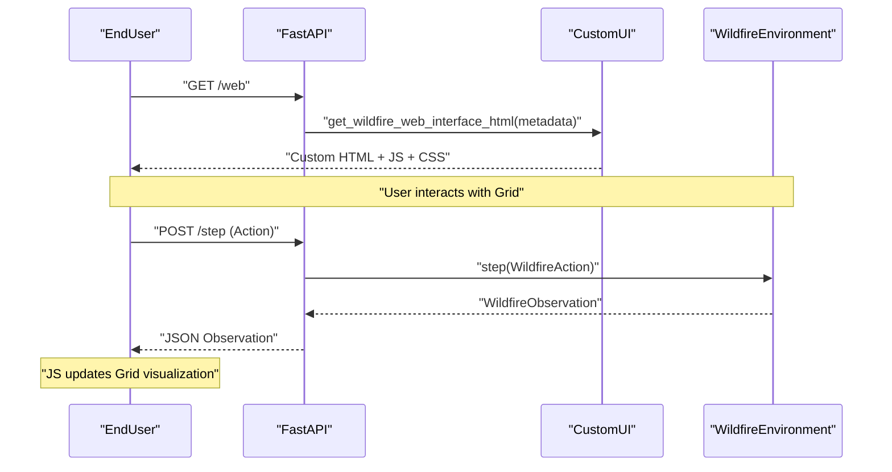
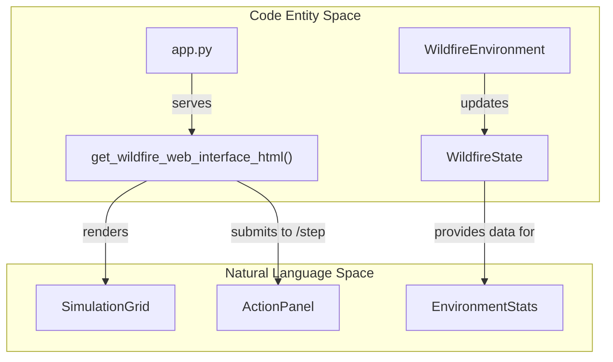
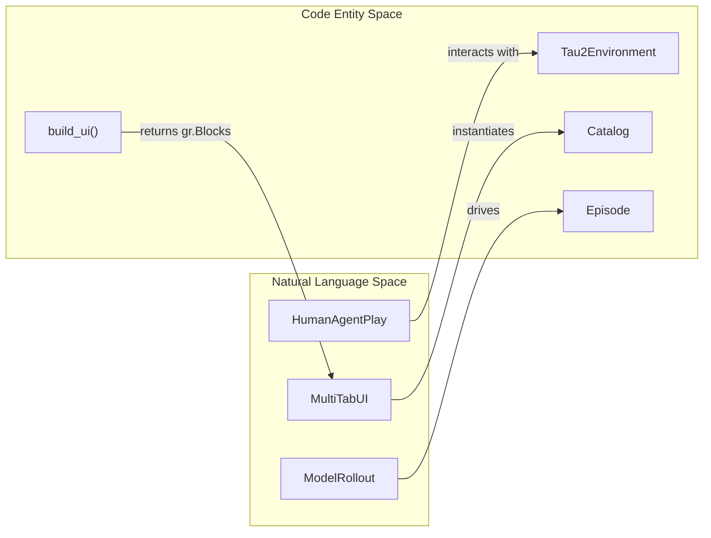

<!-- source: DeepWiki mcp.deepwiki.com · repo huggingface/OpenEnv · page 4.2 Custom Environment Web UIs · fetched 2026-10-26 -->

# Custom Environment Web UIs

Relevant source files

The following files were used as context for generating this wiki page:

- [docs/source/environments/tau2.md](docs/source/environments/tau2.md)
- [docs/source/guides/customizing-web-ui.md](docs/source/guides/customizing-web-ui.md)
- [envs/calendar_env/server/database/managers/event_manager.py](envs/calendar_env/server/database/managers/event_manager.py)
- [envs/calendar_env/server/schemas/settings.py](envs/calendar_env/server/schemas/settings.py)
- [envs/dipg_safety_env/server/dipg_environment.py](envs/dipg_safety_env/server/dipg_environment.py)
- [envs/finrl_env/README.md](envs/finrl_env/README.md)
- [envs/kernrl/README.md](envs/kernrl/README.md)
- [envs/kernrl/server/evaluator.py](envs/kernrl/server/evaluator.py)
- [envs/kernrl/server/kernrl_environment.py](envs/kernrl/server/kernrl_environment.py)
- [envs/sumo_rl_env/README.md](envs/sumo_rl_env/README.md)
- [envs/tau2_env/.dockerignore](envs/tau2_env/.dockerignore)
- [envs/tau2_env/README.md](envs/tau2_env/README.md)
- [envs/tau2_env/openenv.yaml](envs/tau2_env/openenv.yaml)
- [envs/tau2_env/server/Dockerfile](envs/tau2_env/server/Dockerfile)
- [envs/tau2_env/server/app.py](envs/tau2_env/server/app.py)
- [envs/tau2_env/server/gradio_ui.py](envs/tau2_env/server/gradio_ui.py)
- [envs/tau2_env/server/task_view.py](envs/tau2_env/server/task_view.py)
- [envs/tau2_env/server/tau2_environment.py](envs/tau2_env/server/tau2_environment.py)
- [envs/tau2_env/uv.lock](envs/tau2_env/uv.lock)
- [envs/websearch_env/README.md](envs/websearch_env/README.md)
- [envs/wildfire_env/client.py](envs/wildfire_env/client.py)
- [envs/wildfire_env/models.py](envs/wildfire_env/models.py)
- [envs/wildfire_env/server/app.py](envs/wildfire_env/server/app.py)
- [envs/wildfire_env/server/wildfire_environment.py](envs/wildfire_env/server/wildfire_environment.py)
- [envs/wildfire_env/server/wildfire_web_interface.py](envs/wildfire_env/server/wildfire_web_interface.py)
- [tests/envs/test_dipg_reward_functions.py](tests/envs/test_dipg_reward_functions.py)
- [tests/envs/test_kernrl_environment.py](tests/envs/test_kernrl_environment.py)
- [tests/envs/test_tau2_env.py](tests/envs/test_tau2_env.py)
- [tests/envs/test_wildfire_environment.py](tests/envs/test_wildfire_environment.py)

While OpenEnv provides a default Gradio-based interface for interacting with environments via `Action` and `Observation` schemas, many environments require specialized visualizations or control panels. This page describes how environments override or extend the default web interface using custom HTML/JavaScript or specialized Gradio applications, covering implementations such as the Wildfire grid visualization, τ²-bench multi-tab Gradio UI, REPL control panels, and OpenSpiel/TextArena interfaces.

## Overview of UI Extension Patterns

Environments typically use one of two patterns to provide a custom UI:
1.  **FastAPI Route Overriding**: The environment server manually removes the default `/web` route and replaces it with a custom `HTMLResponse`. This is used for high-performance, custom JS visualizations like the Wildfire grid.
2.  **Gradio App Customization**: The environment defines a specialized Gradio interface (or passes a custom `gradio_builder` to the server factory) that is mounted by the `create_app` factory. This is used for complex, multi-component dashboards like the τ²-bench customer service platform, REPL Control Panel, or OpenCode UI.

### Data Flow for Custom UIs

The following diagram illustrates how a custom UI (like Wildfire) interacts with the `EnvironmentServer` and the underlying `Environment` logic.

**Custom UI Interaction Flow**

Sources: [envs/wildfire_env/server/app.py:58-62](), [envs/wildfire_env/server/wildfire_web_interface.py:16-30]()

---

## Pattern 1: HTML/JS Overrides — Wildfire Grid Visualization

The `wildfire_env` implements a high-performance cellular automata simulation visualization. Instead of using standard Gradio components, it serves a custom HTML page that uses CSS Grid for the simulation display and standard Fetch API calls to communicate with the environment's REST endpoints.

### Implementation Details
*   **Route Overriding**: In `envs/wildfire_env/server/app.py`, the server iterates through `app.routes` to find and remove the default `/web` route before registering a new `@app.get("/web")` handler [envs/wildfire_env/server/app.py:43-62]().
*   **Metadata Integration**: It uses `load_environment_metadata` to fetch `readme_content` from `openenv.yaml`, which is then passed to the frontend for rendering via `marked.js` [envs/wildfire_env/server/wildfire_web_interface.py:24-28]().
*   **Grid Rendering**: The frontend represents the `WildfireObservation.grid` (a flattened list of integers) as a dynamic HTML grid where each cell class (e.g., `.cell.burning`, `.cell.fuel`) corresponds to the state integers defined in the model [envs/wildfire_env/server/wildfire_web_interface.py:189-194](), accompanied by methods like `render_web()` tested in `tests/envs/test_wildfire_environment.py` [tests/envs/test_wildfire_environment.py:9-22]().

**Entity Mapping: Wildfire UI**

Sources: [envs/wildfire_env/server/wildfire_web_interface.py:16-19](), [envs/wildfire_env/models.py:39-57](), [envs/wildfire_env/server/app.py:27-32](), [tests/envs/test_wildfire_environment.py:9-22]()

---

## Pattern 2: Specialized Gradio UIs — τ²-bench & REPL/OpenCode

Environments like `tau2_env`, `repl_env`, and `opencode_env` use the `gradio` library to build sophisticated IDE-like interfaces or multi-tab agent evaluation dashboards.

### τ²-bench Multi-Tab Gradio Dashboard
The τ²-bench environment (`tau2_env`) provides a comprehensive customer-service evaluation dashboard mounted through `create_app`'s `gradio_builder` argument [envs/tau2_env/server/app.py:61-72]().
*   **Task Explorer**: Allows browsing tasks split by domain (`airline`, `retail`, `telecom`) and split (`test`, `train`, `base`), inspecting hidden user motivations, database states, and policies [envs/tau2_env/server/gradio_ui.py:116-160](), [docs/source/environments/tau2.md:16-24]().
*   **Model Runner**: Selects an agent model on Hugging Face Inference Providers to execute conversations against simulated customers with real-time collapsible tool call logs and final reward breakdowns [docs/source/environments/tau2.md:21]().
*   **Interactive Play-as-Agent**: Enables human-in-the-loop interaction where visitors act as the customer support agent using domain tools via a form interface [docs/source/environments/tau2.md:22]().
*   **Run Comparison**: Manages session run histories and allows side-by-side comparison of 2 to 4 rollout runs [docs/source/environments/tau2.md:23]().

**Entity Mapping: τ²-bench Gradio UI**

Sources: [envs/tau2_env/server/gradio_ui.py:116-194](), [envs/tau2_env/server/app.py:61-72](), [docs/source/environments/tau2.md:16-27]()

### REPL Control Panel and OpenCode UI
*   **REPL Control Panel**: Provides a "Needle in a Haystack" testing interface and a recursive agent visualization. It includes a server-side PDF/Text extractor using `pypdf` for uploading documents as context, and documents injected helpers like `llm_query` and `FINAL()` [envs/repl_env/server/gradio_ui.py:94-156]().
*   **OpenCode Gradio UI**: Designed for configuring complex agent rollouts in E2B sandboxes. It includes catalog selectors for backend endpoints (`vllm`, `openai`, `hf_router`), text areas for `instruction`, `setup`, and `verify` scripts, and logprob statistics visualization for GRPO training [envs/opencode_env/server/gradio_ui.py:14-181]().

Sources: [envs/repl_env/server/gradio_ui.py:7-118](), [envs/opencode_env/server/gradio_ui.py:7-181]()

---

## Other Simulation and Game UIs (OpenSpiel, TextArena)

In addition to Wildfire and τ²-bench, other simulation environments provide custom rendering or action mechanisms:
*   **OpenSpiel Environment**: Implements specialized `render_web` and `web_actions` methods to translate combinatorial game states (such as chess, checkers, or matrix games) into web-renderable observation strings or interactive UI elements.
*   **TextArena Environment**: Formulates text-based game environments (e.g., negotiations, deduction games) that leverage standard text-area based Gradio chat layouts to stream multi-agent conversational turns.

Sources: [envs/wildfire_env/server/wildfire_environment.py:57-60](), [tests/envs/test_wildfire_environment.py:15-18]()

---

## Summary of Custom UI Components

| Environment | UI Type | Key Features | File Reference |
| :--- | :--- | :--- | :--- |
| **Wildfire** | Custom HTML/JS | Real-time CSS Grid simulation, wind/humidity sliders, `render_web` | [envs/wildfire_env/server/wildfire_web_interface.py:30-40]() |
| **τ²-bench** | Gradio (Multi-Tab) | Task explorer, Model runner with Inference Providers, Human-agent play, Run comparison | [envs/tau2_env/server/gradio_ui.py:7-41]() |
| **REPL** | Gradio | PDF/Text upload, namespace helper documentation, recursive call trace | [envs/repl_env/server/gradio_ui.py:7-118]() |
| **OpenCode** | Gradio | Task setup/verify bash editors, logprob stats, E2B sandbox monitoring | [envs/opencode_env/server/gradio_ui.py:7-24]() |
| **OpenSpiel** | Custom Methods | `render_web` and `web_actions` for game tree and board visualization | [envs/wildfire_env/server/wildfire_environment.py:57-60]() |

Sources: [envs/wildfire_env/server/wildfire_web_interface.py:1-6](), [envs/tau2_env/server/gradio_ui.py:7-12](), [envs/repl_env/server/gradio_ui.py:7-10](), [envs/opencode_env/server/gradio_ui.py:7-11]()

---

