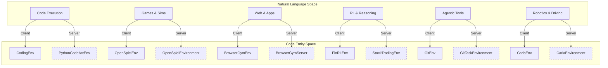
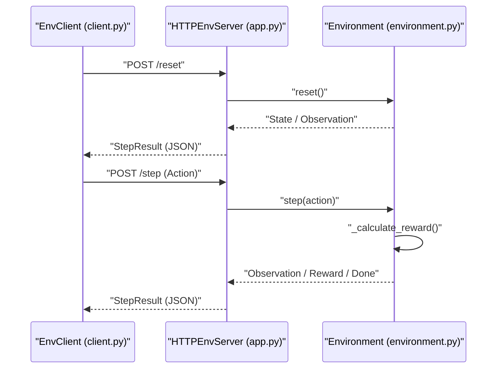

<!-- source: DeepWiki mcp.deepwiki.com · repo huggingface/OpenEnv · page 5 Environment Catalog · fetched 2026-10-26 -->

# Environment Catalog

<details>
<summary>Relevant source files</summary>

The following files were used as context for generating this wiki page:

- [docs/source/environments/chat.md](docs/source/environments/chat.md)
- [docs/source/environments/dipg.md](docs/source/environments/dipg.md)
- [docs/source/environments/finrl.md](docs/source/environments/finrl.md)
- [docs/source/environments/git.md](docs/source/environments/git.md)
- [docs/source/environments/reasoning_gym.md](docs/source/environments/reasoning_gym.md)
- [docs/source/environments/repl.md](docs/source/environments/repl.md)
- [docs/source/environments/websearch.md](docs/source/environments/websearch.md)
- [envs/agent_world_model_env/pyproject.toml](envs/agent_world_model_env/pyproject.toml)
- [envs/agent_world_model_env/uv.lock](envs/agent_world_model_env/uv.lock)
- [envs/atari_env/server/app.py](envs/atari_env/server/app.py)
- [envs/browsergym_env/uv.lock](envs/browsergym_env/uv.lock)
- [envs/carla_env/server/app.py](envs/carla_env/server/app.py)
- [envs/chat_env/server/app.py](envs/chat_env/server/app.py)
- [envs/chess_env/server/app.py](envs/chess_env/server/app.py)
- [envs/coding_env/server/app.py](envs/coding_env/server/app.py)
- [envs/connect4_env/server/app.py](envs/connect4_env/server/app.py)
- [envs/dipg_safety_env/server/app.py](envs/dipg_safety_env/server/app.py)
- [envs/finrl_env/uv.lock](envs/finrl_env/uv.lock)
- [envs/git_env/server/app.py](envs/git_env/server/app.py)
- [envs/jupyter_env/uv.lock](envs/jupyter_env/uv.lock)
- [envs/maze_env/server/app.py](envs/maze_env/server/app.py)
- [envs/openapp_env/uv.lock](envs/openapp_env/uv.lock)
- [envs/pelican_svg_env/server/app.py](envs/pelican_svg_env/server/app.py)
- [envs/repl_env/uv.lock](envs/repl_env/uv.lock)
- [envs/snake_env/uv.lock](envs/snake_env/uv.lock)
- [envs/sumo_rl_env/server/app.py](envs/sumo_rl_env/server/app.py)
- [envs/sumo_rl_env/uv.lock](envs/sumo_rl_env/uv.lock)
- [envs/terminus_env/uv.lock](envs/terminus_env/uv.lock)
- [envs/websearch_env/uv.lock](envs/websearch_env/uv.lock)
- [envs/wildfire_env/uv.lock](envs/wildfire_env/uv.lock)

</details>


OpenEnv provides a diverse library of environments spanning code execution, competitive games, web automation, robotics, and specialized RL benchmarks. Each environment follows the standard **Client-Server-Model** pattern, allowing them to be run locally, in Docker containers, or as hosted Hugging Face Spaces.

This page serves as a high-level index of all available environments and outlines the shared layout conventions used across the environment catalog. For deep technical details on specific groups, please refer to the child pages linked in each section.

## Shared Environment Layout

Every environment in OpenEnv adheres to a predictable directory structure and standard component pattern. This ensures seamless integration with container providers, the `EnvClient` runtime, and auto-discovery mechanisms.

```
envs/
├── <env_name>/
│   ├── models.py      # Pydantic schemas for Action, Observation, and State
│   ├── client.py      # Subclass of EnvClient defining synchronous/asynchronous methods
│   ├── server/        # Server-side logic and FastAPI app entrypoint
│   │   ├── app.py     # FastAPI application factory via create_app()
│   │   └── ...        # Environment-specific engine code
│   ├── Dockerfile     # Container build instructions for sandbox/remote execution
│   └── uv.lock        # Pinned dependency lockfile
```

- **`models.py`**: Defines strongly-typed Pydantic classes for environment actions, observations, and state representations, ensuring rigid API contracts between client and server.
- **`client.py`**: Implements the client-side communication wrapper (`EnvClient`), handling HTTP/WebSocket serialization and method abstractions.
- **`server/app.py`**: Houses the FastAPI application built using core server factories [envs/maze_env/server/app.py:33-52]().
- **`Dockerfile` & `uv.lock`**: Provide reproducible environments, dependency pinning via `uv`, and containerization support for deployment across various providers.

Sources: [envs/maze_env/server/app.py:31-53]()

---

## Categorization Overview

The catalog is organized into six primary functional domains:

1. **Code Execution**: Environments providing sandboxed runtimes for Python, Julia, Jupyter, and tool-use sandboxes.
2. **Games and Simulations**: Classic RL benchmarks (Atari), board games (OpenSpiel), and cellular automata.
3. **Web and Applications**: Web browsing agents and authenticated application automation.
4. **RL Benchmarks and Reasoning**: Math puzzles, financial trading, reasoning gyms, and safety-critical evaluations.
5. **Agentic Tool-Use and World Models**: Tool discovery, Git operations, calendars, and world model environments.
6. **Driving, Robotics, and Traffic**: Autonomous driving scenarios (CARLA), robotics physics (MuJoCo), and traffic signal control.

### Environment-to-Code Mapping
The following diagram bridges the natural language categories to specific code entities and server implementations within the repository.

**System Mapping: Category to Implementation**

Sources: [docs/source/environments/coding.md:139-152](), [docs/source/environments/openspiel.md:183-203](), [docs/source/environments/browsergym.md:31-59](), [docs/source/environments/finrl.md:112-149](), [docs/source/environments/git.md:185-197]()

---

## 5.1 [Code Execution Environments](#5.1)

These environments are designed for agents that interact with the world via code execution. They feature robust sandboxing, stream monitoring, and persistent state across execution steps.

- **`coding_env`**: Implements the Python CodeAct pattern, where the agent writes and executes arbitrary Python code in a sandboxed `PythonExecutor`.
- **`repl_env`**: A specialized environment for Recursive Language Model (RLM) execution, allowing nested LLM calls from within a Python REPL.
- **`julia_env`** & **`jupyter_env`**: Provide Julia process pools and Jupyter kernel interfaces for interactive data science workflows.
- **`terminus_env`** & **`thinkingbox_env`**: Offer secure E2B-backed sandboxes and reasoning box utilities.

For details, see [Code Execution Environments](#5.1).

Sources: [docs/source/environments/coding.md:1-4](), [docs/source/environments/repl.md:4-16]()

---

## 5.2 [Game and Simulation Environments](#5.2)

Classic and modern simulations used for testing reinforcement learning algorithms, strategic reasoning, and cellular automata.

- **`openspiel_env`**: Integration with DeepMind's OpenSpiel, supporting board and card games like Chess, Checkers, and Kuhn Poker.
- **`atari_env`**: Standard Arcade Learning Environment wrapper for classic Atari 2600 arcade titles.
- **`snake_env`**, **`connect4_env`**, & **`maze_env`**: Grid and board environments with customizable action spaces.
- **`wildfire_env`**: Cellular automata simulation of forest fires requiring agent containment strategies.

For details, see [Game and Simulation Environments](#5.2).

Sources: [docs/source/environments/openspiel.md:4-19](), [docs/source/environments/atari.md:4-22](), [docs/source/environments/snake.md:4-26]()

---

## 5.3 [Web and Application Environments](#5.3)

Environments focused on UI automation, web navigation, and interacting with external web apps.

- **`browsergym_env`**: Playwright-based web agent harness including MiniWoB++, WebArena, and WorkArena.
- **`helium_browser_env`**: Lightweight browser automation wrapper.
- **`openapp_env`** & **`opencode_env`**: Application-level automation for internal business tools and development IDEs.
- **`websearch_env`**: Controlled search engine interface for retrieval-augmented agent loops.

For details, see [Web and Application Environments](#5.3).

Sources: [docs/source/environments/browsergym.md:4-24]()

---

## 5.4 [RL Benchmark and Reasoning Environments](#5.4)

Environments targeting advanced mathematical reasoning, financial portfolio management, and safety-critical constraints.

- **`finrl_env`**: Stock trading and financial portfolio management benchmark using historical market feeds.
- **`dipg_safety_env`**: High-stakes medical reasoning environment enforcing strict verification traces and safety constraints.
- **`reasoning_gym_env`** & **`qed_math_env`**: Collections of logic puzzles and mathematical deduction tasks.
- **`tbench2_env`**, **`tau2_env`**, & **`sophistry_bench_sprint_env`**: Complex reasoning and agentic benchmark suites.

For details, see [RL Benchmark and Reasoning Environments](#5.4).

Sources: [docs/source/environments/finrl.md:4-14](), [docs/source/environments/dipg.md:2-13]()

---

## 5.5 [Agentic Tool-Use and World Model Environments](#5.5)

Environments emphasizing tool discovery, state management, and environment dynamics modeling.

- **`git_env`**: Isolated Gitea server for training version-control agents on clone, commit, and merge tasks.
- **`agent_world_model_env` (AWM)**: Over 1,000 generated tool-use scenarios with SQL and code verification backends.
- **`calendar_env`**: Model Context Protocol (MCP) compliant calendar environment with database seeding.
- **`chat_env`** & **`echo_env`**: Foundational message history management and echo world model testing backends.

For details, see [Agentic Tool-Use and World Model Environments](#5.5).

Sources: [docs/source/environments/git.md:4-10](), [docs/source/environments/chat.md:4-17]()

---

## 5.6 [Driving, Robotics, and Traffic Environments](#5.6)

Heavyweight simulation environments involving physics engines, autonomous driving scenarios, and urban traffic management.

- **`carla_env`**: Autonomous driving benchmark scenarios built on the CARLA simulator.
- **`dm_control_env`**: MuJoCo physics and robotics control tasks.
- **`sumo_rl_env`**: Traffic signal control simulation using the Simulation of Urban MObility (SUMO) engine.

For details, see [Driving, Robotics, and Traffic Environments](#5.6).

Sources: [docs/source/environments/sumo_rl_env/server/app.py:1-30]()

---

## Environment Interaction Model

Every environment in this catalog shares a common communication lifecycle, typically mediated by the `EnvClient` and `HTTPEnvServer`.

**Code Entity Space: Client-Server Interaction**

Sources: [envs/echo_env/README.md:146-160](), [docs/source/environments/atari.md:24-39](), [docs/source/environments/finrl.md:112-149]()

---

