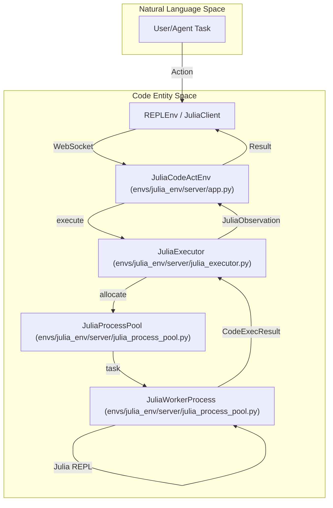
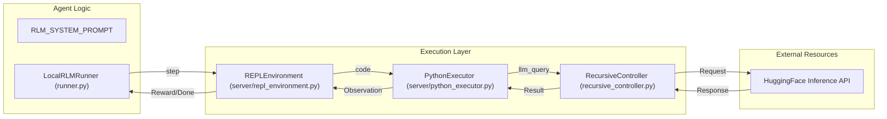

<!-- source: DeepWiki mcp.deepwiki.com · repo huggingface/OpenEnv · page 5.1 Code Execution Environments · fetched 2026-10-26 -->

# Code Execution Environments

Relevant source files

The following files were used as context for generating this wiki page:

- [docs/source/environments/coding_tools.md](docs/source/environments/coding_tools.md)
- [docs/source/environments/jupyter.md](docs/source/environments/jupyter.md)
- [docs/source/environments/terminus.md](docs/source/environments/terminus.md)
- [envs/coding_env/models.py](envs/coding_env/models.py)
- [envs/coding_env/server/Dockerfile](envs/coding_env/server/Dockerfile)
- [envs/coding_env/server/python_codeact_env.py](envs/coding_env/server/python_codeact_env.py)
- [envs/coding_env/server/python_executor.py](envs/coding_env/server/python_executor.py)
- [envs/coding_env/server/transforms.py](envs/coding_env/server/transforms.py)
- [envs/coding_tools_env/README.md](envs/coding_tools_env/README.md)
- [envs/coding_tools_env/server/coding_tools_env_environment.py](envs/coding_tools_env/server/coding_tools_env_environment.py)
- [envs/julia_env/.dockerignore](envs/julia_env/.dockerignore)
- [envs/julia_env/README.md](envs/julia_env/README.md)
- [envs/julia_env/__init__.py](envs/julia_env/__init__.py)
- [envs/julia_env/models.py](envs/julia_env/models.py)
- [envs/julia_env/openenv.yaml](envs/julia_env/openenv.yaml)
- [envs/julia_env/pyproject.toml](envs/julia_env/pyproject.toml)
- [envs/julia_env/server/Dockerfile](envs/julia_env/server/Dockerfile)
- [envs/julia_env/server/__init__.py](envs/julia_env/server/__init__.py)
- [envs/julia_env/server/app.py](envs/julia_env/server/app.py)
- [envs/julia_env/server/julia_codeact_env.py](envs/julia_env/server/julia_codeact_env.py)
- [envs/julia_env/server/julia_executor.py](envs/julia_env/server/julia_executor.py)
- [envs/julia_env/server/julia_process_pool.py](envs/julia_env/server/julia_process_pool.py)
- [envs/julia_env/server/julia_transforms.py](envs/julia_env/server/julia_transforms.py)
- [envs/jupyter_env/README.md](envs/jupyter_env/README.md)
- [envs/jupyter_env/server/e2b_sandbox.py](envs/jupyter_env/server/e2b_sandbox.py)
- [envs/jupyter_env/server/jupyter_environment.py](envs/jupyter_env/server/jupyter_environment.py)
- [envs/repl_env/README.md](envs/repl_env/README.md)
- [envs/repl_env/__init__.py](envs/repl_env/__init__.py)
- [envs/repl_env/client.py](envs/repl_env/client.py)
- [envs/repl_env/local.py](envs/repl_env/local.py)
- [envs/repl_env/models.py](envs/repl_env/models.py)
- [envs/repl_env/prompts.py](envs/repl_env/prompts.py)
- [envs/repl_env/pyproject.toml](envs/repl_env/pyproject.toml)
- [envs/repl_env/recursive_backends.py](envs/repl_env/recursive_backends.py)
- [envs/repl_env/recursive_controller.py](envs/repl_env/recursive_controller.py)
- [envs/repl_env/rubrics.py](envs/repl_env/rubrics.py)
- [envs/repl_env/runner.py](envs/repl_env/runner.py)
- [envs/repl_env/server/app.py](envs/repl_env/server/app.py)
- [envs/repl_env/server/gradio_ui.py](envs/repl_env/server/gradio_ui.py)
- [envs/repl_env/server/python_executor.py](envs/repl_env/server/python_executor.py)
- [envs/repl_env/server/repl_environment.py](envs/repl_env/server/repl_environment.py)
- [envs/terminus_env/README.md](envs/terminus_env/README.md)
- [envs/terminus_env/server/e2b_sandbox.py](envs/terminus_env/server/e2b_sandbox.py)
- [envs/terminus_env/server/terminus_env_environment.py](envs/terminus_env/server/terminus_env_environment.py)
- [envs/thinkingbox_env/.dockerignore](envs/thinkingbox_env/.dockerignore)
- [envs/thinkingbox_env/__init__.py](envs/thinkingbox_env/__init__.py)
- [envs/thinkingbox_env/benchmark_data.py](envs/thinkingbox_env/benchmark_data.py)
- [envs/thinkingbox_env/client.py](envs/thinkingbox_env/client.py)
- [envs/thinkingbox_env/evaluation.py](envs/thinkingbox_env/evaluation.py)
- [envs/thinkingbox_env/models.py](envs/thinkingbox_env/models.py)
- [envs/thinkingbox_env/pyproject.toml](envs/thinkingbox_env/pyproject.toml)
- [envs/thinkingbox_env/runtime.py](envs/thinkingbox_env/runtime.py)
- [envs/thinkingbox_env/server/Dockerfile](envs/thinkingbox_env/server/Dockerfile)
- [envs/thinkingbox_env/server/app.py](envs/thinkingbox_env/server/app.py)
- [envs/thinkingbox_env/server/config.py](envs/thinkingbox_env/server/config.py)
- [envs/thinkingbox_env/server/thinkingbox_environment.py](envs/thinkingbox_env/server/thinkingbox_environment.py)
- [envs/thinkingbox_env/uv.lock](envs/thinkingbox_env/uv.lock)
- [examples/repl_oolong_simple.py](examples/repl_oolong_simple.py)
- [examples/repl_with_llm.py](examples/repl_with_llm.py)
- [examples/thinkingbox/eval_testlist.py](examples/thinkingbox/eval_testlist.py)
- [examples/thinkingbox/example_usage.py](examples/thinkingbox/example_usage.py)
- [tests/envs/test_coding_codeact_env.py](tests/envs/test_coding_codeact_env.py)
- [tests/envs/test_coding_env_integration.py](tests/envs/test_coding_env_integration.py)
- [tests/envs/test_coding_tools_environment.py](tests/envs/test_coding_tools_environment.py)
- [tests/envs/test_julia_env.py](tests/envs/test_julia_env.py)
- [tests/envs/test_jupyter_environment.py](tests/envs/test_jupyter_environment.py)
- [tests/envs/test_python_codeact_reset.py](tests/envs/test_python_codeact_reset.py)
- [tests/envs/test_python_codeact_rewards.py](tests/envs/test_python_codeact_rewards.py)
- [tests/envs/test_repl_env.py](tests/envs/test_repl_env.py)
- [tests/envs/test_terminus_environment.py](tests/envs/test_terminus_environment.py)
- [tests/envs/test_thinkingbox_env.py](tests/envs/test_thinkingbox_env.py)

Code execution environments in OpenEnv provide sandboxed runtimes for language models to interact with programming languages, shells, and analytical tools. These environments span diverse paradigms, ranging from simple Python code execution (`coding_env`) to complex recursive REPLs with multi-turn LLM calls (`repl_env`), high-performance process pools for non-Python languages (`julia_env`), and cloud-sandboxed environments (`terminus_env` and `jupyter_env`).

---

## Python CodeAct and Executor Sandboxing

The foundation for most Python-based code execution environments in OpenEnv is the `PythonExecutor` class, which manages a persistent execution namespace across multiple turns while capturing `stdout`, `stderr`, and local variable snapshots [envs/repl_env/server/python_executor.py:25-42]().

### PythonExecutor Implementation and Sandboxing
The executor utilizes `smolagents.LocalPythonExecutor` to run untrusted code securely within a local interpreter environment [envs/repl_env/server/python_executor.py:108-112](). Its key capabilities include:
- **Namespace Persistence**: Variables and functions defined in one `step` remain available in subsequent execution steps [tests/envs/test_repl_env.py:114-120]().
- **Output Truncation**: Enforces a strict `max_output_length` limit (default `8192` chars) to protect the agent's context window from runaway outputs [envs/repl_env/server/python_executor.py:118-120]().
- **Function Injection**: Exposes custom runtime functions (such as `llm_query` or `rlm_query`) directly into the global execution namespace via `inject_function()` [envs/repl_env/server/python_executor.py:143-154]().

### coding_env (Python CodeAct)
The `coding_env` implements the standard CodeAct agent loop, where models output executable code blocks wrapped in Markdown. The server-side `PythonCodeActEnv` parses these blocks, executes them using `PythonExecutor`, and packages stdout, stderr, exit codes, and reward signals into observations [envs/coding_env/server/python_codeact_env.py:31-60]().

Sources: [envs/repl_env/server/python_executor.py:25-154](), [envs/coding_env/server/python_codeact_env.py:31-60](), [tests/envs/test_repl_env.py:29-162]()

---

## REPL Environment (RLM REPL)

The `repl_env` environment implements the **Recursive Language Models (RLM)** paradigm [envs/repl_env/server/repl_environment.py:10-17](). It enables models to solve complex reasoning and data-processing tasks by programmatically chunking massive contexts, maintaining state across turns, and spawning recursive sub-LLM calls.

### Recursive Controller and Functions
The environment embeds a `RecursiveController` that exposes several built-in helper functions inside the execution namespace [envs/repl_env/server/repl_environment.py:46-48]() and [envs/repl_env/prompts.py:36-46]():
- `llm_query(prompt, model=None)`: Performs a lightweight, single-turn LLM completion call without REPL iteration [envs/repl_env/prompts.py:40-40]().
- `llm_query_batched(prompts, model=None)`: Concurrently runs multiple LLM completion requests, returning a list of strings [envs/repl_env/prompts.py:41-41]().
- `rlm_query(prompt, model=None)`: Spawns a recursive child RLM instance equipped with its own isolated REPL environment for multi-step subtask reasoning [envs/repl_env/prompts.py:42-42]().
- `rlm_query_batched(prompts, model=None)`: Runs multiple recursive child RLM sessions concurrently [envs/repl_env/prompts.py:43-43]().
- `SHOW_VARS()`: Inspects and lists all user-defined variables currently stored in the namespace [envs/repl_env/prompts.py:44-44]().

### Finalization Patterns
`REPLEnvironment` supports two distinct ways to conclude an episode:
1. **RLM-Style (Print Final)**: Printing `FINAL(answer)` or `FINAL_VAR("variable_name")` to stdout [envs/repl_env/server/repl_environment.py:72-73]().
2. **Prime Intellect Style (Dict Answer)**: Assigning a dictionary to the `answer` variable, e.g., `answer = {"content": "...", "ready": True}` [envs/repl_env/server/repl_environment.py:74-74]().

### REPL Execution Data Flow

| Step | Entity | Action |
| :--- | :--- | :--- |
| 1 | `REPLEnvironment` | Initializes `PythonExecutor`, sets environment variables, and loads initial `context` [envs/repl_env/server/repl_environment.py:125-148](). |
| 2 | `REPLAction` | Model submits code block containing Python code or query functions [envs/repl_env/models.py:45-55](). |
| 3 | `PythonExecutor` | Executes code; if `llm_query` or `rlm_query` is invoked, the `RecursiveController` routes requests to the HF Inference API or model backend [envs/repl_env/server/repl_environment.py:330-345](). |
| 4 | `REPLObservation` | Returns `CodeBlockResult`, updated `available_variables`, truncation status, and reward [envs/repl_env/models.py:60-80](). |

Sources: [envs/repl_env/server/repl_environment.py:61-148](), [envs/repl_env/prompts.py:36-119](), [envs/repl_env/client.py:31-116]()

---

## Julia Environment (julia_env)

The `julia_env` provides a high-performance Julia execution backend (`JuliaCodeActEnv`), addressing the startup latency inherent in Julia by maintaining a persistent process pool [envs/julia_env/server/julia_codeact_env.py:107-138]().

### Julia Process Pool and Execution
- **Persistent Workers**: `JuliaWorkerProcess` maintains long-running Julia REPL subprocesses, communicating via delimiter-based protocols over `stdin`/`stdout` [envs/julia_env/server/julia_process_pool.py:48-62]().
- **Health Monitoring & Auto-Recovery**: The `JuliaProcessPool` monitors worker health and automatically restarts failed or unresponsive workers [envs/julia_env/server/julia_process_pool.py:18-19]().
- **Infinite Loop Detection**: Before executing code, static regex-based heuristics inspect code for unmitigated `while true` loops lacking `break`, `return`, or `error` statements [envs/julia_env/server/julia_codeact_env.py:43-104]().

**Julia Execution Topology**

Sources: [envs/julia_env/server/julia_codeact_env.py:107-138](), [envs/julia_env/server/julia_executor.py:59-122](), [envs/julia_env/server/julia_process_pool.py:48-132]()

---

## Specialized and Cloud Sandbox Environments

OpenEnv provides several specialized environments for advanced agentic workflows:

- **`terminus_env`**: Integrates with E2B sandboxes (`e2b_sandbox.py`) to provide secure, isolated cloud-based terminal environments for shell execution, file manipulation, and software engineering benchmarks [docs/source/environments/terminus.md]().
- **`jupyter_env`**: Connects to remote Jupyter kernels via E2B, letting agents execute code across notebook cells, inspect variables, and render plots or rich MIME outputs [tests/envs/test_jupyter_environment.py]().
- **`coding_tools_env`**: Pre-configured with software engineering toolchains (linters, test runners, git) to evaluate coding agents on multi-file repositories.
- **`thinkingbox_env`**: Encapsulates reasoning-focused coding verification tasks (`thinkingbox_environment.py`), scoring agent outputs against test suites (`evaluation.py`) [envs/thinkingbox_env/server/thinkingbox_environment.py]().

Sources: [docs/source/environments/terminus.md](), [envs/terminus_env/server/e2b_sandbox.py](), [envs/jupyter_env/server/e2b_sandbox.py](), [envs/thinkingbox_env/server/thinkingbox_environment.py]()

---

## System Architecture: RLM to Code Execution

This diagram illustrates how high-level RLM runner logic invokes the server environment and dispatches sub-queries to external language model APIs.

**RLM Execution Logic**

Sources: [envs/repl_env/runner.py:65-66](), [envs/repl_env/server/repl_environment.py:61-108](), [envs/repl_env/recursive_controller.py:15-88](), [envs/repl_env/prompts.py:122-127]()

---

