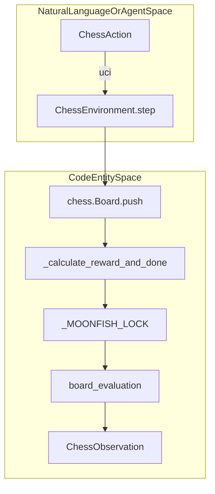
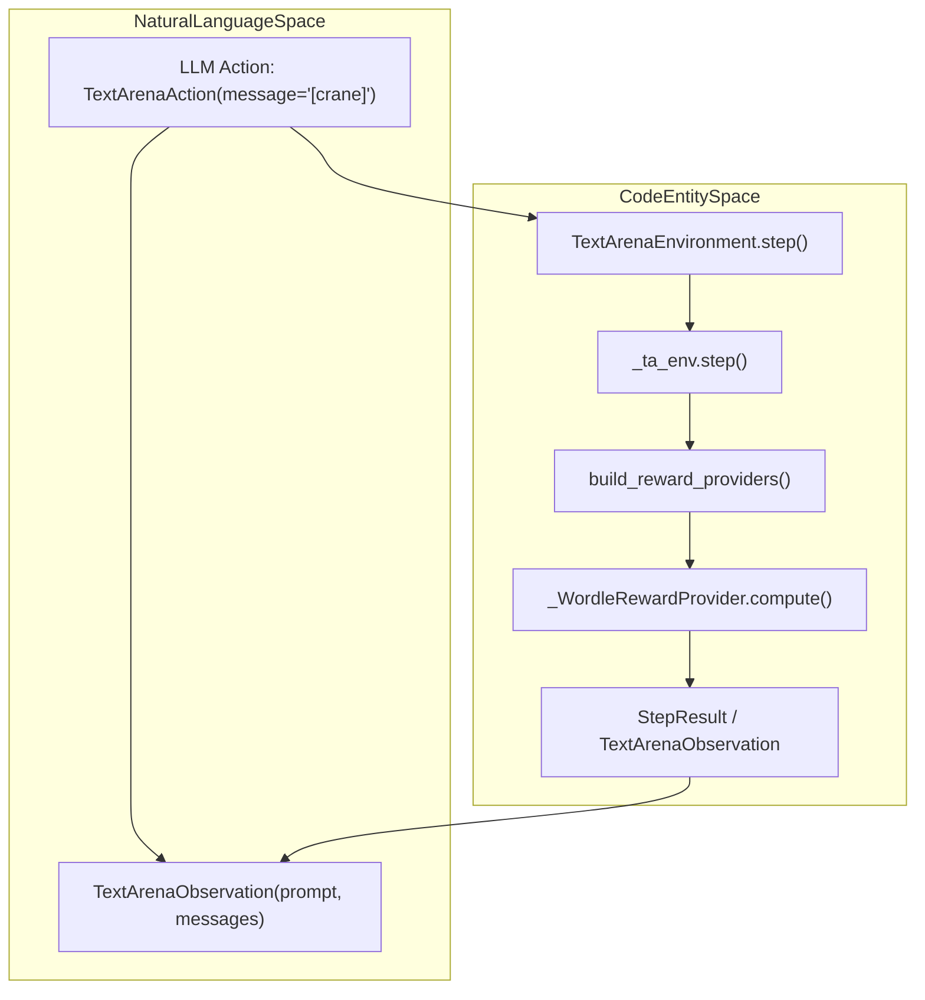
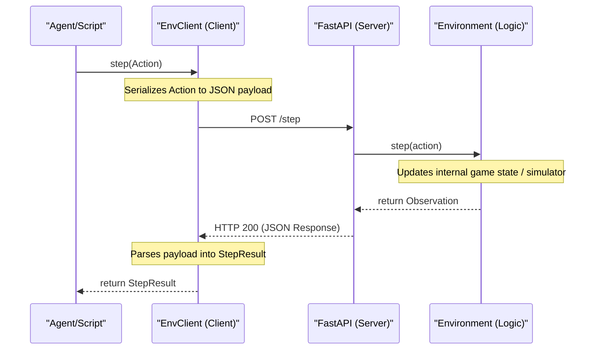

<!-- source: DeepWiki mcp.deepwiki.com · repo huggingface/OpenEnv · page 5.2 Game and Simulation Environments · fetched 2026-10-26 -->

# Game and Simulation Environments

Relevant source files

The following files were used as context for generating this wiki page:

- [docs/source/environments/openspiel.md](docs/source/environments/openspiel.md)
- [envs/atari_env/models.py](envs/atari_env/models.py)
- [envs/atari_env/pyproject.toml](envs/atari_env/pyproject.toml)
- [envs/atari_env/server/atari_environment.py](envs/atari_env/server/atari_environment.py)
- [envs/atari_env/server/requirements.txt](envs/atari_env/server/requirements.txt)
- [envs/atari_env/uv.lock](envs/atari_env/uv.lock)
- [envs/carla_env/pyproject.toml](envs/carla_env/pyproject.toml)
- [envs/chat_env/models.py](envs/chat_env/models.py)
- [envs/chat_env/server/chat_environment.py](envs/chat_env/server/chat_environment.py)
- [envs/chess_env/pyproject.toml](envs/chess_env/pyproject.toml)
- [envs/chess_env/server/chess_environment.py](envs/chess_env/server/chess_environment.py)
- [envs/connect4_env/server/connect4_environment.py](envs/connect4_env/server/connect4_environment.py)
- [envs/finrl_env/models.py](envs/finrl_env/models.py)
- [envs/git_env/models.py](envs/git_env/models.py)
- [envs/grid_world_env/server/app.py](envs/grid_world_env/server/app.py)
- [envs/grid_world_env/server/grid_world_environment.py](envs/grid_world_env/server/grid_world_environment.py)
- [envs/maze_env/client.py](envs/maze_env/client.py)
- [envs/maze_env/models.py](envs/maze_env/models.py)
- [envs/maze_env/server/maze_env_environment.py](envs/maze_env/server/maze_env_environment.py)
- [envs/openapp_env/client.py](envs/openapp_env/client.py)
- [envs/openapp_env/models.py](envs/openapp_env/models.py)
- [envs/openapp_env/server/app.py](envs/openapp_env/server/app.py)
- [envs/openapp_env/server/openapp_environment.py](envs/openapp_env/server/openapp_environment.py)
- [envs/openspiel_env/README.md](envs/openspiel_env/README.md)
- [envs/openspiel_env/server/Dockerfile](envs/openspiel_env/server/Dockerfile)
- [envs/openspiel_env/server/Dockerfile.openspiel-base](envs/openspiel_env/server/Dockerfile.openspiel-base)
- [envs/openspiel_env/server/prepare_hf.sh](envs/openspiel_env/server/prepare_hf.sh)
- [envs/qed_math_env/server/qed_math_environment.py](envs/qed_math_env/server/qed_math_environment.py)
- [envs/snake_env/client.py](envs/snake_env/client.py)
- [envs/snake_env/models.py](envs/snake_env/models.py)
- [envs/snake_env/server/app.py](envs/snake_env/server/app.py)
- [envs/snake_env/server/snake_environment.py](envs/snake_env/server/snake_environment.py)
- [envs/sumo_rl_env/models.py](envs/sumo_rl_env/models.py)
- [envs/textarena_env/models.py](envs/textarena_env/models.py)
- [envs/textarena_env/rewards.py](envs/textarena_env/rewards.py)
- [envs/textarena_env/server/environment.py](envs/textarena_env/server/environment.py)
- [envs/websearch_env/client.py](envs/websearch_env/client.py)
- [envs/websearch_env/models.py](envs/websearch_env/models.py)
- [envs/websearch_env/server/app.py](envs/websearch_env/server/app.py)
- [envs/websearch_env/server/web_search_environment.py](envs/websearch_env/server/web_search_environment.py)
- [examples/openspiel_all_games.py](examples/openspiel_all_games.py)
- [examples/openspiel_simple.py](examples/openspiel_simple.py)
- [examples/poker_inference.py](examples/poker_inference.py)
- [src/openenv/__init__.py](src/openenv/__init__.py)
- [src/openenv_core/__init__.py](src/openenv_core/__init__.py)
- [tests/core/test_package_version.py](tests/core/test_package_version.py)
- [tests/envs/test_atari_environment.py](tests/envs/test_atari_environment.py)
- [tests/envs/test_chess_environment.py](tests/envs/test_chess_environment.py)
- [tests/envs/test_grid_world.py](tests/envs/test_grid_world.py)
- [tests/envs/test_maze_reset.py](tests/envs/test_maze_reset.py)
- [tests/envs/test_maze_web_playground.py](tests/envs/test_maze_web_playground.py)
- [tests/envs/test_snake_environment.py](tests/envs/test_snake_environment.py)
- [tests/envs/test_textarena_environment.py](tests/envs/test_textarena_environment.py)
- [tests/envs/test_websearch_environment.py](tests/envs/test_websearch_environment.py)

Game and simulation environments in OpenEnv provide a diverse set of benchmarks ranging from classical board games and Atari titles to complex cellular automata simulations like wildfire spread and text-based reasoning tasks. These environments follow the standard OpenEnv 3-component architecture (`models.py`, `client.py`, and `server/`) and are widely used for Reinforcement Learning (RL) training, agentic evaluation, and multi-turn reasoning benchmarks.

## Overview of Game Environments

The environment catalog covers several distinct modalities, spanning discrete board games, text-based interactive games, arcade emulators, and physics/grid-based simulations.

| Category | Environments | Core Underlying Technology |
| :--- | :--- | :--- |
| **Board Games** | `openspiel_env`, `chess_env`, `connect4_env` | DeepMind OpenSpiel (`pyspiel`), `python-chess`, `moonfish` |
| **Text Games** | `textarena_env` | TextArena (`textarena`), NLTK |
| **Classic Arcade** | `atari_env`, `snake_env` | Arcade Learning Environment (`ale-py`), `marlenv`, Gymnasium |
| **Grid Simulations** | `grid_world_env`, `maze_env` | Custom NumPy cellular/grid models |
| **Cellular Automata** | `wildfire_env` | Custom stochastic wildfire spread simulation |

Sources:
- [envs/textarena_env/server/environment.py:144-185]() (`TextArenaEnvironment`)
- [envs/chess_env/server/chess_environment.py:32-72]() (`ChessEnvironment`)
- [envs/snake_env/server/snake_environment.py:112-182]() (`SnakeEnvironment`)
- [envs/atari_env/server/atari_environment.py:43-91]() (`AtariEnvironment`)

---

## Board Games (`openspiel_env`, `chess_env`, `connect4_env`)

Board game environments in OpenEnv offer rigorous testbeds for tactical reasoning, state tracking, and opponent modeling.

### OpenSpiel Integration (`openspiel_env`)
The `openspiel_env` provides a unified interface to the DeepMind OpenSpiel library, supporting hundreds of games including Connect4, Poker, and Tic-Tac-Toe.
- **State Management**: Wraps `pyspiel.State` and serializes game states into OpenEnv observation containers.
- **Action Space**: Exposes discrete integer actions corresponding to legal game moves.

### Chess Environment (`chess_env`)
The chess environment implements a specialized RL-ready interface using `python-chess` for rules enforcement and `moonfish` for heuristic position evaluation and opponent play [envs/chess_env/server/chess_environment.py:7-13]().
- **Concurrency & Locking**: Because `moonfish` maintains a module-level position evaluation cache (`BOARD_EVALUATION_CACHE`), `ChessEnvironment` coordinates thread access using `_MOONFISH_LOCK` and clears the cache during `reset()` [envs/chess_env/server/chess_environment.py:28-86]().
- **Opponent Modes**: Supports `"moonfish"`, `"random"`, or `None` (self-play) with configurable `opponent_depth` and `agent_color` assignment [envs/chess_env/server/chess_environment.py:43-72]().

Sources:
- [envs/chess_env/server/chess_environment.py:15-72]() (`ChessEnvironment` initialization and locking)
- [envs/chess_env/server/chess_environment.py:83-125]() (`ChessEnvironment.reset`)
- [envs/chess_env/server/chess_environment.py:126-177]() (`ChessEnvironment.step`)

---

## Text-Based Games (`textarena_env`)

`TextArenaEnvironment` allows LLM agents to play games through a pure natural language interface [envs/textarena_env/server/environment.py:144-145](). It wraps arbitrary TextArena games (such as `Wordle-v0` or `Sudoku-v0`) and manages NLTK dependency initialization and text observation formatting [envs/textarena_env/server/environment.py:61-114, 149-185].

### Reward Augmentation & Wordle Tracking
TextArena games often lack dense intermediate rewards. The environment integrates with the `RewardProvider` system (`build_reward_providers`) to compute auxiliary rewards (e.g., green/yellow letter matches in Wordle) to assist training algorithms like GRPO [envs/textarena_env/server/environment.py:178-180].

Sources:
- [envs/textarena_env/server/environment.py:61-114]() (`_ensure_nltk_data`)
- [envs/textarena_env/server/environment.py:144-185]() (`TextArenaEnvironment.__init__`)
- [tests/envs/test_textarena_environment.py:29-70]() (Wordle reset and state accumulation tests)

---

## Classic Arcade and Grid Worlds (`atari_env`, `snake_env`, `grid_world_env`, `maze_env`)

### Atari (`atari_env`)
Wraps the Arcade Learning Environment (`ale-py`) via `ALEInterface` [envs/atari_env/server/atari_environment.py:43-95]().
- **Action Selection**: Supports minimal or full action sets (`full_action_space` flag) [envs/atari_env/server/atari_environment.py:117-122]().
- **Observation Types**: Supports `"rgb"`, `"grayscale"`, and `"ram"` tensor configurations with configurable frame skipping [envs/atari_env/server/atari_environment.py:73-90, 125-132].

### Snake (`snake_env`)
Wraps `marlenv`'s multi-agent snake simulation into a single-agent interface using `SingleAgentWrapper` [envs/snake_env/server/snake_environment.py:10-12, 36-80].
- **State & Actions**: Translates multi-agent observation tensors and action lists into single-agent `SnakeObservation` and `SnakeAction` models [envs/snake_env/server/snake_environment.py:44-80, 112-182].

### Grid World & Maze (`grid_world_env`, `maze_env`)
- **`GridWorldEnvironment`**: A reference 5x5 grid navigation task where an agent moves from `[0, 0]` to `[4, 4]` [envs/grid_world_env/server/grid_world_environment.py:18-33]. It implements custom web interface rendering (`render_web`) and button layouts (`web_actions`) [envs/grid_world_env/server/grid_world_environment.py:102-138].
- **`MazeEnvironment`**: A wall-bounded maze built on NumPy arrays (`Maze`) supporting custom start and exit cells, legal action masking, and persistent WebSocket client interactions via `MazeEnv` [envs/maze_env/server/maze_env_environment.py:52-94; envs/maze_env/client.py:26-34].

Sources:
- [envs/atari_env/server/atari_environment.py:71-144]() (`AtariEnvironment.__init__`)
- [envs/snake_env/server/snake_environment.py:36-80]() (`SingleAgentWrapper`)
- [envs/grid_world_env/server/grid_world_environment.py:18-40]() (`GridWorldEnvironment`)
- [envs/maze_env/server/maze_env_environment.py:52-94]() (`MazeEnvironment`)
- [envs/maze_env/client.py:26-34]() (`MazeEnv` client)

---

## Weather and Physics Simulations (`wildfire_env`)

The wildfire environment is a stochastic, weather-aware cellular automata simulation where agents act as fire containment units placing firebreaks or spraying water.

### Simulation Dynamics
- **Cell States**: Grids consist of states such as Ash, Fuel, Burning, Firebreak, and Watered.
- **Spread Model**: Fire propagation is governed by wind direction (`wind_dir`), humidity, and ignition probabilities.
- **Web UI Integration**: Renders real-time cellular grids via custom HTML/JS interfaces override routes in FastAPI app factories.

Sources:
- Existing page content on Wildfire simulation logic and web interface.

---

## Data Flow: Client-Server Interaction

The sequence below depicts the end-to-end execution flow when an agent interacts with a game environment client (such as `AtariEnv` or `MazeEnv`) connecting to the FastAPI environment server.

Sources:
- [envs/maze_env/client.py:35-74]() (`MazeEnv._step_payload` and `_parse_result`)
- [envs/atari_env/server/atari_environment.py:162-201]() (`AtariEnvironment.step`)

---

