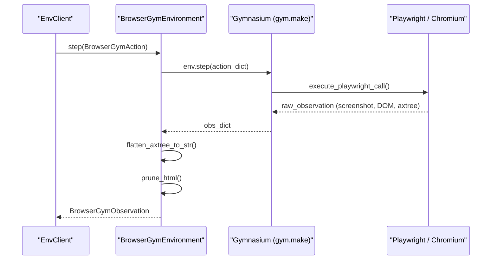
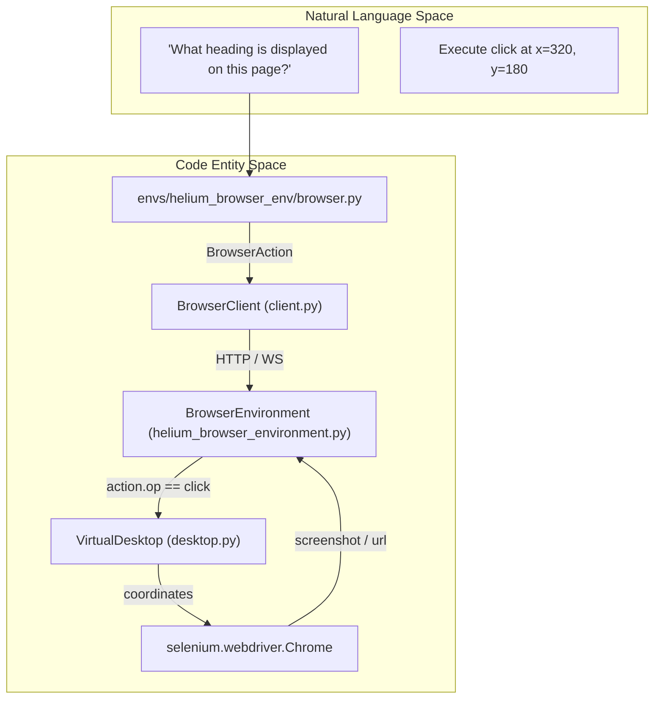
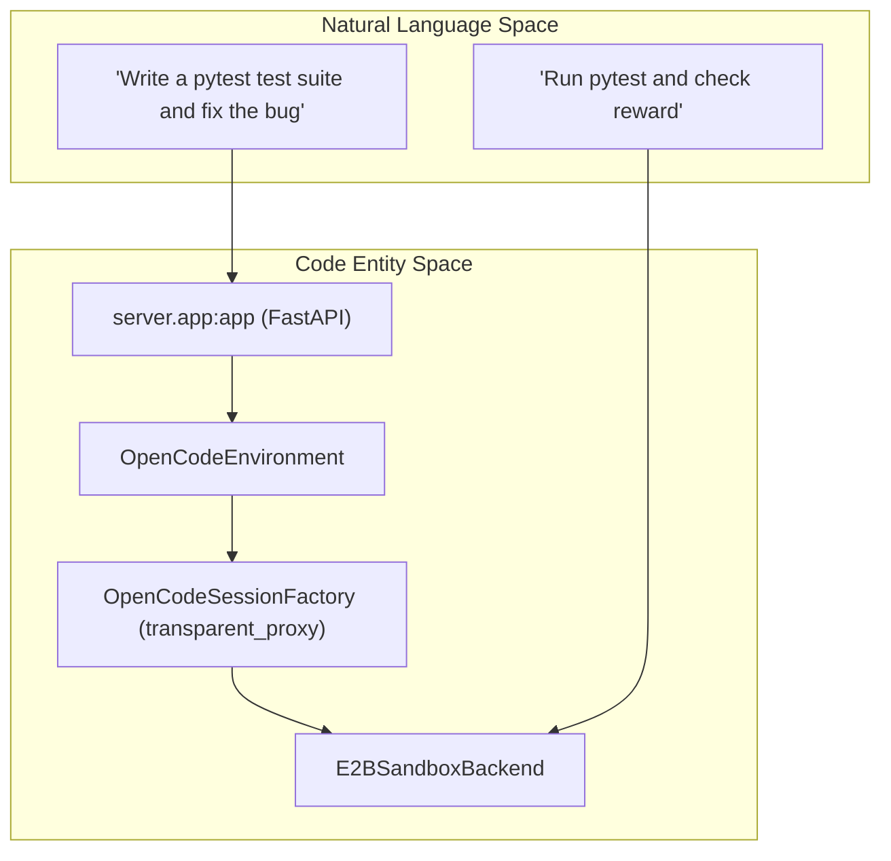

<!-- source: DeepWiki mcp.deepwiki.com · repo huggingface/OpenEnv · page 5.3 Web and Application Environments · fetched 2026-10-26 -->

# Web and Application Environments

Relevant source files

The following files were used as context for generating this wiki page:

- [docs/source/environments/chat.md](docs/source/environments/chat.md)
- [docs/source/environments/dipg.md](docs/source/environments/dipg.md)
- [docs/source/environments/finrl.md](docs/source/environments/finrl.md)
- [docs/source/environments/git.md](docs/source/environments/git.md)
- [docs/source/environments/helium_browser.md](docs/source/environments/helium_browser.md)
- [docs/source/environments/reasoning_gym.md](docs/source/environments/reasoning_gym.md)
- [docs/source/environments/repl.md](docs/source/environments/repl.md)
- [docs/source/environments/websearch.md](docs/source/environments/websearch.md)
- [envs/browsergym_env/server/Dockerfile](envs/browsergym_env/server/Dockerfile)
- [envs/browsergym_env/server/app.py](envs/browsergym_env/server/app.py)
- [envs/browsergym_env/server/browsergym_environment.py](envs/browsergym_env/server/browsergym_environment.py)
- [envs/helium_browser_env/README.md](envs/helium_browser_env/README.md)
- [envs/helium_browser_env/__init__.py](envs/helium_browser_env/__init__.py)
- [envs/helium_browser_env/browser.py](envs/helium_browser_env/browser.py)
- [envs/helium_browser_env/client.py](envs/helium_browser_env/client.py)
- [envs/helium_browser_env/hf_sandbox.py](envs/helium_browser_env/hf_sandbox.py)
- [envs/helium_browser_env/models.py](envs/helium_browser_env/models.py)
- [envs/helium_browser_env/openenv.yaml](envs/helium_browser_env/openenv.yaml)
- [envs/helium_browser_env/pyproject.toml](envs/helium_browser_env/pyproject.toml)
- [envs/helium_browser_env/server/Dockerfile](envs/helium_browser_env/server/Dockerfile)
- [envs/helium_browser_env/server/__init__.py](envs/helium_browser_env/server/__init__.py)
- [envs/helium_browser_env/server/helium_browser_environment.py](envs/helium_browser_env/server/helium_browser_environment.py)
- [examples/browsergym_trl_hf_sandbox.py](examples/browsergym_trl_hf_sandbox.py)
- [examples/hf_sandbox_coding_env.py](examples/hf_sandbox_coding_env.py)
- [src/openenv/core/containers/runtime/hf_sandbox_provider.py](src/openenv/core/containers/runtime/hf_sandbox_provider.py)
- [tests/envs/test_browsergym_observation_serialization.py](tests/envs/test_browsergym_observation_serialization.py)
- [tests/envs/test_browsergym_task_switch.py](tests/envs/test_browsergym_task_switch.py)
- [tests/envs/test_browsergym_threading.py](tests/envs/test_browsergym_threading.py)
- [tests/envs/test_helium_browser_environment.py](tests/envs/test_helium_browser_environment.py)

This page covers the Web and Application Environments in OpenEnv, which provide specialized sandboxes for agents to interact with browsers, authenticated enterprise applications, search engines, and cloud-based coding sandboxes. These environments leverage frameworks like **Playwright**, **Selenium**, **Helium**, and the **Model Context Protocol (MCP)** to bridge the gap between high-level agent instructions and low-level browser or system interactions.

---

## 1. BrowserGym Environment (`browsergym_env`)

`browsergym_env` is a wrapper around the **BrowserGym** framework, providing a unified OpenEnv interface to multiple web navigation benchmarks including **MiniWoB++**, **WebArena**, **VisualWebArena**, and **WorkArena** [envs/browsergym_env/server/browsergym_environment.py:1-9]().

### Implementation Details

The core class `BrowserGymEnvironment` inherits from the OpenEnv `Environment` base class [envs/browsergym_env/server/browsergym_environment.py:128-133](). Because browsergym/Playwright keeps a process-wide synchronous instance that must be accessed from the thread that started it, the environment enforces single-thread affinity via a module-level `ThreadPoolExecutor` (`_PLAYWRIGHT_THREAD`) with `max_workers=1` [envs/browsergym_env/server/browsergym_environment.py:32-40]().

**Key Functions:**
- `_on_playwright_thread`: Dispatches calls to the single-threaded Playwright executor [envs/browsergym_env/server/browsergym_environment.py:38-40]().
- `_get_axtree_txt`: Converts raw Accessibility Tree objects into flattened text for LLM consumption using `flatten_axtree_to_str` [envs/browsergym_env/server/browsergym_environment.py:64-87]().
- `_get_pruned_html`: Extracts and cleans DOM objects into pruned HTML strings to reduce token usage [envs/browsergym_env/server/browsergym_environment.py:90-114]().
- `reset()`: Rebuilds the underlying `gym.make` environment if the task changes, preserving episode parameters [tests/envs/test_browsergym_task_switch.py:102-139]().

### Data Flow: Browser Interaction

Sources: [envs/browsergym_env/server/browsergym_environment.py:38-114](), [tests/envs/test_browsergym_threading.py:52-78]()

---

## 2. Helium Browser Environment (`helium_browser_env`)

`helium_browser_env` provides an isolated Chromium browser environment driven by **Selenium** and **Helium** designed specifically to run inside Hugging Face Sandboxes (`BROWSER_SANDBOX=hf`) [envs/helium_browser_env/server/helium_browser_environment.py:1-53]().

### Implementation Details

The environment runs with a fixed 800x600 viewport geometry (`VIEWPORT_GEOMETRY = [800, 600, 1, 0, 0]`) to ensure screenshot pixels and click coordinates align correctly [envs/helium_browser_env/server/helium_browser_environment.py:46-49](). 

**Key Components:**
- `BrowserEnvironment`: Implements `reset`, `step`, `observe`, and cleanup using a temporary Chrome profile directory [envs/helium_browser_env/server/helium_browser_environment.py:46-175]().
- `VirtualDesktop`: Manages Xvfb and window focus within the sandbox container [envs/helium_browser_env/server/helium_browser_environment.py:18-19]().
- `BrowserAction`: Validated Pydantic model supporting operations: `click`, `type`, `key`, `scroll`, `back`, `wait`, `finish` [docs/source/environments/helium_browser.md:117-128]().

### Natural Language Space to Code Entity Space

The following diagram illustrates how natural language agent instructions map to the underlying OpenEnv and Selenium execution entities in `helium_browser_env`:

Sources: [envs/helium_browser_env/server/helium_browser_environment.py:111-167](), [envs/helium_browser_env/browser.py:23-67](), [docs/source/environments/helium_browser.md:105-115]()

---

## 3. OpenApp Environment (`openapp_env`)

`openapp_env` focuses on authenticated application automation, specifically targeting the **OpenApps** suite (Calendar, Todo, Editor, Messages) [envs/openapp_env/example_usage.py:123-125](). It is designed for reinforcement learning training where agents must perform multi-step workflows across distinct application states [envs/openapp_env/example_usage.py:131-186]().

### Action Types & State

The `OpenAppAction` model supports several interaction primitives [envs/openapp_env/example_usage.py:60-111]():
- `goto`: Navigate to a specific URL.
- `click`: Interact with an element via its BrowserGym element ID (`bid`).
- `fill`: Input text into a form field.
- `select_option`: Choose from a dropdown.
- `noop`: Observe the current state without acting.

Observations in `openapp_env` include standard web fields (HTML, URL, Screenshot) combined with an `app_state` field containing structured data from the target application (e.g., active calendar events or todo items) [envs/openapp_env/example_usage.py:119-126]().

Sources: [envs/openapp_env/example_usage.py:60-129]()

---

## 4. OpenCode Environment (`opencode_env`)

`opencode_env` provides an isolated coding sandbox using the **E2B** SDK. It is optimized for **GRPO (Group Relative Policy Optimization)** training by capturing per-token logprobs during agent rollouts [envs/opencode_env/README.md:15-19]().

### System Architecture & Natural Language Mapping

Sources: [envs/opencode_env/README.md:30-41](), [envs/opencode_env/server/gradio_ui.py:7-23]()

### The `run_rollout` Tool

The primary interface is the `run_rollout` MCP tool, which accepts a `Task` specification [envs/opencode_env/README.md:30-32]():
- `instruction`: The prompt for the agent.
- `setup`: Bash commands to prepare the sandbox (e.g., `pip install`).
- `verify`: Bash commands to evaluate the agent's work (e.g., `pytest`).

Rewards are calculated based on `passed_verify / total_verify` or custom outputs written to `/home/user/logs/verifier/reward.txt` [envs/opencode_env/README.md:40-41]().

Sources: [envs/opencode_env/README.md:15-41](), [envs/opencode_env/server/gradio_ui.py:109-150]()

---

## 5. WebSearch Environment (`websearch_env`)

`websearch_env` provides a simplified interface for agents to perform web searches and retrieve page content via the Google Search API (using Serper.dev) [docs/source/environments/websearch.md:1-5]().

### Core Logic & Observation Structure

- **Prerequisites**: Requires a `SERPER_API_KEY` environment variable or Space secret [docs/source/environments/websearch.md:8-31]().
- **Reset**: Clears search history and resets step counters [docs/source/environments/websearch.md:44-46]().
- **Step**: Takes a `WebSearchAction` with a `query`, executes the search, and returns a `WebSearchObservation` containing `web_contents` and formatted `content` [docs/source/environments/websearch.md:51-54]().

| Field | Type | Description |
| :--- | :--- | :--- |
| `web_contents` | `list` | List of top-ranked web search results (titles, snippets, links). |
| `content` | `str` | Aggregated text prompt combining query and web contents. |
| `metadata` | `dict` | Includes step counts and execution details. |

Sources: [docs/source/environments/websearch.md:1-103]()

---

