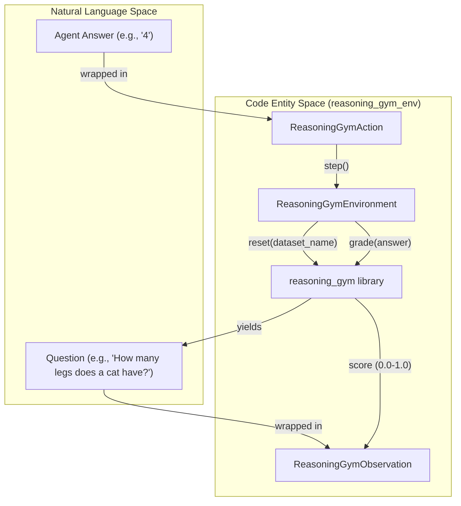
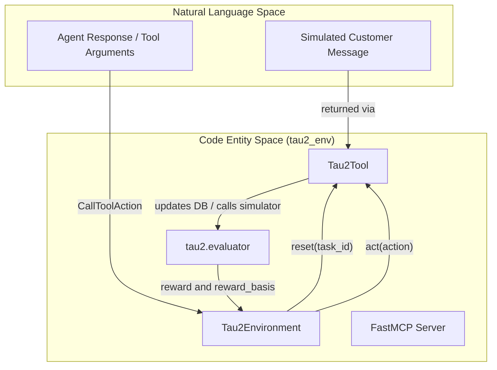
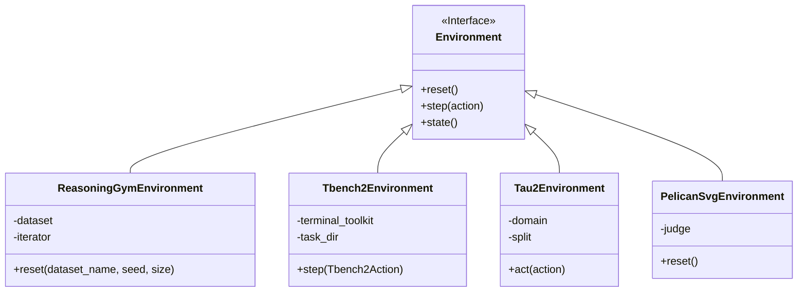

<!-- source: DeepWiki mcp.deepwiki.com · repo huggingface/OpenEnv · page 5.4 RL Benchmark and Reasoning Environments · fetched 2026-10-26 -->

# RL Benchmark and Reasoning Environments

Relevant source files

The following files were used as context for generating this wiki page:

- [docs/source/environments/tau2.md](docs/source/environments/tau2.md)
- [docs/source/environments/tbench2.md](docs/source/environments/tbench2.md)
- [envs/chess_env/uv.lock](envs/chess_env/uv.lock)
- [envs/coding_env/uv.lock](envs/coding_env/uv.lock)
- [envs/finqa_env/.openenvignore](envs/finqa_env/.openenvignore)
- [envs/finqa_env/README.md](envs/finqa_env/README.md)
- [envs/finqa_env/__init__.py](envs/finqa_env/__init__.py)
- [envs/finqa_env/client.py](envs/finqa_env/client.py)
- [envs/finqa_env/download_data.sh](envs/finqa_env/download_data.sh)
- [envs/finqa_env/models.py](envs/finqa_env/models.py)
- [envs/finqa_env/pyproject.toml](envs/finqa_env/pyproject.toml)
- [envs/finqa_env/server/Dockerfile](envs/finqa_env/server/Dockerfile)
- [envs/finqa_env/uv.lock](envs/finqa_env/uv.lock)
- [envs/julia_env/uv.lock](envs/julia_env/uv.lock)
- [envs/pelican_svg_env/pyproject.toml](envs/pelican_svg_env/pyproject.toml)
- [envs/pelican_svg_env/server/geometry.py](envs/pelican_svg_env/server/geometry.py)
- [envs/pelican_svg_env/server/pelican_svg_environment.py](envs/pelican_svg_env/server/pelican_svg_environment.py)
- [envs/pelican_svg_env/server/scoring.py](envs/pelican_svg_env/server/scoring.py)
- [envs/pelican_svg_env/server/structure.py](envs/pelican_svg_env/server/structure.py)
- [envs/pelican_svg_env/server/tasks.py](envs/pelican_svg_env/server/tasks.py)
- [envs/pelican_svg_env/server/vision_judge.py](envs/pelican_svg_env/server/vision_judge.py)
- [envs/qed_math_env/pyproject.toml](envs/qed_math_env/pyproject.toml)
- [envs/qed_math_env/server/rubric.py](envs/qed_math_env/server/rubric.py)
- [envs/qed_math_env/uv.lock](envs/qed_math_env/uv.lock)
- [envs/reasoning_gym_env/.dockerignore](envs/reasoning_gym_env/.dockerignore)
- [envs/reasoning_gym_env/README.md](envs/reasoning_gym_env/README.md)
- [envs/reasoning_gym_env/__init__.py](envs/reasoning_gym_env/__init__.py)
- [envs/reasoning_gym_env/client.py](envs/reasoning_gym_env/client.py)
- [envs/reasoning_gym_env/models.py](envs/reasoning_gym_env/models.py)
- [envs/reasoning_gym_env/openenv.yaml](envs/reasoning_gym_env/openenv.yaml)
- [envs/reasoning_gym_env/pyproject.toml](envs/reasoning_gym_env/pyproject.toml)
- [envs/reasoning_gym_env/server/Dockerfile](envs/reasoning_gym_env/server/Dockerfile)
- [envs/reasoning_gym_env/server/__init__.py](envs/reasoning_gym_env/server/__init__.py)
- [envs/reasoning_gym_env/server/app.py](envs/reasoning_gym_env/server/app.py)
- [envs/reasoning_gym_env/server/reasoning_gym_environment.py](envs/reasoning_gym_env/server/reasoning_gym_environment.py)
- [envs/reasoning_gym_env/server/requirements.txt](envs/reasoning_gym_env/server/requirements.txt)
- [envs/tau2_env/.dockerignore](envs/tau2_env/.dockerignore)
- [envs/tau2_env/README.md](envs/tau2_env/README.md)
- [envs/tau2_env/openenv.yaml](envs/tau2_env/openenv.yaml)
- [envs/tau2_env/server/Dockerfile](envs/tau2_env/server/Dockerfile)
- [envs/tau2_env/server/app.py](envs/tau2_env/server/app.py)
- [envs/tau2_env/server/gradio_ui.py](envs/tau2_env/server/gradio_ui.py)
- [envs/tau2_env/server/task_view.py](envs/tau2_env/server/task_view.py)
- [envs/tau2_env/server/tau2_environment.py](envs/tau2_env/server/tau2_environment.py)
- [envs/tau2_env/uv.lock](envs/tau2_env/uv.lock)
- [envs/tbench2_env/README.md](envs/tbench2_env/README.md)
- [envs/tbench2_env/__init__.py](envs/tbench2_env/__init__.py)
- [envs/tbench2_env/client.py](envs/tbench2_env/client.py)
- [envs/tbench2_env/models.py](envs/tbench2_env/models.py)
- [envs/tbench2_env/openenv.yaml](envs/tbench2_env/openenv.yaml)
- [envs/tbench2_env/pyproject.toml](envs/tbench2_env/pyproject.toml)
- [envs/tbench2_env/server/Dockerfile](envs/tbench2_env/server/Dockerfile)
- [envs/tbench2_env/server/__init__.py](envs/tbench2_env/server/__init__.py)
- [envs/tbench2_env/server/app.py](envs/tbench2_env/server/app.py)
- [envs/tbench2_env/server/tbench2_env_environment.py](envs/tbench2_env/server/tbench2_env_environment.py)
- [examples/pelican_svg_eval.py](examples/pelican_svg_eval.py)
- [examples/pelican_svg_grpo.py](examples/pelican_svg_grpo.py)
- [tests/envs/mock_dataset.jsonl](tests/envs/mock_dataset.jsonl)
- [tests/envs/test_browsergym_environment.py](tests/envs/test_browsergym_environment.py)
- [tests/envs/test_browsergym_models.py](tests/envs/test_browsergym_models.py)
- [tests/envs/test_connect4_env.py](tests/envs/test_connect4_env.py)
- [tests/envs/test_dipg_client.py](tests/envs/test_dipg_client.py)
- [tests/envs/test_dipg_environment.py](tests/envs/test_dipg_environment.py)
- [tests/envs/test_pelican_svg_env.py](tests/envs/test_pelican_svg_env.py)
- [tests/envs/test_qed_math_environment.py](tests/envs/test_qed_math_environment.py)
- [tests/envs/test_reasoning_gym_environment.py](tests/envs/test_reasoning_gym_environment.py)
- [tests/envs/test_tau2_env.py](tests/envs/test_tau2_env.py)
- [tests/envs/test_tbench2_env.py](tests/envs/test_tbench2_env.py)
- [tests/envs/test_websockets.py](tests/envs/test_websockets.py)

This page covers the specialized RL benchmark and reasoning environments integrated into OpenEnv. These environments span procedural logic and mathematical puzzles, OS-level terminal tool use, customer service multi-turn dialogue benchmarks (`tau2_env`), spatial visual grounding and SVG generation (`pelican_svg_env`), high-stakes medical safety verification (`dipg_safety_env`), financial reasoning (`finqa_env`, `finrl_env`), and kernel optimization (`kernrl`).

---

## Reasoning Gym Environment (`reasoning_gym_env`)

The `ReasoningGymEnvironment` integrates the [Reasoning Gym](https://github.com/open-thought/reasoning-gym) library to provide procedural reasoning tasks. It is designed for single-step episodes where an agent receives a question and submits a verifiable answer [envs/reasoning_gym_env/README.md:16-18]().

### Implementation Details
The environment supports simple datasets and composite datasets where multiple reasoning tasks are combined with specific weights [envs/reasoning_gym_env/README.md:139-160](). The dataset persists across `reset()` calls to allow sequential iteration through questions until configuration parameters change [envs/reasoning_gym_env/README.md:164-178]().

*   **`ReasoningGymEnvironment`**: Manages the procedural dataset and generator state.
*   **`ReasoningGymAction`**: Encapsulates the agent's string-based `answer` [envs/reasoning_gym_env/README.md:93-97]().
*   **`ReasoningGymObservation`**: Returns the `question`, `score` (0.0 to 1.0), `correct_answer`, and `dataset_metadata` [envs/reasoning_gym_env/README.md:99-108]().

### Data Flow: Reasoning Task Execution
Title: Reasoning Gym Step Flow

Sources: [envs/reasoning_gym_env/README.md:31-46]()

---

## Terminal-Bench 2 Environment (`tbench2_env`)

The `tbench2_env` provides an OpenEnv wrapper for [Terminal-Bench 2](https://github.com/laude-institute/terminal-bench-2) tasks, focusing on OS-level tool use and terminal interaction [envs/tbench2_env/README.md:16-18]().

### Execution Modes
The environment supports two backends [envs/tbench2_env/README.md:20-23]():
1.  **Local Mode**: Commands execute directly in the server process using `TerminalToolkit` from `camel-ai`. Ideal for Hugging Face Spaces where Docker-in-Docker is unavailable [envs/tbench2_env/README.md:104-116]().
2.  **Docker Mode**: Each task runs in an isolated container using the image specified in `task.toml`. Scoring utilizes the task's canonical `tests/test.sh` script [envs/tbench2_env/README.md:119-125]().

### Budgets and Verification
`reset()` reports execution time budgets in `info` (`verifier_timeout_sec`, `command_timeout_s`) so clients can establish per-message deadlines [envs/tbench2_env/README.md:82-88](). Actions include `exec`, `write`, `view`, `wait`, `kill`, `write_file`, `evaluate`, and `close` [envs/tbench2_env/README.md:136-148]().

Sources: [envs/tbench2_env/README.md:16-173](), [envs/tbench2_env/server/tbench2_env_environment.py:80-96]()

---

## $\tau^2$-bench Environment (`tau2_env`)

`tau2_env` models customer-service dialogues as interactive Model Context Protocol (MCP) environments [envs/tau2_env/server/tau2_environment.py:7-24]().

### Core Architecture
Each episode represents a task in a domain (e.g., `airline`, `retail`, `telecom`, `banking_knowledge`) where the agent interacts with an LLM-simulated user [envs/tau2_env/server/tau2_environment.py:154-174]().
*   **Domain Tools**: Read and write the task database (e.g., `get_user_details`, `book_reservation`) [envs/tau2_env/server/tau2_environment.py:11-14]().
*   **`respond_to_user(message)`**: Sends a message to the simulated customer and returns their reply [envs/tau2_env/server/tau2_environment.py:15-16]().
*   **`done()`**: Terminates the conversation [envs/tau2_env/server/tau2_environment.py:17-18]().

Evaluation relies on $\tau^2$-bench's built-in evaluator, which assesses database state and natural-language assertions upon episode completion [envs/tau2_env/server/tau2_environment.py:19-24]().

### Data Flow: Dialogue and Tool Execution
Title: Tau2 Environment MCP Execution Flow

Sources: [envs/tau2_env/server/tau2_environment.py:130-143](), [tests/envs/test_tau2_env.py:64-92]()

---

## Pelican SVG Drawing Environment (`pelican_svg_env`)

`PelicanSvgEnvironment` tasks models with generating SVG code depicting animals riding vehicles (defaulting to a pelican riding a bicycle) [envs/pelican_svg_env/server/pelican_svg_environment.py:55-66]().

### Implementation and Scoring
Episodes consist of a single exchange: `reset()` outputs the prompt, and `step()` submits raw SVG text [envs/pelican_svg_env/server/pelican_svg_environment.py:5-10]().
*   **Source Gate (`inspect_source`)**: Rejects bad-faith submissions containing data-URI rasters, external references, forbidden scripts, or text labels naming the subject [tests/envs/test_pelican_svg_env.py:103-146]().
*   **Deterministic Evaluation**: Measures ink fraction, structural shape composition, and geometric properties using `resvg-py` rendering [tests/envs/test_pelican_svg_env.py:167-181]().
*   **Vision Judge**: Optional semantic scoring via a multimodal LLM client (`VisionJudge`) when an `HF_TOKEN` is present [envs/pelican_svg_env/server/pelican_svg_environment.py:30-50]().

Sources: [tests/envs/test_pelican_svg_env.py:1-183](), [envs/pelican_svg_env/server/pelican_svg_environment.py:52-111]()

---

## DIPG Safety Environment (`dipg_safety_env`)

`dipg_safety_env` evaluates LLMs on high-stakes clinical data regarding Diffuse Intrinsic Pontine Glioma (DIPG) [tests/envs/test_dipg_environment.py:1-16]().
*   **Action (`DIPGAction`)**: Accepts structured LLM outputs containing analysis and final answer channels [tests/envs/test_dipg_environment.py:109-112]().
*   **Throughput Scaling**: During RL training (GRPO), environment servers deploy with **Gunicorn** and multiple **Uvicorn workers** to handle high-frequency evaluation requests without timeouts [tests/envs/test_dipg_environment.py:44-53]().

Sources: [tests/envs/test_dipg_environment.py:1-124]()

---

## Other RL Benchmarks & Reasoning Environments

*   **`kernrl`**: GPU kernel optimization environment where agents write CUDA/Triton kernels. Rewards are computed based on execution speedup over PyTorch reference implementations, penalizing compilation or correctness failures [README.md]().
*   **`finrl_env` & `finqa_env`**: Quantitative finance environments handling portfolio optimization, automated trading, and numerical reasoning over financial reports [README.md]().
*   **`qed_math_env`**: Mathematical reasoning benchmark environment validating formal mathematical step proofs.
*   **`sophistry_bench_sprint_env`**: Sprint-based reasoning benchmark evaluating logical consistency and debate robustness.

---

## Environment Class Mapping
Title: RL Environment Class Hierarchy

Sources: [envs/reasoning_gym_env/server/reasoning_gym_environment.py:33](), [envs/tbench2_env/server/tbench2_env_environment.py:97](), [envs/tau2_env/server/tau2_environment.py:154](), [envs/pelican_svg_env/server/pelican_svg_environment.py:52]()

Sources: [envs/reasoning_gym_env/server/reasoning_gym_environment.py](), [envs/tbench2_env/server/tbench2_env_environment.py](), [envs/tau2_env/server/tau2_environment.py](), [envs/pelican_svg_env/server/pelican_svg_environment.py](), [tests/envs/test_dipg_environment.py]()

---

