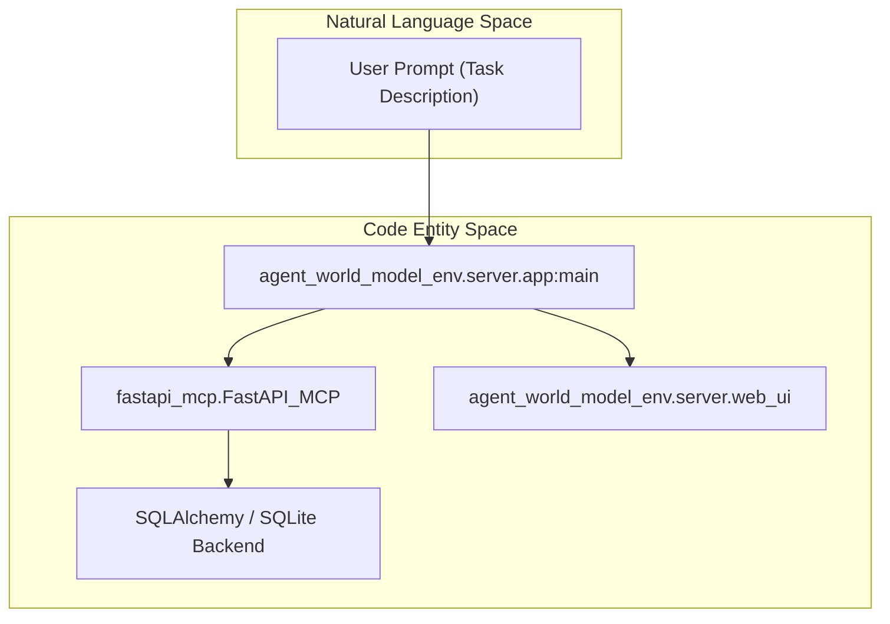
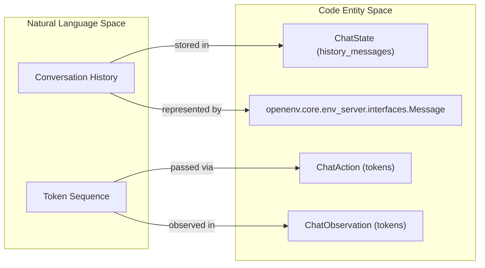

<!-- source: DeepWiki mcp.deepwiki.com · repo huggingface/OpenEnv · page 5.5 Agentic Tool-Use and World Model Environments · fetched 2026-10-26 -->

# Agentic Tool-Use and World Model Environments

Relevant source files

The following files were used as context for generating this wiki page:

- [docs/source/environments/calendar.md](docs/source/environments/calendar.md)
- [docs/source/environments/coding.md](docs/source/environments/coding.md)
- [docs/source/environments/echo.md](docs/source/environments/echo.md)
- [docs/source/environments/unity.md](docs/source/environments/unity.md)
- [envs/agent_world_model_env/pyproject.toml](envs/agent_world_model_env/pyproject.toml)
- [envs/agent_world_model_env/uv.lock](envs/agent_world_model_env/uv.lock)
- [envs/browsergym_env/uv.lock](envs/browsergym_env/uv.lock)
- [envs/calendar_env/Dockerfile](envs/calendar_env/Dockerfile)
- [envs/calendar_env/README.md](envs/calendar_env/README.md)
- [envs/calendar_env/client_notebooks/OpenEnv_and_mcp_Single_Gym_Client_Meta_Turing.ipynb](envs/calendar_env/client_notebooks/OpenEnv_and_mcp_Single_Gym_Client_Meta_Turing.ipynb)
- [envs/calendar_env/mcp_databases/seed_store.db](envs/calendar_env/mcp_databases/seed_store.db)
- [envs/chat_env/README.md](envs/chat_env/README.md)
- [envs/chess_env/README.md](envs/chess_env/README.md)
- [envs/coding_env/README.md](envs/coding_env/README.md)
- [envs/echo_env/README.md](envs/echo_env/README.md)
- [envs/finrl_env/uv.lock](envs/finrl_env/uv.lock)
- [envs/jupyter_env/uv.lock](envs/jupyter_env/uv.lock)
- [envs/openapp_env/uv.lock](envs/openapp_env/uv.lock)
- [envs/repl_env/uv.lock](envs/repl_env/uv.lock)
- [envs/snake_env/uv.lock](envs/snake_env/uv.lock)
- [envs/sumo_rl_env/uv.lock](envs/sumo_rl_env/uv.lock)
- [envs/terminus_env/uv.lock](envs/terminus_env/uv.lock)
- [envs/unity_env/README.md](envs/unity_env/README.md)
- [envs/unity_env/server/unity_environment.py](envs/unity_env/server/unity_environment.py)
- [envs/websearch_env/uv.lock](envs/websearch_env/uv.lock)
- [envs/wildfire_env/uv.lock](envs/wildfire_env/uv.lock)
- [src/openenv/core/containers/__init__.py](src/openenv/core/containers/__init__.py)
- [src/openenv/core/containers/test_local_docker_provider.py](src/openenv/core/containers/test_local_docker_provider.py)
- [src/openenv/core/env_server/base_transforms.py](src/openenv/core/env_server/base_transforms.py)
- [src/openenv/core/tools/__init__.py](src/openenv/core/tools/__init__.py)
- [src/openenv/core/tools/git_server_client.py](src/openenv/core/tools/git_server_client.py)
- [src/openenv/core/tools/local_python_executor.py](src/openenv/core/tools/local_python_executor.py)
- [tests/core/test_git_server_client.py](tests/core/test_git_server_client.py)
- [tests/envs/test_unity_ports.py](tests/envs/test_unity_ports.py)
- [tests/envs/test_unity_web_playground.py](tests/envs/test_unity_web_playground.py)

This page provides comprehensive technical documentation for environments designed specifically for evaluating agentic reasoning, tool-use proficiency, and interaction with complex world models within OpenEnv. These environments span synthetic tool-use scenario generators, protocol-compliant MCP integrations (such as calendar scheduling), communication protocols, version-control systems, simulation echo backends, and physical game/simulation engines like Unity.

---

## 1. Agent World Model (AWM) Environment

The `agent_world_model_env` (AWM) is a high-scale simulation and benchmarking environment containing over 1,000 LLM-synthesized tool-use scenarios [envs/agent_world_model_env/pyproject.toml:8](). It stress-tests an agent's ability to navigate diverse, dynamically generated APIs and verify its operational results across multiple verification modalities.

### Implementation and Verification Modes
AWM supports multiple verification backends to ensure programmatic correctness:
*   **SQL Verification**: Interacts with a `sqlalchemy` relational backend [envs/agent_world_model_env/uv.lock:31]() to verify state mutations and database assertions.
*   **Code Verification**: Executes sandboxed code checks to confirm runtime state changes.
*   **Tool-Use Scenarios**: Complex multi-step tool graphs exposed via `fastapi-mcp` [envs/agent_world_model_env/uv.lock:45]().

### AWM Data Flow and Architecture

**AWM Data Flow: Natural Language to Tool Execution**

Sources: [envs/agent_world_model_env/pyproject.toml:33](), [envs/agent_world_model_env/uv.lock:45-56]()

---

## 2. Calendar Environment

The `calendar_env` implements a Model Context Protocol (MCP) server designed for organizational and scheduling workloads. It combines protocol-compliant tool handling with persistent relational storage to model real-world calendar management.

### Key Components
*   **MCP Integration**: Exposes tools for creating, updating, searching, and deleting calendar entries via JSON-RPC 2.0 transports.
*   **Database Seeding**: Initializes environments using a pre-populated SQLite database (`seed_store.db`) [envs/calendar_env/mcp_databases/seed_store.db:1](), ensuring consistent initial scheduling states across evaluation runs.
*   **Container and Client Design**: Packages service dependencies inside `envs/calendar_env/Dockerfile:1` and exposes synchronous/asynchronous interaction clients.

Sources: [envs/calendar_env/mcp_databases/seed_store.db:1](), [envs/calendar_env/Dockerfile:1]()

---

## 3. Chat and Communication Environments

Communication-focused environments prioritize message history tracking, tokenization, and dialogue state management for fine-tuning conversational agents.

### Chat Environment (`chat_env`)
`chat_env` provides a low-level interface for managing conversational histories and token flows.
*   **`ChatAction`**: Encapsulates model outputs via `tokens`, incorporating a `_coerce_tokens` validator to normalize lists, tuples, or tensor representations [envs/chat_env/models.py:36-51]().
*   **`ChatState`**: Tracks `history_messages` (as `Message` structures) and `history_tokens` (as integer arrays) [envs/chat_env/models.py:54-58]().
*   **`ChatObservation`**: Exposes structured conversation states in HuggingFace-compatible dialogue schemas alongside raw tokenized indices [envs/chat_env/models.py:61-78]().

### TextArena Integration (`textarena_env`)
OpenEnv wraps `TextArena` to provide multi-agent text-based game environments (e.g., Wordle).
*   **`TextArenaAction`**: Represents single-string or structured message actions [envs/textarena_env/models.py:30-33]().
*   **`TextArenaObservation`**: Contains `prompt`, participant message logs (`messages`), and active participant identifiers (`legal_players`) [envs/textarena_env/models.py:36-43]().

**Entity Mapping: Conversational Models to State**

Sources: [envs/chat_env/models.py:14-78](), [envs/textarena_env/models.py:18-43]()

---

## 4. Git and Version Control Environments

The `git_env` simulates version-control workflows, allowing coding agents to issue commands like `commit`, `branch`, `merge`, and `checkout` against isolated filesystem repositories. 
*   **`GitServerClient`**: Manages communication with backend Git servers (such as Gitea instances), optimizing task isolation by sharing a central server while maintaining independent local workspaces and performing fast resets via git operations [src/openenv/core/tools/git_server_client.py:33-75]().

Sources: [src/openenv/core/tools/git_server_client.py:33-125]()

---

## 5. Echo and Testing World Model Environments

The `echo_env` serves as a lightweight, deterministic testing backend for OpenEnv infrastructure validation. It echoes back actions, inputs, and state configurations without invoking heavy external simulation loops, making it ideal for unit testing client-server communication pipelines, WebSocket event loops, and mock agent harnesses.

Sources: [envs/echo_env/README.md:1-1]()

---

## 6. Unity ML-Agents Environment

The `unity_env` wraps the Unity ML-Agents toolkit to provide 3D physics and simulation environments (such as `PushBlock`, `3DBall`, `GridWorld`, and `Basic`) inside OpenEnv [envs/unity_env/server/unity_environment.py:92-125]().

### Architecture and Execution Modes
*   **Environment Management**: Manages binary execution, headless graphics rendering (`UNITY_NO_GRAPHICS`), time scaling (`UNITY_TIME_SCALE`), and local caching (`~/.mlagents-cache/`) [envs/unity_env/README.md:35-44]().
*   **Action Spaces**: Supports both discrete vector actions (e.g., movement indices) and continuous platform controls [envs/unity_env/README.md:115-121]().

Sources: [envs/unity_env/server/unity_environment.py:92-185](), [envs/unity_env/README.md:35-147]()

---

## 7. LLM Client and Tool-Calling Support

All agentic and tool-use environments integrate with OpenEnv's shared model provider infrastructure.
*   **`LLMClient` and `OpenAIClient`**: Abstract REST/gRPC interactions with model endpoints, offering `complete_with_tools` to parse MCP schema bindings and map them to provider tool calls [src/openenv/core/llm_client.py:70-125]().
*   **`LLMJudge`**: Evaluates agent trajectories using secondary LLM scoring models when programmatic assertions are insufficient [src/openenv/core/rubrics/llm_judge.py:1]().

Sources: [src/openenv/core/llm_client.py:37-184](), [src/openenv/core/rubrics/llm_judge.py:1]()

---

