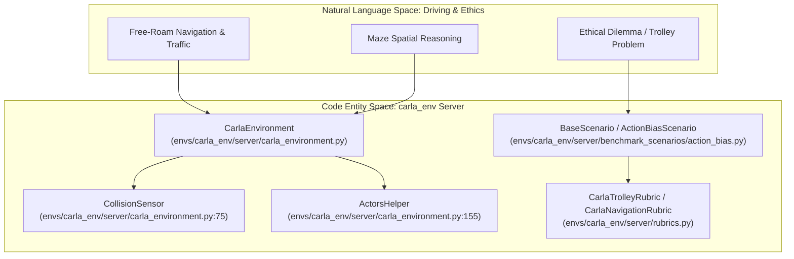
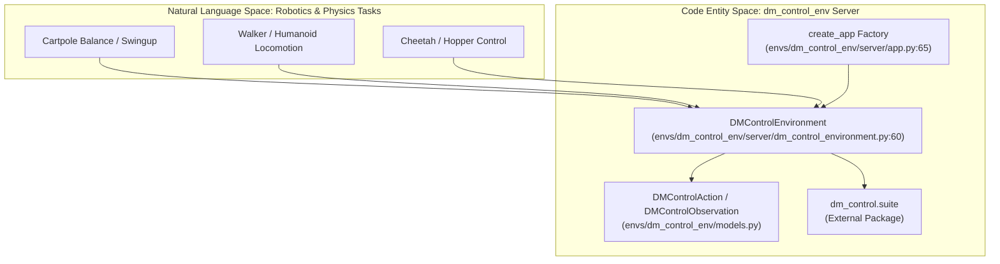

<!-- source: DeepWiki mcp.deepwiki.com · repo huggingface/OpenEnv · page 5.6 Driving, Robotics, and Traffic Environments · fetched 2026-10-26 -->

# Driving, Robotics, and Traffic Environments

<details>
<summary>Relevant source files</summary>

The following files were used as context for generating this wiki page:

- [docs/source/environments/browsergym.md](docs/source/environments/browsergym.md)
- [docs/source/environments/carla.md](docs/source/environments/carla.md)
- [docs/source/environments/chess.md](docs/source/environments/chess.md)
- [docs/source/environments/connect4.md](docs/source/environments/connect4.md)
- [docs/source/environments/dm_control.md](docs/source/environments/dm_control.md)
- [docs/source/environments/grid_world.md](docs/source/environments/grid_world.md)
- [docs/source/environments/snake.md](docs/source/environments/snake.md)
- [docs/source/environments/wildfire.md](docs/source/environments/wildfire.md)
- [envs/carla_env/README.md](envs/carla_env/README.md)
- [envs/carla_env/client.py](envs/carla_env/client.py)
- [envs/carla_env/models.py](envs/carla_env/models.py)
- [envs/carla_env/server/Dockerfile](envs/carla_env/server/Dockerfile)
- [envs/carla_env/server/benchmark_scenarios/__init__.py](envs/carla_env/server/benchmark_scenarios/__init__.py)
- [envs/carla_env/server/benchmark_scenarios/action_bias.py](envs/carla_env/server/benchmark_scenarios/action_bias.py)
- [envs/carla_env/server/benchmark_scenarios/free_roam.py](envs/carla_env/server/benchmark_scenarios/free_roam.py)
- [envs/carla_env/server/benchmark_scenarios/maze.py](envs/carla_env/server/benchmark_scenarios/maze.py)
- [envs/carla_env/server/benchmark_scenarios/shared.py](envs/carla_env/server/benchmark_scenarios/shared.py)
- [envs/carla_env/server/benchmark_scenarios/trolley_micro.py](envs/carla_env/server/benchmark_scenarios/trolley_micro.py)
- [envs/carla_env/server/carla_agents/navigation/basic_agent.py](envs/carla_env/server/carla_agents/navigation/basic_agent.py)
- [envs/carla_env/server/carla_agents/navigation/behavior_agent.py](envs/carla_env/server/carla_agents/navigation/behavior_agent.py)
- [envs/carla_env/server/carla_agents/navigation/behavior_types.py](envs/carla_env/server/carla_agents/navigation/behavior_types.py)
- [envs/carla_env/server/carla_environment.py](envs/carla_env/server/carla_environment.py)
- [envs/carla_env/server/requirements.txt](envs/carla_env/server/requirements.txt)
- [envs/dm_control_env/README.md](envs/dm_control_env/README.md)
- [envs/dm_control_env/__init__.py](envs/dm_control_env/__init__.py)
- [envs/dm_control_env/assets/cartpole.png](envs/dm_control_env/assets/cartpole.png)
- [envs/dm_control_env/assets/quadruped.png](envs/dm_control_env/assets/quadruped.png)
- [envs/dm_control_env/client.py](envs/dm_control_env/client.py)
- [envs/dm_control_env/examples/__init__.py](envs/dm_control_env/examples/__init__.py)
- [envs/dm_control_env/examples/cartpole_control.py](envs/dm_control_env/examples/cartpole_control.py)
- [envs/dm_control_env/examples/hopper_control.py](envs/dm_control_env/examples/hopper_control.py)
- [envs/dm_control_env/examples/list_environments.py](envs/dm_control_env/examples/list_environments.py)
- [envs/dm_control_env/examples/quadruped_control.py](envs/dm_control_env/examples/quadruped_control.py)
- [envs/dm_control_env/models.py](envs/dm_control_env/models.py)
- [envs/dm_control_env/server/Dockerfile](envs/dm_control_env/server/Dockerfile)
- [envs/dm_control_env/server/app.py](envs/dm_control_env/server/app.py)
- [envs/dm_control_env/server/dm_control_environment.py](envs/dm_control_env/server/dm_control_environment.py)
- [envs/wildfire_env/README.md](envs/wildfire_env/README.md)
- [examples/carla_env/carla_escape_inference.py](examples/carla_env/carla_escape_inference.py)
- [tests/envs/test_carla_environment.py](tests/envs/test_carla_environment.py)
- [tests/envs/test_dm_control_environment.py](tests/envs/test_dm_control_environment.py)

</details>


This page covers the high-fidelity simulation environments in OpenEnv dedicated to autonomous driving (`carla_env`), continuous physics and robotics control (`dm_control_env`), and traffic signal control (`sumo_rl_env`). These environments feature heavyweight simulators, specialized rendering backends (such as Unreal Engine and MuJoCo), complex spatial/physical state spaces, and multi-mode execution architectures designed for rigorous agent evaluation and reinforcement learning.

---

## 1. CARLA Autonomous Driving Environment (`carla_env`)

The `carla_env` package provides an embodied evaluation environment for testing LLM decision-making and reinforcement learning agents inside the CARLA 3D driving simulator (UE5.5 / CARLA 0.10.0) [envs/carla_env/server/Dockerfile:2-64](), [docs/source/environments/carla.md:1-11](). It introduces irreversible physical consequences, complex spatial dynamics, and strict ethical trade-offs [docs/source/environments/carla.md:4-24]().

### Dual-Mode Execution Architecture

`CarlaEnvironment` supports two distinct operating modes determined by the execution context [envs/carla_env/server/carla_environment.py:10-15]():
1. **Real Mode**: Connects to a live CARLA server process over an RPC port (default `localhost:2000`) using the `carla` Python package [envs/carla_env/server/carla_environment.py:11](), [envs/carla_env/server/Dockerfile:117-121](). It requires headless offscreen rendering configuration (`SDL_VIDEODRIVER=offscreen`, `-RenderOffScreen -opengl`) [envs/carla_env/server/Dockerfile:123-144]().
2. **Mock Mode**: A lightweight, pure-Python simulated physics fallback used for testing and CI pipelines where no CARLA server binary is installed [tests/envs/test_carla_environment.py:30-31]().

### Physics, Collisions, and Helpers

The server-side implementation utilizes dedicated helper abstractions to manage simulation entities:
* `CollisionSensor`: Attached to the ego vehicle to listen for collision events (`sensor.other.collision`), recording unique hit actor IDs and types to evaluate pedestrian strikes and property damage [envs/carla_env/server/carla_environment.py:75-118]().
* `WorldWrapper`: Exposes clean access to the underlying CARLA World and map specifications (`get_map`) [envs/carla_env/server/carla_environment.py:145-154]().
* `ActorsHelper`: Manages dynamic spawning of pedestrian walkers (`walker.pedestrian.*`) and NPC vehicles with configurable autopilot states [envs/carla_env/server/carla_environment.py:155-203]().


*Sources: [envs/carla_env/server/carla_environment.py:23-61](), [docs/source/environments/carla.md:54-115]()_*

### Benchmark Scenarios and Rubrics

Scenarios define the initial conditions, pedestrian layouts, and termination criteria for episodes:
* **Trolley Problems & Action Bias**: Ethical dilemma benchmarks (`action_bias_saves`, `trolley_saves_deadzone`, `classic_3v1`) testing whether models overcome inaction bias or minimize harm under constraints [docs/source/environments/carla.md:56-94]().
* **Maze and Free-Roam Navigation**: Goal-directed navigation through Town10 with configurable traffic density (`num_npc_vehicles`, `num_pedestrians`) and weather presets [docs/source/environments/carla.md:97-130]().
* **Rubrics**: Automatically selected via `_rubric_for_scenario()`, evaluating trajectories using `CarlaTrolleyRubric` (for ethical choices) or `CarlaNavigationRubric` (for progress and collisions) [envs/carla_env/server/carla_environment.py:33-61]().

### Heavyweight Docker Deployment

Because CARLA 0.10.0 depends on Unreal Engine 5.5, the standalone server container requires an NVIDIA GPU (A10G or better), ~15GB disk space, and runs inside an Ubuntu 22.04 CUDA runtime image [envs/carla_env/server/Dockerfile:1-15](). It enforces security by creating a non-root user `carla` (since CARLA refuses root execution) and launches via `/start.sh` with offscreen OpenGL flags [envs/carla_env/server/Dockerfile:108-144]().

Sources:
- [envs/carla_env/server/carla_environment.py:1-203]()
- [envs/carla_env/server/Dockerfile:1-173]()
- [docs/source/environments/carla.md:1-174]()
- [tests/envs/test_carla_environment.py:30-108]()

---

## 2. MuJoCo Physics & Robotics Environment (`dm_control_env`)

The `dm_control_env` package provides a standardized OpenEnv wrapper for Google DeepMind's `dm_control.suite`, granting access to continuous physics control tasks powered by the MuJoCo physics engine [envs/dm_control_env/server/dm_control_environment.py:7-12](), [docs/source/environments/dm_control.md:1-4]().

### Core Implementation & Dynamic Environment Switching

`DMControlEnvironment` inherits from the core `Environment` interface and supports concurrent sessions (`SUPPORTS_CONCURRENT_SESSIONS = True`) [envs/dm_control_env/server/dm_control_environment.py:60-91](). It permits dynamic domain and task switching on reset [envs/dm_control_env/server/dm_control_environment.py:68-87]():

```python
# Switch environment dynamically on reset
obs = env.reset(domain_name="walker", task_name="walk")
```
*Sources: [envs/dm_control_env/server/dm_control_environment.py:68-87](), [docs/source/environments/dm_control.md:54-65]()*

Supported domains include `cartpole`, `walker`, `humanoid`, `cheetah`, `hopper`, `reacher`, `pendulum`, `finger`, `fish`, and `ball_in_cup` [docs/source/environments/dm_control.md:17-29]().


*Sources: [envs/dm_control_env/server/dm_control_environment.py:60-166](), [envs/dm_control_env/server/app.py:65-72]()*

### Rendering Backend Configuration

Headless rendering requires specific environment variables depending on the host operating system:
* **Linux**: Configures `MUJOCO_GL=egl` automatically upon import for GPU-accelerated headless rendering [envs/dm_control_env/server/dm_control_environment.py:25-26]().
* **macOS**: Defaults to GLFW or `osmesa` when running synchronously in the main thread [envs/dm_control_env/server/dm_control_environment.py:21-23](), [envs/dm_control_env/server/dm_control_environment.py:155-162]().

### Data Flow and Models

* `DMControlAction`: Wraps continuous control values (`values: List[float]`), whose dimensionality scales with the robot's joint degrees of freedom (e.g., 1 for cartpole, 6 for walker, 21 for humanoid) [docs/source/environments/dm_control.md:90-113]().
* `DMControlObservation`: Contains named observation arrays (`observations: Dict[str, List[float]]`), base64-encoded PNG pixels (`pixels: Optional[str]`), scalar `reward`, and boolean `done` flags [docs/source/environments/dm_control.md:105-122]().
* `DMControlState`: Tracks domain/task metadata, action/observation specs, physics and control timesteps, and episode tracking identifiers [docs/source/environments/dm_control.md:115-136]().

Sources:
- [envs/dm_control_env/server/dm_control_environment.py:1-183]()
- [envs/dm_control_env/server/app.py:1-90]()
- [docs/source/environments/dm_control.md:1-160]()
- [tests/envs/test_dm_control_environment.py:1-29]()

---

## 3. Traffic Signal Control Environments (`sumo_rl_env`)

While autonomous driving focuses on single-agent control in rich 3D simulators, OpenEnv also supports macroscopic urban traffic simulation via `sumo_rl_env` (Simulation of Urban MObility). 

### Traffic Simulation Mechanics

`sumo_rl_env` models multi-agent or single-agent traffic signal intersection control where an RL or LLM agent decides phase switches for traffic lights to minimize vehicle waiting times, queue lengths, and network congestion. 
* **State Space**: Encodes vehicle counts, queue lengths per lane, and current traffic light phases.
* **Action Space**: Discrete phase selection actions or duration adjustments for intersection signal groups.
* **Reward Structure**: Negative sum of squared waiting times across all incoming lanes, encouraging smooth traffic flow and high throughput.

Sources:
- [docs/source/environments/wildfire.md:1-166]() *(General simulation paradigm)*

---

## Summary of Environment Comparison

| Environment | Simulator / Engine | Primary Modality | Typical Use Case | Key Docker / System Dependency |
|---|---|---|---|---|
| `carla_env` | CARLA 0.10.0 / UE5.5 [envs/carla_env/server/Dockerfile:64] | Text + Camera JPEG + RPC [docs/source/environments/carla.md:11-28] | Autonomous driving, ethical trolley dilemmas, spatial navigation [docs/source/environments/carla.md:56-115] | NVIDIA GPU (A10G+), CUDA 11.8 runtime, ~15GB disk [envs/carla_env/server/Dockerfile:5-15] |
| `dm_control_env` | MuJoCo (`dm_control.suite`) [envs/dm_control_env/server/dm_control_environment.py:10] | Numeric arrays + Optional PNG pixels [docs/source/environments/dm_control.md:105-122] | Continuous robotics control (cartpole, walker, humanoid) [docs/source/environments/dm_control.md:17-29] | `MUJOCO_GL=egl` (Linux) or GLFW (macOS) [envs/dm_control_env/server/dm_control_environment.py:21-26] |
| `sumo_rl_env` | SUMO (Simulation of Urban MObility) | Numeric grid/lane metrics + phase states | Traffic signal control & urban optimization | SUMO binaries and libsumo dependencies |

Sources:
- [envs/carla_env/server/Dockerfile:1-173]()
- [envs/dm_control_env/server/dm_control_environment.py:1-183]()
- [docs/source/environments/carla.md:1-174]()
- [docs/source/environments/dm_control.md:1-160]()

---

