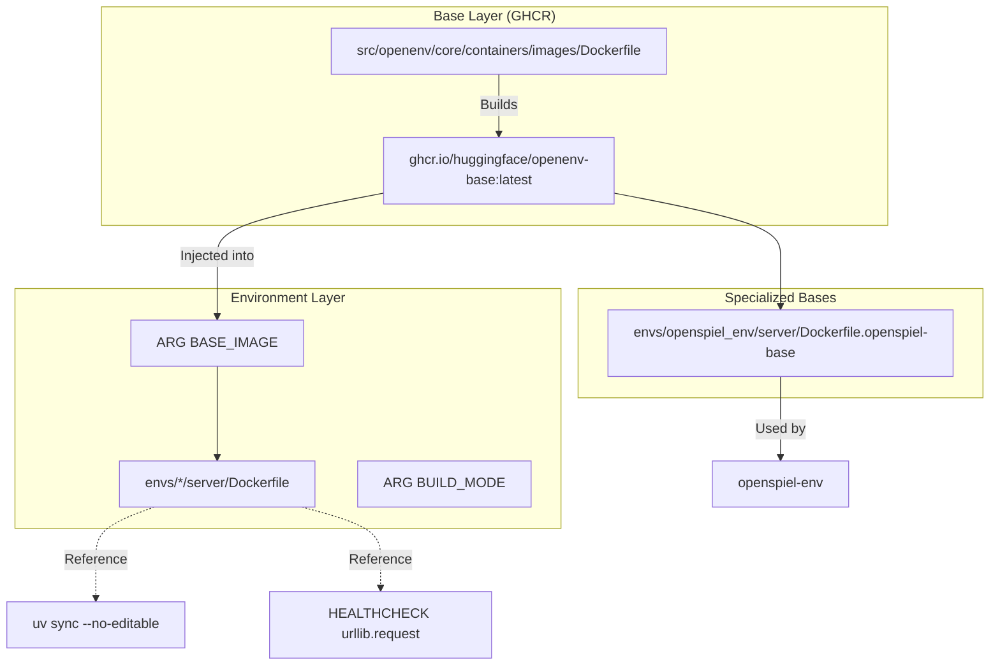
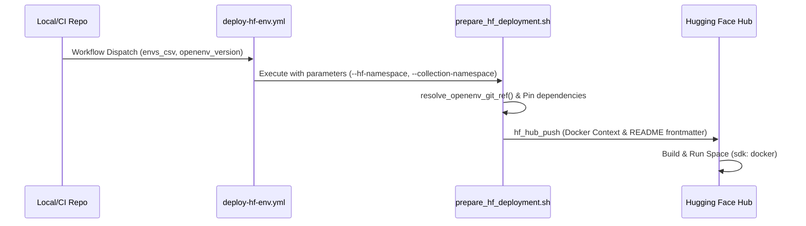

<!-- source: DeepWiki mcp.deepwiki.com · repo huggingface/OpenEnv · page 6.1 Docker Image Pipeline · fetched 2026-10-26 -->

# Docker Image Pipeline

Relevant source files

The following files were used as context for generating this wiki page:

- [.github/PULL_REQUEST_TEMPLATE/release.md](.github/PULL_REQUEST_TEMPLATE/release.md)
- [.github/workflows/build_documentation.yml](.github/workflows/build_documentation.yml)
- [.github/workflows/build_pr_documentation.yml](.github/workflows/build_pr_documentation.yml)
- [.github/workflows/deploy-hf-env.yml](.github/workflows/deploy-hf-env.yml)
- [.github/workflows/discovery-catalog.yml](.github/workflows/discovery-catalog.yml)
- [.github/workflows/docker-build.yml](.github/workflows/docker-build.yml)
- [.github/workflows/manage-hf-collection.yml](.github/workflows/manage-hf-collection.yml)
- [.github/workflows/openspiel_base_build.yml](.github/workflows/openspiel_base_build.yml)
- [.github/workflows/package-ci.yml](.github/workflows/package-ci.yml)
- [.github/workflows/publish-pypi.yml](.github/workflows/publish-pypi.yml)
- [.github/workflows/publish-testpypi.yml](.github/workflows/publish-testpypi.yml)
- [.github/workflows/test.yml](.github/workflows/test.yml)
- [.github/workflows/upload_pr_documentation.yml](.github/workflows/upload_pr_documentation.yml)
- [.github/workflows/validation-runtime.yml](.github/workflows/validation-runtime.yml)
- [envs/browsergym_env/README.md](envs/browsergym_env/README.md)
- [envs/chat_env/server/Dockerfile](envs/chat_env/server/Dockerfile)
- [envs/coding_env/server/Dockerfile.backup](envs/coding_env/server/Dockerfile.backup)
- [envs/echo_env/server/Dockerfile](envs/echo_env/server/Dockerfile)
- [envs/git_env/README.md](envs/git_env/README.md)
- [envs/openspiel_env/server/app.py](envs/openspiel_env/server/app.py)
- [envs/repl_env/server/Dockerfile](envs/repl_env/server/Dockerfile)
- [envs/snake_env/README.md](envs/snake_env/README.md)
- [envs/snake_env/server/Dockerfile.backup](envs/snake_env/server/Dockerfile.backup)
- [envs/textarena_env/server/Dockerfile](envs/textarena_env/server/Dockerfile)
- [envs/textarena_env/server/__init__.py](envs/textarena_env/server/__init__.py)
- [envs/textarena_env/server/app.py](envs/textarena_env/server/app.py)
- [envs/unity_env/server/Dockerfile](envs/unity_env/server/Dockerfile)
- [envs/websearch_env/server/Dockerfile](envs/websearch_env/server/Dockerfile)
- [src/openenv/cli/templates/openenv_env/server/Dockerfile](src/openenv/cli/templates/openenv_env/server/Dockerfile)
- [src/openenv/core/containers/images/Dockerfile](src/openenv/core/containers/images/Dockerfile)
- [tests/test_core/test_docker_base_image.py](tests/test_core/test_docker_base_image.py)

The OpenEnv Docker Image Pipeline is a multi-tier build system designed to produce standardized, lightweight, and performant container images for environment servers. It utilizes a hierarchical structure where a central base image provides core dependencies, and environment-specific images layer on top with specialized requirements.

## 1. The Hierarchical Build Structure

OpenEnv employs a two-tier Docker image hierarchy to optimize build times and ensure consistency across dozens of environments.

### 1.1 OpenEnv Base Image (`openenv-base`)
The foundation of the pipeline is the `openenv-base` image. It is built from a slim Python Bookworm image and includes `uv` for high-speed dependency management [src/openenv/core/containers/images/Dockerfile:1-31]().

**Key Components:**
*   **uv**: Installed and configured for system-wide use [src/openenv/core/containers/images/Dockerfile:1-31]().
*   **Core Dependencies**: FastAPI, Uvicorn, and standard OpenEnv core packages [src/openenv/core/containers/images/Dockerfile:1-31]().
*   **Standard Metadata**: Versioning and labels for tracking [src/openenv/core/containers/images/Dockerfile:1-31]().

### 1.2 Environment-Specific Images
Environment images inherit from `openenv-base` via the `BASE_IMAGE` build argument [.github/workflows/docker-build.yml:153-154](). They follow a multi-stage build pattern to keep final runtime images small.

**Common Environment Build Steps:**
1.  **Builder Stage**: Copies the environment source code and uses `uv sync` to create a virtual environment [.github/workflows/docker-build.yml:143-152]().
2.  **Runtime Stage**: Copies only the `.venv` and source code from the builder stage into a fresh `openenv-base` instance [.github/workflows/docker-build.yml:143-152]().
3.  **Standard Configuration**: Sets `PYTHONPATH`, `PATH`, and environment variables like `ENABLE_WEB_INTERFACE` [envs/textarena_env/server/app.py:69-70]().

### Docker Hierarchy and Code Entity Map
The following diagram maps the Docker build stages to the specific files and build arguments used in the codebase.

**Sources:** [src/openenv/core/containers/images/Dockerfile:1-60](), [.github/workflows/docker-build.yml:1-154](), [.github/workflows/openspiel_base_build.yml:90-101]()

---

## 2. CI/CD Pipeline: `docker-build.yml`

The primary automation for the image pipeline is defined in the `docker-build.yml` workflow. It orchestrates the building of the base image followed by a parallelized matrix build of all supported environments [.github/workflows/docker-build.yml:1-154]().

### 2.1 Workflow Logic
1.  **Job 1: `build-base`**: Triggered on changes to the core or manually. It builds and pushes the base image to the GitHub Container Registry (GHCR) [.github/workflows/docker-build.yml:19-58]().
2.  **Job 2: `build-envs`**: Depends on `build-base`. It uses a matrix strategy to build individual environment images [.github/workflows/docker-build.yml:60-154]().

### Parallel Build Matrix
The matrix defines the context and Dockerfile location for each environment:

| Environment | Dockerfile Path | Build Context |
| :--- | :--- | :--- |
| `echo-env` | `envs/echo_env/server/Dockerfile` | `envs/echo_env` |
| `browsergym-env` | `envs/browsergym_env/server/Dockerfile` | `envs/browsergym_env` |
| `openspiel-env` | `envs/openspiel_env/server/Dockerfile` | `envs/openspiel_env` |

**Sources:** [.github/workflows/docker-build.yml:69-121]()

---

## 3. Specialized Build: `openspiel-base`

Some environments require heavy system-level dependencies or long compilation times. The `openspiel_env` uses a specialized intermediate image, `openspiel-base`, to avoid re-compiling the OpenSpiel library during every environment update [.github/workflows/openspiel_base_build.yml:60-103]().

The `openspiel_base_build.yml` workflow manages this image separately, ensuring it is only rebuilt when necessary or manually triggered [.github/workflows/openspiel_base_build.yml:1-11]().

**Sources:** [.github/workflows/openspiel_base_build.yml:1-11](), [.github/workflows/openspiel_base_build.yml:60-101]()

---

## 4. Environment Staging and HF Deployment

While GHCR serves as the primary image registry, OpenEnv also supports deploying environments to Hugging Face (HF) Spaces as Docker-sdk spaces [.github/workflows/deploy-hf-env.yml:1-114]().

### 4.1 Deployment Scripting (`prepare_hf_deployment.sh`)
The deployment pipeline uses staging utilities to prepare environments for Hugging Face Spaces by pinning versions, injecting metadata, and normalizing names [.github/workflows/deploy-hf-env.yml:78-114]().

### Deployment Data Flow
This diagram tracks how an environment moves from the local repository to a live Hugging Face Space using the deployment scripts and workflows.

**Sources:** [.github/workflows/deploy-hf-env.yml:1-114]()

---

## 5. Runtime Configuration and Health Checks

Every image produced by the pipeline follows a standard runtime contract to ensure compatibility with container providers like `LocalDockerProvider`.

*   **Port Exposure**: Images expose port `8000` by default to match FastAPI expectations [envs/textarena_env/server/app.py:121-124]().
*   **Health Check**: A Python-based health check probes endpoints to verify the FastAPI server is responsive [envs/textarena_env/server/app.py:103-125]().
*   **Entrypoint**: Servers are started via `uvicorn` within the virtual environment created during the build [envs/textarena_env/server/app.py:103-125]().

**Sources:** [.github/workflows/docker-build.yml:1-154](), [envs/textarena_env/server/app.py:103-128]()

---

