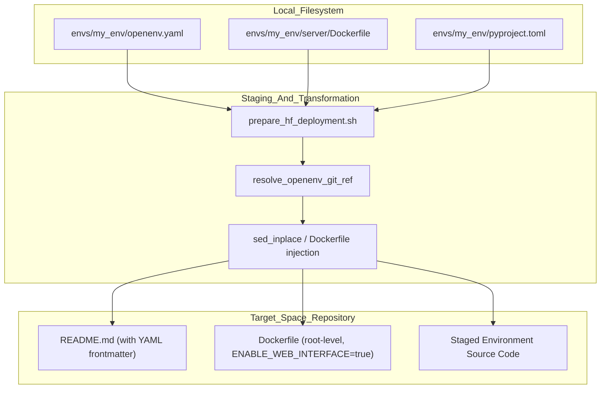
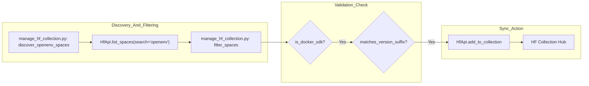

<!-- source: DeepWiki mcp.deepwiki.com · repo huggingface/OpenEnv · page 6.2 Hugging Face Spaces Deployment · fetched 2026-10-26 -->

# Hugging Face Spaces Deployment

Relevant source files

The following files were used as context for generating this wiki page:

- [.github/PULL_REQUEST_TEMPLATE/release.md](.github/PULL_REQUEST_TEMPLATE/release.md)
- [.github/workflows/build_documentation.yml](.github/workflows/build_documentation.yml)
- [.github/workflows/build_pr_documentation.yml](.github/workflows/build_pr_documentation.yml)
- [.github/workflows/deploy-hf-env.yml](.github/workflows/deploy-hf-env.yml)
- [.github/workflows/discovery-catalog.yml](.github/workflows/discovery-catalog.yml)
- [.github/workflows/docker-build.yml](.github/workflows/docker-build.yml)
- [.github/workflows/manage-hf-collection.yml](.github/workflows/manage-hf-collection.yml)
- [.github/workflows/openspiel_base_build.yml](.github/workflows/openspiel_base_build.yml)
- [.github/workflows/package-ci.yml](.github/workflows/package-ci.yml)
- [.github/workflows/publish-pypi.yml](.github/workflows/publish-pypi.yml)
- [.github/workflows/publish-testpypi.yml](.github/workflows/publish-testpypi.yml)
- [.github/workflows/test.yml](.github/workflows/test.yml)
- [.github/workflows/upload_pr_documentation.yml](.github/workflows/upload_pr_documentation.yml)
- [.github/workflows/validation-runtime.yml](.github/workflows/validation-runtime.yml)
- [MANIFEST.in](MANIFEST.in)
- [envs/dipg_safety_env/__init__.py](envs/dipg_safety_env/__init__.py)
- [scripts/manage_hf_collection.py](scripts/manage_hf_collection.py)
- [scripts/prepare_hf_deployment.sh](scripts/prepare_hf_deployment.sh)
- [scripts/verify_private_spaces.py](scripts/verify_private_spaces.py)
- [tests/core/test_web_interface.py](tests/core/test_web_interface.py)
- [tests/scripts/__init__.py](tests/scripts/__init__.py)
- [tests/scripts/test_manage_hf_collection.py](tests/scripts/test_manage_hf_collection.py)
- [tests/scripts/test_prepare_hf_deployment.py](tests/scripts/test_prepare_hf_deployment.py)
- [tests/scripts/test_verify_private_spaces.py](tests/scripts/test_verify_private_spaces.py)

The Hugging Face (HF) Spaces deployment infrastructure in OpenEnv provides a robust, automated pipeline for staging, versioning, and managing environment instances as Docker-based Spaces. This system transforms local environment code into production-ready HF Spaces, handling dependency pinning, repository naming, Dockerfile injection, collection synchronization, and verification.

## Deployment Pipeline Overview

The deployment process follows a multi-stage pipeline designed to ensure environments are self-contained and version-linked to the core OpenEnv framework.

### Staging and Preparation (`prepare_hf_deployment.sh`)
The `scripts/prepare_hf_deployment.sh` script serves as the primary entry point for mass deployments and staging `[scripts/prepare_hf_deployment.sh:3-8]`. It copies environment directories to a staging root (defaulting to `hf-staging`) and performs several critical transformations `[scripts/prepare_hf_deployment.sh:30-35]`:

1.  **Dependency Pinning**: Uses `resolve_openenv_git_ref` to resolve release tags, branch heads, or specific commits (`[scripts/prepare_hf_deployment.sh:136-170]()`) and rewrites `pyproject.toml` references to target a specific OpenEnv version or Git ref.
2.  **Dockerfile Injection & Web Interface Enforcement**: Staged environments have their `Dockerfile` adjusted to ensure they reside at the repository root (required by HF Spaces) and explicitly force `ENV ENABLE_WEB_INTERFACE=true` to guarantee that the Gradio-based playground is active on the Hub `[tests/scripts/test_prepare_hf_deployment.sh:56-95]()`.
3.  **Opt-Out Handling**: When run with `--all`, the staging script automatically inspects environment folders and skips any directory containing a `SKIP_HF_DEPLOYMENT` marker, whereas explicit selection (`--env <name>`) bypasses this opt-out `[scripts/prepare_hf_deployment.sh:16-19]`, `[tests/scripts/test_prepare_hf_deployment.py:137-198]()`.
4.  **README Generation**: Injects mandatory Hugging Face frontmatter (title, SDK, app_port) and sets up Hub metadata using `HUB_TAG` `[scripts/prepare_hf_deployment.sh:31]`.

**Data Flow: Local Environment to Space Repository**

Sources: `[scripts/prepare_hf_deployment.sh:1-170]()`, `[tests/scripts/test_prepare_hf_deployment.py:56-95]()`.

---

## CLI Deployment (`openenv push` and `openenv fork`)

For individual, ad-hoc deployments, the OpenEnv CLI offers dedicated commands:
*   `openenv push`: Performs local pre-flight checks of the environment structure (`[src/openenv/cli/commands/push.py:22]()`) before calling `HfApi.upload_folder` (`[src/openenv/cli/commands/push.py:151-187]()`) to synchronize files. It supports custom ignore patterns and space variable injection (`[src/openenv/cli/commands/push.py:60-85]()`).
*   `openenv fork`: Duplicates an existing environment Space into a user-specified namespace using the Hub's `duplicate_space` API, while allowing custom environment variable and secret overrides (`[src/openenv/cli/commands/fork.py:133-147]()`).

Sources: `[src/openenv/cli/commands/push.py:22-187]()`, `[src/openenv/cli/commands/fork.py:18-147]()`.

---

## Collection Management (`manage_hf_collection.py`)

OpenEnv uses Hugging Face Collections to logically group environments by version or tier. The `scripts/manage_hf_collection.py` script automates this categorization.

### Operation Modes and Discovery
The collection manager operates in multiple modes:
1.  **Versioned Release Collections**: Creates or updates a collection dedicated to a specific OpenEnv release (e.g., `OpenEnv Environment Hub 0.2.1`) containing all spaces deployed with that version suffix `[scripts/manage_hf_collection.py:103-105]()`.
2.  **Global Hub Collections**: Maintains the canonical catalog of first-party environments `[scripts/manage_hf_collection.py:32-34]()`.

The script discovers spaces using `HfApi.list_spaces` filtered by the `openenv` tag, validating that each candidate uses the `docker` SDK and possesses the expected metadata before adding it to the target collection `[scripts/manage_hf_collection.py:127-163]`, `[scripts/manage_hf_collection.py:190-210]()`.

**Diagram: Collection Synchronization Logic**

Sources: `[scripts/manage_hf_collection.py:127-163]`, `[scripts/manage_hf_collection.py:190-210]()`.

---

## Verification and Private Spaces (`verify_private_spaces.py`)

To ensure that version-suffixed or staging spaces adhere to security and visibility policies, OpenEnv provides `scripts/verify_private_spaces.py` alongside corresponding test suites. This script verifies that deployed spaces correctly match the requested visibility (`--private` or `--public`) and flags misconfigured repositories on the Hub.

Sources: `[scripts/verify_private_spaces.py:1-50]()`, `[tests/scripts/test_verify_private_spaces.py:1-30]()`.

---

## GitHub Actions Workflows

Automated deployments and builds are managed via GitHub Actions workflows located in `.github/workflows/`.

### `deploy-hf-env.yml`
This workflow orchestrates manual or automated dispatch of environment deployments `[.github/workflows/deploy-hf-env.yml:1-10]()`. It accepts inputs such as `envs_csv`, `openenv_version`, `hf_namespace`, and `private` visibility flags `[.github/workflows/deploy-hf-env.yml:11-41]()`.

Execution steps in the workflow:
1.  **Checkout & Setup**: Checks out the repository with full history (`fetch-depth: 0`) and sets up Python 3.12 `[.github/workflows/deploy-hf-env.yml:48-57]()`.
2.  **CLI Installation**: Installs the Hugging Face CLI and `huggingface-hub` Python package `[.github/workflows/deploy-hf-env.yml:58-67]()`.
3.  **Staging and Push**: Invokes `scripts/prepare_hf_deployment.sh` using the provided parameters, mapping comma-separated lists or deploying all eligible environments `[.github/workflows/deploy-hf-env.yml:78-114]()`.

### Docker Base Images (`docker-build.yml`)
The underlying Docker images are built via a two-tier hierarchy:
*   **Base Image (`build-base`)**: Builds and pushes `openenv-base` from `src/openenv/core/containers/images/Dockerfile` across architectures `[.github/workflows/docker-build.yml:18-58]()`.
*   **Environment Images (`build-envs`)**: Matrix job that builds individual environment containers (e.g., `echo-env`, `chat-env`, `browsergym-env`) on top of the base image `[.github/workflows/docker-build.yml:59-154]()`.

Sources: `[.github/workflows/deploy-hf-env.yml:1-114]()`, `[.github/workflows/docker-build.yml:1-154]()`.

---

## Versioning, Suffixing, and Testing

| Feature | Implementation Details | Source Reference |
| :--- | :--- | :--- |
| **Space Suffixing** | Appends `-<version>` (e.g., `-0.2.1`) to space names to allow side-by-side versions. | `[scripts/prepare_hf_deployment.sh:116-129]()` |
| **Git Ref Pinning** | Resolves version tags and references to stable commits for dependency pinning. | `[scripts/prepare_hf_deployment.sh:136-170]()` |
| **Private Staging** | Defaults version-suffixed spaces to private visibility for pre-release validation. | `[.github/workflows/deploy-hf-env.yml:21-25]()` |
| **Staging Tests** | Validates repo-id overrides, web-interface overrides, and `SKIP_HF_DEPLOYMENT` handling. | `[tests/scripts/test_prepare_hf_deployment.py:1-206]()` |

Sources: `[scripts/prepare_hf_deployment.sh:116-170]()`, `[.github/workflows/deploy-hf-env.yml:21-25]()`, `[tests/scripts/test_prepare_hf_deployment.py:1-206]()`.

---

