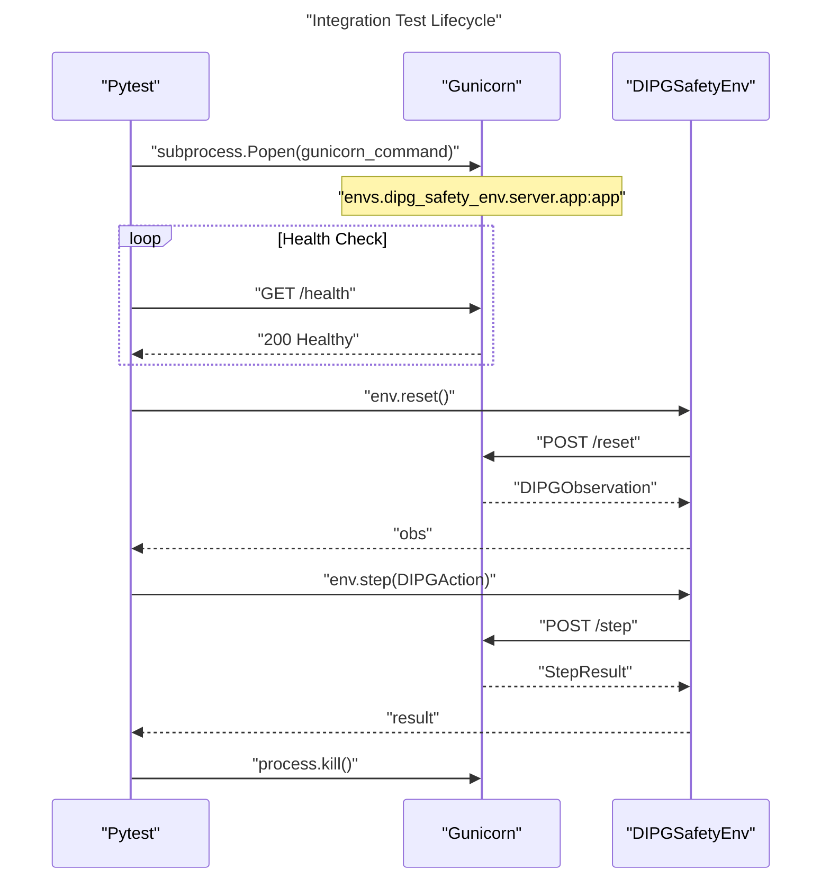

<!-- source: DeepWiki mcp.deepwiki.com · repo huggingface/OpenEnv · page 6.3 Testing and CI · fetched 2026-10-26 -->

# Testing and CI

<details>
<summary>Relevant source files</summary>

The following files were used as context for generating this wiki page:

- [.github/PULL_REQUEST_TEMPLATE/release.md](.github/PULL_REQUEST_TEMPLATE/release.md)
- [.github/workflows/build_documentation.yml](.github/workflows/build_documentation.yml)
- [.github/workflows/build_pr_documentation.yml](.github/workflows/build_pr_documentation.yml)
- [.github/workflows/deploy-hf-env.yml](.github/workflows/deploy-hf-env.yml)
- [.github/workflows/discovery-catalog.yml](.github/workflows/discovery-catalog.yml)
- [.github/workflows/docker-build.yml](.github/workflows/docker-build.yml)
- [.github/workflows/manage-hf-collection.yml](.github/workflows/manage-hf-collection.yml)
- [.github/workflows/openspiel_base_build.yml](.github/workflows/openspiel_base_build.yml)
- [.github/workflows/package-ci.yml](.github/workflows/package-ci.yml)
- [.github/workflows/publish-pypi.yml](.github/workflows/publish-pypi.yml)
- [.github/workflows/publish-testpypi.yml](.github/workflows/publish-testpypi.yml)
- [.github/workflows/test.yml](.github/workflows/test.yml)
- [.github/workflows/upload_pr_documentation.yml](.github/workflows/upload_pr_documentation.yml)
- [.github/workflows/validation-runtime.yml](.github/workflows/validation-runtime.yml)
- [docs/source/getting-started.md](docs/source/getting-started.md)
- [docs/source/getting_started/contributing-envs.md](docs/source/getting_started/contributing-envs.md)
- [docs/source/guides/runtime-providers.md](docs/source/guides/runtime-providers.md)
- [docs/source/reference/core.md](docs/source/reference/core.md)
- [scripts/PR_REVIEW_BOT.md](scripts/PR_REVIEW_BOT.md)
- [scripts/pr-review-cron-wrapper.sh](scripts/pr-review-cron-wrapper.sh)
- [scripts/pr_tracker.py](scripts/pr_tracker.py)
- [tests/test_core/conftest.py](tests/test_core/conftest.py)
- [tests/test_core/test_env_client_capacity.py](tests/test_core/test_env_client_capacity.py)
- [tests/test_core/test_env_client_headers.py](tests/test_core/test_env_client_headers.py)

</details>


This page details the testing infrastructure and Continuous Integration (CI) pipelines for OpenEnv. The project utilizes GitHub Actions to automate environment validation, unit testing, linting, documentation builds, and the PyPI/TestPyPI release lifecycle.

## Test Suite Structure

The test suite is organized into distinct directories based on the component under test. OpenEnv uses `pytest` as the primary test runner and `pytest-asyncio` for handling asynchronous client and server interactions.

### Directory Organization
- **`tests/core`**: Contains tests for foundational abstractions including `EnvClient`, `HTTPEnvServer`, and the Rubric system.
- **`tests/envs`**: Contains environment-specific tests covering models and functional client-server interactions.
- **`tests/test_cli`**: Validates CLI commands such as `openenv init`, `openenv validate`, and `openenv build`.
- **`tests/scripts`**: Tests for utility scripts used in documentation syncing and deployment preparation.
- **`tests/validation_runtime`**: Tests for environment auto-validation and acceptance suites.

### Environment Testing Patterns
Environments are tested using two primary patterns:
1.  **Unit/Model Tests**: Validating that action and observation models serialize and deserialize correctly [.github/workflows/test.yml:85-86]().
2.  **Integration Tests (Server-Client)**: Spawning a background server process (often using `gunicorn` with `uvicorn` workers) and connecting via a client to verify the full request-response lifecycle [tests/envs/test_dipg_environment.py:44-60]().

**Data Flow: Integration Test Lifecycle**
The following diagram illustrates how a typical environment integration test (like `DIPGSafetyEnv`) orchestrates the server and client.


Sources: [tests/envs/test_dipg_environment.py:24-86](), [tests/envs/test_dipg_environment.py:97-115]()

## CI Workflows (`test.yml`)

OpenEnv uses `uv` for high-performance dependency management and virtual environment orchestration within GitHub Actions [.github/workflows/test.yml:14-35](). The primary workflow is defined in `.github/workflows/test.yml` and runs on pull requests and pushes to `main` [.github/workflows/test.yml:1-12]().

### Parallel CI Jobs
- **`validate-env-locks`**: Detects changes in `envs/*/pyproject.toml` or `uv.lock`. It runs `uv sync --frozen` in changed directories to ensure lockfiles are synchronized and valid [.github/workflows/test.yml:19-65]().
- **`test`**: Runs the main test suite across Python 3.11 and 3.12, ignoring heavy integration environments (e.g., BrowserGym, DIPG, WebSearch) and network/docker-dependent tests [.github/workflows/test.yml:67-105]().
- **`test-thinkingbox-env`**: Installs and tests the ThinkingBox environment specifically using its isolated project constraints [.github/workflows/test.yml:106-141]().
- **`test-tau2-env`**: Fetches τ²-bench data and tests the τ²-bench environment and Claude Code recipes on Python 3.12 [.github/workflows/test.yml:142-178]().
- **`check-env-docs`**: Runs `scripts/sync_env_docs.py --check` to verify environment stubs match central documentation [.github/workflows/test.yml:179-194]().
- **`lint`**: Installs `ruff` and `usort` to enforce code formatting and import ordering [.github/workflows/test.yml:195-215]().

Sources: [.github/workflows/test.yml:1-215]()

## Package CI and Documentation Builds

### Package CI (`publish-pypi.yml`)
The package release pipeline validates distribution creation, metadata correctness, and wheel installation smoke tests [.github/workflows/publish-pypi.yml:23-108](). When a tag matching `v*.*.*` is pushed, it:
1. Validates the tag against `pyproject.toml` version [.github/workflows/publish-pypi.yml:38-60]().
2. Verifies the tag commit originates from `main` [.github/workflows/publish-pypi.yml:62-68]().
3. Builds source and wheel distributions using `python -m build` [.github/workflows/publish-pypi.yml:75-81]().
4. Performs a smoke test by installing the built wheel in a virtual environment and checking imports [.github/workflows/publish-pypi.yml:86-101]().

### Documentation Workflows
Documentation builds are handled via Hugging Face `doc-builder` workflows:
- **`build_documentation.yml`**: Builds and publishes main/release docs on push to `main` or release branches [.github/workflows/build_documentation.yml:1-18]().
- **`build_pr_documentation.yml`** and **`upload_pr_documentation.yml`**: Generates and posts preview documentation comments for pull requests [.github/workflows/build_pr_documentation.yml:1-19](), [.github/workflows/upload_pr_documentation.yml:1-17]().

Sources: [.github/workflows/publish-pypi.yml:1-160](), [.github/workflows/build_documentation.yml:1-18](), [.github/workflows/upload_pr_documentation.yml:1-17]()

## Release and Versioning Workflows

OpenEnv uses automated release and post-release version bumping workflows to manage PyPI distributions and repository version states.

### Release and Publish Pipeline
- **Publish to PyPI (`publish-pypi.yml`)**: Uses trusted publishers via OIDC tokens to publish verified wheel and source distributions to PyPI [.github/workflows/publish-pypi.yml:109-129](). It subsequently creates or updates a GitHub Release with the distribution assets [.github/workflows/publish-pypi.yml:130-160]().
- **Publish to TestPyPI (`publish-testpypi.yml`)**: Manually triggered workflow allowing developers to verify builds on TestPyPI with custom version suffixes (e.g., `.dev123`) [.github/workflows/publish-testpypi.yml:1-175]().
- **Post-Release Version Bump**: Following a successful PyPI release, the `post-release-bump` job calculates the next development version (e.g., `X.Y.(Z+1).dev0`) and opens a PR against `main` [.github/workflows/publish-pypi.yml:161-215]().

**Versioning State Machine**
```mermaid
stateDiagram-v2
    title "Versioning State Machine"
    [*] --> DevBranch : "version = X.Y.Z.dev0"
    DevBranch --> ReleaseTag : "Tag vX.Y.Z on main"
    ReleaseTag --> BuildAndPublish : "publish-pypi.yml"
    BuildAndPublish --> GitHubRelease : "Create Release"
    GitHubRelease --> PostReleaseBump : "Open bump PR to main"
    PostReleaseBump --> DevBranch : "version = X.Y.(Z+1).dev0"
```
Sources: [.github/workflows/publish-pypi.yml:1-215](), [.github/workflows/publish-testpypi.yml:1-175]()

---

