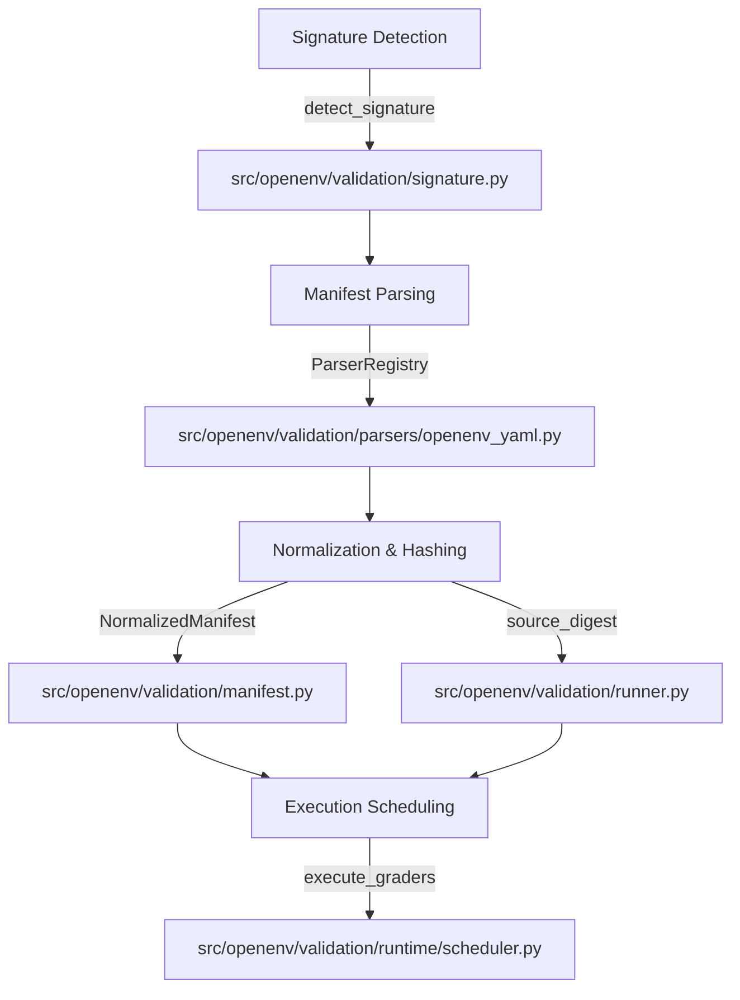
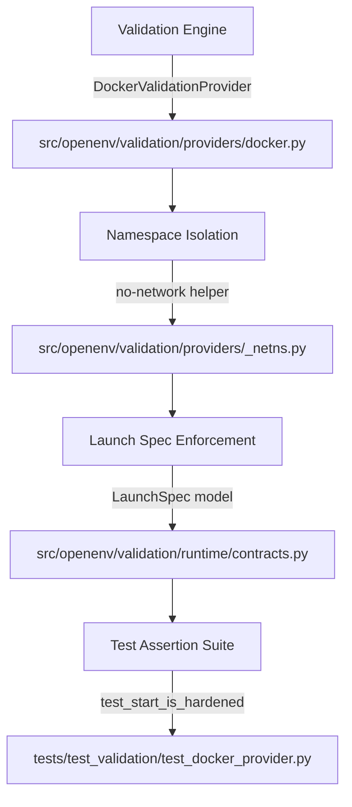

<!-- source: DeepWiki mcp.deepwiki.com · repo huggingface/OpenEnv · page 6.4 Environment Validation Framework · fetched 2026-10-26 -->

# Environment Validation Framework

Relevant source files

The following files were used as context for generating this wiki page:

- [docs/source/reference/cli.md](docs/source/reference/cli.md)
- [envs/carla_env/uv.lock](envs/carla_env/uv.lock)
- [envs/grid_world_env/uv.lock](envs/grid_world_env/uv.lock)
- [envs/reasoning_gym_env/uv.lock](envs/reasoning_gym_env/uv.lock)
- [pyproject.toml](pyproject.toml)
- [rfcs/008-environment-auto-validation.md](rfcs/008-environment-auto-validation.md)
- [scripts/sync_validation_schemas.py](scripts/sync_validation_schemas.py)
- [scripts/validation/reproduce.py](scripts/validation/reproduce.py)
- [scripts/validation/verify_artifacts.py](scripts/validation/verify_artifacts.py)
- [src/openenv/validation/__init__.py](src/openenv/validation/__init__.py)
- [src/openenv/validation/graders/__init__.py](src/openenv/validation/graders/__init__.py)
- [src/openenv/validation/graders/runtime/__init__.py](src/openenv/validation/graders/runtime/__init__.py)
- [src/openenv/validation/graders/runtime/network.py](src/openenv/validation/graders/runtime/network.py)
- [src/openenv/validation/parsers/__init__.py](src/openenv/validation/parsers/__init__.py)
- [src/openenv/validation/policies/severity-v1.json](src/openenv/validation/policies/severity-v1.json)
- [src/openenv/validation/policy.py](src/openenv/validation/policy.py)
- [src/openenv/validation/providers/__init__.py](src/openenv/validation/providers/__init__.py)
- [src/openenv/validation/providers/_netns.py](src/openenv/validation/providers/_netns.py)
- [src/openenv/validation/providers/docker.py](src/openenv/validation/providers/docker.py)
- [src/openenv/validation/report.py](src/openenv/validation/report.py)
- [src/openenv/validation/runner.py](src/openenv/validation/runner.py)
- [src/openenv/validation/runtime/artifacts.py](src/openenv/validation/runtime/artifacts.py)
- [src/openenv/validation/runtime/contracts.py](src/openenv/validation/runtime/contracts.py)
- [src/openenv/validation/schemas/report.schema.json](src/openenv/validation/schemas/report.schema.json)
- [src/openenv/validation/signature.py](src/openenv/validation/signature.py)
- [tests/fixtures/validation/runtime/served_probe/app.py](tests/fixtures/validation/runtime/served_probe/app.py)
- [tests/test_validation/conftest.py](tests/test_validation/conftest.py)
- [tests/test_validation/integration/test_docker_lifecycle.py](tests/test_validation/integration/test_docker_lifecycle.py)
- [tests/test_validation/integration/test_docker_network.py](tests/test_validation/integration/test_docker_network.py)
- [tests/test_validation/integration/test_runtime_cli.py](tests/test_validation/integration/test_runtime_cli.py)
- [tests/test_validation/integration/test_served_probe.py](tests/test_validation/integration/test_served_probe.py)
- [tests/test_validation/test_docker_provider.py](tests/test_validation/test_docker_provider.py)
- [tests/test_validation/test_protocols.py](tests/test_validation/test_protocols.py)
- [tests/test_validation/test_reproduction.py](tests/test_validation/test_reproduction.py)
- [tests/test_validation/test_runner.py](tests/test_validation/test_runner.py)
- [tests/test_validation/test_runtime_artifacts.py](tests/test_validation/test_runtime_artifacts.py)
- [tests/test_validation/test_schema_sync.py](tests/test_validation/test_schema_sync.py)
- [tests/test_validation/test_types.py](tests/test_validation/test_types.py)
- [tests/validation_runtime/README.md](tests/validation_runtime/README.md)
- [tests/validation_runtime/acceptance.json](tests/validation_runtime/acceptance.json)
- [tests/validation_runtime/pyproject.toml](tests/validation_runtime/pyproject.toml)
- [tests/validation_runtime/toolchain.json](tests/validation_runtime/toolchain.json)
- [tests/validation_runtime/uv.lock](tests/validation_runtime/uv.lock)

## Purpose and Scope

The Environment Validation Framework implements the automated verification specifications of RFC 008 (`rfcs/008-environment-auto-validation.md:1-125`), providing a uniform quality bar for OpenEnv packages prior to training or hub intake. Located in `src/openenv/validation` and `tests/validation_runtime`, the framework verifies package structure, runtime isolation, reward well-formedness, observation schemas, and network policies without shipping centralized hub infrastructure [rfcs/008-environment-auto-validation.md:1-24]. 

Validation executes across four hierarchical levels—Static (L1), Runtime (L2), Semantic (L3), and Statistical (L4)—producing immutable JSON reports and forensic artifact bundles [rfcs/008-environment-auto-validation.md:75-115].

Sources: `rfcs/008-environment-auto-validation.md:1-125`, `src/openenv/validation/__init__.py:1-20`

---

## Auto-Validation Runner & Pipeline Architecture

Validation begins with signature detection (`detect_signature` in `src/openenv/validation/signature.py`) which identifies package formats (e.g., standard OpenEnv manifests or Harbor task packages). The `ParserRegistry` (`src/openenv/validation/parsers/__init__.py`) parses manifests into normalized dataclasses (`NormalizedManifest` in `src/openenv/validation/manifest.py`), computing a deterministic content digest via `source_digest()` (`src/openenv/validation/runner.py:38-79`).

*Figure 1: Validation pipeline mapping natural language orchestration steps to OpenEnv code entity functions.*

The validation runner (`src/openenv/validation/runner.py`) coordinates execution across static graders, container providers, and runtime collectors, ensuring non-terminating dependency accumulation so authors receive comprehensive diagnostic reports even when early checks fail [src/openenv/validation/runner.py:110-135].

Sources: `src/openenv/validation/runner.py:1-125`, `src/openenv/validation/signature.py:1-50`, `src/openenv/validation/manifest.py:1-50`, `src/openenv/validation/parsers/__init__.py:1-30`

---

## Docker Provider and Network Namespace (`netns`) Isolation

Runtime validation is bound to strict container isolation implemented by `DockerValidationProvider` (`src/openenv/validation/providers/docker.py`). It applies deep runtime hardening, including dropping all Linux capabilities (`--cap-drop ALL`), setting read-only root filesystems (`--read-only`), allocating secure tmpfs mounts, enforcing strict PIDs limits, and omitting host credential leakage such as `HF_TOKEN` (`tests/test_validation/test_docker_provider.py:104-135`).

*Figure 2: Container provider architecture bridging security boundaries to concrete validation modules.*

For subjects declaring `no-network` policies, the validator runs a trusted helper container sharing only the subject's network namespace (`src/openenv/validation/providers/_netns.py`), allowing local HTTP wire probes (`/health`, `/ws`) while isolating external socket egress [src/openenv/validation/providers/docker.py:1-35].

Sources: `src/openenv/validation/providers/docker.py:1-150`, `src/openenv/validation/providers/_netns.py:1-50`, `tests/test_validation/test_docker_provider.py:1-60`

---

## Graders and Execution Scheduling

Grading logic is organized around the `GraderRegistry` and individual grader classes (`src/openenv/validation/graders/__init__.py`). Graders evaluate specific structural and behavioral contracts:

| Grader Class | Target File | Evaluated Property |
| :--- | :--- | :--- |
| `StaticManifestGrader` | `src/openenv/validation/graders/static.py` | Manifest version, resource bounds, dependency pins |
| `RewardWellFormedGrader` | `src/openenv/validation/graders/runtime/reward.py` | Numeric step rewards, non-null step requirements |
| `ObservationSchemaGrader` | `src/openenv/validation/graders/runtime/observation.py` | Compliance with `/schema` definitions for reset and steps |
| `StateContractGrader` | `src/openenv/validation/graders/runtime/state.py` | State continuity across session interactions |
| `NetworkPolicyGrader` | `src/openenv/validation/graders/runtime/network.py` | Enforcement of declared `public` vs `no-network` egress limits |

Graders are ordered and scheduled using topological dependency resolution (`src/openenv/validation/runtime/scheduler.py`), ensuring prerequisite checks (such as successful startup and schema acquisition) complete before behavioral verification runs [src/openenv/validation/runner.py:25-35].

Sources: `src/openenv/validation/graders/__init__.py:1-40`, `src/openenv/validation/runner.py:82-120`, `src/openenv/validation/graders/runtime/network.py:1-50`, `src/openenv/validation/runtime/scheduler.py:1-40`

---

## Report Schemas, Severity Policies, and CLI Contracts

Validation outcomes are serialized into standardized reports conforming to versioned JSON Schemas (`src/openenv/validation/schemas/report.schema.json`) managed by `ValidationReport` and `CheckResult` (`src/openenv/validation/report.py`).

Severity policies (`src/openenv/validation/policy.py`) load declarative rules (`src/openenv/validation/policies/severity-v1.json`) to map check findings to terminal exit codes:
- **`PASS`**: Exit code `0`. All checks met or appropriately skipped.
- **`FAIL`**: Exit code `1`. Contract violations or security failures detected.
- **Unsupported Package**: Exit code `2`.
- **Internal / Policy Error**: Exit code `3`.

The CLI integration (`docs/source/reference/cli.md`) exposes these mechanisms via `openenv validate`, supporting `--level static`, `--level runtime`, and artifact bundle generation (`report.json`, replay plans, redacted logs, and `SHA256SUMS`) [docs/source/reference/cli.md:36-102].

Sources: `src/openenv/validation/report.py:1-50`, `src/openenv/validation/policy.py:1-50`, `src/openenv/validation/policies/severity-v1.json:1-30`, `docs/source/reference/cli.md:36-108`

---

## Validation Runtime Lab, Acceptance Suites, and Evidence Generation (`reproduce.py`)

The standalone test harness under `tests/validation_runtime` provides locked execution environments using pinned toolchains (`tests/validation_runtime/toolchain.json`), isolated dependency lockfiles (`tests/validation_runtime/uv.lock`), and strict acceptance criteria (`tests/validation_runtime/acceptance.json`) [tests/validation_runtime/README.md:1-25].

The reproduction script (`scripts/validation/reproduce.py`) executes validation suites (`fast`, `protocol`, `docker`), verifying wire-level faults (e.g., bad reward injection, malformed observations, missing terminal flags) and confirming container cleanup guarantees across signal interruptions (`SIGINT`, `SIGTERM`) [tests/validation_runtime/README.md:25-50, tests/test_validation/integration/test_runtime_cli.py:1-70]. Evidence bundles are written to `outputs/validation-runtime/<run-id>/` and can be verified using `scripts/validation/verify_artifacts.py` [tests/validation_runtime/README.md:55-67].

Sources: `tests/validation_runtime/README.md:1-82`, `tests/validation_runtime/acceptance.json:1-38`, `tests/test_validation/integration/test_runtime_cli.py:1-70`, `tests/test_validation/integration/test_docker_lifecycle.py:1-40`

---

