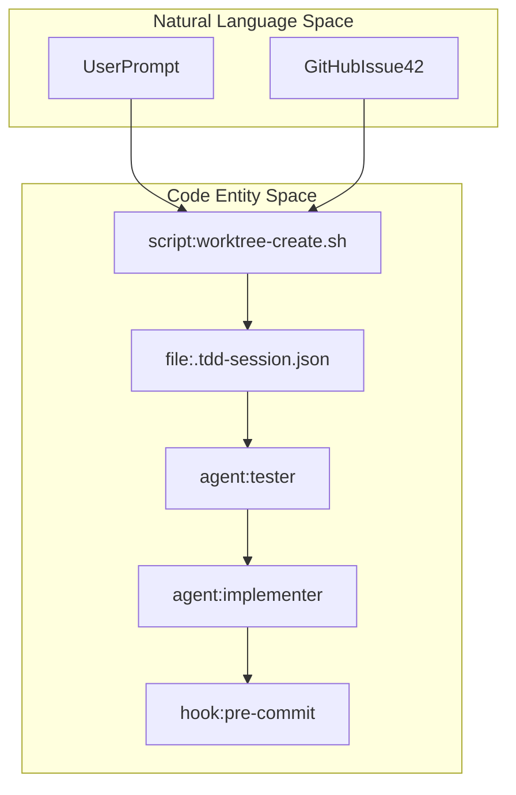
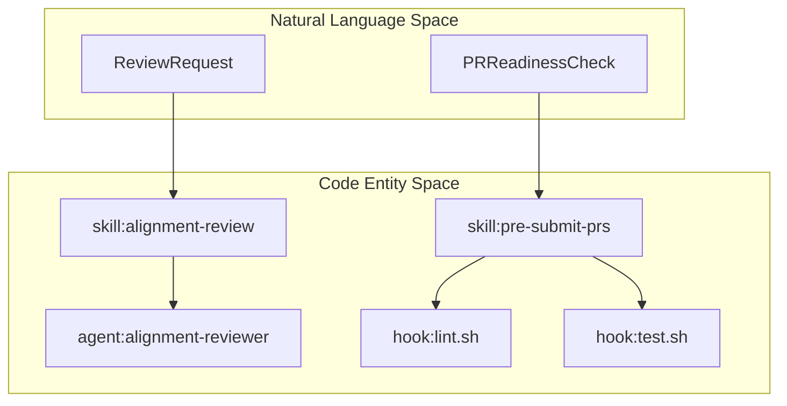

<!-- source: DeepWiki mcp.deepwiki.com · repo huggingface/OpenEnv · page 7 Contributing and Development Workflow · fetched 2026-10-26 -->

# Contributing and Development Workflow

Relevant source files

The following files were used as context for generating this wiki page:

- [.claude/docs/CONTRIBUTING.md](.claude/docs/CONTRIBUTING.md)
- [.claude/docs/REPO_WALKTHROUGH.md](.claude/docs/REPO_WALKTHROUGH.md)
- [.claude/hooks/after-docs-updater.sh](.claude/hooks/after-docs-updater.sh)
- [.claude/hooks/after-implementer.sh](.claude/hooks/after-implementer.sh)
- [.claude/hooks/ci-wait.sh](.claude/hooks/ci-wait.sh)
- [.claude/hooks/delegate-todos.sh](.claude/hooks/delegate-todos.sh)
- [.claude/hooks/install.sh](.claude/hooks/install.sh)
- [.claude/hooks/no-direct-code.sh](.claude/hooks/no-direct-code.sh)
- [.claude/hooks/pre-commit-check.sh](.claude/hooks/pre-commit-check.sh)
- [.claude/hooks/session-start.sh](.claude/hooks/session-start.sh)
- [.claude/settings.json](.claude/settings.json)
- [.claude/skills/generate-openenv-env/agents/openai.yaml](.claude/skills/generate-openenv-env/agents/openai.yaml)
- [.claude/skills/generate-openenv-env/assets/openenv_env_template/.dockerignore](.claude/skills/generate-openenv-env/assets/openenv_env_template/.dockerignore)
- [.claude/skills/generate-openenv-env/assets/openenv_env_template/README.md](.claude/skills/generate-openenv-env/assets/openenv_env_template/README.md)
- [.claude/skills/generate-openenv-env/assets/openenv_env_template/__init__.py](.claude/skills/generate-openenv-env/assets/openenv_env_template/__init__.py)
- [.claude/skills/generate-openenv-env/assets/openenv_env_template/client.py](.claude/skills/generate-openenv-env/assets/openenv_env_template/client.py)
- [.claude/skills/generate-openenv-env/assets/openenv_env_template/models.py](.claude/skills/generate-openenv-env/assets/openenv_env_template/models.py)
- [.claude/skills/generate-openenv-env/assets/openenv_env_template/server/Dockerfile](.claude/skills/generate-openenv-env/assets/openenv_env_template/server/Dockerfile)
- [.claude/skills/generate-openenv-env/references/openenv-tutorial-01-environments.md](.claude/skills/generate-openenv-env/references/openenv-tutorial-01-environments.md)
- [.claude/skills/pre-submit-pr/SKILL.md](.claude/skills/pre-submit-pr/SKILL.md)
- [.claude/skills/release/SKILL.md](.claude/skills/release/SKILL.md)
- [.claude/skills/simplify/SKILL.md](.claude/skills/simplify/SKILL.md)
- [.claude/skills/watch-pr/SKILL.md](.claude/skills/watch-pr/SKILL.md)
- [.claude/skills/work-on-issue/SKILL.md](.claude/skills/work-on-issue/SKILL.md)
- [CLAUDE.md](CLAUDE.md)
- [docs/source/environments/thinkingbox.md](docs/source/environments/thinkingbox.md)
- [envs/carla_env/server/Dockerfile.real](envs/carla_env/server/Dockerfile.real)
- [envs/sophistry_bench_sprint_env/server/Dockerfile](envs/sophistry_bench_sprint_env/server/Dockerfile)
- [envs/thinkingbox_env/README.md](envs/thinkingbox_env/README.md)
- [envs/thinkingbox_env/openenv.yaml](envs/thinkingbox_env/openenv.yaml)
- [tests/core/test_mcp/test_mode_aware_tools.py](tests/core/test_mcp/test_mode_aware_tools.py)

This page covers the development workflow, agentic tooling, quality enforcement hooks, and pull request processes for the OpenEnv codebase. OpenEnv adopts an **agentic-first** architecture where development tasks are split between human-driven design and AI-driven implementation loops [CLAUDE.md:13-20](). 

For detailed implementation guides on specific areas, refer to the child pages:
- For creating custom environments, see [Building a New Environment](#7.1).
- For reinforcement learning loops and training integrations, see [Training Integration and RL Workflows](#7.2).
- For code examples, reference scripts, and tutorials, see [Examples and Tutorials](#7.3).

---

## 1. Agentic-First Workflow and Worktree Management

OpenEnv relies on Claude Code as a primary engineering interface [CLAUDE.md:13-15](). The workflow divides engineering into two phases: human ownership of design and requirements, and agent ownership of iterative code generation, testing, and validation [CLAUDE.md:15-20]().

To prevent breaking the main branch and to isolate experiments, OpenEnv enforces a **worktree-based** development model [CLAUDE.md:55-64](). Direct commits to `main` or `master` are blocked locally by git hooks [.claude/hooks/install.sh:32-39]().

### TDD Lifecycle and Code Entities

Title: TDD Enforcement and Code Entities

Sources: [CLAUDE.md:46-64](), [.claude/hooks/install.sh:21-76]()

Sources: [CLAUDE.md:13-64](), [.claude/hooks/install.sh:21-76]()

---

## 2. Claude Code Integration and Ecosystem

The `.claude/` directory houses configuration files, specialized skills, and isolated subagents that automate repetitive coding tasks [CLAUDE.md:22](). Skills execute inline during conversations for quick checks, while subagents run with isolated contexts for complex, multi-step execution [CLAUDE.md:84-88]().

### Available Skills and Subagents

| Category | Component Name | Path / Definition | Role |
| :--- | :--- | :--- | :--- |
| **Skill** | `alignment-review` | [.claude/skills/alignment-review/SKILL.md]() | Two-tier code review for bugs and architecture alignment [CLAUDE.md:97]() |
| **Skill** | `pre-submit-pr` | [.claude/skills/pre-submit-pr/SKILL.md]() | Comprehensive PR readiness check [CLAUDE.md:98]() |
| **Agent** | `alignment-reviewer` | [.claude/agents/alignment-reviewer.md]() | Independent review agent verifying invariants [CLAUDE.md:122]() |
| **Agent** | `env-validator` | [.claude/agents/env-validator.md]() | End-to-end environment verification [CLAUDE.md:123]() |

### Agentic Mapping to Code Artifacts

Title: Agent Integration Space

Sources: [CLAUDE.md:84-136](), [.claude/skills/pre-submit-pr/SKILL.md:1-53]()

Sources: [CLAUDE.md:84-136](), [.claude/skills/pre-submit-pr/SKILL.md:1-53]()

---

## 3. Automated Quality Gates and Git Hooks

Local quality enforcement is handled by git hooks installed via `.claude/hooks/install.sh` [._claude/hooks/install.sh:2](). These hooks run automatically during commits and pushes to guarantee formatting standards, clean code, and design invariants.

### Hook Pipeline Checks
1. **Branch Protection:** Blocks commits or pushes originating directly on `main` or `master` [.claude/hooks/install.sh:32-39]().
2. **Formatting & Sorting:** Automatically executes `usort` and `ruff format` on modified Python files [.claude/hooks/install.sh:46-55]().
3. **Linting:** Runs static analysis checks using `.claude/hooks/lint.sh` [.claude/hooks/install.sh:63]().
4. **Client-Server Invariant:** Verifies that client packages do not import from server-side modules [.claude/hooks/install.sh:183-201]().

Sources: [.claude/hooks/install.sh:1-215]()

---

## 4. Pull Request Review and Alignment Process

Before submitting changes to the repository, contributors and agents must run the `/pre-submit-pr` skill to evaluate readiness [.claude/skills/pre-submit-pr/SKILL.md:1-10]().

### Review Tiers
- **Tier 1 (Mechanical Checks):** Automated checks for syntax errors, formatting compliance, passing tests, and debug artifacts [.claude/skills/pre-submit-pr/SKILL.md:19-23]().
- **Tier 2 (Alignment Review):** Human-led or agent-assisted review checking adherence to design principles and architectural RFC documents [.claude/skills/pre-submit-pr/SKILL.md:24-32]().

For further reading on environment structure, see [Building a New Environment](#7.1). For RL training patterns, consult [Training Integration and RL Workflows](#7.2). For usage samples, explore [Examples and Tutorials](#7.3).

Sources: [.claude/skills/pre-submit-pr/SKILL.md:1-53]()

---

