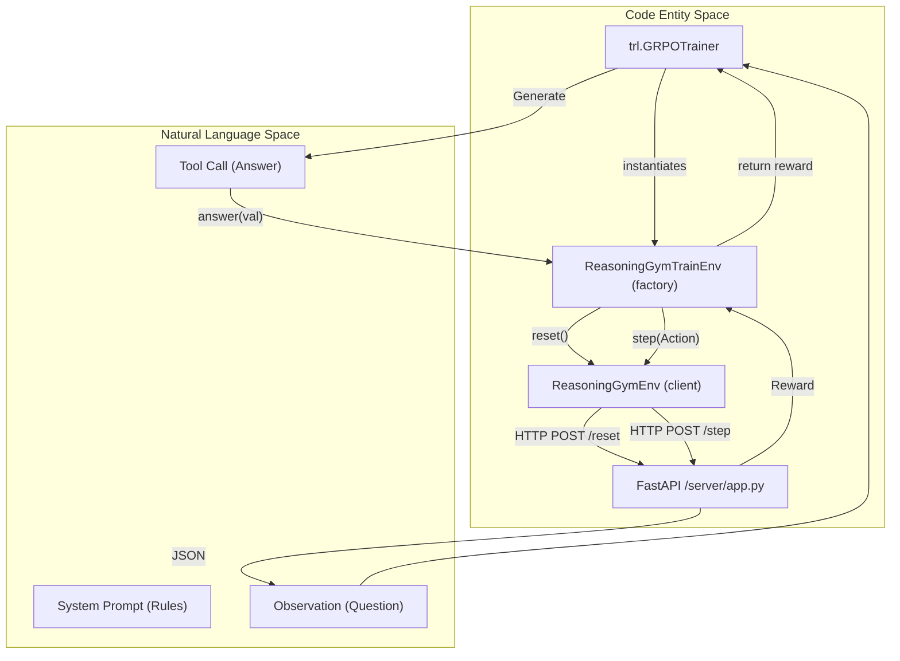
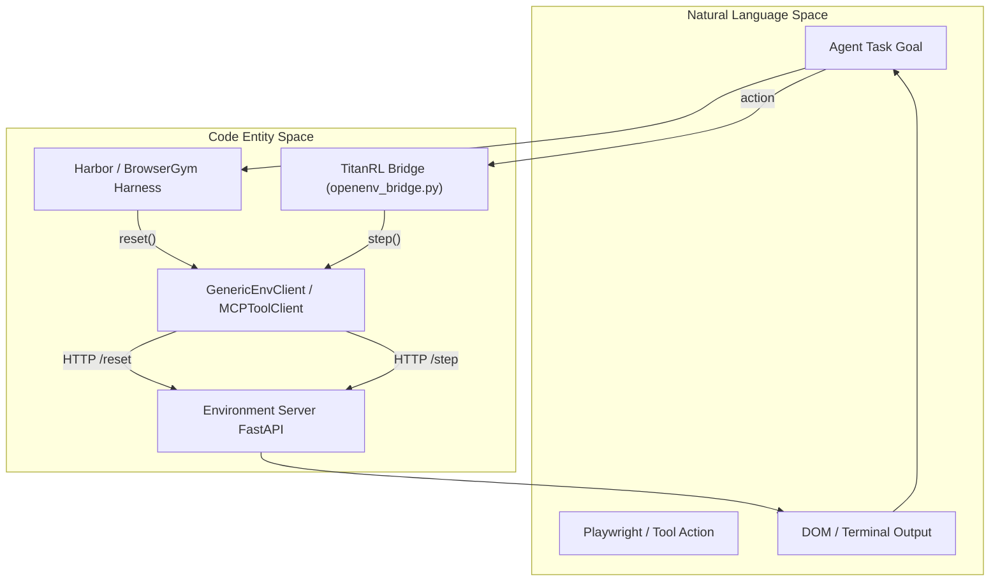
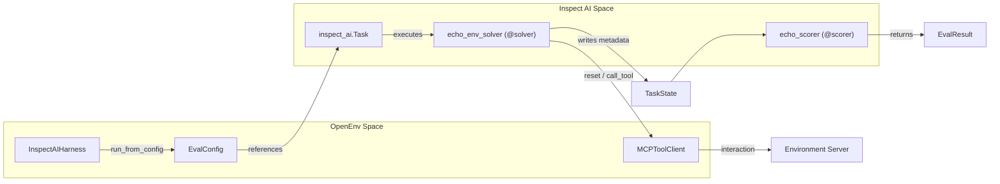

<!-- source: DeepWiki mcp.deepwiki.com · repo huggingface/OpenEnv · page 7.2 Training Integration and RL Workflows · fetched 2026-10-26 -->

# Training Integration and RL Workflows

<details>
<summary>Relevant source files</summary>

The following files were used as context for generating this wiki page:

- [docs/README.md](docs/README.md)
- [docs/source/tutorials/end-to-end-walkthrough.md](docs/source/tutorials/end-to-end-walkthrough.md)
- [docs/source/tutorials/evaluation-inspect.md](docs/source/tutorials/evaluation-inspect.md)
- [docs/source/tutorials/rl-training-2048.md](docs/source/tutorials/rl-training-2048.md)
- [docs/source/tutorials/sft-warmup.md](docs/source/tutorials/sft-warmup.md)
- [docs/source/tutorials/wordle-grpo.md](docs/source/tutorials/wordle-grpo.md)
- [examples/carla_env/README.md](examples/carla_env/README.md)
- [examples/dipg/dipg-rl.ipynb](examples/dipg/dipg-rl.ipynb)
- [examples/dipg/hyperparameter_finetuning.ipynb](examples/dipg/hyperparameter_finetuning.ipynb)
- [examples/echo_world_model/README.md](examples/echo_world_model/README.md)
- [examples/echo_world_model/backends/echo_trl_run_heldout.png](examples/echo_world_model/backends/echo_trl_run_heldout.png)
- [examples/echo_world_model/backends/tinker.md](examples/echo_world_model/backends/tinker.md)
- [examples/echo_world_model/backends/tinker_echo_demo.py](examples/echo_world_model/backends/tinker_echo_demo.py)
- [examples/echo_world_model/backends/trl.md](examples/echo_world_model/backends/trl.md)
- [examples/echo_world_model/backends/trl_echo_demo.py](examples/echo_world_model/backends/trl_echo_demo.py)
- [examples/echo_world_model/test_tinker_echo.py](examples/echo_world_model/test_tinker_echo.py)
- [examples/echo_world_model/trajectory.py](examples/echo_world_model/trajectory.py)
- [examples/end_to_end_walkthrough.ipynb](examples/end_to_end_walkthrough.ipynb)
- [examples/evaluation_inspect.ipynb](examples/evaluation_inspect.ipynb)
- [examples/rubrics.ipynb](examples/rubrics.ipynb)
- [examples/sft_warmup.ipynb](examples/sft_warmup.ipynb)
- [examples/titanrl_openenv/README.md](examples/titanrl_openenv/README.md)
- [examples/titanrl_openenv/__init__.py](examples/titanrl_openenv/__init__.py)
- [examples/titanrl_openenv/assets/training_curves.png](examples/titanrl_openenv/assets/training_curves.png)
- [examples/titanrl_openenv/config_registry.py](examples/titanrl_openenv/config_registry.py)
- [examples/titanrl_openenv/data.py](examples/titanrl_openenv/data.py)
- [examples/titanrl_openenv/openenv_bridge.py](examples/titanrl_openenv/openenv_bridge.py)
- [examples/titanrl_openenv/plot_run.py](examples/titanrl_openenv/plot_run.py)
- [examples/titanrl_openenv/rubric.py](examples/titanrl_openenv/rubric.py)
- [examples/titanrl_openenv/run_bridge_demo.py](examples/titanrl_openenv/run_bridge_demo.py)
- [examples/titanrl_openenv/serve_chess.py](examples/titanrl_openenv/serve_chess.py)
- [tutorial/02-deployment.md](tutorial/02-deployment.md)
- [tutorial/03-scaling.md](tutorial/03-scaling.md)
- [tutorial/04-training.md](tutorial/04-training.md)
- [tutorial/README.md](tutorial/README.md)
- [tutorial/examples/OpenEnv_Tutorial.ipynb](tutorial/examples/OpenEnv_Tutorial.ipynb)
- [tutorial/examples/unsloth_2048.ipynb](tutorial/examples/unsloth_2048.ipynb)
- [tutorial/examples/wordle.py](tutorial/examples/wordle.py)
- [tutorial/examples/wordle_prompt.txt](tutorial/examples/wordle_prompt.txt)
- [tutorial/images/banner.png](tutorial/images/banner.png)

</details>


OpenEnv provides native integration points for reinforcement learning (RL) frameworks, supervised fine-tuning (SFT) data generation pipelines, advanced world-model losses (ECHO), and third-party agentic harnesses. This page documents how environment clients and servers connect to training libraries such as Hugging Face TRL, Unsloth, TitanRL, and evaluation suites like Inspect AI.

---

## Purpose and Scope

The scope of this document covers the programmatic bridges between OpenEnv and training infrastructure:
*   **TRL Integration**: Using the `environment_factory` pattern with `GRPOTrainer` for multi-turn tool-use environments [docs/source/tutorials/end-to-end-walkthrough.md:79-84]().
*   **SFT Warmup Pipelines**: Collecting correct trajectories using `openenv collect` for supervised initialization [docs/source/tutorials/sft-warmup.md:5-17]().
*   **Game and Reasoning Tutorials**: Concrete walkthroughs for Wordle, 2048 (Unsloth), and reasoning gym environments [docs/source/tutorials/wordle-grpo.md:1-25](), [docs/source/tutorials/rl-training-2048.md:1-10]().
*   **ECHO World Model Backends**: Implementing per-token role masks to leverage environment response tokens as a zero-cost loss function (RFC 010) [examples/echo_world_model/README.md:16-32]().
*   **Agentic Bridges**: TitanRL integration, Harbor, and BrowserGym execution harnesses.

Sources: [docs/source/tutorials/end-to-end-walkthrough.md:5-15](), [examples/echo_world_model/README.md:1-20]()

---

## RL Training Patterns and TRL Integration

OpenEnv bridges the gap between language model training loops and interactive environments primarily via **Group Relative Policy Optimization (GRPO)**, a value-free RL method that ranks multiple rollouts of the same prompt against each other using per-rollout scalar rewards [docs/source/tutorials/end-to-end-walkthrough.md:15-18]().

### The `environment_factory` Pattern

To integrate with TRL's `GRPOTrainer`, OpenEnv uses a factory pattern where the trainer instantiates a Python wrapper per rollout thread [docs/source/tutorials/end-to-end-walkthrough.md:79-84](). The class requires:
1.  **`__init__`**: Establishes a connection to the environment client [docs/source/tutorials/end-to-end-walkthrough.md:81-81]().
2.  **`reset()`**: Starts a new episode and returns the initial observation string [docs/source/tutorials/end-to-end-walkthrough.md:82-82]().
3.  **Tool Methods**: Public methods with docstrings that the trainer auto-discovers and exposes as tools to the model. Each tool invocation corresponds to an `env.step()` [docs/source/tutorials/end-to-end-walkthrough.md:83-84]().

**GRPO Training Data Flow**

Sources: [docs/source/tutorials/end-to-end-walkthrough.md:79-152](), [docs/source/tutorials/wordle-grpo.md:28-35]()

Sources: [docs/source/tutorials/end-to-end-walkthrough.md:79-152](), [docs/source/tutorials/wordle-grpo.md:28-35]()

---

## SFT Warmup and Data Collection Pipelines

Before deploying RL training, models benefit from supervised fine-tuning (SFT) to learn correct tool invocation syntax and formatting constraints. OpenEnv facilitates this via the `openenv collect` CLI command [docs/source/tutorials/sft-warmup.md:124-129]().

### Collection Workflow
*   **Teacher Rollouts**: A strong teacher model (e.g., GPT-4o or `gpt-5-mini`) interacts with the environment through tool calls [docs/source/tutorials/sft-warmup.md:11-13]().
*   **Automatic Reward Filtering**: The environment's `step()` reward is recorded alongside conversation history; filtering by `reward == 1.0` yields a clean dataset without manual labeling [docs/source/tutorials/sft-warmup.md:24-25]().
*   **Format Conversion**: Standard OpenAI-style tool calls are converted into text-based tool syntaxes (such as Qwen3 `<tool_call>` blocks) so the resulting SFT checkpoint acts as a direct drop-in warm start for GRPO [docs/source/tutorials/sft-warmup.md:160-180]().

Sources: [docs/source/tutorials/sft-warmup.md:5-32](), [examples/sft_warmup.ipynb:65-73]()

---

## Game and Reasoning Tutorials: Wordle and 2048

OpenEnv includes reference implementations for training agents on multi-turn games and combinatorial puzzles using TRL and Unsloth.

### Wordle GRPO Tutorial

The Wordle tutorial wraps `TextArenaEnv` to train a model to play Wordle [docs/source/tutorials/wordle-grpo.md:78-87](). The model receives color-coded feedback (`GREEN`, `YELLOW`, `GRAY`) after each guess and learns to maximize its solving efficiency [docs/source/tutorials/wordle-grpo.md:19-25]().
*   **Environment Class**: `WordleEnv` wraps `TextArenaEnv` and tracks incremental feedback by slicing newly appended output from the session messages [docs/source/tutorials/wordle-grpo.md:98-135]().
*   **Tool Exposure**: The `guess(guess: str)` method is discovered automatically by TRL's rollout engine [tutorial/examples/wordle.py:111-135]().

### 2048 Unsloth Example

The 2048 training workflow integrates OpenSpiel (`openspiel_env`) with TRL and Unsloth for memory-efficient fine-tuning on consumer hardware [docs/source/tutorials/rl-training-2048.md:1-10]().
*   **Environment Class**: `Game2048Env` connects to an OpenSpiel server configured for 2048, converting text actions (`up`, `down`, `left`, `right`) into integer action IDs [docs/source/tutorials/rl-training-2048.md:61-100]().
*   **Reward Assignment**: The cumulative score increment returned by tile merges forms the environment reward [docs/source/tutorials/rl-training-2048.md:89-94]().

Sources: [docs/source/tutorials/wordle-grpo.md:78-135](), [docs/source/tutorials/rl-training-2048.md:1-100](), [tutorial/examples/wordle.py:95-135]()

---

## Advanced World Model Backends: ECHO (RFC 010)

Standard GRPO training masks out environment response tokens, computing policy gradients exclusively on assistant-generated action tokens [examples/echo_world_model/README.md:16-20](). **ECHO** introduces a secondary cross-entropy objective that trains the policy model to predict environment observation tokens as well [examples/echo_world_model/README.md:16-24]().

### The ECHO Objective

$$\mathcal{L}_{\text{ECHO}} = \mathcal{L}_{\text{GRPO}}(\text{action tokens}) + \lambda \cdot \mathcal{L}_{\text{env}}(\text{observation tokens})$$

Because the model already conditions on environment observation tokens and computes their logits during the standard forward pass, the extra world-modeling signal is virtually free, accelerating RL convergence significantly [examples/echo_world_model/README.md:26-30]().

### TRL Backend Implementation

When using TRL's white-box `environment_factory` path, the trainer constructs a per-token `tool_mask` (where assistant tokens are 1 and environment/tool response tokens are 0) [examples/echo_world_model/backends/trl.md:23-28](). By subclassing `GRPOTrainer`, we cache per-token log probabilities and compute length-normalized cross-entropy over observation tokens [examples/echo_world_model/backends/trl.md:42-59]():

```python
class EchoGRPOTrainer(GRPOTrainer):
    def __init__(self, *args, world_model_coeff=0.1, **kwargs):
        super().__init__(*args, **kwargs)
        self.world_model_coeff = world_model_coeff
        self._policy_logps = None

    def _get_per_token_logps_and_entropies(self, *args, **kwargs):
        out = super()._get_per_token_logps_and_entropies(*args, **kwargs)
        if out[0].requires_grad:
            self._policy_logps = out[0]
        return out

    def _compute_loss(self, model, inputs):
        loss = super()._compute_loss(model, inputs)
        obs_mask = inputs["completion_mask"] * (1 - inputs["tool_mask"])
        env_ce = -(self._policy_logps * obs_mask).sum() / obs_mask.sum().clamp(min=1.0)
        return loss + self.world_model_coeff * env_ce
```

Sources: [examples/echo_world_model/README.md:1-42](), [examples/echo_world_model/backends/trl.md:15-62]()

---

## Agentic Framework Bridges: TitanRL, Harbor, and BrowserGym

OpenEnv provides specialized bridge modules to connect its server environments with external reinforcement learning frameworks and agent evaluation suites.

### TitanRL Bridge

The TitanRL integration (`examples/titanrl_openenv/openenv_bridge.py`) maps OpenEnv client sessions into TitanRL's rollout and trajectory batch structures, allowing high-throughput parallel environment stepping for asynchronous training loops.
*   **Config Registry**: `examples/titanrl_openenv/config_registry.py` manages environment-specific hyperparameters and reward shaping functions.
*   **Chess & Game Serving**: `examples/titanrl_openenv/serve_chess.py` spins up dedicated servers for multi-agent game environments.

### Harbor and BrowserGym Harnesses

*   **Harbor**: Runs black-box agent harnesses (such as Claude Code or OpenCode) inside Docker sandboxes while intercepting LLM calls via an OpenAI-compatible capture proxy (`CaptureServer`), storing training traces (`TrainingTrace`) complete with token IDs and loss masks [docs/source/workflows/harbor.md]().
*   **BrowserGym**: Integrates Playwright-based web agent environments (MiniWoB, WebArena, WorkArena) with OpenEnv's client-server topology [examples/browsergym_harness.py]().

**Agentic Bridge Architecture**

Sources: [examples/titanrl_openenv/openenv_bridge.py](), [examples/echo_world_model/README.md:80-88](), [examples/browsergym_harness.py]()

Sources: [examples/titanrl_openenv/openenv_bridge.py](), [examples/echo_world_model/README.md:80-88](), [examples/browsergym_harness.py]()

---

## Evaluation with Inspect AI

After training or fine-tuning, models can be evaluated against held-out episodes using OpenEnv's integration with **Inspect AI** via `InspectAIHarness` [docs/source/tutorials/evaluation-inspect.md:5-9]().

### Inspect AI Integration Architecture

Sources: [docs/source/tutorials/evaluation-inspect.md:10-22](), [docs/source/tutorials/evaluation-inspect.md:172-191](), [examples/evaluation_inspect.ipynb:108-172]()

Sources: [docs/source/tutorials/evaluation-inspect.md:10-22](), [docs/source/tutorials/evaluation-inspect.md:172-191](), [examples/evaluation_inspect.ipynb:108-172]()

---

