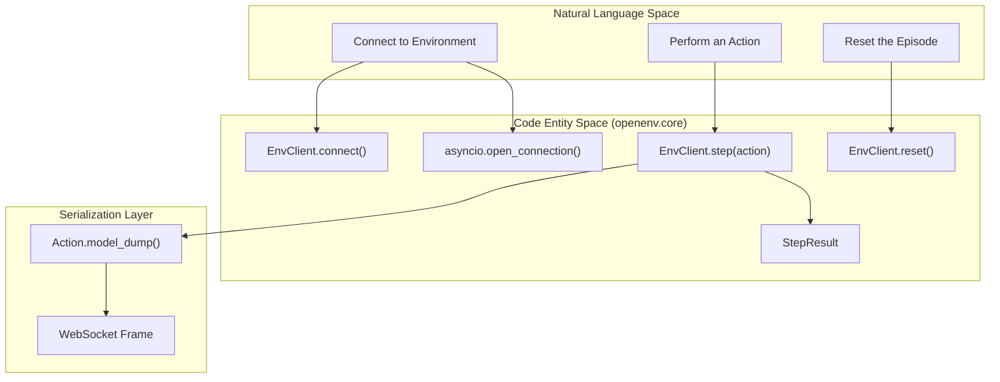
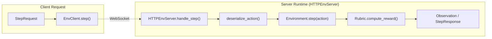

<!-- source: DeepWiki mcp.deepwiki.com · repo huggingface/OpenEnv · page 8 Glossary · fetched 2026-10-26 -->

# Glossary

Relevant source files

The following files were used as context for generating this wiki page:

- [README.md](README.md)
- [docs/source/_toctree.yml](docs/source/_toctree.yml)
- [docs/source/contributing.md](docs/source/contributing.md)
- [docs/source/environments.md](docs/source/environments.md)
- [docs/source/guides/async-sync.md](docs/source/guides/async-sync.md)
- [docs/source/guides/rewards.md](docs/source/guides/rewards.md)
- [docs/source/guides/simulation-vs-production.md](docs/source/guides/simulation-vs-production.md)
- [docs/source/guides/task-api.md](docs/source/guides/task-api.md)
- [docs/source/index.md](docs/source/index.md)
- [docs/source/tutorials/browsergym-harness.md](docs/source/tutorials/browsergym-harness.md)
- [docs/source/tutorials/harbor-harness.md](docs/source/tutorials/harbor-harness.md)
- [docs/source/tutorials/harnesses.md](docs/source/tutorials/harnesses.md)
- [docs/source/tutorials/index.md](docs/source/tutorials/index.md)
- [docs/source/tutorials/mcp-environment.md](docs/source/tutorials/mcp-environment.md)
- [docs/source/tutorials/openenv-tutorial.md](docs/source/tutorials/openenv-tutorial.md)
- [docs/source/tutorials/rubrics.md](docs/source/tutorials/rubrics.md)
- [examples/echo_mcp_demo.py](examples/echo_mcp_demo.py)
- [examples/mcp_environment.ipynb](examples/mcp_environment.ipynb)
- [src/openenv/core/README.md](src/openenv/core/README.md)
- [src/openenv/core/__init__.py](src/openenv/core/__init__.py)
- [src/openenv/core/client_types.py](src/openenv/core/client_types.py)
- [src/openenv/core/env_server/__init__.py](src/openenv/core/env_server/__init__.py)
- [src/openenv/core/env_server/exceptions.py](src/openenv/core/env_server/exceptions.py)
- [src/openenv/core/env_server/http_server.py](src/openenv/core/env_server/http_server.py)
- [src/openenv/core/env_server/interfaces.py](src/openenv/core/env_server/interfaces.py)
- [src/openenv/core/env_server/mcp_types.py](src/openenv/core/env_server/mcp_types.py)
- [src/openenv/core/env_server/types.py](src/openenv/core/env_server/types.py)
- [tests/core/test_types_and_enums.py](tests/core/test_types_and_enums.py)
- [tutorial/01-environments.md](tutorial/01-environments.md)

This glossary defines technical terms, architectural patterns, and domain-specific jargon used throughout the OpenEnv codebase. It is designed to help onboarding engineers quickly understand core abstractions, configuration files, and system workflows.

## Core Concepts

### 1. Environment Session
A stateful, isolated instance of an environment. While an `Environment` class defines the business logic and state transitions, a session represents a specific running instance (often inside a container or WebSocket connection) with its own execution history, step counter, and unique identifier [src/openenv/core/env_server/http_server.py:173-218]().

Sources: [src/openenv/core/env_server/http_server.py:173-218](), [src/openenv/core/README.md:39-42]()

### 2. Simulation vs. Production Mode
OpenEnv supports two distinct communication protocols between the client and the environment server, governed by the `ServerMode` enum:
- **Simulation Mode**: Uses the Gymnasium-style `reset()` and `step()` control loop over WebSockets, optimized for reinforcement learning training loops, trajectory collection, and batch rollouts [src/openenv/core/env_server/types.py:18-23](), [README.md:16-16]().
- **Production Mode**: Exposes tools over `/mcp` via the Model Context Protocol (JSON-RPC 2.0), enabling real-world agent tool use and standard chat frameworks while maintaining internal execution isolation [README.md:21-21]().

Sources: [src/openenv/core/env_server/types.py:18-23](), [README.md:16-21]()

### 3. MCP (Model Context Protocol)
A standard protocol that allows agents to discover and call tools dynamically. In OpenEnv, environments can operate as MCP servers, exposing their internal capabilities and environment actions as tools that can be invoked via JSON-RPC transport layers [README.md:21-21](), [docs/source/tutorials/openenv-tutorial.md:76-87]().

Sources: [README.md:21-21](), [docs/source/tutorials/openenv-tutorial.md:76-87]()

---

## Technical Components

### EnvClient & SyncEnvClient
The primary client-side abstraction for communicating with remote or local environment servers:
- `EnvClient`: An asynchronous WebSocket-first client supporting non-blocking `reset()`, `step()`, and `state()` operations [src/openenv/core/README.md:18-21]().
- `SyncEnvClient`: A synchronous wrapper accessed via the `.sync()` method, enabling integration into synchronous scripts and notebooks [src/openenv/core/README.md:20-21]().

Sources: [src/openenv/core/README.md:18-21](), [docs/source/tutorials/openenv-tutorial.md:76-81]()

### Container Provider
A pluggable abstraction layer for managing the lifecycle of environment compute resources (starting containers, health checks, network setup, and teardown) [src/openenv/core/README.md:22-22]().
- `LocalDockerProvider`: Manages local container instances using the Docker SDK [src/openenv/core/README.md:158-166]().
- **DaytonaProvider / Cloud Providers**: Manage cloud-based secure sandboxes [docs/source/contributing.md:28-32]().

Sources: [src/openenv/core/README.md:22-22](), [src/openenv/core/README.md:158-166]()

### Rubric
A modular, composable system for computing reward signals and evaluating trajectories. Rubrics can range from simple terminal state checks to complex multi-component weighted sums and LLM-based judges [docs/source/tutorials/rubrics.md:1-36]().

Sources: [src/openenv/core/env_server/interfaces.py:21-23](), [docs/source/tutorials/rubrics.md:1-36]()

---

## Implementation Diagrams

### Natural Language to Code Entity Mapping
This diagram bridges user-facing natural language commands to the concrete classes and methods inside the core package.

**Title: "Client-Side Entity Mapping"**

Sources: [src/openenv/core/env_server/types.py:50-88](), [src/openenv/core/README.md:185-197]()

### Environment Execution Data Flow
This diagram illustrates the lifecycle of a step execution within an environment server instance.

**Title: "Environment Step Execution Flow"**

Sources: [src/openenv/core/env_server/http_server.py:173-218](), [src/openenv/core/env_server/types.py:125-170]()

---

## Abbreviations & Jargon

| Term | Definition | Code Pointer |
| :--- | :--- | :--- |
| **ActT / ObsT** | TypeVars bounded by `Action` and `Observation` used in generic classes. | [src/openenv/core/env_server/interfaces.py:24-25]() |
| **HF Space** | A deployment target on Hugging Face for hosting environment servers via Spaces. | [docs/source/index.md:17-18]() |
| **RLM** | Recursive Language Models; execution paradigms where models invoke tools or sub-agents recursively. | [docs/source/environments.md:114-115]() |
| **Base Image** | The `openenv-base` Docker image containing the standard Python and runtime dependencies. | [README.md:17-18]() |
| **Auto-Env / Auto-Action** | Factory patterns for dynamically discovering and instantiating environment clients and action schemas. | [docs/source/tutorials/openenv-tutorial.md:102-103]() |

Sources: [src/openenv/core/env_server/interfaces.py:24-25](), [docs/source/index.md:17-18]()

---

## Configuration & Metadata

### openenv.yaml
The manifest file required in every environment directory. It specifies the configuration, entry points, and dependencies needed by the CLI and `AutoEnv` for discovery and container packaging [README.md:93-96]().

Sources: [README.md:93-96](), [docs/source/_toctree.yml:16-17]()

### StepResult
The container returned by `env.step()`, encapsulating the outcome of a single interaction turn. It includes:
- `observation`: The environment-specific observation payload.
- `reward`: The scalar reward signal computed by the environment or rubric.
- `done`: A boolean flag indicating whether the episode has terminated.
- `metadata`: Additional diagnostic dictionaries.

Sources: [src/openenv/core/README.md:90-96](), [src/openenv/core/env_server/types.py:68-88]()