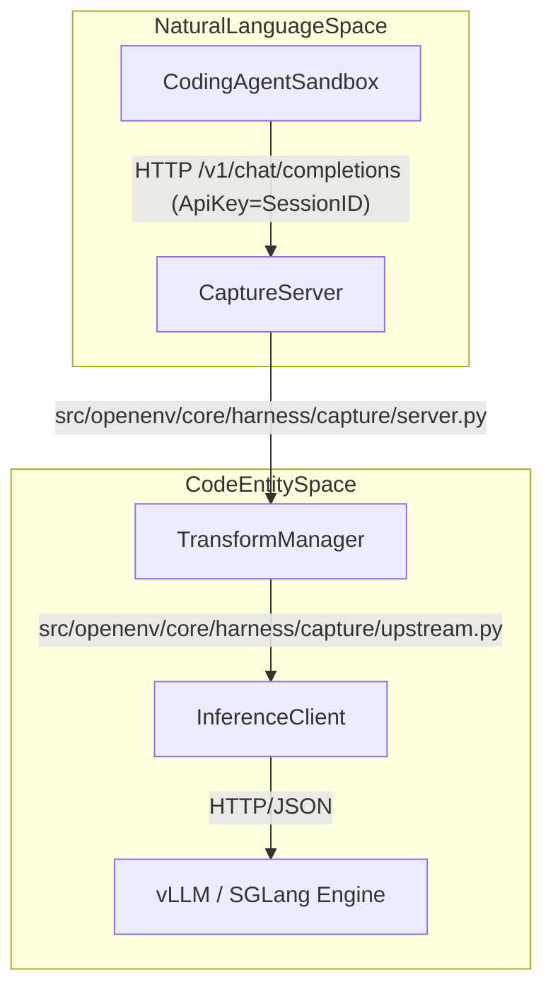
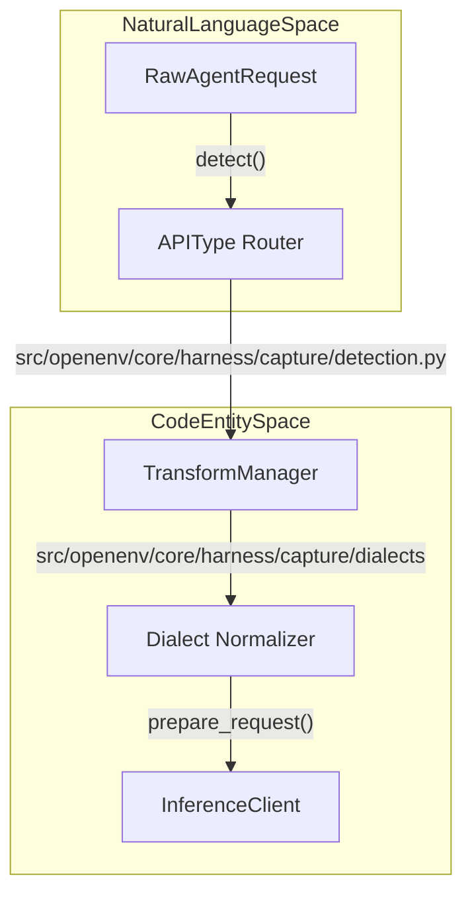
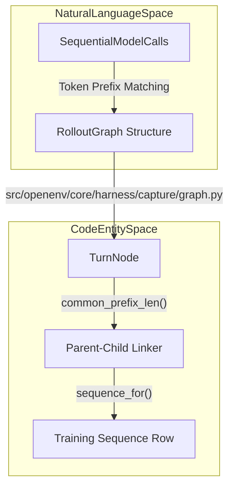

<!-- source: DeepWiki mcp.deepwiki.com · repo huggingface/OpenEnv · extra page Capture Proxy and Training Traces · fetched 2026-10-26 -->

# Capture Proxy and Training Traces

Relevant source files

The following files were used as context for generating this wiki page:

- [src/openenv/core/harness/capture/graph.py](src/openenv/core/harness/capture/graph.py)
- [src/openenv/core/harness/capture/server.py](src/openenv/core/harness/capture/server.py)
- [src/openenv/core/harness/capture/upstream.py](src/openenv/core/harness/capture/upstream.py)
- [src/openenv/core/harness/capture/validate_llm.py](src/openenv/core/harness/capture/validate_llm.py)
- [src/openenv/harbor/runner.py](src/openenv/harbor/runner.py)
- [src/openenv/harbor/tasks.py](src/openenv/harbor/tasks.py)
- [tests/envs/test_harbor_capture_graph.py](tests/envs/test_harbor_capture_graph.py)
- [tests/envs/test_harbor_capture_level.py](tests/envs/test_harbor_capture_level.py)
- [tests/envs/test_harbor_capture_server.py](tests/envs/test_harbor_capture_server.py)
- [tests/envs/test_harbor_native_provider.py](tests/envs/test_harbor_native_provider.py)
- [tests/envs/test_harbor_per_session_engine.py](tests/envs/test_harbor_per_session_engine.py)
- [tests/envs/test_harbor_runner_lifecycle.py](tests/envs/test_harbor_runner_lifecycle.py)
- [tests/envs/test_harbor_tasks_and_dialects.py](tests/envs/test_harbor_tasks_and_dialects.py)
- [tests/envs/test_harbor_upstream_request.py](tests/envs/test_harbor_upstream_request.py)

This page provides a deep technical dive into the OpenEnv capture proxy layer (`src/openenv/core/harness/capture`), which intercepts OpenAI-compatible and native model calls from agentic harnesses (such as Claude Code or OpenCode running inside sandboxes), forwards them to inference engines (vLLM or SGLang), and builds faithful `TrainingTrace` data structures without performing local tokenization.

---

## 1. The CaptureServer and Upstream Architecture

The `CaptureServer` class acts as an OpenAI-compatible HTTP proxy [src/openenv/core/harness/capture/server.py:1-35](). It enables coding agents inside sandboxes to point their standard base URL environment variables (`OPENAI_BASE_URL`, `ANTHROPIC_BASE_URL`) directly at the proxy without modifying agent code [src/openenv/core/harness/capture/server.py:6-12]().

Multiplexing across concurrent sessions is handled entirely via the API key: the bearer token provided by the client corresponds to a rollout session identifier managed by `SessionRegistry` [src/openenv/core/harness/capture/server.py:10-11, 59-66]().

*Sources: `src/openenv/core/harness/capture/server.py:1-35`, `src/openenv/core/harness/capture/upstream.py:1-38`*

Auxiliary routes that do not represent chat completions (such as token counting requests from `claude-code`) are intercepted by `is_aux_route()` and answered directly via `aux_token_count_response()` without generating graph nodes [src/openenv/core/harness/capture/server.py:96-143]().

### Sources
- `src/openenv/core/harness/capture/server.py:1-161`
- `src/openenv/core/harness/capture/upstream.py:1-38`

---

## 2. Dialect Detection and Request Forwarding

When an incoming HTTP request hits the proxy, `detect()` examines the path, headers, and request body shape to determine the calling dialect (`APIType.OPENAI_CHAT`, `APIType.ANTHROPIC`, `APIType.OPENAI_RESPONSES`, or `APIType.GOOGLE`) [tests/envs/test_harbor_tasks_and_dialects.py:35-77]().

Once detected, `TransformManager` routes the request payload through dialect-specific normalizers [src/openenv/core/harness/capture/server.py:56](). The upstream client (`InferenceClient`) automatically forces capture parameters (`logprobs=True`, `return_token_ids=True`, and `top_logprobs=0` or higher) to ensure the inference engine returns token identifiers and aligned logprobs [tests/envs/test_harbor_upstream_request.py:32-48, src/openenv/core/harness/capture/upstream.py:15-24]().

*Sources: `tests/envs/test_harbor_tasks_and_dialects.py:35-77`, `src/openenv/core/harness/capture/upstream.py:15-38`*

To prevent training/inference skew, the proxy avoids local re-tokenization. It relies entirely on the inference engine's returned `prompt_token_ids` and sampled completion token IDs [src/openenv/core/harness/capture/server.py:18-22]().

### Sources
- `src/openenv/core/harness/capture/detection.py:1-50`
- `src/openenv/core/harness/capture/upstream.py:1-148`
- `tests/envs/test_harbor_upstream_request.py:1-100`
- `tests/envs/test_harbor_tasks_and_dialects.py:35-77`

---

## 3. Capture Graph and Capture Levels

Harnesses often retry turns, spawn subagents, or compact context. A flat list of messages cannot accurately represent these branching behaviors. The capture layer uses `RolloutGraph` and `TurnNode` to store model calls as a directed tree linked exclusively by exact token prefixes [src/openenv/core/harness/capture/graph.py:1-35]().

*Sources: `src/openenv/core/harness/capture/graph.py:1-51`, `tests/envs/test_harbor_capture_graph.py:56-155`*

### Capture Levels

Before accepting rollouts, `validate_llm()` probes the upstream inference engine to establish its capabilities, classifying it into one of three capture levels [src/openenv/core/harness/capture/validate_llm.py:10-38]:
- **`tokens`**: Returns prompt IDs, sampled IDs, and aligned logprobs. Fully trainable. Requires vLLM with specific flags or SGLang built from main [src/openenv/core/harness/capture/validate_llm.py:13-14, 29-34].
- **`logprobs`**: Returns logprobs but no token IDs. Not trainable (unpaired logprobs cannot be attached to tokens) [src/openenv/core/harness/capture/validate_llm.py:15].
- **`text`**: Returns neither logprobs nor token IDs (e.g., standard OpenAI/Anthropic hosted APIs). Used purely as an evaluation backend [src/openenv/core/harness/capture/validate_llm.py:16, 62-70].

### Sources
- `src/openenv/core/harness/capture/graph.py:1-141`
- `src/openenv/core/harness/capture/validate_llm.py:1-105`
- `tests/envs/test_harbor_capture_graph.py:1-155`
- `tests/envs/test_harbor_capture_level.py:1-110`

---

## 4. TrainingTrace Contract and Sequence Construction

Once a rollout path is finalized through the `RolloutGraph`, `sequence_for()` flattens the path into a training sequence containing `input_ids`, `loss_mask`, and `logprobs` [src/openenv/core/harness/capture/graph.py:11-15, tests/envs/test_harbor_capture_graph.py:143-154]().

The `TrainingTrace` contract enforces strict mask rules:
- **Prompt and Scaffolding Tokens**: Assigned a loss mask value of `0` (ignored during backpropagation).
- **Sampled Completion Tokens**: Assigned a loss mask value of `1` (trainable model outputs) [tests/envs/test_harbor_capture_graph.py:143-154]().

By concatenating `node.context_ids + node.sampled_ids` along the graph path, the resulting tensor sequence precisely mirrors the exact token sequence the model processed and generated [src/openenv/core/harness/capture/graph.py:26-34]().

### Sources
- `src/openenv/core/harness/capture/graph.py:1-50`
- `tests/envs/test_harbor_capture_graph.py:143-173`

---

## 5. Ingestion Validation and Pre-Flight Probing

To prevent silent training failures where loss curves remain flat due to misaligned logprobs or missing token fields, validation occurs at ingest time rather than at export time [src/openenv/core/harness/capture/server.py:31-33]().

The validation module (`src/openenv/core/harness/capture/validate.py`) executes `check_turn()` to verify that completion token counts match logprob array lengths and that prompt token identifiers align correctly with preceding turns [src/openenv/core/harness/capture/server.py:75](). If a provider rejects parameters like `return_token_ids` or `max_tokens`, `diagnose()` in `src/openenv/core/harness/capture/compat.py` automatically formulates compatible fixes or parameter renames before retrying upstream [tests/envs/test_harbor_capture_level.py:109-167, src/openenv/core/harness/capture/validate_llm.py:23-27]().

### Sources
- `src/openenv/core/harness/capture/validate_llm.py:1-70`
- `tests/envs/test_harbor_capture_level.py:90-167`
- `src/openenv/core/harness/capture/server.py:31-77`

---

