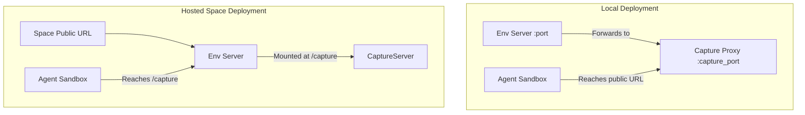
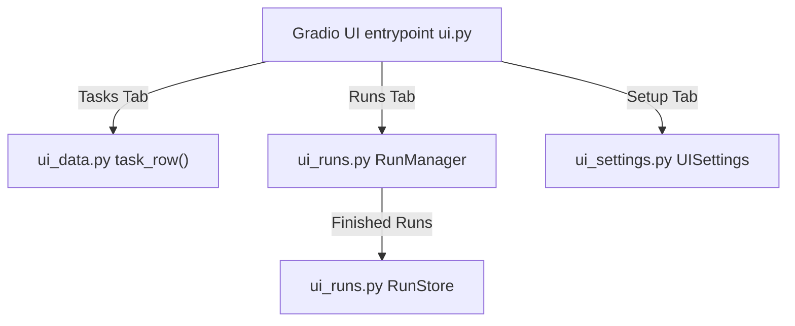
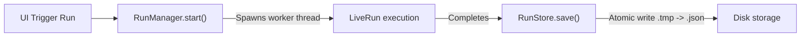

<!-- source: DeepWiki mcp.deepwiki.com · repo huggingface/OpenEnv · extra page Harbor UI, Serving, and CLI · fetched 2026-10-26 -->

# Harbor UI, Serving, and CLI

Relevant source files

The following files were used as context for generating this wiki page:

- [docs/source/environments/harbor.md](docs/source/environments/harbor.md)
- [docs/source/tutorials/claude-code-harness.md](docs/source/tutorials/claude-code-harness.md)
- [envs/harbor_env/README.md](envs/harbor_env/README.md)
- [examples/claude_code_harness_eval/Dockerfile](examples/claude_code_harness_eval/Dockerfile)
- [examples/claude_code_harness_eval/Dockerfile.dockerignore](examples/claude_code_harness_eval/Dockerfile.dockerignore)
- [examples/claude_code_harness_eval/README.md](examples/claude_code_harness_eval/README.md)
- [examples/claude_code_harness_eval/chat.py](examples/claude_code_harness_eval/chat.py)
- [examples/claude_code_harness_eval/claude_code_adapter.py](examples/claude_code_harness_eval/claude_code_adapter.py)
- [examples/claude_code_harness_eval/run_eval.py](examples/claude_code_harness_eval/run_eval.py)
- [examples/claude_code_harness_eval/serve.py](examples/claude_code_harness_eval/serve.py)
- [examples/claude_code_harness_eval/tau2_harness.py](examples/claude_code_harness_eval/tau2_harness.py)
- [src/openenv/cli/commands/harbor.py](src/openenv/cli/commands/harbor.py)
- [src/openenv/harbor/serving.py](src/openenv/harbor/serving.py)
- [src/openenv/harbor/ui.py](src/openenv/harbor/ui.py)
- [src/openenv/harbor/ui_assets/run_card.js](src/openenv/harbor/ui_assets/run_card.js)
- [src/openenv/harbor/ui_assets/task_browser.js](src/openenv/harbor/ui_assets/task_browser.js)
- [src/openenv/harbor/ui_data.py](src/openenv/harbor/ui_data.py)
- [src/openenv/harbor/ui_pages.py](src/openenv/harbor/ui_pages.py)
- [src/openenv/harbor/ui_runs.py](src/openenv/harbor/ui_runs.py)
- [src/openenv/harbor/ui_settings.py](src/openenv/harbor/ui_settings.py)
- [src/openenv/harbor/ui_trace.py](src/openenv/harbor/ui_trace.py)
- [tests/envs/test_harbor_ui_training_contract.py](tests/envs/test_harbor_ui_training_contract.py)
- [tests/scripts/fake_claude_code.py](tests/scripts/fake_claude_code.py)
- [tests/scripts/test_claude_code_harness_eval_example.py](tests/scripts/test_claude_code_harness_eval_example.py)

This page covers the infrastructure supporting Harbor environment deployment and human interaction: the `HarborService` and `serve_harbor` serving mechanics, the multi-tab Gradio user interface (`ui.py`), background execution management through `RunManager` and `RunStore`, and the OpenEnv CLI commands (`info`, `rollout`, `serve`, `push`) defined under `src/openenv/cli/commands/harbor.py`.

---

## 1. Harbor Service and Serving Topology (`HarborService`)

The core execution and proxy manager for Harbor environments is encapsulated in `HarborService` (`[src/openenv/harbor/serving.py:52-105]()`). Serving Harbor tasks involves two distinct logical interfaces: a management/Task API server (facing trainers and browsers) and an OpenAI-compatible capture proxy (facing agent sandboxes).

Depending on the deployment target (local development versus a Hugging Face Space), the serving topology adjusts how the capture proxy is exposed:

Sources: `[src/openenv/harbor/serving.py:1-125]()`

### Key Serving Classes and Functions

- `HarborService`: Manages the lifecycle of the `CaptureServer` (`[src/openenv/harbor/serving.py:91-101]()`), mints administrative access tokens (`[src/openenv/harbor/serving.py:83-85]()`), and coordinates local tunneling/forwarding via `make_forwarder` (`[src/openenv/harbor/serving.py:127-140]()`).
- `space_public_url()`: Detects whether the process is executing inside a Hugging Face Space by inspecting `SPACE_HOST` or `SPACE_ID` environment variables (`[src/openenv/harbor/serving.py:32-49]()`).
- `CAPTURE_MOUNT`: The standard subpath (`/capture`) used to mount the capture proxy directly onto the FastAPI application when running on a hosted Space (`[src/openenv/harbor/serving.py:28-29]()`, `[src/openenv/harbor/serving.py:120-125]()`).

Sources: `[src/openenv/harbor/serving.py:1-165]()`

---

## 2. Multi-Tab Gradio UI Architecture

The browser-based interface for Harbor env servers is implemented as a Gradio application (`[src/openenv/harbor/ui.py:1-24]()`). It separates functionality into dedicated tabs:

1. **Tasks Tab**: Displays dataset discovery rows, reads instruction files on demand via `task_row` (`[src/openenv/harbor/ui_data.py:137-176]()`), renders file trees up to `MAX_TREE_FILES` (`[src/openenv/harbor/ui_data.py:32-33]()`), and configures prompt/agent execution parameters.
2. **Runs Tab**: Lists historical and active rollouts tracked by the server, allowing side-by-side trajectory inspection.
3. **Setup Tab**: Diagnostic view exposing available sandboxes, hardware status, and capabilities.

Sources: `[src/openenv/harbor/ui.py:1-15]()`, `[src/openenv/harbor/ui_data.py:137-176]()`, `[src/openenv/harbor/ui_runs.py:67-154]()`

Sources: `[src/openenv/harbor/ui.py:1-43](), [src/openenv/harbor/ui_data.py:1-40]()`

---

## 3. Run Management and Quotas (`RunManager` and `RunStore`)

UI-initiated rollouts execute asynchronously in worker threads so that closing or navigating away from the browser tab does not abort the computation (`[src/openenv/harbor/ui_runs.py:1-11]()`). 

### Concurrency Control and Storage

- `RunStore`: Persists completed rollouts as individual JSON files inside a designated runs directory (`[src/openenv/harbor/ui_runs.py:67-94]()`). Writes use atomic file replacement via temporary files (`.tmp`) to prevent partial index corruption during unexpected process termination (`[src/openenv/harbor/ui_runs.py:95-105]()`).
- `LiveRun`: A dataclass tracking in-flight rollouts, recording runtime status (`"starting"`, `"running"`), captured session identifiers, wall time, and execution errors (`[src/openenv/harbor/ui_runs.py:121-152]()`).
- `RunManager`: Enforces concurrency limits (`max_live`, defaulting to 4 concurrent runs) and tracks active endpoints per visitor (`[src/openenv/harbor/ui_runs.py:153-174]()`).

Sources: `[src/openenv/harbor/ui_runs.py:95-119](), [src/openenv/harbor/ui_runs.py:153-194]()`

Sources: `[src/openenv/harbor/ui_runs.py:1-194]()`

---

## 4. Harbor CLI Commands

The OpenEnv CLI provides dedicated subcommands for interacting with Harbor environments without requiring manual script authoring (`[src/openenv/cli/commands/harbor.py:1-100]()`).

- `openenv harbor info`: Performs a read-only probe checking sandbox credential validity, SDK import availability, and dataset integrity (`[docs/source/environments/harbor.md:55-75]()`).
- `openenv harbor rollout`: Executes a single end-to-end rollout directly in-process without booting an environment HTTP server, outputting structured JSON results (`[docs/source/environments/harbor.md:77-90]()`).
- `openenv harbor serve`: Launches the full serving topology (Task API, MCP rollouts, Gradio UI, and capture proxy) against specified datasets and LLM endpoints (`[docs/source/environments/harbor.md:95-103]()`, `[src/openenv/harbor/serving.py:166-200]()`).
- `openenv harbor push`: Prepares and deploys Harbor environments to Hugging Face Spaces.

Sources: `[docs/source/environments/harbor.md:46-120](), [src/openenv/harbor/serving.py:166-250]()`

---

