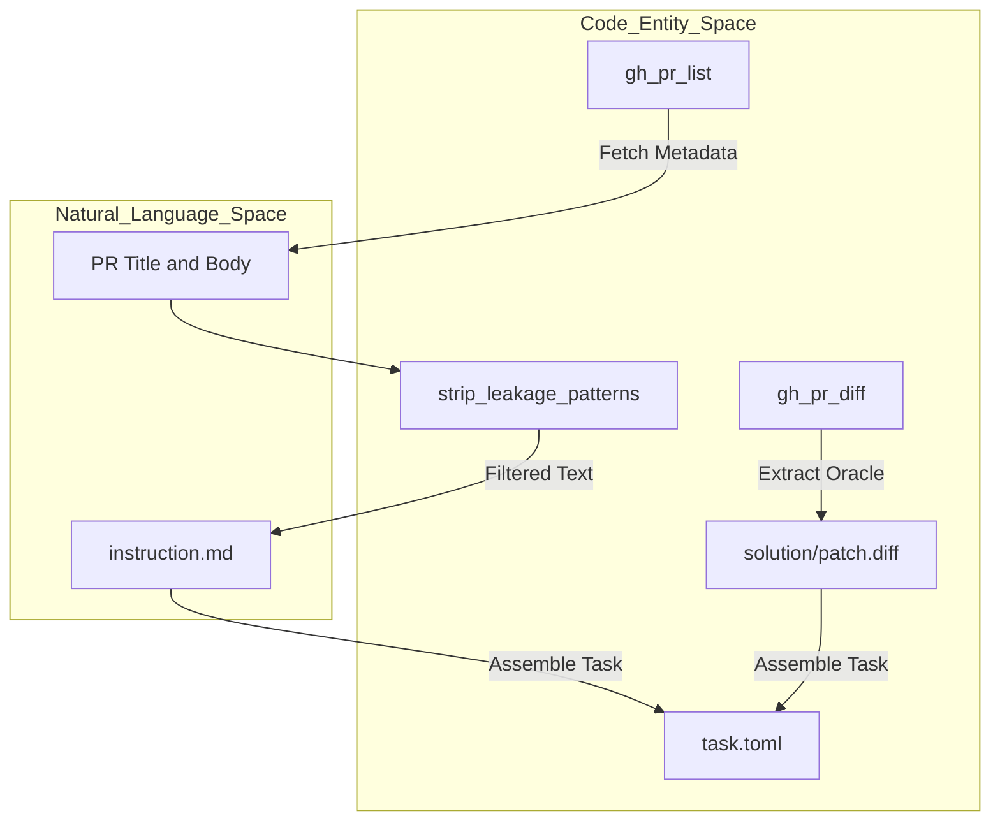
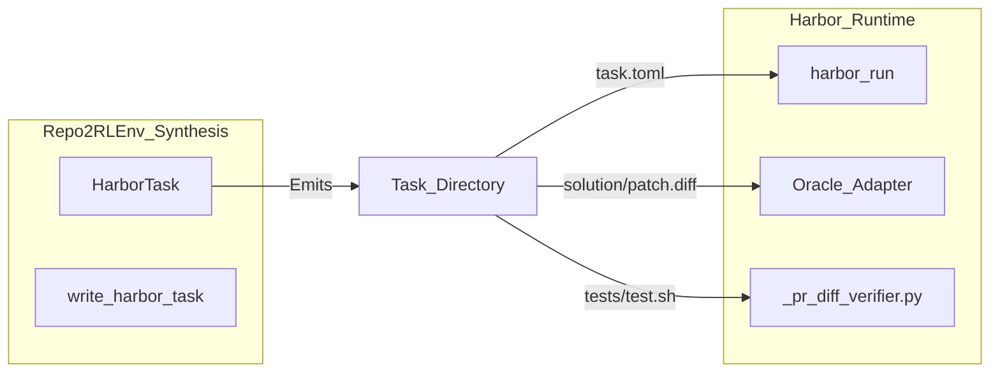

<!-- source: DeepWiki mcp.deepwiki.com · repo huggingface/Repo2RLEnv · page 1.1 Getting Started · fetched 2026-10-26 -->

# Getting Started

<details>
<summary>Relevant source files</summary>

The following files were used as context for generating this wiki page:

- [.env.example](.env.example)
- [docs/pipelines/tasksmith.md](docs/pipelines/tasksmith.md)
- [docs/quickstart.md](docs/quickstart.md)
- [docs/release_notes/HISTORY.md](docs/release_notes/HISTORY.md)
- [pyproject.toml](pyproject.toml)
- [src/repo2rlenv/bootstrap/presets.py](src/repo2rlenv/bootstrap/presets.py)
- [uv.lock](uv.lock)

</details>


Repo2RLEnv is a technical framework designed to transform any GitHub repository into a Reinforcement Learning (RL) environment for training and evaluating coding agents. It automates task extraction from repository history (PRs, commits) and emits standardized task directories compatible with the **Harbor** runtime [docs/quickstart.md:1-3]().

## Prerequisites and External Tools

Before setting up `repo2rlenv`, ensure the following external tools and credentials are available in your environment:

*   **uv**: The recommended high-speed package and tool manager [docs/quickstart.md:8-9]().
*   **gh CLI**: Used for repository mining, listing Pull Requests, and authenticating both public and private repository clones [docs/quickstart.md:11-13]().
*   **Docker**: Required for sandbox-verified pipelines (such as `pr_runtime`) and container image bootstrapping [docs/quickstart.md:67-67]().
*   **LLM API Keys**: Required for the bootstrap agent and semantic pipelines. Repo2RLEnv integrates via **LiteLLM**, supporting providers such as Anthropic, OpenAI, and Hugging Face [pyproject.toml:52-52](), [docs/quickstart.md:15-16]().

Sources: [docs/quickstart.md:5-20](), [pyproject.toml:51-54]()

## Installation and Optional Dependencies

Install `repo2rlenv` globally using `uv` or via standard `pip` [docs/quickstart.md:31-33](). The package defines several optional dependency groups in `pyproject.toml` to support specialized execution backends, agentic workflows, and mutation engines [pyproject.toml:68-86]().

```bash
# Install base package
uv tool install repo2rlenv

# Or install with specific extras
uv pip install "repo2rlenv[tasksmith,modal,harbor]"
```

The available optional dependencies include:
*   `tasksmith`: Installs `langgraph` and checkpointing modules for agentic task authoring [pyproject.toml:69-72]().
*   `modal`: Pulls in `modal` and `dockerfile-parse` for cloud-based remote sandboxing [pyproject.toml:73-76]().
*   `daytona`: Installs the `daytona` SDK for alternative container management [pyproject.toml:77-79]().
*   `mutation`: Includes `libcst` and `pyflakes` for procedural AST bug injection [pyproject.toml:80-83]().
*   `harbor`: Pins the `harbor` evaluation runtime SDK [pyproject.toml:84-86]().

Sources: [pyproject.toml:68-86](), [docs/quickstart.md:30-34]()

## First Dataset Generation with `pr_diff`

The `pr_diff` pipeline offers the fastest entry point since it does not require a local Docker daemon during the generation phase. It mines merged Pull Requests and emits tasks where candidate solutions are scored via a multi-component diff-similarity reward function [docs/quickstart.md:36-38]().

### 1. Authenticate and Set Keys
```bash
gh auth login
export ANTHROPIC_API_KEY=your_key_here
```
Sources: [docs/quickstart.md:11-17]()

### 2. Execute Generation
Run the `generate` subcommand to mine the last 10 merged PRs from a target repository:

```bash
repo2rlenv generate \
  --repo pallets/click \
  --pipeline pr_diff \
  --pipeline-opt limit=10 \
  --out ./datasets/click-ds
```
Sources: [docs/quickstart.md:44-50]()

### Natural Language to Code Entity Space: `pr_diff` Pipeline
The following diagram illustrates how unstructured PR metadata and descriptions are transformed into structured code entities and Harbor task files during a `pr_diff` generation run.

**Pipeline Execution Flow**

Sources: [docs/quickstart.md:52-58](), [pyproject.toml:60-61]()

## Dataset Distribution and Hugging Face Hub

Repo2RLEnv supports a robust publication workflow via `repo2rlenv push` [docs/quickstart.md:60-75](). For sandbox-verified pipelines, the push command simultaneously uploads the dataset to the Hugging Face Hub and pushes the bootstrap Docker images to an OCI registry (such as GitHub Container Registry) [docs/quickstart.md:77-78]().

### 1. Verify Registry Credentials
Before executing a push that involves container images, verify authorization status:
```bash
repo2rlenv push --check-auth
```
Sources: [docs/quickstart.md:85-85]()

### 2. Push and Pull Workflow
```bash
# Push generated dataset to Hub
repo2rlenv push ./datasets/click-ds <your-org>/click-r2e

# Pull dataset back for training or evaluation
repo2rlenv pull <your-org>/click-r2e
```
Sources: [docs/quickstart.md:70-74]()

### System Mapping: Task Emission to Harbor Execution
This diagram demonstrates the mapping between `repo2rlenv` generation components and the runtime evaluation architecture in `harbor`.

**Task Entity Mapping**

Sources: [docs/quickstart.md:115-124](), [pyproject.toml:60-61]()

Sources for this page: `pyproject.toml`, `docs/quickstart.md`, `docs/release_notes/HISTORY.md`

---

