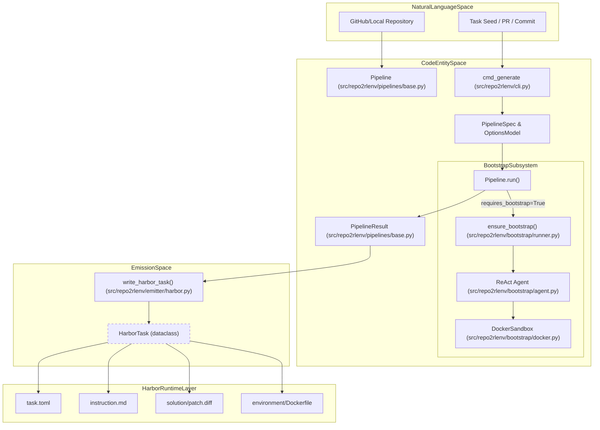
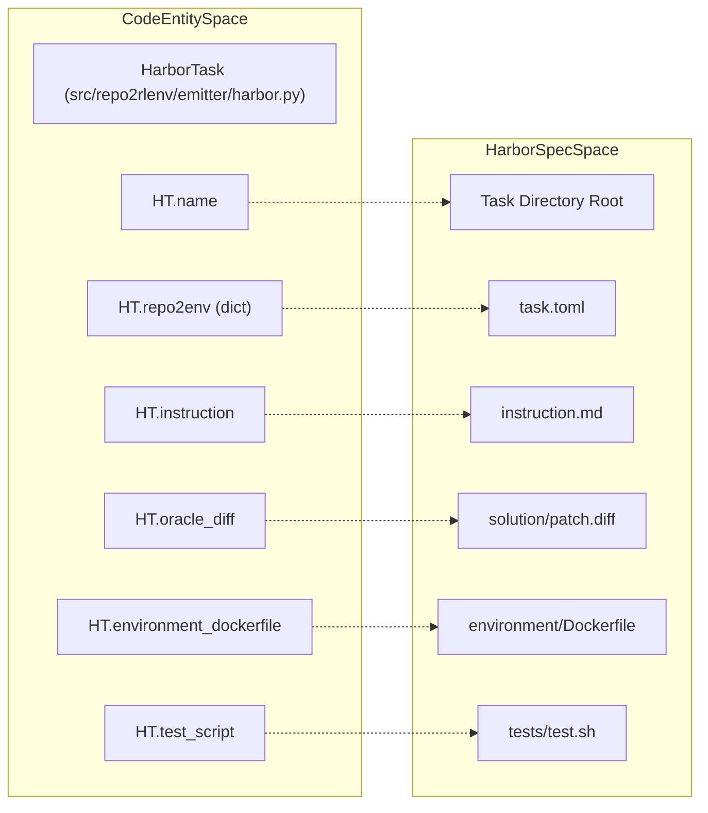

<!-- source: DeepWiki mcp.deepwiki.com · repo huggingface/Repo2RLEnv · page 1.2 System Architecture · fetched 2026-10-26 -->

# System Architecture

Relevant source files

The following files were used as context for generating this wiki page:

- [CLAUDE.md](CLAUDE.md)
- [README.md](README.md)
- [docs/reference/API.md](docs/reference/API.md)
- [docs/reference/SPEC.md](docs/reference/SPEC.md)
- [src/repo2rlenv/pipelines/_env_guard.py](src/repo2rlenv/pipelines/_env_guard.py)
- [src/repo2rlenv/pipelines/base.py](src/repo2rlenv/pipelines/base.py)
- [src/repo2rlenv/validation.py](src/repo2rlenv/validation.py)
- [tests/test_pipeline_contract.py](tests/test_pipeline_contract.py)
- [tests/test_validation.py](tests/test_validation.py)

Repo2RLEnv is designed as a modular synthesis engine that transforms raw source code repositories into verifiable Reinforcement Learning (RL) environments. The architecture is split into a **Synthesis Layer** (Repo2RLEnv) which handles data mining, LLM task generation, and environment creation, and a **Runtime Layer** (Harbor) which handles execution, agent evaluation, and reward computation [README.md:28-30](), [CLAUDE.md:21-37]().

---

## Layered Architecture Overview

The system follows a "synthesis-first" approach where the complexity of environment setup and verification is shifted entirely to the generation phase. This ensures that emitted datasets are lightweight, portable, and ready to drop straight into Harbor's execution backends [CLAUDE.md:21-27]().

| Layer | Code Module | Responsibility |
|---|---|---|
| **Generation Layer** | `repo2rlenv.pipelines` | Mines repositories, runs the bootstrap agent loop, synthesizes task instructions, and builds test oracles [CLAUDE.md:32-34](). |
| **Spec & Emission Layer** | `repo2rlenv.emitter` | Standardizes task outputs into the Harbor `task.toml` format with the namespaced `[metadata.repo2env]` provenance extension [docs/reference/SPEC.md:73-77](). |
| **Consumption Runtime** | Harbor Framework (External) | Orchestrates local Docker, Modal, or Daytona sandboxes, executes agent solutions, and evaluates test verification [CLAUDE.md:21-27](). |

### Component Flow and Code Entity Mapping
This diagram bridges natural language task concepts to concrete Python modules, classes, and protocol entry points within the codebase.

Title: Component Flow from Repository to Harbor Spec

**Sources:** [src/repo2rlenv/pipelines/base.py:57-97](), [src/repo2rlenv/bootstrap/runner.py](), [src/repo2rlenv/emitter/harbor.py](), [README.md:28-43]()

---

## The Pipeline Protocol

The core architectural interface of Repo2RLEnv is the `Pipeline` protocol defined in `src/repo2rlenv/pipelines/base.py`. Every native synthesis strategy and research recipe implements this duck-typed interface to ensure uniform execution via the CLI dispatcher [src/repo2rlenv/pipelines/base.py:57-77](), [tests/test_pipeline_contract.py:10-21]().

### Protocol Attributes and Methods
- `name: ClassVar[PipelineName]`: A unique identifier mapped from the `PipelineName` enumeration [src/repo2rlenv/pipelines/base.py:79]().
- `requires_bootstrap: ClassVar[bool]`: A boolean flag indicating whether the pipeline requires a pre-built Docker environment from the bootstrap subsystem prior to execution [src/repo2rlenv/pipelines/base.py:80]().
- `supported_languages: ClassVar[frozenset[LanguageHint] | None]`: Restricts the pipeline to specific language hints (e.g., Python); `None` indicates language-agnostic operation [src/repo2rlenv/pipelines/base.py:81-84]().
- `experimental: ClassVar[bool]`: Identifies whether a pipeline is stable or experimental (triggering warnings during CLI dispatch) [src/repo2rlenv/pipelines/base.py:85-88]().
- `__init__(input: GenerationInput, options: BaseModel, bootstrap: Any = None)`: Initializes the pipeline with validated configuration input and optional bootstrap artifacts [src/repo2rlenv/pipelines/base.py:90-95]().
- `run(out_dir: Path) -> PipelineResult`: Executes task mining, verification, and emission, returning uniform counters via `PipelineResult` [src/repo2rlenv/pipelines/base.py:37-54]().

**Sources:** [src/repo2rlenv/pipelines/base.py:1-98](), [tests/test_pipeline_contract.py:10-44](), [src/repo2rlenv/pipelines/__init__.py:1-30]()

---

## Task Lifecycle: From Repo Mining to Harbor-Spec Output

The transformation of a repository into a published dataset follows a strict 4-stage pipeline lifecycle managed by the command-line interface and library API [README.md:28-43]().

### 1. Repository Mining and Filtering
Pipelines discover candidate changes (pull requests via `gh pr list`, commit histories, or code snippets) and filter out drafts, oversized diffs, or non-conforming commits [docs/reference/API.md:66-71]().

### 2. Bootstrap and Sandbox Verification
For full pipelines where `requires_bootstrap=True` (e.g., `pr_runtime`, `commit_runtime`), Repo2RLEnv invokes `ensure_bootstrap()` to build and cache a dedicated Docker container [src/repo2rlenv/pipelines/base.py:73-77](). Test oracles are verified inside the sandbox by checking "Fail-to-Pass" (F2P) and "Pass-to-Pass" (P2P) outcomes [docs/pipelines/README.md:51-55]().

### 3. Task Emission and Provenance Binding
Validated candidate tasks are structured into `HarborTask` data classes and written to disk via `write_harbor_task()` [docs/reference/API.md:117-130](). Each task directory contains standard Harbor files alongside a custom `[metadata.repo2env]` extension table in `task.toml` [docs/reference/SPEC.md:73-77]().

### Data Flow: Task Entity Mapping
This diagram maps internal Python data structures to their corresponding filesystem paths within an emitted Harbor task directory.

Title: Task Entity Data Mapping

**Sources:** [src/repo2rlenv/emitter/harbor.py](), [docs/reference/SPEC.md:73-90](), [docs/reference/API.md:115-131]()

---

## Contamination Defenses

To prevent LLM agents from cheating on benchmark tasks by reading published solutions or hidden test files via network egress or git logs, Repo2RLEnv implements strict built-in contamination defenses [CLAUDE.md:38-54]().

### Git History Scrubbing
When building sandbox environments for patch tasks, `src/repo2rlenv/pipelines/_env_guard.py` applies `git_history_scrub()` inside the Dockerfile build sequence [src/repo2rlenv/pipelines/_env_guard.py:43-67](). This function:
- Checks out a detached HEAD at `base_commit` [src/repo2rlenv/pipelines/_env_guard.py:58]()
- Removes remote origins and prunes all branches and tags pointing past the base commit [src/repo2rlenv/pipelines/_env_guard.py:59-64]()
- Expires the reflog and runs `git gc --prune=now` to completely purge future commits, preventing agents from running `git diff origin/main` or reading hidden test files [src/repo2rlenv/pipelines/_env_guard.py:61-66]()

### Network Egress Restrictions
To prevent package manager downloads of fixed library versions (e.g., `pip download pkg==fixed`), `egress_guard_compose()` generates an `environment/docker-compose.yaml` overlay that blackholes known fix-serving domains (`pypi.org`, `github.com`, `raw.githubusercontent.com`) by mapping them to `0.0.0.0` [src/repo2rlenv/pipelines/_env_guard.py:31-40, 70-87](). General internet access remains open so agent runtimes can still communicate with model APIs and package installers [src/repo2rlenv/pipelines/_env_guard.py:11-15]().

**Sources:** [src/repo2rlenv/pipelines/_env_guard.py:1-87](), [CLAUDE.md:44-54]()

---

## LLM Cost Control and Caching

API spend on large language models is strictly governed across synthesis pipelines through several architectural patterns:

- **LiteLLM Abstraction Wrapper**: All LLM completions are routed through `src/repo2rlenv/llm.py`, providing unified provider resolution, API key lookup, and budget tracking [docs/reference/API.md:73-88]().
- **Bootstrap Caching**: The bootstrap subsystem uses content-addressed caching (`src/repo2rlenv/bootstrap/cache.py`) to ensure that expensive container build phases and environment analysis runs are executed exactly once per repository configuration, avoiding redundant LLM generation steps.
- **Lite vs. Full Separation**: Lite pipelines (such as `pr_diff`) bypass sandbox builds and LLM agent loops entirely, performing pure text and diff operations to minimize token overhead unless explicit multi-component generation is selected.

**Sources:** [docs/reference/API.md:73-89](), [src/repo2rlenv/llm.py](), [src/repo2rlenv/bootstrap/cache.py]()

---

