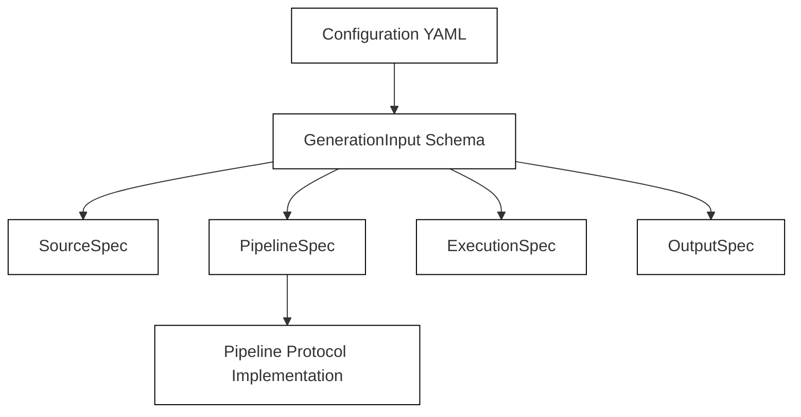

<!-- source: DeepWiki mcp.deepwiki.com · repo huggingface/Repo2RLEnv · page 1.3 Example Configurations · fetched 2026-10-26 -->

# Example Configurations

Relevant source files

The following files were used as context for generating this wiki page:

- [examples/owned-cli-gym.yaml](examples/owned-cli-gym.yaml)
- [examples/owned-dataarc.yaml](examples/owned-dataarc.yaml)
- [examples/owned-r2e.yaml](examples/owned-r2e.yaml)
- [examples/owned-scaler.yaml](examples/owned-scaler.yaml)
- [examples/owned-seta-evol.yaml](examples/owned-seta-evol.yaml)
- [examples/owned-seta.yaml](examples/owned-seta.yaml)
- [examples/owned-swe-smith.yaml](examples/owned-swe-smith.yaml)
- [examples/owned-terminalworld.yaml](examples/owned-terminalworld.yaml)
- [examples/owned-tmax.yaml](examples/owned-tmax.yaml)

## Purpose and Scope

The `examples/` directory provides production-ready YAML configuration files representing owned research recipes within `Repo2RLEnv`. These files serve as declarative blueprints that map high-level synthesis strategies to the underlying execution pipelines, LLM providers, sandbox environments, and target dataset outputs. Each configuration populates the `GenerationInput` schema, steering the synthesis engine to generate reinforcement learning environments and Harbor-compliant evaluation datasets.

Sources: [examples/owned-scaler.yaml:1-23](), [examples/owned-r2e.yaml:1-31]()

---

## Anatomy of an Owned Recipe Configuration

An owned recipe configuration is partitioned into top-level blocks that direct every stage of task synthesis:

1. **`source`**: Defines the origin of task raw materials (e.g., git repositories, family definition files, seed datasets, recordings).
2. **`pipeline`**: Specifies the execution `name` (the registered pipeline engine), the `recipe` identifier, and pipeline-specific `options`.
3. **`llm`**: Configures the language model provider, model tag, and invocation timeouts.
4. **`execution`**: Controls campaign paths, run identifiers, worker receipt files, wheel distribution paths, and global timeout ceilings.
5. **`output`**: Determines task emission paths, Hugging Face organization, dataset naming, and repository visibility.

*Figure 1: Configuration Data Flow Architecture*

Sources: [examples/owned-scaler.yaml:1-23](), [examples/owned-r2e.yaml:1-31]()

---

## Tour of Owned Recipe Configurations

### 1. SCALER (`owned-scaler.yaml`)
The SCALER recipe configures reasoning-intensive synthesis workflows using family definitions to scale difficulty levels across generated tasks.
- **Source Kind**: `family` pointing to a JSON file of task families [examples/owned-scaler.yaml:1-3].
- **Pipeline**: `reasoning_synth` with recipe `scaler` [examples/owned-scaler.yaml:4-6].
- **Options**: Controls candidate ceilings, difficulty matrices, sample frequency per tier, and random seeding [examples/owned-scaler.yaml:7-12].

Sources: [examples/owned-scaler.yaml:1-23]()

### 2. R2E (`owned-r2e.yaml`)
The R2E (Repo-to-Environment) configuration drives test equivalence generation targeting python library codebases.
- **Source Kind**: `repository` pointing to `more-itertools/more-itertools` at a specific git ref [examples/owned-r2e.yaml:1-6].
- **Pipeline**: `equivalence_tests` with recipe `r2e` [examples/owned-r2e.yaml:7-9].
- **Options**: Defines `source_paths`, `test_paths`, target counts, candidate generation limits, round limits, and branch coverage thresholds [examples/owned-r2e.yaml:10-16].

Sources: [examples/owned-r2e.yaml:1-31]()

### 3. CLI-Gym (`owned-cli-gym.yaml`)
CLI-Gym targets command-line interface applications, driving environment repair loops to construct interactive CLI verification tasks.
- **Source Kind**: `repository` pointing to `pallets/click` [examples/owned-cli-gym.yaml:1-6].
- **Pipeline**: `env_repair` with recipe `cli_gym` [examples/owned-cli-gym.yaml:7-9].
- **Options**: Specifies source directories, test paths, round caps, test timeouts, and custom installation commands containing wheelhouse packaging steps [examples/owned-cli-gym.yaml:10-17].

Sources: [examples/owned-cli-gym.yaml:1-31]()

### 4. SWE-Smith (`owned-swe-smith.yaml`)
SWE-Smith orchestrates synthetic bug injection and repository mutation to generate software engineering tasks.
- **Source Kind**: `repository` pointing to public `more-itertools` [examples/owned-swe-smith.yaml:1-6].
- **Pipeline**: `repo_mutate` with recipe `swe_smith` [examples/owned-swe-smith.yaml:7-9].
- **Options**: Sets target counts and max candidate thresholds [examples/owned-swe-smith.yaml:10-14].
- **LLM**: Utilizes `openai` provider with `gpt-5-mini` [examples/owned-swe-smith.yaml:15-17].

Sources: [examples/owned-swe-smith.yaml:1-28]()

### 5. SETA and SETA-Evol (`owned-seta.yaml`, `owned-seta-evol.yaml`)
SETA configurations handle terminal synthesis from seed specifications and evolutionary task difficulty tuning.
- **Source Kind**: `seeds` (JSONL format) or `task` workspaces [examples/owned-seta.yaml:1-3, examples/owned-seta-evol.yaml:1-3].
- **Pipeline**: `terminal_synth` (`seta_seed2synth`) or `task_evolve` (`seta_evol`) [examples/owned-seta.yaml:4-6, examples/owned-seta-evol.yaml:4-6].
- **Options**: Configures repair limits, evolution strategies (`increase_difficulty`, `change_context`, `decrease_difficulty`), and candidate bounds [examples/owned-seta.yaml:7-10, examples/owned-seta-evol.yaml:7-11].

Sources: [examples/owned-seta.yaml:1-24](), [examples/owned-seta-evol.yaml:1-26]()

### 6. DataArc (`owned-dataarc.yaml`)
DataArc recipes consume seed corpuses to synthesize structured reasoning and data-oriented tasks.
- **Source Kind**: `seeds` path pointing to `workspace/dataarc-seeds` [examples/owned-dataarc.yaml:1-3].
- **Pipeline**: `terminal_synth` with recipe `dataarc` [examples/owned-dataarc.yaml:4-6].
- **Options**: Defines generation strategies (`few_shot`, `self_instruct`, `evol_instruct`), evolutionary directions, and sampling frequency [examples/owned-dataarc.yaml:7-13].

Sources: [examples/owned-dataarc.yaml:1-27]()

### 7. TMax (`owned-tmax.yaml`)
TMax focuses on terminal environment task generation driven by custom sampler configurations.
- **Source Kind**: `seeds` path pointing to a sampler JSON file [examples/owned-tmax.yaml:1-3].
- **Pipeline**: `terminal_synth` with recipe `tmax` [examples/owned-tmax.yaml:4-6].
- **Options**: Sets target task counts, candidate caps, and repair rounds [examples/owned-tmax.yaml:7-10].

Sources: [examples/owned-tmax.yaml:1-24]()

### 8. TerminalWorld (`owned-terminalworld.yaml`)
TerminalWorld reconstructs complex CLI environments from recorded terminal sessions.
- **Source Kind**: `recording` path pointing to session recordings [examples/owned-terminalworld.yaml:1-3].
- **Pipeline**: `terminal_reconstruct` with recipe `terminalworld` [examples/owned-terminalworld.yaml:4-6].
- **Options**: Sets scoring thresholds, target counts, and repair limits [examples/owned-terminalworld.yaml:7-11].

Sources: [examples/owned-terminalworld.yaml:1-25]()

---

## Natural Language Space to Code Entity Space

The following diagram maps high-level recipe configurations and pipeline names (Natural Language Space) directly to their implementing Python classes, runner modules, and protocol definitions (Code Entity Space).

```mermaid
graph TD
    subsystem1["Recipe: scaler / Pipeline: reasoning_synth"] --> class1["ReasoningSynthPipeline (pipelines/reasoning.py)"]
    subsystem2["Recipe: r2e / Pipeline: equivalence_tests"] --> class2["EquivalenceTestsPipeline (pipelines/equivalence.py)"]
    subsystem3["Recipe: cli_gym / Pipeline: env_repair"] --> class3["EnvRepairPipeline (pipelines/env_repair.py)"]
    subsystem4["Recipe: swe_smith / Pipeline: repo_mutate"] --> class4["RepoMutatePipeline (pipelines/mutation.py)"]
    subsystem5["Recipe: seta_evol / Pipeline: task_evolve"] --> class5["TaskEvolvePipeline (pipelines/task_evolve.py)"]
    subsystem6["Recipe: terminalworld / Pipeline: terminal_reconstruct"] --> class6["TerminalReconstructPipeline (pipelines/terminal_reconstruct.py)"]

    style subsystem1 fill:none,stroke:#000,stroke-width:1px
    style subsystem2 fill:none,stroke:#000,stroke-width:1px
    style subsystem3 fill:none,stroke:#000,stroke-width:1px
    style subsystem4 fill:none,stroke:#000,stroke-width:1px
    style subsystem5 fill:none,stroke:#000,stroke-width:1px
    style subsystem6 fill:none,stroke:#000,stroke-width:1px
    style class1 fill:none,stroke:#000,stroke-width:1px
    style class2 fill:none,stroke:#000,stroke-width:1px
    style class3 fill:none,stroke:#000,stroke-width:1px
    style class4 fill:none,stroke:#000,stroke-width:1px
    style class5 fill:none,stroke:#000,stroke-width:1px
    style class6 fill:none,stroke:#000,stroke-width:1px
```

*Figure 2: Natural Language Recipe Mapping to Pipeline Code Entities*

Sources: [examples/owned-scaler.yaml:1-23](), [examples/owned-r2e.yaml:1-31](), [examples/owned-cli-gym.yaml:1-31](), [examples/owned-swe-smith.yaml:1-28](), [examples/owned-seta-evol.yaml:1-26](), [examples/owned-terminalworld.yaml:1-25]()

---

## Adapting Configurations

To adapt an owned recipe configuration for custom synthesis campaigns:

1. **Modify Repository Sources**: Update `source.repo.url` and `source.repo.ref` to point to target git repositories [examples/owned-cli-gym.yaml:3-6].
2. **Tune Pipeline Options**: Adjust `target` counts, `max_candidates`, and source/test paths to align with target codebase layouts [examples/owned-r2e.yaml:9-15].
3. **Change LLM Providers**: Switch between `anthropic` and `openai` models under the `llm` block depending on capability requirements and rate limits [examples/owned-swe-smith.yaml:15-17].
4. **Configure Execution Budgets**: Adjust `timeout_sec` values across the execution block to accommodate longer-running test suites or complex sandbox compilation steps [examples/owned-scaler.yaml:13-18].

Sources: [examples/owned-scaler.yaml:13-18](), [examples/owned-cli-gym.yaml:3-17](), [examples/owned-swe-smith.yaml:15-17]()

---

