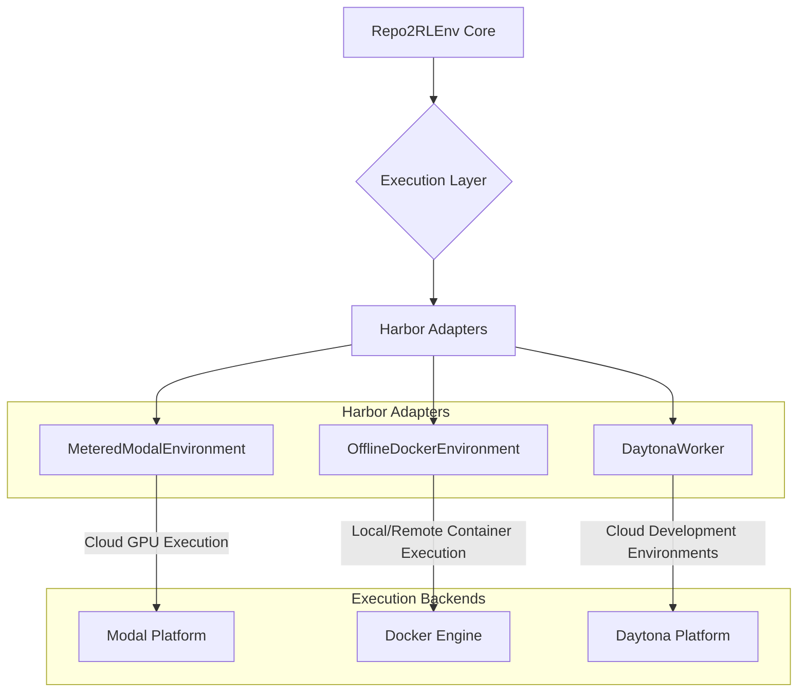

<!-- source: DeepWiki mcp.deepwiki.com · repo huggingface/Repo2RLEnv · page 10 Execution Backends and Campaign Accounting · fetched 2026-10-26 -->

# Execution Backends and Campaign Accounting

<details>
<summary>Relevant source files</summary>

The following files were used as context for generating this wiki page:

- [requirements-docs.txt](requirements-docs.txt)
- [src/repo2rlenv/execution/harbor_modal.py](src/repo2rlenv/execution/harbor_modal.py)
- [src/repo2rlenv/execution/harbor_offline.py](src/repo2rlenv/execution/harbor_offline.py)
- [src/repo2rlenv/locking.py](src/repo2rlenv/locking.py)
- [src/repo2rlenv/pipelines/recipes/history/worker.py](src/repo2rlenv/pipelines/recipes/history/worker.py)
- [src/repo2rlenv/quality/loop/native_recovery.py](src/repo2rlenv/quality/loop/native_recovery.py)
- [src/repo2rlenv/quality/loop/runner.py](src/repo2rlenv/quality/loop/runner.py)
- [src/repo2rlenv/tasksmith/batch.py](src/repo2rlenv/tasksmith/batch.py)
- [src/repo2rlenv/tasksmith/runner.py](src/repo2rlenv/tasksmith/runner.py)
- [tests/test_daytona_worker_contract.py](tests/test_daytona_worker_contract.py)
- [tests/test_harbor_offline.py](tests/test_harbor_offline.py)
- [tests/test_native_modal_accounting.py](tests/test_native_modal_accounting.py)

</details>


This page provides a high-level overview of the execution layer in Repo2RLEnv, which manages how tasks are run on various remote and local environments. It also introduces the campaign budget and accounting system, designed to meter and control remote spending. The execution backends abstract away the complexities of running code in different environments, while the accounting system ensures that resource usage is tracked and managed effectively.

For detailed information on specific components, please refer to the linked child pages.

## Execution Backends

Repo2RLEnv supports multiple execution backends, allowing flexibility in where and how tasks are run. These backends are integrated through Harbor adapters, providing a consistent interface for the core system. The primary backends include Modal for cloud-based GPU execution, Docker for local or remote containerized execution, and Daytona for cloud development environments.

Each backend is designed to handle specific types of tasks and resource requirements, from lightweight offline Docker environments to powerful GPU-accelerated Modal sandboxes. The system ensures that the execution environment adheres to strict contracts, such as network policies and resource allocations.

For details on specific worker types and their lifecycle, see [Remote Workers and Harbor Adapters](#10.1).

### Execution Backend Overview


Sources: [src/repo2rlenv/execution/harbor_modal.py](), [src/repo2rlenv/execution/harbor_offline.py](), [tests/test_daytona_worker_contract.py]()

### Harbor Adapter Integration

The `MeteredModalEnvironment` [src/repo2rlenv/execution/harbor_modal.py]() and `OfflineDockerEnvironment` [src/repo2rlenv/execution/harbor_offline.py]() classes are key Harbor adapters. They extend Harbor's base environment classes (`ModalEnvironment` and `DockerEnvironment` respectively) to integrate with Repo2RLEnv's specific requirements, such as budget accounting and strict network policies. For instance, `MeteredModalEnvironment` [src/repo2rlenv/execution/harbor_modal.py:80-118]() enforces that GPU trials must be offline and cannot receive controller secrets or shared volumes. Similarly, `OfflineDockerEnvironment` [src/repo2rlenv/execution/harbor_offline.py:20-35]() ensures that tasks run in a permanently offline, single-container Docker environment.

The `DaytonaWorker` [tests/test_daytona_worker_contract.py:10]() provides an interface for Daytona environments, allowing tasks to be provisioned and executed within Daytona's cloud development platform.

## Campaign Accounting

The campaign accounting system is responsible for tracking and managing the financial budget allocated for remote execution. It uses a `BudgetLedger` [src/repo2rlenv/campaigns/budget.py]() to reserve, settle, and track costs associated with various operations, such as provisioning workers or running tasks. This system is crucial for controlling LLM and cloud resource spending during large-scale generation campaigns.

The `BudgetLedger` maintains different states for allocations (e.g., `reserved`, `settled`, `uncertain`) to accurately reflect the financial commitment and actual spend. It integrates with the execution backends to receive cost estimates and actual usage data.

For a detailed explanation of the budget ledger and receipt system, see [Budget Ledger and Receipts](#10.2).

### Budgeting and Accounting Flow

```mermaid
graph TD
    A[Campaign Initialization] --> B{BudgetLedger `campaigns/budget.py`}
    B -- "Reserves Budget (`reserve`)" --> C[Worker Provisioning]
    C --> D[Task Execution (e.g., `MeteredModalEnvironment`)]
    D -- "Generates Cost Estimates (`compute_estimate`)" --> E[Allocation Receipts]
    E --> B
    B -- "Settles Costs (`settle`)" --> F[Campaign Completion]

    subgraph "Execution Backends"
        C
        D
    end

    subgraph "Accounting System"
        B
        E
    end
```
Sources: [src/repo2rlenv/campaigns/budget.py](), [src/repo2rlenv/execution/harbor_modal.py:45-77](), [tests/test_native_modal_accounting.py:131-159]()

The `RunBudget` class [src/repo2rlenv/quality/loop/client.py]() acts as an interface to the `BudgetLedger` for specific execution runs, ensuring that each operation adheres to its allocated budget. The system also handles scenarios where allocations are uncertain, such as when a remote worker fails to respond after a creation request, ensuring that budget is retained until the outcome is resolved [tests/test_native_modal_accounting.py:131-159]().

Sources:
- [requirements-docs.txt]()
- [src/repo2rlenv/campaigns/budget.py]()
- [src/repo2rlenv/execution/harbor_modal.py]()
- [src/repo2rlenv/execution/harbor_offline.py]()
- [src/repo2rlenv/execution/lifecycle.py]()
- [src/repo2rlenv/locking.py]()
- [src/repo2rlenv/pipelines/recipes/history/worker.py]()
- [src/repo2rlenv/quality/loop/client.py]()
- [src/repo2rlenv/quality/loop/native_recovery.py]()
- [src/repo2rlenv/quality/loop/runner.py]()
- [src/repo2rlenv/tasksmith/batch.py]()
- [src/repo2rlenv/tasksmith/runner.py]()
- [tests/test_daytona_worker_contract.py]()
- [tests/test_harbor_offline.py]()
- [tests/test_native_modal_accounting.py]()

---

