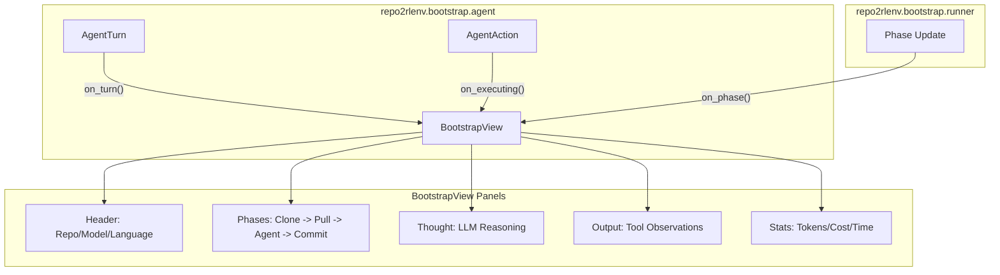
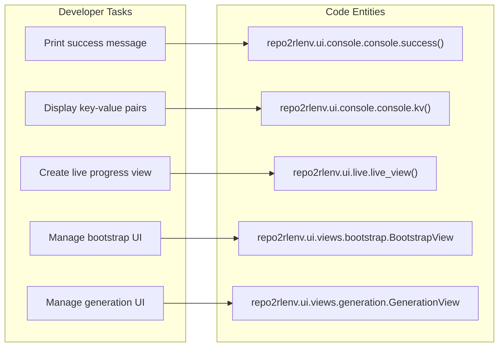

<!-- source: DeepWiki mcp.deepwiki.com · repo huggingface/Repo2RLEnv · page 11 UI and Developer Experience · fetched 2026-10-26 -->

# UI and Developer Experience

Relevant source files

The following files were used as context for generating this wiki page:

- [.python-version](.python-version)
- [src/repo2rlenv/__init__.py](src/repo2rlenv/__init__.py)
- [src/repo2rlenv/py.typed](src/repo2rlenv/py.typed)
- [src/repo2rlenv/ui/__init__.py](src/repo2rlenv/ui/__init__.py)
- [src/repo2rlenv/ui/console.py](src/repo2rlenv/ui/console.py)
- [tests/test_ui_console.py](tests/test_ui_console.py)

The Repo2RLEnv UI is built on a unified **Rich-based** system designed for high-density information display during long-running LLM synthesis and environment bootstrap tasks [src/repo2rlenv/ui/__init__.py:1-35](). The system prioritizes developer experience by providing real-time feedback, cost tracking, and structured logging, while maintaining a clean programmatic API for integration into larger RL training pipelines.

This page provides a high-level overview of the UI and developer experience. For detailed information, refer to the child pages:
- [Rich Terminal UI](#11.1) covers the console singleton, theme, primitives, Live views, and the no-raw-prints policy.
- [Python API and Docs Site](#11.2) discusses public package exports, API reference, and documentation generation.

## Terminal UI System

Repo2RLEnv strictly adheres to a **no-raw-prints** policy. All terminal output is routed through a central `R2EConsole` singleton or specific `Live` view classes.

### The Console Singleton
The `repo2rlenv.ui.console.console` instance is the primary entry point for terminal interaction [src/repo2rlenv/ui/console.py:103](). It provides semantic helpers for consistent styling across the CLI:

| Helper | Purpose | Style/Glyph |
|---|---|---|
| `success(msg)` | Positive outcome | `bold green` + `✓` |
| `info(msg)` | General status | `cyan` + `ⓘ` |
| `warn(msg)` | Non-fatal issue | `bold yellow` + `⚠` |
| `error(msg)` | Fatal failure | `bold red` + `✗` |
| `kv(dict)` | Metadata display | Key/Value table in a cyan panel |
| `section(title)` | Block grouping | Rule with title before/after block |

For details, see [Rich Terminal UI](#11.1).

**Sources:** [src/repo2rlenv/ui/console.py:53-84](), [src/repo2rlenv/ui/theme.py:35-42]()

### Logging Integration
Standard Python logging is captured and rerouted via `RichHandler` [src/repo2rlenv/ui/console.py:125](). This ensures that log messages from internal modules (e.g., git cloning, docker operations) blend seamlessly with the UI.

To prevent display "tearing" during live updates, the system implements a `quiet_libraries()` context manager that suppresses noisy output from `litellm`, `httpx`, and `openai` during active Live views [src/repo2rlenv/ui/__init__.py:38]().

For details, see [Rich Terminal UI](#11.1).

**Sources:** [src/repo2rlenv/ui/console.py:113-140](), [src/repo2rlenv/ui/__init__.py:38]()

---

## Live Views

For long-running processes, Repo2RLEnv uses `rich.live.Live` to provide a redrawing, multi-panel display via the `live_view` context manager [src/repo2rlenv/ui/__init__.py:38]().

### BootstrapView
The `BootstrapView` orchestrates the display for the `bootstrap` command, which uses an LLM agent to build Docker environments [src/repo2rlenv/ui/__init__.py:46](). It tracks distinct phases of the bootstrap process.

**Data Flow: Bootstrap UI**

For details, see [Rich Terminal UI](#11.1).

**Sources:** [src/repo2rlenv/ui/__init__.py:27-31](), [src/repo2rlenv/ui/__init__.py:46]()

### GenerationView
Used by the `generate` command, this view provides a progress bar and tally of task emission status [src/repo2rlenv/ui/__init__.py:47](). It uses a callback `on_candidate` to update the UI as the pipeline processes each PR or commit.

For details, see [Rich Terminal UI](#11.1).

**Sources:** [src/repo2rlenv/ui/__init__.py:47]()

---

## Developer API Surface

While the CLI is the primary interface, Repo2RLEnv is designed as a library. The CLI itself is a thin wrapper over the Python API.

### Core Programmatic Modules

| Code Entity | Purpose |
|---|---|
| `repo2rlenv.ui.console.R2EConsole` | The core console object for structured terminal output [src/repo2rlenv/ui/console.py:41-51]() |
| `repo2rlenv.ui.live.live_view` | Context manager for creating live-updating terminal displays [src/repo2rlenv/ui/__init__.py:38]() |
| `repo2rlenv.ui.views.bootstrap.BootstrapView` | Live view for the bootstrap process [src/repo2rlenv/ui/__init__.py:46]() |
| `repo2rlenv.ui.views.generation.GenerationView` | Live view for the generation process [src/repo2rlenv/ui/__init__.py:47]() |

### Natural Language to Code Mapping

This diagram maps common developer tasks related to the UI to the specific code entities responsible for them.

For details on the Python API and documentation, see [Python API and Docs Site](#11.2).

**Sources:** [src/repo2rlenv/ui/__init__.py:49-64](), [src/repo2rlenv/ui/console.py:54-64](), [src/repo2rlenv/ui/console.py:80-83]()

## UI Theme and Primitives

The visual identity is centralized in `repo2rlenv.ui.theme`, allowing for global updates to colors and glyphs.

- **Styles**: Defined in the `STYLE` class, covering semantic colors (SUCCESS, WARN, ERROR) and panel borders [src/repo2rlenv/ui/theme.py:11-33]().
- **Glyphs**: Uses Unicode symbols for status (`✓`, `⚠`, `✗`) and emojis for bootstrap phases (📥, 🤖, 🐳) [src/repo2rlenv/ui/theme.py:35-52]().
- **Primitives**: Pure functions in `repo2rlenv.ui.primitives` return Rich renderables like `kv_panel`, `success_panel`, and `styled_table` for consistent layout across different views [src/repo2rlenv/ui/__init__.py:40-44]().

For details, see [Rich Terminal UI](#11.1).

**Sources:** [src/repo2rlenv/ui/__init__.py:39-44](), [src/repo2rlenv/ui/theme.py:11-61]()

---

