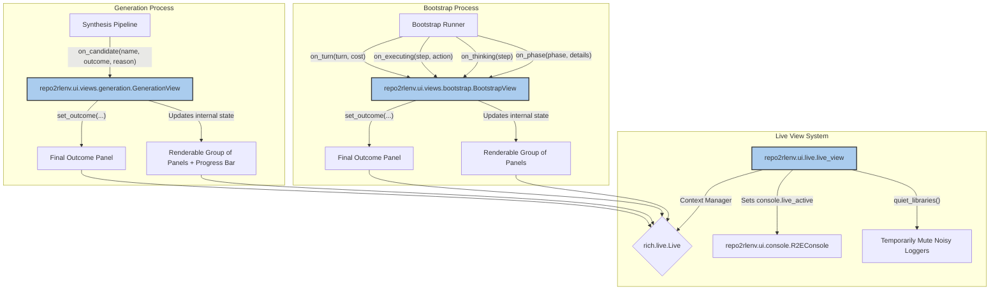

<!-- source: DeepWiki mcp.deepwiki.com · repo huggingface/Repo2RLEnv · page 11.1 Rich Terminal UI · fetched 2026-10-26 -->

# Rich Terminal UI

<details>
<summary>Relevant source files</summary>

The following files were used as context for generating this wiki page:

- [src/repo2rlenv/ui/__init__.py](src/repo2rlenv/ui/__init__.py)
- [src/repo2rlenv/ui/console.py](src/repo2rlenv/ui/console.py)
- [src/repo2rlenv/ui/live.py](src/repo2rlenv/ui/live.py)
- [src/repo2rlenv/ui/primitives.py](src/repo2rlenv/ui/primitives.py)
- [src/repo2rlenv/ui/theme.py](src/repo2rlenv/ui/theme.py)
- [src/repo2rlenv/ui/views/bootstrap.py](src/repo2rlenv/ui/views/bootstrap.py)
- [src/repo2rlenv/ui/views/generation.py](src/repo2rlenv/ui/views/generation.py)
- [tests/test_ui_console.py](tests/test_ui_console.py)

</details>


This page details the rich terminal user interface (UI) system used throughout the Repo2RLEnv CLI. It covers the `console` singleton for consistent output, the theming system, and the `Live` views that provide dynamic, real-time updates for long-running operations like bootstrapping and generation. A core principle of the UI is the "no raw prints" policy, ensuring all output is formatted and styled consistently.

## The Console Singleton

The `repo2rlenv.ui.console.console` object is a module-level singleton that provides a consistent interface for all terminal output within Repo2RLEnv [src/repo2rlenv/ui/console.py:103-103](). It wraps `rich.console.Console` and adds convenience methods for common output patterns, such as stamped lines (success, info, warn, error), section headers, and key-value panels [src/repo2rlenv/ui/console.py:41-86]().

The `R2EConsole` class manages the underlying `rich.Console` instance and tracks whether a `Live` view is active, which is crucial for suppressing noisy log streams during dynamic updates [src/repo2rlenv/ui/console.py:41-51]().

### Stamped Lines

The `console` singleton provides methods for printing messages with predefined styles and glyphs:
- `console.success(msg)`: Prints a success message with a green checkmark [src/repo2rlenv/ui/console.py:54-55]().
- `console.info(msg)`: Prints an informational message with a cyan 'i' glyph [src/repo2rlenv/ui/console.py:57-58]().
- `console.warn(msg)`: Prints a warning message with a yellow warning triangle [src/repo2rlenv/ui/console.py:60-61]().
- `console.error(msg)`: Prints an error message with a red 'X' glyph [src/repo2rlenv/ui/console.py:63-64]().
- `console.dim(msg)`: Prints a message with a dimmed style [src/repo2rlenv/ui/console.py:66-67]().

### Structured Output

For more structured output, `R2EConsole` offers:
- `console.section(title)`: A context manager that prints a rule before and after a block of output, creating visual separation [src/repo2rlenv/ui/console.py:71-79]().
- `console.kv(pairs, title)`: Renders a dictionary of key-value pairs as a two-column table within a panel [src/repo2rlenv/ui/console.py:81-83]().
- `console.panel(body, title, style)`: Prints arbitrary Rich renderables within a panel [src/repo2rlenv/ui/console.py:85-86]().
- `console.json(value)`: Writes a machine-readable JSON record to the console, bypassing terminal wrapping and ANSI codes [src/repo2rlenv/ui/console.py:92-95]().

### Logging Integration

The UI system integrates with Python's standard logging module via `rich.logging.RichHandler` [src/repo2rlenv/ui/console.py:125-132](). This ensures that all log lines from various parts of the codebase are consistently colored and formatted with the rest of the UI. When a `Live` view is active, noisy loggers from libraries like `litellm` and `httpx` are temporarily silenced to prevent output tearing [src/repo2rlenv/ui/console.py:138-140]().

The `install_logging()` function sets up the `RichHandler` and can optionally mute noisy libraries [src/repo2rlenv/ui/console.py:113-140](). The `ensure_utf8_output()` function reconfigures `sys.stdout` and `sys.stderr` to use UTF-8 encoding, preventing `UnicodeEncodeError` on systems with non-UTF-8 default encodings, especially on Windows [src/repo2rlenv/ui/console.py:143-157]().

```mermaid
graph TD
    subgraph "Repo2RLEnv CLI"
        A[CLI Command] --> B{repo2rlenv.ui.console.console}
        B -- "success(), info(), warn(), error()" --> C[Stamped Lines]
        B -- "section(), kv(), panel()" --> D[Structured Output]
        B -- "print(), json()" --> E[Raw/Machine Output]
        B -- "live_active flag" --> F{repo2rlenv.ui.live.live_view}
    end

    subgraph "Logging System"
        G[Python Logging] --> H[rich.logging.RichHandler]
        H --> B
        F -- "Temporarily Mute" --> I[Noisy Loggers (litellm, httpx)]
    end

    subgraph "Terminal Output"
        C --> J[Styled Text + Glyphs]
        D --> K[Panels, Tables, Rules]
        E --> L[Direct Terminal Write]
        F --> M[Dynamic Live Views]
    end

    subgraph "Initialization"
        N[CLI Entry Point] --> O[ensure_utf8_output()]
        N --> P[install_logging()]
        O --> B
        P --> B
    end

    style B fill:#ace,stroke:#333,stroke-width:2px
    style F fill:#ace,stroke:#333,stroke-width:2px
    style H fill:#ace,stroke:#333,stroke-width:2px
    style O fill:#ace,stroke:#333,stroke-width:2px
    style P fill:#ace,stroke:#333,stroke-width:2px
```
**Diagram: Console Singleton and Logging Integration**
Sources: [src/repo2rlenv/ui/__init__.py:1-35](), [src/repo2rlenv/ui/console.py:1-167](), [src/repo2rlenv/ui/live.py:1-22]()

## Theme and Primitives

The UI's look and feel are centrally defined in `src/repo2rlenv/ui/theme.py` [src/repo2rlenv/ui/theme.py:1-4](). This module provides `STYLE` and `GLYPH` classes, which are `Final` constants for colors, text styles, and Unicode characters used throughout the UI [src/repo2rlenv/ui/theme.py:11-53](). By modifying these constants, the entire CLI's appearance can be updated consistently.

The `src/repo2rlenv/ui/primitives.py` module contains reusable functions that return `rich` renderables, such as panels and tables, styled according to the defined theme [src/repo2rlenv/ui/primitives.py:1-13](). These primitives ensure a consistent visual language across different parts of the application.

Key primitives include:
- `kv_panel(pairs, title, border_style)`: Renders a dictionary as a key-value table within a `Panel` [src/repo2rlenv/ui/primitives.py:15-26]().
- `success_panel(body, title)`: Creates a green-bordered `Panel` with a success glyph [src/repo2rlenv/ui/primitives.py:29-35]().
- `error_panel(body, title)`: Creates a red-bordered `Panel` with an error glyph [src/repo2rlenv/ui/primitives.py:38-44]().
- `warn_panel(body, title)`: Creates a yellow-bordered `Panel` with a warning glyph [src/repo2rlenv/ui/primitives.py:47-53]().
- `header_panel(line1, line2, border_style)`: Creates a `Panel` for headers, optionally with a second line [src/repo2rlenv/ui/primitives.py:56-61]().
- `styled_table(headers, rows, title)`: Generates a `rich.Table` with a consistent style (bold magenta header, no edge/padding) [src/repo2rlenv/ui/primitives.py:63-78]().

```mermaid
graph TD
    subgraph "UI Theming"
        A[repo2rlenv.ui.theme.STYLE] --> B[Color Definitions]
        A --> C[Text Style Definitions]
        D[repo2rlenv.ui.theme.GLYPH] --> E[Unicode Glyph Definitions]
    end

    subgraph "UI Primitives"
        F[repo2rlenv.ui.primitives.kv_panel] --> G[Key-Value Panel]
        F --> B
        F --> C
        F --> E
        H[repo2rlenv.ui.primitives.success_panel] --> I[Success Panel]
        H --> B
        H --> C
        H --> E
        J[repo2rlenv.ui.primitives.error_panel] --> K[Error Panel]
        J --> B
        J --> C
        J --> E
        L[repo2rlenv.ui.primitives.warn_panel] --> M[Warning Panel]
        L --> B
        L --> C
        L --> E
        N[repo2rlenv.ui.primitives.header_panel] --> O[Header Panel]
        N --> B
        N --> C
        P[repo2rlenv.ui.primitives.styled_table] --> Q[Styled Table]
        P --> B
        P --> C
    end

    subgraph "Console Singleton"
        R[repo2rlenv.ui.console.R2EConsole] --> F
        R --> H
        R --> J
        R --> L
        R --> N
        R --> P
    end

    style A fill:#ace,stroke:#333,stroke-width:2px
    style D fill:#ace,stroke:#333,stroke-width:2px
    style F fill:#ace,stroke:#333,stroke-width:2px
    style H fill:#ace,stroke:#333,stroke-width:2px
    style J fill:#ace,stroke:#333,stroke-width:2px
    style L fill:#ace,stroke:#333,stroke-width:2px
    style N fill:#ace,stroke:#333,stroke-width:2px
    style P fill:#ace,stroke:#333,stroke-width:2px
    style R fill:#ace,stroke:#333,stroke-width:2px
```


**Diagram: Theme and Primitives Relationship**
Sources: [src/repo2rlenv/ui/theme.py:1-61](), [src/repo2rlenv/ui/primitives.py:1-78]()

## Live Views for Bootstrap and Generation Progress

For long-running operations, Repo2RLEnv uses `rich.live.Live` views to provide dynamic, redrawing terminal displays. These views are implemented as context managers that update the terminal in real-time, showing progress, status, and detailed information without cluttering the console with static output. The `repo2rlenv.ui.live.live_view` context manager is a wrapper around `rich.Live` that also handles temporarily quieting noisy loggers [src/repo2rlenv/ui/live.py:40-71]().

### BootstrapView

The `BootstrapView` class (`src/repo2rlenv/ui/views/bootstrap.py`) provides a live, redrawing view of the bootstrap agent loop [src/repo2rlenv/ui/views/bootstrap.py:55-57](). It stacks multiple panels to display comprehensive information:
- **Header**: Shows repository, model, language, base image, and max iterations [src/repo2rlenv/ui/views/bootstrap.py:188-200]().
- **Phases**: Displays the status of different bootstrap phases (clone, pull, sandbox, agent, commit, push) [src/repo2rlenv/ui/views/bootstrap.py:202-230]().
- **Steps**: Lists completed agent turns, including action, duration, and cost [src/repo2rlenv/ui/views/bootstrap.py:232-260]().
- **Now**: Shows a spinner and the current activity (e.g., "thinking..." or "executing X → cmd") [src/repo2rlenv/ui/views/bootstrap.py:262-274]().
- **Thought**: Displays the latest LLM reasoning [src/repo2rlenv/ui/views/bootstrap.py:276-284]().
- **Output**: Shows the last few lines of tool observations [src/repo2rlenv/ui/views/bootstrap.py:286-294]().
- **Stats**: Summarizes iterations, tokens, cost, and elapsed time [src/repo2rlenv/ui/views/bootstrap.py:296-310]().

The `BootstrapView` interacts with the bootstrap runner via `on_phase()`, `on_thinking()`, `on_executing()`, and `on_turn()` callbacks to update its internal state and redraw the display [src/repo2rlenv/ui/views/bootstrap.py:104-164]().

### GenerationView

The `GenerationView` class (`src/repo2rlenv/ui/views/generation.py`) provides a live view for synthesis pipeline runs, specifically for the `repo2rlenv generate` command [src/repo2rlenv/ui/views/generation.py:28-30](). It includes:
- **Header**: Displays repository, pipeline, model, limit, and output directory [src/repo2rlenv/ui/views/generation.py:151-165]().
- **Progress Bar**: Shows the progress of processing candidates with a spinner, description, and completion count [src/repo2rlenv/ui/views/generation.py:55-66]().
- **Live Tally**: Tracks emitted, skipped, and error tasks, along with skip reasons [src/repo2rlenv/ui/views/generation.py:167-191]().

Pipelines interact with `GenerationView` via the `on_candidate()` callback, which is invoked for each processed candidate, updating the progress and tallies [src/repo2rlenv/ui/views/generation.py:81-104](). The `set_outcome()` method is called at the end to display the final results [src/repo2rlenv/ui/views/generation.py:106-133]().


**Diagram: Live Views Data Flow**
Sources: [src/repo2rlenv/ui/live.py:40-71](), [src/repo2rlenv/ui/views/bootstrap.py:55-310](), [src/repo2rlenv/ui/views/generation.py:28-191]()

## No Raw Prints Policy

A fundamental principle of the Repo2RLEnv UI is the "no raw prints" policy. This means that direct calls to `print()` are discouraged in favor of using the `console` singleton's methods or the structured output primitives. This policy ensures:
1.  **Consistency**: All output adheres to the defined theme (colors, glyphs, styles).
2.  **Readability**: Structured output (panels, sections, key-value tables) improves the clarity of information.
3.  **Maintainability**: Changes to the UI's look and feel can be made in a single place (`theme.py`) without modifying numerous `print()` statements.
4.  **Compatibility with Live Views**: Raw prints can interfere with `rich.Live` views, causing "tearing" or corrupted displays. By routing all output through the `console`, the system can manage output streams effectively, especially when `Live` views are active and noisy loggers are suppressed [src/repo2rlenv/ui/console.py:7-10]().

The `R2EConsole` class provides an escape hatch with its `print()` method, which directly calls the underlying `rich.Console.print()` [src/repo2rlenv/ui/console.py:89-90](). However, this should be used sparingly and only when the other structured methods are insufficient.

Sources: [src/repo2rlenv/ui/__init__.py:1-5](), [src/repo2rlenv/ui/console.py:7-10](), [src/repo2rlenv/ui/console.py:89-90]()

---

