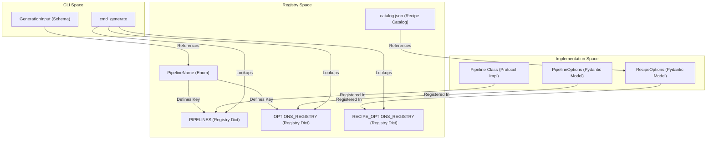

<!-- source: DeepWiki mcp.deepwiki.com · repo huggingface/Repo2RLEnv · page 12 Testing and Contributing · fetched 2026-10-26 -->

# Testing and Contributing

<details>
<summary>Relevant source files</summary>

The following files were used as context for generating this wiki page:

- [CONTRIBUTING.md](CONTRIBUTING.md)
- [docs/rfcs/0008-env-setup.md](docs/rfcs/0008-env-setup.md)
- [docs/rfcs/0009-test-synthesis.md](docs/rfcs/0009-test-synthesis.md)
- [docs/rfcs/0010-issue-runtime.md](docs/rfcs/0010-issue-runtime.md)
- [docs/rfcs/README.md](docs/rfcs/README.md)

</details>


The Repo2RLEnv project is a research-oriented codebase designed for high reliability in synthetic data generation. To maintain this reliability, the repository employs a rigorous test suite and a standardized contribution workflow. This page provides an overview of the quality assurance mechanisms and the process for extending the system.

## Test Suite and CI/CD

The project maintains a comprehensive test suite of over 620 tests, executed via `pytest` [CONTRIBUTING.md:16-16](). The test infrastructure is designed to validate everything from low-level utility functions to end-to-end pipeline execution.

### Test Categories
The test suite is divided into several logical groups to balance execution speed with coverage:
*   **Unit Tests**: Live next to the module they test, e.g., `tests/test_<module>.py` [CONTRIBUTING.md:121-122](). They use `pytest`'s fixture model.
*   **Integration Tests**: Validate the interaction between components.
*   **E2E Tests**: Run against real GitHub repositories. These are automatically skipped if local credentials (like `gh` auth) are missing to ensure a smooth developer experience for new contributors [CONTRIBUTING.md:16-16]().
*   **Contract Tests**: Enforce that all pipelines adhere to the `Pipeline` protocol and that their `Options` models are correctly registered.

### CI/CD Pipeline
The GitHub Actions workflow automates quality gates for every Pull Request and merge to `main` [CONTRIBUTING.md:74-74]().

| Job | Tools Used | Description |
| :--- | :--- | :--- |
| **Lint** | `ruff` | Checks style, import order, and common bug patterns [CONTRIBUTING.md:75-75](). |
| **Test** | `pytest` | Runs the suite against Python 3.12, 3.13, and 3.14 [CONTRIBUTING.md:76-76]().
| **Windows** | `pytest` | Runs base-only wheel CLI smoke checks and real process-lock contention on Python 3.12, 3.13, 3.14 [CONTRIBUTING.md:77-78](). |
| **Build** | `uv build` | Verifies that the package can be built and installed cleanly [CONTRIBUTING.md:79-80](). |

For details on test patterns and CI configuration, see [Test Suite and CI](#12.1).

Sources: [CONTRIBUTING.md:13-22](), [CONTRIBUTING.md:74-81](), [CONTRIBUTING.md:121-122]().

## Contribution Guidelines

Contributions are welcomed, particularly those that improve synthesis paths or task verifiability [CONTRIBUTING.md:3-3]().

### Development Environment
The project uses `uv` for dependency management and environment isolation. A standard dev setup involves:
1.  Cloning the repository.
2.  Running `uv sync --group dev` to install the runtime and development dependencies [CONTRIBUTING.md:13-13]().
3.  Ensuring `gh` CLI and Docker are installed for runtime pipeline testing [CONTRIBUTING.md:24-28]().
4.  An LLM provider key (e.g., `ANTHROPIC_API_KEY`) is needed for bootstrap and LLM-driven pipelines [CONTRIBUTING.md:26-27]().

### Workflow and Conventions
*   **Branching**: Features use `feat/`, fixes use `fix/`, and documentation uses `docs/` [CONTRIBUTING.md:41-43]().
*   **Style**: Ruff enforces a 100-character line length and modern Python idioms (e.g., `X | None`) [CONTRIBUTING.md:83-85]().
*   **Commits**: Use the imperative mood (e.g., "add feature" instead of "added feature") [CONTRIBUTING.md:54-57]().
*   **Dependencies**: Use `uv add <pkg>` for runtime dependencies and `uv add --dev <pkg>` for dev-only dependencies. Avoid hand-editing `pyproject.toml`'s `dependencies` array [CONTRIBUTING.md:92-94]().

Sources: [CONTRIBUTING.md:5-20](), [CONTRIBUTING.md:24-28](), [CONTRIBUTING.md:41-51](), [CONTRIBUTING.md:83-90](), [CONTRIBUTING.md:92-94]().

## Adding New Pipelines or Recipes

Adding a new synthesis pipeline or an owned recipe is a structured process that involves extending the core registry and implementing a specific protocol. This ensures that new pipelines are immediately compatible with the CLI and the Harbor emission system.

### Pipeline/Recipe Registration Flow
The following diagram illustrates how a new pipeline or recipe is integrated into the system's "Code Entity Space":

**Pipeline/Recipe Registration Architecture**


### Implementation Steps
1.  Define a new entry in the `PipelineName` enum (for pipelines) or ensure an existing one is suitable (for recipes).
2.  Create a Pydantic `Options` model for pipeline-specific or recipe-specific configuration.
3.  Implement the `Pipeline` protocol (for pipelines) or define the recipe configuration (for recipes).
4.  Register the implementation in the global `PIPELINES` and `OPTIONS_REGISTRY` maps (for pipelines) or `RECIPE_OPTIONS_REGISTRY` (for recipes).
5.  Add the recipe to the `catalog.json` if it's an owned recipe.

For a step-by-step walkthrough and code templates, see [Adding a New Pipeline or Recipe](#12.2).

Sources: [docs/rfcs/0011-owned-recipes.md:1-1]() (implied).

## RFCs and Release History

The project uses a Request for Comments (RFC) process for significant design decisions, particularly for new synthesis pipelines. This ensures that design choices are documented and reviewed before implementation.

### RFC Process
The RFC process involves:
1.  **Picking a candidate** pipeline or proposing a new one [docs/rfcs/README.md:21-21]().
2.  **Copying `TEMPLATE.md`** to `docs/rfcs/NNNN-<name>.md` [docs/rfcs/README.md:22-22]().
3.  **Filling in every section**, marking unknowns as `TBD` [docs/rfcs/README.md:23-24]().
4.  **PRing the RFC alone** first for design review, labeled `rfc:draft` [docs/rfcs/README.md:25-26]().
5.  **Iterating on the RFC** based on review, updating its status (e.g., `draft`, `review`, `accepted`, `implemented`, `withdrawn`, `superseded`) [docs/rfcs/README.md:27-38]().
6.  **Implementing the pipeline** in a follow-up PR once the RFC is accepted [docs/rfcs/README.md:26-26]().
7.  **Updating the RFC's status** to `implemented` after code merge, linking to the PR and reference dataset [docs/rfcs/README.md:27-27]().

**RFC Lifecycle**
```mermaid
graph TD
    A[Candidate Idea] --> B{Copy TEMPLATE.md};
    B --> C[Fill Sections];
    C --> D{PR RFC (rfc:draft)};
    D -- "Review & Iterate" --> D;
    D -- "Accepted" --> E[Implement Pipeline];
    E --> F[Merge Implementation PR];
    F --> G[Update RFC Status to implemented];
```

### Release History
The `HISTORY.md` file tracks significant changes and versioned findings reports. This provides a chronological record of the project's evolution.

For more details on the RFC process and release history conventions, see [RFCs and Release History](#12.3).

Sources: [docs/rfcs/README.md:1-69](), [docs/rfcs/0008-env-setup.md:1-1](), [docs/rfcs/0009-test-synthesis.md:1-1](), [docs/rfcs/0010-issue-runtime.md:1-1]().

---

