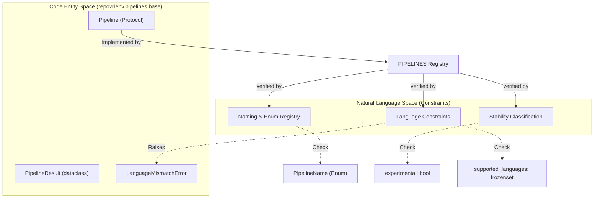
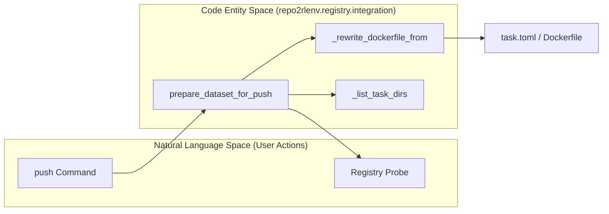
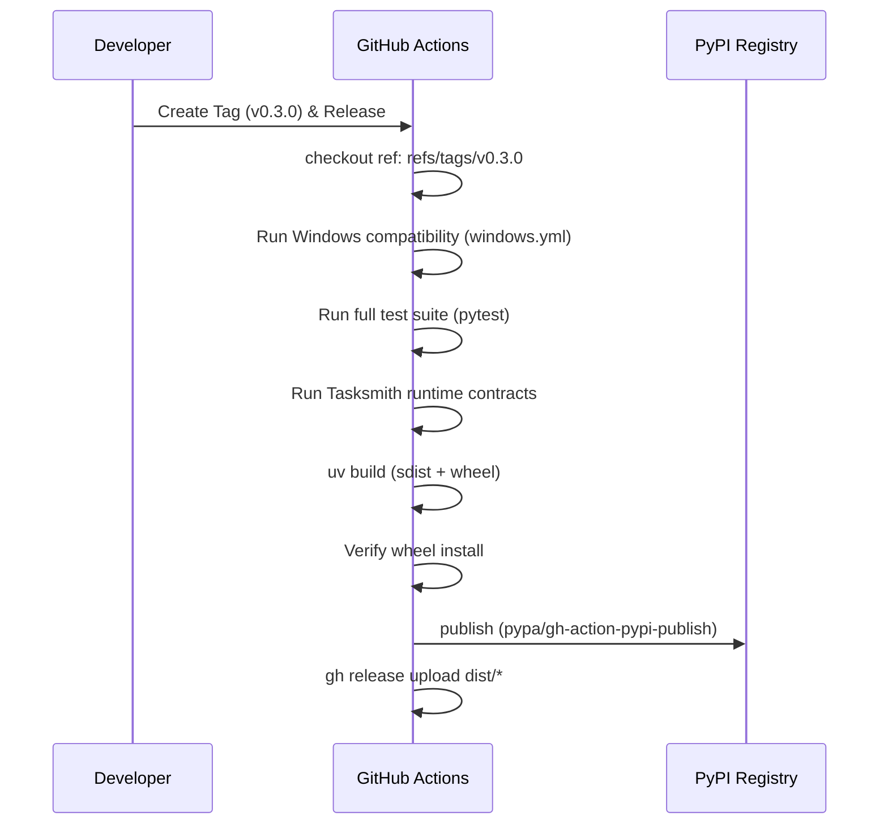

<!-- source: DeepWiki mcp.deepwiki.com · repo huggingface/Repo2RLEnv · page 12.1 Test Suite and CI · fetched 2026-10-26 -->

# Test Suite and CI

Relevant source files

The following files were used as context for generating this wiki page:

- [.github/dependabot.yml](.github/dependabot.yml)
- [.github/workflows/ci.yml](.github/workflows/ci.yml)
- [.github/workflows/deploy-docs.yml](.github/workflows/deploy-docs.yml)
- [.github/workflows/release.yml](.github/workflows/release.yml)
- [.github/workflows/windows.yml](.github/workflows/windows.yml)
- [src/repo2rlenv/pipelines/base.py](src/repo2rlenv/pipelines/base.py)
- [tests/test_pipeline_contract.py](tests/test_pipeline_contract.py)
- [tests/test_subprocess_encoding.py](tests/test_subprocess_encoding.py)

The Repo2RLEnv test suite ensures the reliability of the synthesis pipelines, the integrity of the Harbor-compliant task emission, and the robustness of external integrations (GitHub, Docker, Hugging Face). The suite consists of over 620 tests ranging from fast unit tests to long-running end-to-end (e2e) validation cycles.

## Test Suite Architecture

The testing infrastructure is categorized by scope and requirements. While unit tests run in every environment, integration and e2e tests are gated by the availability of external tools like the `gh` CLI or Docker.

### Test Categories

| Category | Description | Implementation |
| :--- | :--- | :--- |
| **Unit Tests** | Logic checks for reward functions, log parsers, and spec validation. | `tests/` (various) |
| **Pipeline Contract** | Enforces that all pipelines satisfy the `Pipeline` Protocol. | [tests/test_pipeline_contract.py:10-111]() |
| **Registry Integration** | Validates OCI registry probing, Dockerfile rewriting, and auth logic. | `tests/registry/test_integration.py` |
| **E2E Public** | Real mining against public repos (e.g., `huggingface/trl`). | `tests/test_e2e_public.py` |
| **E2E Private** | Validates auth-token propagation using private repositories. | `tests/test_e2e_private.py` |
| **Owned Recipe Contracts** | Tests specific behaviors and outputs of owned recipes like SWE-smith, SWE-gen, R2E, etc. | [.github/workflows/ci.yml:111-165]() |
| **Tasksmith Runtime Contracts** | Verifies the Node.js coding runtimes (`pi.mjs`, `opencode.mjs`) against local mock servers. | [.github/workflows/ci.yml:166-177](), [.github/workflows/release.yml:67-90]() |
| **Cross-Platform (Windows)** | Ensures core functionality, wheel installation, CLI entry points, and process locking work on Windows. | [.github/workflows/windows.yml:15-45]() |

### Pipeline Contract Enforcement

A critical component of the suite is the contract test, which ensures that every class registered in the `PIPELINES` dictionary adheres to the `Pipeline` protocol defined in [src/repo2rlenv/pipelines/base.py:57-98](). This prevents runtime failures in the CLI dispatcher during the `generate` command.

**Pipeline Protocol Relationships**

**Sources:** [src/repo2rlenv/pipelines/base.py:57-98](), [tests/test_pipeline_contract.py:10-44]()

## Key Validation Logic

### Pipeline Requirements
The suite enforces several structural rules for all synthesis pipelines:
1.  **Naming:** The `name` class attribute must match the key in the `PIPELINES` dictionary [tests/test_pipeline_contract.py:13-21]() and exist in the `PipelineName` enum [tests/test_pipeline_contract.py:23-28]().
2.  **Options:** Every pipeline must have a corresponding Pydantic model in the `OPTIONS_REGISTRY` [tests/test_pipeline_contract.py:30-34]().
3.  **Bootstrap Declaration:** Pipelines must explicitly state if they require a Docker environment via `requires_bootstrap` [tests/test_pipeline_contract.py:36-43]().
4.  **Language Safety:** Python-only pipelines (e.g., `code_instruct`, `equivalence_tests`) must restrict `supported_languages` to `PYTHON` [tests/test_pipeline_contract.py:60-80](). Language-agnostic pipelines (e.g., `pr_diff`, `pr_runtime`) must have `supported_languages` set to `None` [tests/test_pipeline_contract.py:81-91]().
5.  **Stability Classification:** Stable pipelines (`pr_diff`, `pr_runtime`, `commit_runtime`) must have `experimental=False` [tests/test_pipeline_contract.py:45-58]().
6.  **`PipelineResult` Shape:** The `PipelineResult` dataclass must contain the expected fields: `candidates`, `emitted`, `skipped`, `out_dir`, and `skip_reasons` [tests/test_pipeline_contract.py:92-104]().

### Registry and Distribution Integration
Tests in `tests/registry/test_integration.py` verify the logic for preparing datasets for the Hugging Face Hub. This includes:
*   **Dockerfile Rewriting:** Ensuring `FROM` instructions are updated from local tags to remote OCI references.
*   **Metadata Integrity:** Verifying that `task.toml` files are correctly updated with reproducibility metadata.
*   **Local Tag Parsing:** Validating the regex-based parsing of local bootstrap image names.

**Registry Data Flow**

### Subprocess Encoding
The test `tests/test_subprocess_encoding.py` statically analyzes the codebase to ensure that all `subprocess` calls made with `text=True` or `universal_newlines=True` also explicitly specify `encoding="utf-8"` [tests/test_subprocess_encoding.py:1-9](). This prevents encoding issues, particularly on Windows where the default locale encoding might not be UTF-8, leading to garbled or missing output from external tools like `git` or `docker` [tests/test_subprocess_encoding.py:40-42]().

**Sources:** [tests/test_pipeline_contract.py:13-104](), [tests/test_subprocess_encoding.py:1-42]()

## GitHub Actions Workflows

Repo2RLEnv uses several GitHub Actions workflows to manage the lifecycle of the codebase, including continuous integration, releases, documentation deployment, and Windows compatibility checks.

### CI Workflow (`ci.yml`)
Triggered on every push and pull request to `main`, and manually via `workflow_dispatch` [.github/workflows/ci.yml:3-9]().
*   **Environment:** Sets `CI=1` and `NO_COLOR=1`, and provides fake API keys (`ANTHROPIC_API_KEY`, `OPENAI_API_KEY`) to prevent accidental network calls to LLM providers during tests. `HF_HUB_DISABLE_TELEMETRY` is also set [.github/workflows/ci.yml:19-28]().
*   **Windows Compatibility:** Calls the `windows.yml` workflow to run Windows-specific checks [.github/workflows/ci.yml:30-33]().
*   **Lint:** Runs `ruff check` and `ruff format --check`. It also generates and verifies documentation sources like prompt references and metrics [.github/workflows/ci.yml:34-66]().
*   **Docs Build:** Builds the MkDocs site to ensure documentation integrity and checks that no tracked files are changed during the build process [.github/workflows/ci.yml:67-84]().
*   **Test Matrix:** Executes `pytest` across Python versions 3.12, 3.13, and 3.14 using `uv run --all-extras pytest -q` [.github/workflows/ci.yml:85-110]().
*   **Owned Recipe Contracts:** Runs a specific subset of tests (`tests/test_swe_smith_mutations.py`, `tests/test_harbor_offline.py`, `tests/test_recipe_contracts.py`, etc.) to validate the behavior of various owned recipes and related components without cloud execution [.github/workflows/ci.yml:111-165]().
*   **Tasksmith Runtime Contracts:** Sets up Node.js and runs tests against the Tasksmith coding runtimes (`pi.mjs`, `opencode.mjs`) using local mock servers [.github/workflows/ci.yml:166-177]().

### Release Workflow (`release.yml`)
Triggered when a GitHub Release is published, or manually via `workflow_dispatch` with a specified tag [.github/workflows/release.yml:18-28]().
*   **Windows Compatibility:** Calls the `windows.yml` workflow to ensure Windows compatibility for the release tag [.github/workflows/release.yml:37-41]().
*   **Sanity Gate (Tests):** Re-runs the full test suite on the specific release tag across Python versions 3.12, 3.13, and 3.14 before publishing [.github/workflows/release.yml:44-65]().
*   **Tasksmith Runtime Contracts:** Verifies Tasksmith coding runtimes on the release tag, similar to the CI workflow [.github/workflows/release.yml:67-90]().
*   **Build sdist + wheel:** Builds the source distribution and wheel package [.github/workflows/release.yml:91-147]().
*   **Version Verification:** Ensures the git tag (e.g., `v0.3.0`) matches the version defined in `pyproject.toml` [.github/workflows/release.yml:118-129]().
*   **Wheel Install Verification:** Installs the built wheel in a temporary virtual environment and verifies the `repo2rlenv` CLI entry point and distribution integrity [.github/workflows/release.yml:135-140]().
*   **Publish to PyPI:** Publishes the built distributions to PyPI using the `PYPI_API_TOKEN` secret. It skips publishing if the version already exists on PyPI [.github/workflows/release.yml:148-173]().
*   **Attach to Release:** Uploads the `sdist` and `wheel` artifacts to the GitHub Release itself [.github/workflows/release.yml:174-190]().

**Release Data Flow**

### Windows Compatibility Workflow (`windows.yml`)
This workflow is called by both `ci.yml` and `release.yml` [.github/workflows/windows.yml:4-5]().
*   **Wheel Build and Install:** Builds the wheel for Windows and installs it in an isolated virtual environment for Python versions 3.12, 3.13, and 3.14 [.github/workflows/windows.yml:15-40]().
*   **CLI and Native Task Validation:** Checks the console entry point, package discovery, and native task validation using `tests/check_cli_install.py` [.github/workflows/windows.yml:41-42]().
*   **Process Locks:** Verifies real Windows process locking behavior using `pytest` on `tests/test_locking.py` and `tests/test_posix_only_imports.py` [.github/workflows/windows.yml:43-45]().

### Deploy Docs Workflow (`deploy-docs.yml`)
Triggered on pushes to `main` that modify documentation-related files (`docs/**`, `mkdocs.yml`, `requirements-docs.txt`, etc.) or manually via `workflow_dispatch` [.github/workflows/deploy-docs.yml:3-16]().
*   **Build:** Checks out the repository, sets up Python, installs documentation dependencies, and builds the MkDocs site. The built site is then uploaded as an artifact [.github/workflows/deploy-docs.yml:29-49]().
*   **Deploy:** Uses the `actions/deploy-pages` action to deploy the built documentation to GitHub Pages [.github/workflows/deploy-docs.yml:50-59]().

**Sources:** [.github/workflows/ci.yml:1-177](), [.github/workflows/release.yml:1-190](), [.github/workflows/windows.yml:1-45](), [.github/workflows/deploy-docs.yml:1-59]()

---

