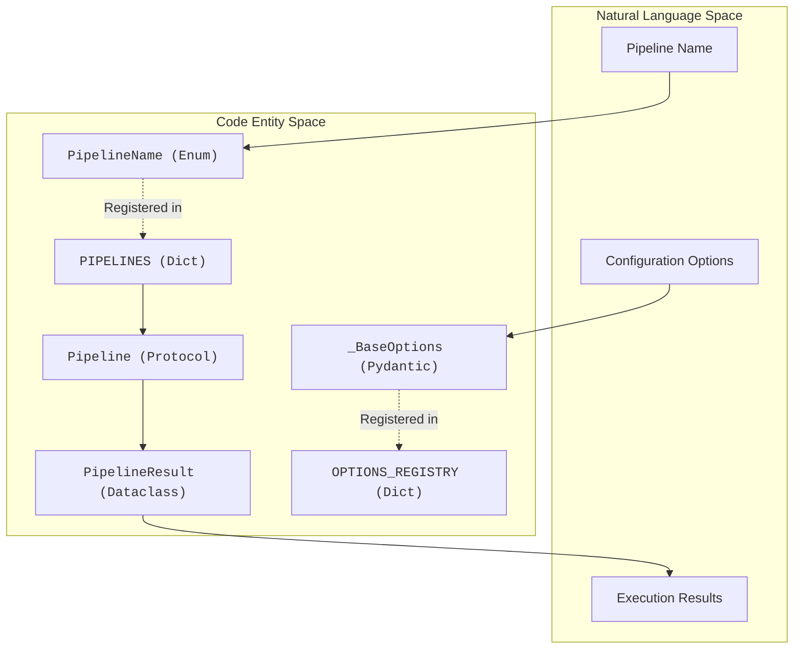
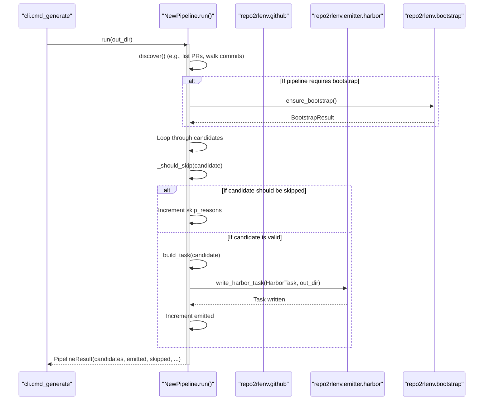

<!-- source: DeepWiki mcp.deepwiki.com · repo huggingface/Repo2RLEnv · page 12.2 Adding a New Pipeline or Recipe · fetched 2026-10-26 -->

# Adding a New Pipeline or Recipe

<details>
<summary>Relevant source files</summary>

The following files were used as context for generating this wiki page:

- [CONTRIBUTING.md](CONTRIBUTING.md)
- [docs/contributing/ADDING_A_PIPELINE.md](docs/contributing/ADDING_A_PIPELINE.md)
- [docs/rfcs/0001-pr-diff.md](docs/rfcs/0001-pr-diff.md)
- [docs/rfcs/0002-pr-runtime.md](docs/rfcs/0002-pr-runtime.md)
- [docs/rfcs/0006-cve-patches.md](docs/rfcs/0006-cve-patches.md)
- [docs/rfcs/0007-pr-to-env.md](docs/rfcs/0007-pr-to-env.md)
- [docs/rfcs/TEMPLATE.md](docs/rfcs/TEMPLATE.md)
- [src/repo2rlenv/pipelines/__init__.py](src/repo2rlenv/pipelines/__init__.py)
- [src/repo2rlenv/spec/options.py](src/repo2rlenv/spec/options.py)

</details>


This guide provides a step-by-step walkthrough for contributors to implement and register a new synthesis pipeline in `Repo2RLEnv`. Pipelines are the core engines of the system, responsible for discovering candidates (e.g., PRs, commits, or AST nodes), filtering them, and emitting Harbor-compatible task environments. This page also covers how to add a new recipe, which layers on top of an existing pipeline.

## The Pipeline Contract

Every pipeline must satisfy the `Pipeline` Protocol defined in `src/repo2rlenv/pipelines/base.py`. This protocol ensures that the `repo2rlenv generate` command can uniformly instantiate and execute any registered pipeline.

### Implementation Requirements
A pipeline class must expose the following attributes and methods:
*   `name`: A `ClassVar[PipelineName]` identifying the pipeline [src/repo2rlenv/pipelines/base.py:79]().
*   `requires_bootstrap`: A `ClassVar[bool]` indicating if the pipeline needs a pre-built Docker image (via the Bootstrap phase) to perform verification or execution [src/repo2rlenv/pipelines/base.py:80]().
*   `supported_languages`: A `ClassVar[frozenset[LanguageHint] | None]`. Use `None` for language-agnostic pipelines or restrict to specific languages (e.g., `PYTHON`) if the pipeline relies on specific AST or test runners [src/repo2rlenv/pipelines/base.py:81-84]().
*   `experimental`: A `ClassVar[bool]` that triggers a CLI warning if set to `True` [src/repo2rlenv/pipelines/base.py:88]().
*   `__init__(input, options, bootstrap=None)`: Accepts the global `GenerationInput`, the pipeline-specific `Options` model, and an optional `BootstrapResult` [src/repo2rlenv/pipelines/base.py:90-95]().
*   `run(out_dir: Path)`: The main execution loop that returns a `PipelineResult` [src/repo2rlenv/pipelines/base.py:97]().

### Data Flow and Contract Overview
The following diagram illustrates how a new pipeline interacts with the system's core entities.

**Pipeline System Entity Map**

Sources: [src/repo2rlenv/pipelines/base.py:37-97](), [src/repo2rlenv/pipelines/__init__.py:11-18](), [src/repo2rlenv/spec/options.py:11-12]()

---

## Step-by-Step Implementation

### 1. Design and RFC
Before coding, you must write an RFC in `docs/rfcs/`. This document captures the motivation, verification approach, and contamination story for the new pipeline [docs/rfcs/README.md:3-9](). Use the template provided in the RFC directory and land the design before starting the implementation [docs/contributing/ADDING_A_PIPELINE.md:5-6]().

**RFC Workflow**
```mermaid
graph TD
    A[New Pipeline Idea] --> B{Is it a major change or new PipelineName?};
    B -- Yes --> C[Write RFC using TEMPLATE.md];
    C --> D[Submit RFC for Review];
    D -- Accepted --> E[Implement Pipeline];
    E --> F[Update RFC Status to "implemented"];
    F --> G[Fill in Implementation Details in RFC];
    B -- No (minor reshape) --> E;
```
Sources: [docs/rfcs/TEMPLATE.md:1-116](), [docs/contributing/ADDING_A_PIPELINE.md:5-6]()

### 2. Register the Pipeline Name
Add your pipeline's unique identifier to the `PipelineName` enum. This enables the CLI to recognize the new pipeline as a valid argument.

*   **File**: `src/repo2rlenv/spec/input.py`
*   **Action**: Add a new member to the `PipelineName` class (e.g., `MY_NEW_PIPELINE = "my_new_pipeline"`) [docs/contributing/ADDING_A_PIPELINE.md:30-37]().

### 3. Create the Options Model
Create a Pydantic model for your pipeline's specific configuration. This model handles validation of CLI flags and configuration file keys.

*   **File**: `src/repo2rlenv/spec/options.py`
*   **Implementation**: Inherit from `_BaseOptions` to ensure `extra="forbid"` behavior [src/repo2rlenv/spec/options.py:26-28]().
*   **Registration**: Add your model to the `OPTIONS_REGISTRY` dictionary [docs/contributing/ADDING_A_PIPELINE.md:53-58]().

For example, `PRRuntimeOptions` defines the configurable parameters for the `pr_runtime` pipeline [src/repo2rlenv/spec/options.py:30-64](). Similarly, `PRDiffOptions` defines options for `pr_diff` [src/repo2rlenv/spec/options.py:66-95]().

### 4. Implement the Pipeline
Implement the logic for candidate discovery and task emission in a new file (e.g., `src/repo2rlenv/pipelines/your_pipeline.py`).

**Typical Execution Flow**

Sources: [src/repo2rlenv/pipelines/base.py:57-97](), [docs/contributing/ADDING_A_PIPELINE.md:94-139]()

The `_discover` method is where pipeline-specific logic for finding candidates resides, such as listing PRs, walking git commits, or querying external databases like OSV [docs/contributing/ADDING_A_PIPELINE.md:143-145](). The `_build_task` method constructs the `HarborTask` object, populating it with necessary metadata and content [docs/contributing/ADDING_A_PIPELINE.md:151-172]().

### 5. Registration and Exports
To make the pipeline available to the system, it must be registered in the central registry.

*   **File**: `src/repo2rlenv/pipelines/__init__.py`
*   **Action**: Import your pipeline class and add it to the `PIPELINES` dictionary [src/repo2rlenv/pipelines/__init__.py:18-30]().

### 6. Adding a New Recipe
A recipe layers on top of an existing pipeline, providing a specific configuration and potentially additional filtering or post-processing. Recipes are defined in the `src/repo2rlenv/spec/recipe_options.py` file.

*   **File**: `src/repo2rlenv/spec/recipe_options.py`
*   **Action**: Create a new Pydantic model for your recipe, inheriting from `_BaseOptions`. This model will define the recipe-specific parameters.
*   **Registration**: Add your recipe's options model to the `RECIPE_OPTIONS_REGISTRY` dictionary.
*   **Catalog Entry**: Add an entry for your recipe in `src/repo2rlenv/recipes/catalog.py` or `src/repo2rlenv/recipes/catalog.json`. This entry links the recipe name to its underlying pipeline and default options.

For example, `SWESmithOptions` defines options for the `swe-smith` recipe [src/repo2rlenv/spec/recipe_options.py:19-20]().

## Validation and Contract Testing

Every pipeline must pass the automated contract test suite located in `tests/test_pipeline_contract.py`. This suite enforces structural consistency across all implementations.

### Key Test Checks
| Test Function | Requirement Enforced |
| :--- | :--- |
| `test_pipelines_implement_protocol` | Class implements `name` and matches `Protocol` [tests/test_pipeline_contract.py:10-21]() |
| `test_pipeline_names_are_in_enum` | The registered key exists in `PipelineName` enum [tests/test_pipeline_contract.py:23-28]() |
| `test_options_registry_aligns_with_pipelines` | Every pipeline has an entry in `OPTIONS_REGISTRY` [tests/test_pipeline_contract.py:30-34]() |
| `test_pipelines_declare_requires_bootstrap` | Must explicitly state if Docker env is needed [tests/test_pipeline_contract.py:36-43]() |
| `test_python_only_pipelines_declare_supported_languages` | Python-only pipelines must restrict `supported_languages` to `PYTHON` [tests/test_pipeline_contract.py:60-79]() |
| `test_language_agnostic_pipelines_have_no_restriction` | Agnostic pipelines must have `supported_languages = None` [tests/test_pipeline_contract.py:81-90]() |

Sources: [tests/test_pipeline_contract.py:1-111]()

## Recommended Helpers
When implementing the `_discover` and `_build_task` methods, use the following standardized modules:

*   **GitHub Interactions**: Use `repo2rlenv.auth.resolve_github_token` for authenticating API calls [docs/contributing/ADDING_A_PIPELINE.md:107]().
*   **Task Emission**: Use `write_harbor_task` from `repo2rlenv.emitter.harbor` to ensure tasks are compatible with the Harbor runtime [docs/contributing/ADDING_A_PIPELINE.md:127]().
*   **Language Check**: Use `check_language_compatibility` in your pipeline's `__init__` or `run` method to enforce language constraints early [src/repo2rlenv/pipelines/base.py:100-113]().

Sources: [docs/contributing/ADDING_A_PIPELINE.md:100-139](), [src/repo2rlenv/pipelines/base.py:100-142]()

---

