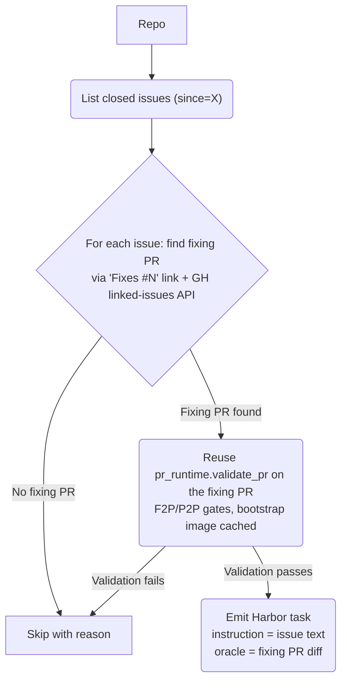
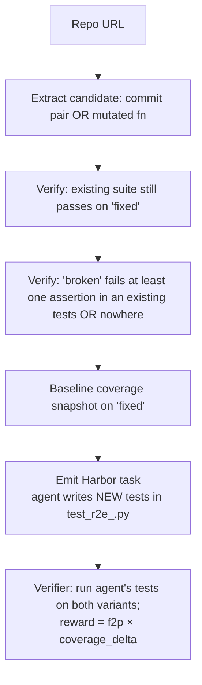
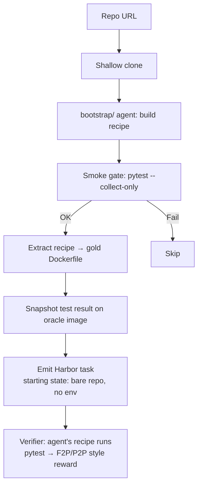

<!-- source: DeepWiki mcp.deepwiki.com · repo huggingface/Repo2RLEnv · page 12.3 RFCs and Release History · fetched 2026-10-26 -->

# RFCs and Release History

<details>
<summary>Relevant source files</summary>

The following files were used as context for generating this wiki page:

- [docs/index.md](docs/index.md)
- [docs/pipelines/tasksmith.md](docs/pipelines/tasksmith.md)
- [docs/release_notes/HISTORY.md](docs/release_notes/HISTORY.md)
- [docs/release_notes/v0.8.2.post3.md](docs/release_notes/v0.8.2.post3.md)
- [docs/release_notes/v0.8.3/findings-pr_diff.md](docs/release_notes/v0.8.3/findings-pr_diff.md)
- [docs/rfcs/0003-commit-runtime.md](docs/rfcs/0003-commit-runtime.md)
- [docs/rfcs/0008-env-setup.md](docs/rfcs/0008-env-setup.md)
- [docs/rfcs/0009-test-synthesis.md](docs/rfcs/0009-test-synthesis.md)
- [docs/rfcs/0010-issue-runtime.md](docs/rfcs/0010-issue-runtime.md)
- [docs/rfcs/README.md](docs/rfcs/README.md)
- [pyproject.toml](pyproject.toml)
- [uv.lock](uv.lock)

</details>


This page details the Request for Comments (RFC) process used for designing new synthesis pipelines and the conventions for documenting release history and findings reports within the Repo2RLEnv codebase.

## Request for Comments (RFCs)

The RFC process in Repo2RLEnv serves as a design-document mechanism for new synthesis pipelines. It ensures that significant design decisions are documented before implementation, providing a permanent record of the rationale behind each pipeline's structure, verification approach, contamination story, LLM usage, and expected yield.

### Purpose and Scope of RFCs

RFCs are mandatory for any new pipeline introduced into the system. They are optional for substantial modifications to existing pipelines that significantly alter their core design or behavior. Minor bug fixes or polish work do not require an RFC. The primary goal is to front-load design audits, forcing consideration of potential issues like contamination before a pipeline is deployed and generates tasks.

Sources:
- [docs/rfcs/README.md:1-10]()

### RFC Lifecycle and Statuses

Each RFC includes a `Status:` header that tracks its progression through various stages:
- **`draft`**: The RFC is being written and is not yet ready for review.
- **`review`**: The RFC is ready for feedback, and a Pull Request (PR) is open for discussion.
- **`accepted`**: The design has been approved, and implementation can begin.
- **`implemented`**: The code for the pipeline has been merged into `main`. The RFC becomes an archival record.
- **`withdrawn`**: The proposal was decided against. The RFC is kept for posterity with an explanation for its withdrawal.
- **`superseded`**: The RFC has been replaced by a newer RFC, with cross-references between them.

Sources:
- [docs/rfcs/README.md:30-39]()

### RFC Process Flow

The process for creating and integrating an RFC is as follows:

1.  **Candidate Selection**: Choose a pipeline idea from `plans/candidate_pipelines.md` or propose a new one.
2.  **Template Copy**: Copy `docs/rfcs/TEMPLATE.md` to `docs/rfcs/NNNN-<name>.md`, using the next available 4-digit number and a kebab-case name.
3.  **Content Filling**: Complete all sections of the template. If a section is not applicable, mark it as "n/a"; if an answer is unknown, mark it `TBD` and list it under "Open questions."
4.  **Initial PR**: Submit the RFC as a standalone PR for design review, labeled `rfc:draft`.
5.  **Iteration**: Update the RFC based on feedback and change its status as it progresses.
6.  **Implementation**: Once accepted, implement the pipeline in a follow-up PR, referencing the RFC number and adhering to `docs/contributing/ADDING_A_PIPELINE.md`.
7.  **Archival Update**: After merging the implementation, update the RFC's status to `implemented`, add the merge commit and PR link, and link the reference dataset.

Sources:
- [docs/rfcs/README.md:19-28]()

### RFC Numbering and Index

RFCs are numbered sequentially (e.g., `0001-<name>.md`, `0002-<name>.md`). Numbers are never reused. If an RFC is withdrawn, its number is retired.

The `docs/rfcs/README.md` file maintains an index of all RFCs, including their number, pipeline name, status, and links to the RFC document and any associated reference datasets.

**RFC Index Example**
```
| #    | Pipeline            | Status                  | RFC                                         | Reference dataset                                                              |
|------|---------------------|-------------------------|---------------------------------------------|--------------------------------------------------------------------------------|
| 0001 | `pr_diff`           | implemented (stable)    | [0001-pr-diff.md](./0001-pr-diff.md)        | [`repo2rlenv-pr-diff`](https://huggingface.co/datasets/AdithyaSK/repo2rlenv-pr-diff) (181) |
| 0002 | `pr_runtime`        | implemented (stable)    | [0002-pr-runtime.md](./0002-pr-runtime.md)  | [`repo2rlenv-pr-runtime`](https://huggingface.co/datasets/AdithyaSK/repo2rlenv-pr-runtime) (100) |
| 0003 | `commit_runtime`    | implemented (stable)    | [0003-commit-runtime.md](./0003-commit-runtime.md) | [`…commit-runtime`](https://huggingface.co/datasets/AdithyaSK/repo2rlenv-commit-runtime) (100) |
| 0010 | `issue_runtime`     | draft                   | [0010-issue-runtime.md](./0010-issue-runtime.md) | —                                                                              |
| 0011 | owned recipe contract | implementation in PR #109 | [0011-owned-recipes.md](0011-owned-recipes.md) | [Release inventory](../pipelines/releases.md)                                  |
```

Sources:
- [docs/rfcs/README.md:41-69]()

### Example RFC: `issue_runtime`

RFC 0010, `issue_runtime`, proposes a pipeline to mine closed issues linked to fixing PRs, using the issue's title and body as the task instruction and the fixing PR's tests as the oracle. This pipeline aims to generate SWE-bench-style tasks on-demand from any repository.

**RFC 0010: `issue_runtime` Design Flow**



The `issue_runtime` pipeline leverages existing `pr_runtime` validation mechanisms, ensuring consistency in verification. The key distinction is the instruction source (issue text vs. PR title/LLM-synthesized) and the mining strategy (issue-centric vs. PR-centric).

Sources:
- [docs/rfcs/0010-issue-runtime.md:1-99]()

### Example RFC: `test_synthesis`

RFC 0009, `test_synthesis`, proposes a pipeline where the agent's task is to *write failing tests* for a deliberately mutated or reverted source function. The reward is based on the fraction of the emitted test suite that fails on the broken variant and passes on the fixed variant, weighted by incremental line coverage. This pipeline introduces Test-Driven Development (TDD) as a first-class RL task.

**RFC 0009: `test_synthesis` Design Flow**



This pipeline introduces a new reward component, `coverage_delta`, to incentivize agents to write tests that increase code coverage.

Sources:
- [docs/rfcs/0009-test-synthesis.md:1-91]()

### Example RFC: `env_setup`

RFC 0008, `env_setup`, proposes a pipeline that tasks an agent with making a bare, un-bootstrapped repository's test suite build and run successfully from scratch. This turns the existing `bootstrap/` machinery, typically a build-time step, into a first-class training and evaluation target.

**RFC 0008: `env_setup` Design Flow**



The `env_setup` pipeline reuses the `bootstrap/` agent to create an oracle solution, then challenges the agent-under-eval to replicate that setup. The reward is based on the fraction of the repo's own tests that pass using the agent's generated installation recipe.

Sources:
- [docs/rfcs/0008-env-setup.md:1-79]()

## Release History and Findings Reports

The `docs/release_notes/HISTORY.md` file serves as the primary record of version history for Repo2RLEnv. It provides high-level summaries of each release, followed by links to more detailed per-release deep dives (e.g., `v0.8.2.post3.md`, `v0.8.3/`).

Sources:
- [docs/release_notes/HISTORY.md:1-7]()

### Versioning and Release Highlights

The project uses semantic versioning, with `pyproject.toml` defining the current version (e.g., `0.9.1`). Each entry in `HISTORY.md` includes the version number, release date, and key highlights.

For example, `v0.9.1` focused on Windows CLI startup fixes and release checks, while `v0.9.0` introduced Tasksmith and 14 research-inspired generation recipes.

Sources:
- [pyproject.toml:3]()
- [docs/release_notes/HISTORY.md:9-33]()

### Detailed Findings Reports

For significant releases or pipeline updates, detailed findings reports are created in subdirectories (e.g., `docs/release_notes/v0.8.3/`). These reports provide in-depth analysis of changes, including:
-   **Published dataset**: Links to Hugging Face Hub datasets, including environment count, source repositories, and licensing.
-   **What changed**: Specific technical modifications, such as new reward components, info-leak stripping patterns, or quality filters.
-   **Generation methodology**: How the reference datasets were generated, including CLI commands and parameters.
-   **Validation evidence**: Results from smoke tests and pilot runs, including identified bugs and their fixes.
-   **Limitations**: Known issues or areas for future improvement.

Sources:
- [docs/release_notes/v0.8.3/findings-pr_diff.md:1-122]()

### Example: `pr_diff` Findings Report (v0.8.3)

The `pr_diff` findings report for v0.8.3 details the transition of `pr_diff` from a text-only output to a fully Harbor-runnable RL environment.

**Key changes highlighted:**
-   **Harbor-runnable environment**: Each task now includes `environment/Dockerfile` and `tests/test.sh`, making it directly executable by `harbor run`. The Dockerfile is agent-agnostic, using a thin base image.
-   **Six-component multi-component reward**: Replaced a single scalar `difflib.ratio()` with a weighted sum of six components: `format_valid`, `size_sanity`, `file_targeting`, `region_overlap`, `similarity`, and `llm_judge`. This provides a more nuanced evaluation of agent-generated patches.
-   **Per-task calibration baseline + difficulty bucket**: Each task includes `reward_calibration` metadata to normalize rewards and categorize difficulty based on lines of code changed.
-   **Broadened instruction info-leak strip**: Expanded patterns to remove potential solutions or hints from PR descriptions, ensuring the agent solves the problem without undue assistance.
-   **Quality filters at generation time**: New filters were introduced to discard candidates that would make weak RL tasks, such as those with only test-file changes, docs-only changes, or reverts.

Sources:
- [docs/release_notes/v0.8.3/findings-pr_diff.md:23-86]()

### Reproducible Image Distribution (v0.8.2.post3)

The `v0.8.2.post3` release focused on making sandbox-required datasets reproducible end-to-end. Previously, `_runtime` datasets used local Docker images, making them non-portable. This release introduced mechanisms for `repo2rlenv push` to:
1.  **Discover and verify** OCI registry credentials.
2.  **Push** bootstrap images to a verified registry.
3.  **Rewrite** `Dockerfile` and `task.toml` to reference the registry-qualified image.
4.  **Fallback** to an inline-Dockerfile mode if no registry is available.

This ensures that datasets pulled from the Hugging Face Hub can be run on any machine without manual Docker image setup. The `[metadata.repo2env.reproducibility]` subtable was added to `task.toml` to record the image distribution mode and details.

Sources:
- [docs/release_notes/v0.8.2.post3.md:1-83]()

**Image Distribution Flow**

```mermaid
graph TD
    A[repo2rlenv push <dataset_path> <hf_target>] --> B{Discover OCI Registry Credentials}
    B --> C{Verify Credentials (L1-L4 Probe)}
    C -- Success --> D[Push Bootstrap Image to Registry]
    D --> E[Rewrite Dockerfile/task.toml with Registry Ref]
    C -- Failure --> F[Fallback to Inline-Dockerfile Mode]
    F --> G[Bake Dockerfile into Task, Record Fallback Reason]
    E --> H[Publish Dataset to HF Hub]
    G --> H
```

Sources:
- [docs/release_notes/v0.8.2.post3.md:14-28]()

---

