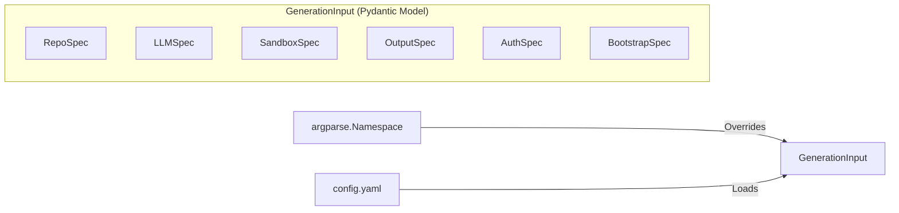

<!-- source: DeepWiki mcp.deepwiki.com · repo huggingface/Repo2RLEnv · page 2 CLI Reference · fetched 2026-10-26 -->

# CLI Reference

<details>
<summary>Relevant source files</summary>

The following files were used as context for generating this wiki page:

- [src/repo2rlenv/cli.py](src/repo2rlenv/cli.py)
- [tests/check_cli_install.py](tests/check_cli_install.py)

</details>


The `repo2rlenv` command-line interface is the primary entry point for turning software repositories into Reinforcement Learning (RL) environments. It manages the entire lifecycle from repository mining and sandbox bootstrapping to dataset distribution via the Hugging Face Hub, agentic task authoring, and quality review campaigns.

The CLI is built using `argparse` and provides a high-level terminal UI powered by the `rich` library [src/repo2rlenv/cli.py:1-24]().

## Subcommand Overview

The interface is organized into several key subcommand groups, each targeting a specific phase of the environment synthesis, distribution, and campaign management workflow.

| Subcommand Group | Purpose | Primary Action |
| :--- | :--- | :--- |
| `generate` | **Synthesis** | Executes a pipeline (e.g., `pr_diff`, `pr_runtime`) to create tasks [src/repo2rlenv/cli.py:4-4]() |
| `validate` | **Quality Control** | Performs structural, deep, and oracle checks on generated dataset directories [src/repo2rlenv/cli.py:5-5]() |
| `bootstrap` | **Environment** | Uses an LLM agent to build a working Docker sandbox for a target repository [src/repo2rlenv/cli.py:6-6]() |
| `push` / `pull` | **Distribution** | Uploads datasets to HF Hub / OCI registries and downloads them via custom URIs [src/repo2rlenv/cli.py:7-8]() |
| `pipelines` | **Catalog** | Lists and describes native synthesis pipelines and owned research recipes [tests/check_cli_install.py:47-48]() |
| `tasksmith` | **Authoring** | Runs LangGraph-driven authoring workflows to investigate PRs and design tasks [tests/check_cli_install.py:45-45]() |
| `quality` | **Review Loop** | Executes evidence-bound reviews, private probes, and repair cycles for tasks [tests/check_cli_install.py:46-46]() |
| `campaign` | **Coordination** | Initializes and manages multi-repository batch runs and controller locks [src/repo2rlenv/cli.py:3-9]() |
| `workers` | **Execution** | Starts, stops, and probes remote execution workers across backends [src/repo2rlenv/cli.py:3-9]() |

### System Flow: From Repo to Dataset

The following diagram illustrates how the CLI subcommands transition a repository from its raw state into a structured RL dataset and interact with execution and distribution subsystems.

**Command Workflow and Entity Mapping**
```mermaid
graph TD
    subgraph "Natural Language Space (Input)"
        UserConfig[""task.toml" / CLI Flags"]
        RepoURL[""github.com/owner/repo""]
    end

    subgraph "Code Entity Space (Execution)"
        CLI[""repo2rlenv.cli:main""]
        GenCmd[""cmd_generate""]
        BootCmd[""ensure_bootstrap""]
        PushCmd[""cmd_push""]
        
        Pipeline[""Pipeline" Protocol"]
        HarborTask[""HarborTask" Dataclass"]
    end

    UserConfig --> CLI
    RepoURL --> CLI
    CLI --> GenCmd
    GenCmd --> BootCmd
    GenCmd --> Pipeline
    Pipeline --> HarborTask
    HarborTask --> PushCmd
```
**Sources:** [src/repo2rlenv/cli.py:1-24](), [src/repo2rlenv/cli.py:145-175]()

---

## Core Workflow Commands

The core of `repo2rlenv` lies in its ability to synthesize data, prepare execution environments, and distribute assets.

### generate, validate, and bootstrap Commands
The `generate` command is the main orchestrator for running native pipelines and owned recipes. For pipelines requiring execution, it automatically triggers the `bootstrap` process if a cached environment is not found. The `validate` command ensures that generated outputs conform to the expected Harbor task structure through structural and deep asset checks.

For details, see [generate, validate, and bootstrap Commands](#2.1).

### push and pull Commands
These commands handle the distribution of datasets and container images. `push` supports Hugging Face Hub uploads alongside optional OCI image uploads. `pull` resolves datasets across multiple URI schemes (`hf://`, `harbor://`, `gh://`).

For details, see [push and pull Commands](#2.2).

---

## Configuration and Schema

The CLI uses a unified configuration system based on Pydantic models. Every command eventually resolves its arguments into a `GenerationInput` object [src/repo2rlenv/cli.py:175-175]().

**Configuration Component Mapping**

**Sources:** [src/repo2rlenv/cli.py:145-175]()

### Configuration Precedence
1. **CLI Flags**: Highest precedence (e.g., `--repo`, `--llm`) [src/repo2rlenv/cli.py:151-171]().
2. **Configuration File**: Provided via `--config` [src/repo2rlenv/cli.py:173-175]().
3. **Environment Variables**: Fallback for secrets and configuration parameters (`.env` loading supported) [src/repo2rlenv/cli.py:27-34]().

For details, see [Configuration Schema (GenerationInput)](#2.3).

---

## Global Options

The CLI supports several global flags applicable across subcommands:

* `--version`: Displays the current version [src/repo2rlenv/cli.py:21]()
* `--verbose / -v`: Increases logging verbosity and Rich traceback detail [src/repo2rlenv/cli.py:22]()
* `.env` Support: Automatically attempts to load a `.env` file in the working directory to populate provider API keys and tokens [src/repo2rlenv/cli.py:27-34]()

**Sources:** [src/repo2rlenv/cli.py:1-175](), [tests/check_cli_install.py:1-75]()

---

