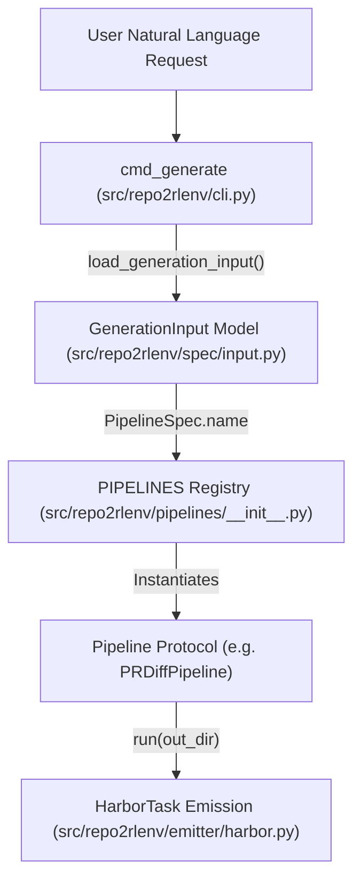
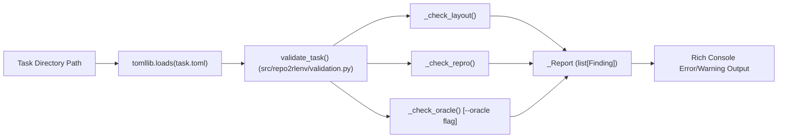

<!-- source: DeepWiki mcp.deepwiki.com · repo huggingface/Repo2RLEnv · page 2.1 generate, validate, and bootstrap Commands · fetched 2026-10-26 -->

# generate, validate, and bootstrap Commands

Relevant source files

The following files were used as context for generating this wiki page:

- [docs/reference/API.md](docs/reference/API.md)
- [docs/reference/SPEC.md](docs/reference/SPEC.md)
- [src/repo2rlenv/cli.py](src/repo2rlenv/cli.py)
- [src/repo2rlenv/validation.py](src/repo2rlenv/validation.py)
- [tests/test_cli_llm_flags.py](tests/test_cli_llm_flags.py)
- [tests/test_validation.py](tests/test_validation.py)

This page provides a detailed technical reference for the three primary workflow commands in the `repo2rlenv` CLI: `generate` (pipeline execution), `validate` (structural, deep, and oracle checks on `task.toml`), and `bootstrap` (LLM-driven Docker environment creation). These commands facilitate the end-to-end process of transforming a GitHub repository into a Harbor-compliant reinforcement learning dataset.

Sources: [src/repo2rlenv/cli.py:1-10](), [docs/reference/SPEC.md:1-10]()

---

## 1. The `generate` Command

The `generate` command is the primary entry point for dataset synthesis. It orchestrates repository cloning, environment bootstrapping (if required), and the execution of a specific synthesis pipeline using the configuration options parsed by `load_generation_input`.

### Implementation and Data Flow
The command is implemented via `cmd_generate` in [src/repo2rlenv/cli.py:145-220](). It follows a multi-stage execution flow:

1. **Configuration Loading & Overrides**: Merges CLI arguments (such as `--repo`, `--pipeline`, `--pipeline-opt`, `--llm`, and `--out`) with an optional config file (`--config`) into a `GenerationInput` Pydantic model via `load_generation_input` [src/repo2rlenv/cli.py:146-175]().
2. **LLM Override Sanitization**: Drops obsolete configuration blocks if a new `--llm` flag conflicts with an existing config file via `_drop_config_llm_extras` [src/repo2rlenv/cli.py:89-113]().
3. **Pipeline Dispatch**: Retrieves the target pipeline from the `PIPELINES` registry [src/repo2rlenv/cli.py:147]().
4. **Pipeline Execution**: Validates options against the named pipeline's `Options` model and executes `pipeline.run(out_dir)` [src/repo2rlenv/cli.py:148]().

### Command Flags and Configuration
| Flag / Option | Description | Code Reference |
| :--- | :--- | :--- |
| `--repo` | Target repository (owner/name, URL, or local path). | [src/repo2rlenv/cli.py:152-153]() |
| `--pipeline` | Name of the synthesis pipeline (e.g., `pr_diff`, `pr_runtime`). | [src/repo2rlenv/cli.py:154-155]() |
| `--pipeline-opt` | Repeated `key=value` parameters passed to pipeline options. | [src/repo2rlenv/cli.py:37-55]() |
| `--llm` | Primary LLM spec as `provider/model` (e.g., `anthropic/claude-sonnet-4-6`). | [src/repo2rlenv/cli.py:58-73]() |
| `--llm-fallback` | Fallback LLM spec for 5xx/rate-limit/network errors. | [src/repo2rlenv/cli.py:74-76]() |
| `--llm-endpoint` | Base URL of a self-hosted OpenAI-compatible server (vLLM, Ollama). | [src/repo2rlenv/cli.py:77-78]() |
| `--llm-key-env` | Environment variable holding the custom API key for the primary LLM. | [src/repo2rlenv/cli.py:79-80]() |
| `--config` | Path to a YAML or TOML configuration file. | [src/repo2rlenv/cli.py:173]() |
| `--out` | Local output destination directory for the generated tasks. | [src/repo2rlenv/cli.py:165-171]() |

### Diagram: Generation Dispatch and Execution Bridge
The following diagram connects natural language intent to the underlying code entities in the `repo2rlenv` codebase.

Sources: [src/repo2rlenv/cli.py:145-220](), [docs/reference/SPEC.md:5-20]()

---

## 2. The `validate` Command

The `validate` command performs structural, deep, and oracle checks on generated task directories and their associated `task.toml` configuration files.

### Implementation and Check Levels
The validation subsystem is driven by `validate_task` in [src/repo2rlenv/validation.py:84-122](). It inspects task assets against Harbor and Repo2RLEnv specifications across multiple verification layers:

1. **Structural Checks**: Recursively locates `task.toml` files, validates the root table structure, checks `[environment]` OS settings (`linux` or `windows`), and ensures mandatory files like `instruction.md` and test scripts (`tests/test.sh` or `.bat`) exist [src/repo2rlenv/validation.py:93-132]().
2. **Deep Asset Checks**: Inspects reward kinds (`test_execution` vs. `diff_similarity`), validates reproducibility modes (`reproducibility.mode`), and confirms that pipeline-specific auxiliary files (such as `f2p.json` and `p2p.json` for `pr_runtime`) are correctly formatted [src/repo2rlenv/validation.py:150-167]() and [tests/test_validation.py:72-88]().
3. **Oracle Checks (`--oracle`)**: Verifies the existence and validity of solution artifacts, allowing named recipes to solve tasks via custom scripts (e.g., `solution/solve.sh`) or standard patch files (`solution/patch.diff`) [tests/test_validation.py:127-147]().

### Diagram: Validation Flow and Finding Generation

Sources: [src/repo2rlenv/validation.py:1-122](), [tests/test_validation.py:1-147]()

---

## 3. The `bootstrap` Command

The `bootstrap` command executes an LLM-driven ReAct agent loop to create, test, and commit a reproducible Docker environment for a given target repository.

### Lifecycle and Agent Mechanics
The bootstrap runner (`ensure_bootstrap`) coordinates environment creation through the following phases:

1. **Language Heuristics**: Inspects repository root files (e.g., `pyproject.toml`, `go.mod`, `Cargo.toml`) to select matching dependency files, base images, and system prompts [docs/reference/BOOTSTRAP.md:22-37]().
2. **Sandbox Allocation**: Spins up a `DockerSandbox` instance wrapping the local Docker daemon to execute build steps [docs/reference/BOOTSTRAP.md:18-18]().
3. **ReAct Loop**: The agent iteratively sends shell commands to install dependencies, run test suites, and read error logs via LiteLLM (`llm.complete`) until a successful "smoke test" exit code is achieved [src/repo2rlenv/llm.py:76-86]().
4. **Image Commitment**: Commits the resulting container state into a content-addressed local image cache (`cache.py`) [docs/reference/SPEC.md:134-140]().

### Configuration (BootstrapSpec)
`BootstrapSpec` governs agent termination criteria and environment parameters:
- `max_iterations`: Maximum LLM turn limit (default: `20`) [docs/reference/BOOTSTRAP.md:18]()
- `max_llm_spend_usd`: Budget ceiling for LiteLLM usage (default: `$5.00`) [docs/reference/SPEC.md:165-188]()
- `base_image`: Optional override for starting container images [docs/reference/SPEC.md:175]()
- `cache_dir`: Local storage path for cached bootstrap outputs (`./workspace/bootstrap`) [docs/reference/SPEC.md:181-183]()

Sources: [docs/reference/BOOTSTRAP.md:1-40](), [src/repo2rlenv/llm.py:76-86](), [docs/reference/SPEC.md:134-188]()

---

