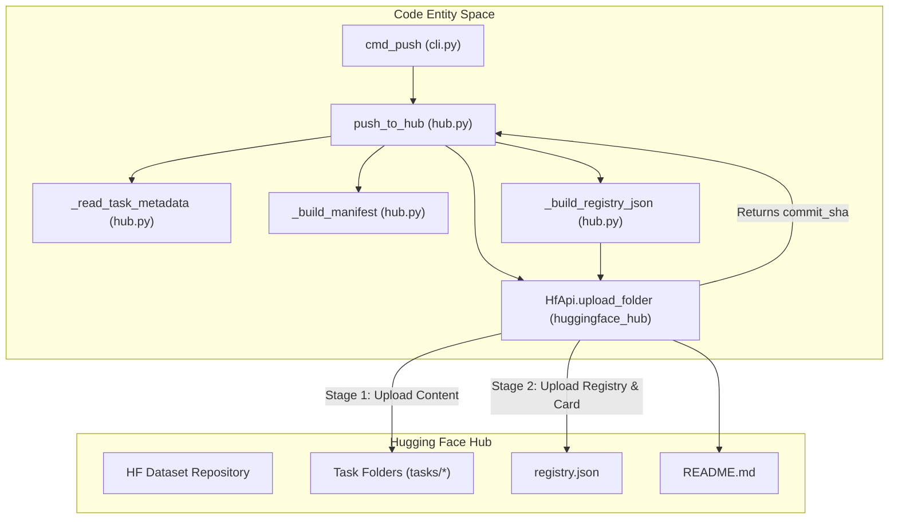
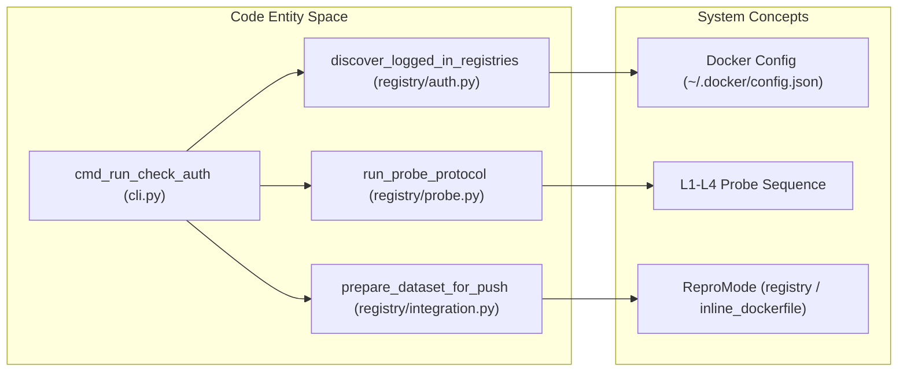

<!-- source: DeepWiki mcp.deepwiki.com · repo huggingface/Repo2RLEnv · page 2.2 push and pull Commands · fetched 2026-10-26 -->

# push and pull Commands

Relevant source files

The following files were used as context for generating this wiki page:

- [docs/reference/REGISTRY_AUTH.md](docs/reference/REGISTRY_AUTH.md)
- [src/repo2rlenv/hub.py](src/repo2rlenv/hub.py)
- [src/repo2rlenv/registry/integration.py](src/repo2rlenv/registry/integration.py)
- [tests/registry/test_integration.py](tests/registry/test_integration.py)
- [tests/test_cli_push_pull.py](tests/test_cli_push_pull.py)
- [tests/test_hub_metadata_read.py](tests/test_hub_metadata_read.py)

## Purpose and Scope

The `push` and `pull` commands manage the distribution lifecycle for Repo2RLEnv datasets. While synthesis pipelines generate tasks locally, these commands facilitate publishing datasets to the Hugging Face Hub, formatting them as Harbor-compatible registries with associated `registry.json` manifests, uploading OCI bootstrap container images for environment reproducibility, and retrieving datasets via multi-backend URIs (`hf://`, `harbor://`, `gh://`).

Sources: [src/repo2rlenv/hub.py:1-26](), [src/repo2rlenv/cli.py:1010-1100]()

---

## Overview and URI Schemes

Repo2RLEnv uses a unified URI parsing function, `_parse_dataset_uri` in `src/repo2rlenv/cli.py`, to handle multiple distribution backends. This allows users to specify targets using shorthand notation or explicit URIs.

| Scheme | Example | Target Backend |
| :--- | :--- | :--- |
| `hf://` | `hf://AdithyaSK/click-r2e` | Hugging Face Hub (Default) |
| `harbor://` | `harbor://swe-bench@lite` | Harbor Registry (Pull-only) |
| `gh://` | `gh://owner/repo@main` | GitHub Repository |
| (none) | `click-r2e` | Auto-resolves to `hf://<whoami>/click-r2e` |

The URI parser decomposes strings into a `_Backend` enum, a `repo_id`, and an optional `revision` (git branch, tag, or commit SHA) [src/repo2rlenv/cli.py:1010-1015](). Bare names without an explicit owner invoke `huggingface_hub.whoami()` using credentials resolved by `resolve_hf_token` [src/repo2rlenv/cli.py:1044-1055]().

Sources: [src/repo2rlenv/cli.py:1010-1100](), [tests/test_cli_push_pull.py:23-58](), [src/repo2rlenv/auth.py:65-80]()

---

## The `push` Command and Two-Stage Commit

The `push` command uploads a local dataset directory to the Hugging Face Hub via `push_to_hub` in `src/repo2rlenv/hub.py`. To ensure the remote repository functions simultaneously as a valid HF Dataset and a Harbor task registry, it implements a strict two-stage commit process.

### Two-Stage Commit Workflow

1.  **Stage 1: Content Upload**: The local task directory structure (`tasks/`) is uploaded to the HF Hub repository via `HfApi.upload_folder` [src/repo2rlenv/hub.py:228-237]().
2.  **Stage 2: Registry and Card Generation**: Upon receiving the resulting `commit_sha`, `push_to_hub` generates a Harbor-compliant `registry.json` and a dataset card (`README.md`) pinned directly to that commit SHA [src/repo2rlenv/hub.py:241-260]().

### Key Registry Artifacts

*   **`registry.json`**: Built by `_build_registry_json`, containing a list of `DatasetSpec` rows mapping task names to the HF dataset git URL and specific `git_commit_id` hashes [src/repo2rlenv/hub.py:117-141]().
*   **Dataset Card (`README.md`)**: Generated via `_build_dataset_card`, incorporating pipeline-specific reward descriptions (e.g., test-execution F2P/P2P for `pr_runtime` versus 6-component diff similarity for `pr_diff`) [src/repo2rlenv/hub.py:144-177]().
*   **Manifest (`manifest.json`)**: Built by `_build_manifest`, capturing a summary of task composition (repo origins, reference PRs, difficulty, and F2P/P2P counts) for machine inspection without cloning full task directories [src/repo2rlenv/hub.py:68-114]().

### Metadata Auto-Discovery
`push_to_hub` automatically inspects the first available `task.toml` in the dataset directory to extract `pipeline` and `repo` values if they are omitted by standalone CLI callers [src/repo2rlenv/hub.py:218-226](), [tests/test_hub_metadata_read.py:78-102]().

Diagram: Push Data Flow and Code Entities

Sources: [src/repo2rlenv/hub.py:68-270](), [src/repo2rlenv/cli.py:840-900](), [tests/test_hub_metadata_read.py:45-102]()

---

## Container Registry Integration and `--check-auth`

For runtime verification pipelines (e.g., `pr_runtime`), datasets require OCI container images for environment reproduction. The distribution subsystem coordinates with OCI registries via `repo2rlenv.registry.integration` and `repo2rlenv.registry.probe`.

### The `--check-auth` Probe Protocol
Before pushing images or executing a generation campaign, users can run `repo2rlenv push --check-auth` to probe available credentials across registries. The probe runs a 4-level check sequence defined in `src/repo2rlenv/registry/probe.py`:

| Level | Probe Operation | Purpose |
| :--- | :--- | :--- |
| **L1** | `GET /v2/` | Verifies registry reachability [src/repo2rlenv/registry/probe.py:9]() |
| **L2** | Bearer-token exchange | Confirms credentials parse and are accepted [src/repo2rlenv/registry/probe.py:10]() |
| **L3** | `HEAD /v2/<ns>/r2e-bootstrap-probe/manifests/latest` | Checks read access on target namespace (404 = pass) [src/repo2rlenv/registry/probe.py:11]() |
| **L4** | `POST` blob upload + `DELETE` cancel | Verifies write access without leaving artifacts [src/repo2rlenv/registry/probe.py:12-13]() |

If no registry authentication is verified, `push` falls back to inline-Dockerfile mode (baking build recipes per task) unless `--require-registry` is specified [src/repo2rlenv/registry/integration.py:6-8](), [docs/reference/REGISTRY_AUTH.md:13-19]().

Diagram: Auth Probing and Registry Integration

Sources: [src/repo2rlenv/cli.py:1134-1200](), [src/repo2rlenv/registry/probe.py:7-20](), [src/repo2rlenv/registry/integration.py:1-13](), [docs/reference/REGISTRY_AUTH.md:159-172]()

---

## The `pull` Command and Backend Dispatchers

The `pull` command retrieves datasets and prepares them for local evaluation or execution. It acts as a dispatcher across the supported URI backends.

*   **HF Backend**: Uses `huggingface_hub.snapshot_download` to fetch datasets into the local cache, returning a `PullResult` containing both `snapshot_path` and `local_dir` [src/repo2rlenv/hub.py:60-66](), [src/repo2rlenv/hub.py:273-306]().
*   **Harbor Backend**: Designed to query Harbor legacy registries via `harbor://` URIs [tests/test_cli_push_pull.py:35-40]().
*   **GitHub Backend**: Executes a standard git clone operation for `gh://` and direct HTTPS git URLs [tests/test_cli_push_pull.py:42-52]().

Sources: [src/repo2rlenv/hub.py:60-306](), [src/repo2rlenv/cli.py:920-960](), [tests/test_cli_push_pull.py:23-52]()

---

## CLI Reference Summary

### `push` Arguments
| Flag | Description |
| :--- | :--- |
| `local_dir` | Path to the local dataset directory. |
| `dataset` | Target destination URI (e.g., `hf://owner/dataset-name`). |
| `--private` | Sets HF dataset visibility to private. |
| `--check-auth` | Executes the L1–L4 registry probe protocol without pushing. |
| `--image-registry` | OCI container registry endpoint for bootstrap images. |
| `--require-registry` | Hard-fails if no verified OCI registry is available instead of falling back to inline Dockerfiles [docs/reference/REGISTRY_AUTH.md:18-19](). |

### `pull` Arguments
| Flag | Description |
| :--- | :--- |
| `dataset` | Source URI of the dataset to pull. |
| `--out` | Local destination directory. |
| `--task` | Optional: download only a specific task ID [src/repo2rlenv/cli.py:182-183](). |

Sources: [src/repo2rlenv/cli.py:350-450](), [src/repo2rlenv/spec/input.py:129-142](), [tests/test_cli_push_pull.py:119-121]()

---

