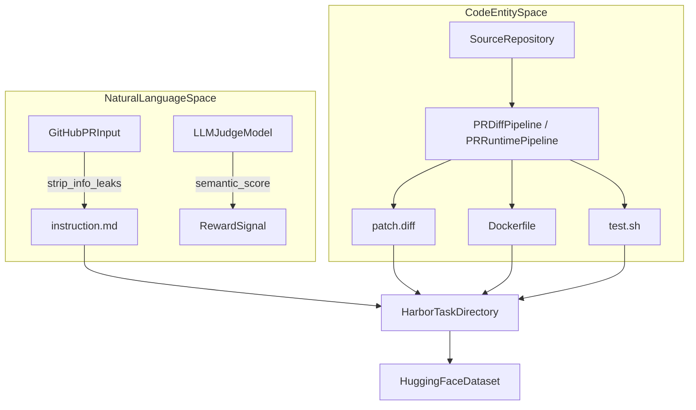
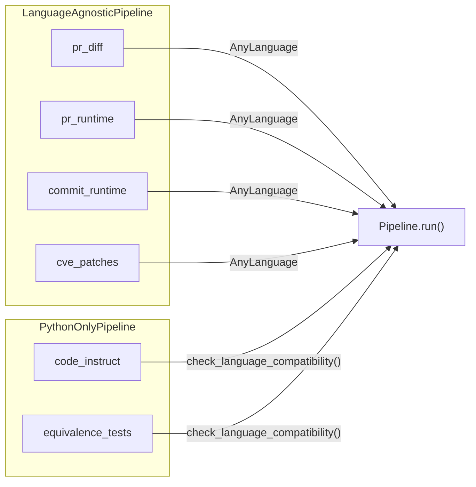

<!-- source: DeepWiki mcp.deepwiki.com · repo huggingface/Repo2RLEnv · page 3 Synthesis Pipelines · fetched 2026-10-26 -->

# Synthesis Pipelines

Relevant source files

The following files were used as context for generating this wiki page:

- [docs/pipelines/README.md](docs/pipelines/README.md)
- [src/repo2rlenv/pipelines/base.py](src/repo2rlenv/pipelines/base.py)
- [tests/test_pipeline_contract.py](tests/test_pipeline_contract.py)

Synthesis Pipelines are the core manufacturing engines of `Repo2RLEnv`. Each pipeline implements a specific strategy for transforming raw repository data (PRs, commits, issues, or AST structures) into verifiable **Harbor tasks**.

All pipelines share a common execution lifecycle: discovering candidates from a source, synthesizing task content (instructions, solutions, and environments), passing through a QA gate, and emitting a standardized Harbor task directory [docs/pipelines/README.md:9-18]().

### The Pipeline Protocol

Every pipeline implementation must conform to the `Pipeline` protocol, ensuring a uniform interface for the CLI and orchestration layers [src/repo2rlenv/pipelines/base.py:57-77]().

| Attribute / Method | Description |
|---|---|
| `name` | The unique identifier used in CLI `--pipeline` flags [src/repo2rlenv/pipelines/base.py:79](). |
| `requires_bootstrap` | Boolean indicating if the pipeline requires a pre-built Docker environment from the Bootstrap System [src/repo2rlenv/pipelines/base.py:80](). |
| `supported_languages` | A set of `LanguageHint` values. If `None`, the pipeline is language-agnostic [src/repo2rlenv/pipelines/base.py:84](). |
| `experimental` | If `True`, the CLI issues a stability warning before execution [src/repo2rlenv/pipelines/base.py:88](). |
| `run(out_dir)` | The primary execution method that returns a `PipelineResult` containing yield and skip metrics [src/repo2rlenv/pipelines/base.py:97](). |

Sources: [src/repo2rlenv/pipelines/base.py:57-97](), [tests/test_pipeline_contract.py:10-43]()

---

### Pipeline Families and Child Pages

`Repo2RLEnv` organizes native pipelines into stable and experimental families, alongside an extensive catalog of research recipes.

#### 3.1. pr_diff Pipeline
The `pr_diff` pipeline is a lightweight, language-agnostic pipeline that bypasses heavy environment bootstrapping. It mines merged pull requests, strips info-leaks from instructions, and evaluates rollouts using a 6-component diff-similarity reward function against a calibration baseline.
* For details, see [pr_diff Pipeline](#3.1).

#### 3.2. pr_runtime Pipeline
The `pr_runtime` pipeline provides sandbox-verified PR mining. It splits patches and test patches, validates fail-to-pass (F2P) and pass-to-pass (P2P) test oracles, and emits fully containerized environments with anti-tamper guards and graded rewards.
* For details, see [pr_runtime Pipeline](#3.2).

#### 3.3. commit_runtime Pipeline
The `commit_runtime` pipeline replaces PR lists with direct git log traversal. It applies structural and metadata filters, synthesizes task instructions from linked issues, and subjects candidates to rigorous F2P/P2P sandbox validation.
* For details, see [commit_runtime Pipeline](#3.3).

#### 3.4. Experimental Pipelines
Experimental pipelines explore alternative authoring mechanics such as bug mutation (`repo_mutate`), equivalence test generation, CVE patch mining via OSV (`cve_patches`), code instruction synthesis, and task evolution.
* For details, see [Experimental Pipelines](#3.4).

#### 3.5. Owned Research Recipes
The `recipes/` subsystem layers method-specific recipes onto core pipeline families. It includes implementations for SWE-smith, SWE-gen, SWE-Flow, R2E, R2E-Gym, SWE-Next, CLI-Gym, SETA, DataArc, TMax, TerminalWorld, Endless Terminals, and SCALER.
* For details, see [Owned Research Recipes](#3.5).

Sources: [docs/pipelines/README.md:25-65](), [src/repo2rlenv/pipelines/__init__.py:1-25]()

---

### Pipeline Architecture: Data Flow

The following diagram illustrates how the `Pipeline` protocol bridges the "Natural Language Space" (instructions and PR descriptions) to the "Code Entity Space" (Docker images and diffs) using internal code symbols.

**Synthesis Pipeline Data Flow**

Sources: [docs/pipelines/README.md:9-18](), [src/repo2rlenv/pipelines/base.py:57-77](), [src/repo2rlenv/pipelines/__init__.py:11-18]()

---

### Choosing a Pipeline and Language Compatibility

The choice of pipeline depends on the desired verification rigor and available compute resources. Language constraints are enforced via `check_language_compatibility()` to prevent silent failures on non-Python codebases [src/repo2rlenv/pipelines/base.py:100-142]().

**Pipeline Language Constraints**

Sources: [src/repo2rlenv/pipelines/base.py:100-142](), [tests/test_pipeline_contract.py:60-91]()

---

