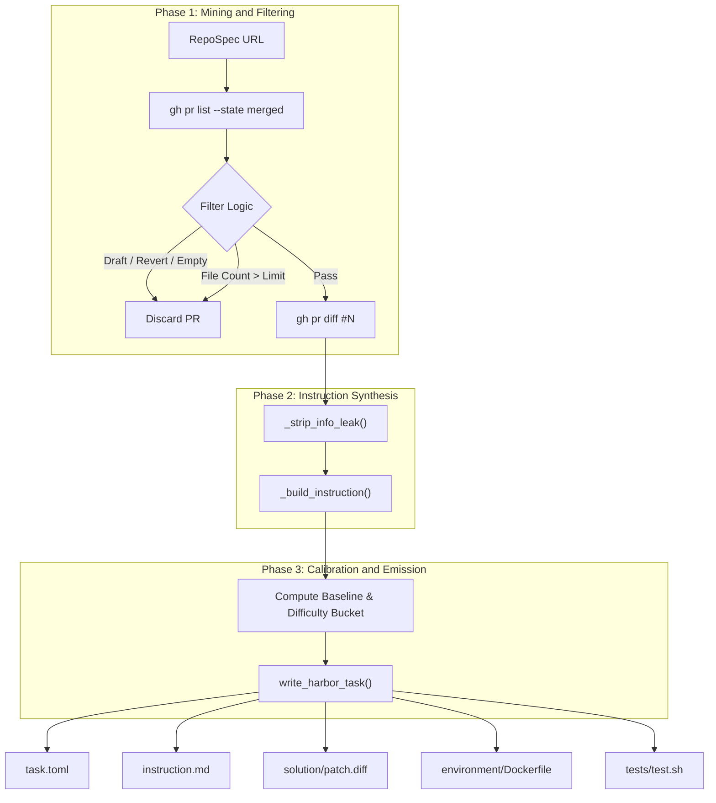
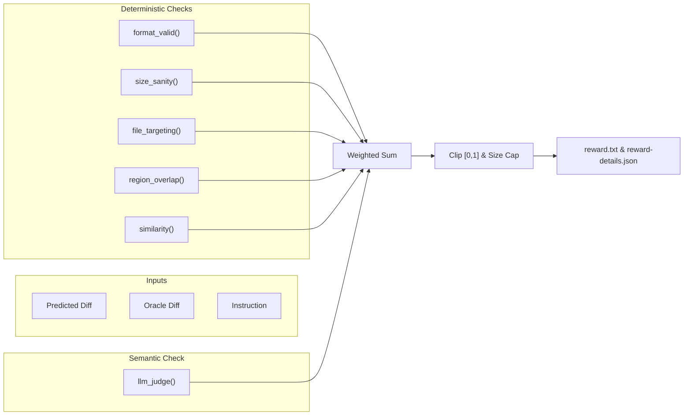

<!-- source: DeepWiki mcp.deepwiki.com · repo huggingface/Repo2RLEnv · page 3.1 pr_diff Pipeline · fetched 2026-10-26 -->

# pr_diff Pipeline

Relevant source files

The following files were used as context for generating this wiki page:

- [docs/pipelines/pr_diff.md](docs/pipelines/pr_diff.md)
- [src/repo2rlenv/pipelines/_pr_diff_verifier.py](src/repo2rlenv/pipelines/_pr_diff_verifier.py)
- [src/repo2rlenv/pipelines/cve_patches.py](src/repo2rlenv/pipelines/cve_patches.py)
- [src/repo2rlenv/pipelines/pr_diff.py](src/repo2rlenv/pipelines/pr_diff.py)
- [src/repo2rlenv/pipelines/pr_runtime.py](src/repo2rlenv/pipelines/pr_runtime.py)
- [tests/test_e2e_hub_build.py](tests/test_e2e_hub_build.py)
- [tests/test_pipeline_pr_diff.py](tests/test_pipeline_pr_diff.py)
- [tests/test_pr_diff_clone.py](tests/test_pr_diff_clone.py)
- [tests/test_pr_diff_verifier.py](tests/test_pr_diff_verifier.py)

The `pr_diff` pipeline is a high-throughput, text-based synthesis pipeline designed to transform merged GitHub and GitLab Pull Requests into Harbor-runnable Reinforcement Learning (RL) environments. Inspired by the **SWE-RL** methodology `[src/repo2rlenv/pipelines/pr_diff.py:21-25]`, it focuses on a "PR-as-task" formulation where an agent is tasked with reproducing the changes found in a real-world PR given only the issue description.

Unlike runtime-heavy pipelines (such as `pr_runtime`), `pr_diff` generation is text-only and does not require a live container sandbox during the synthesis phase `[src/repo2rlenv/pipelines/pr_diff.py:3-8]`. Instead, it emits a thin Docker environment equipped with a sophisticated 6-component verifier that scores agent-produced patches against the "gold" oracle diff.

Sources: `[src/repo2rlenv/pipelines/pr_diff.py:1-37]`, `[docs/pipelines/pr_diff.md:1-16]`

---

## Pipeline Data Flow & Mining Logic

The following diagram illustrates the lifecycle of a task within the `pr_diff` pipeline, from initial repository mining and structural filtering to the emission of a Harbor-compliant task directory.

**Diagram: pr_diff Task Synthesis Flow**

Sources: `[src/repo2rlenv/pipelines/pr_diff.py:1-40]`, `[docs/pipelines/pr_diff.md:17-40]`

For each merged PR within scope, the pipeline executes the following steps:
1. Lists PRs using `gh pr list` or GitLab equivalent, applying structural filters (draft status, file count limits) and quality filters (drop test-only, docs-only, reverts, or trivially small diffs) `[docs/pipelines/pr_diff.md:34-34]()`.
2. Fetches the unified diff via `gh pr diff` `[docs/pipelines/pr_diff.py:5-5]()`.
3. Strips leakage patterns from the PR title and body `[docs/pipelines/pr_diff.py:145-148]()`.
4. Computes the calibration baseline and difficulty bucket `[docs/pipelines/pr_diff.py:1-10]()`.
5. Emits a Harbor task directory structure containing `instruction.md`, `solution/patch.diff`, `solution/solve.sh`, `environment/Dockerfile`, `tests/test.sh`, and `task.toml` `[docs/pipelines/pr_diff.md:38-38]()`.

Sources: `[src/repo2rlenv/pipelines/pr_diff.py:1-55]`, `[docs/pipelines/pr_diff.md:17-43]`

---

## Instruction Info-Leak Stripping

To prevent RL agents from "cheating" by following direct references to the solution (such as issue links, commit hashes, or pull request URLs), the pipeline implements a robust text-cleaning module `_strip_info_leak` `[src/repo2rlenv/pipelines/pr_diff.py:120-143]()`.

| Pattern Family | Regex Variable | Example Stripped |
| :--- | :--- | :--- |
| **Closes / Fixes / Resolves** | `_CLOSES_RE`, `_CLOSES_MD_RE` | `Closes #42`, `Fixes [#1](url)` |
| **See / Refs / Follow-up** | `_REFS_RE`, `_REFS_MD_RE` | `See #99`, `Follow-up to #10` |
| **Markdown Issue Links** | `_MD_ISSUE_LINK_RE` | `[#1234](https://github.com/...)` |
| **Markdown GitHub URLs** | `_MD_GH_URL_RE` | `[analysis](https://github.com/.../pull/1)` |
| **Bare GitHub URLs** | `_GH_URL_RE` | `https://redirect.github.com/.../pull/42` |
| **Commit Trailers** | `_TRAILER_LINE_RE` | `Co-authored-by: ...`, `Signed-off-by: ...` |
| **Title Squash Suffix** | `_SQUASH_SUFFIX_RE` | `Fix the bug (#1234)` |

Order of execution is critical: composite patterns (such as markdown-wrapped issue links and descriptive markdown URLs) are processed before piece-wise regexes to ensure no orphaned keywords (`Closes `) or empty bracket pairs (``) remain in the final instruction text `[src/repo2rlenv/pipelines/pr_diff.py:127-130]()`.

Sources: `[src/repo2rlenv/pipelines/pr_diff.py:67-142]`, `[tests/test_pipeline_pr_diff.py:48-117]`

---

## The 6-Component Diff-Similarity Reward Model

The verifier embedded in `tests/test.sh` computes a weighted multi-component similarity score between the agent's predicted diff and the gold oracle diff `[src/repo2rlenv/pipelines/_pr_diff_verifier.py:1-47]()`.

**Diagram: In-Container Verifier Architecture**

Sources: `[src/repo2rlenv/pipelines/_pr_diff_verifier.py:1-47]`, `[docs/pipelines/pr_diff.md:44-60]`

### Component Breakdown
1. **`format_valid` (Default Weight: 0.00):** A guard check returning `1.0` if the predicted text parses as a valid unified diff (containing a `diff --git` header and at least one `+/-` change line) or `0.0` otherwise `[src/repo2rlenv/pipelines/_pr_diff_verifier.py:132-151]()`.
2. **`size_sanity` (Default Weight: 0.08):** Computes `min(oracle_loc, predicted_loc) / max(...)` to penalize code rampages or no-op submissions `[src/repo2rlenv/pipelines/_pr_diff_verifier.py:186-200]`.
3. **`file_targeting` (Default Weight: 0.12):** Computes the F1 score over the sets of modified files. F1 is preferred over Jaccard similarity to heavily penalize missing oracle files while offering graceful partial credit for extra file exploration `[src/repo2rlenv/pipelines/_pr_diff_verifier.py:154-177]`.
4. **`region_overlap` (Default Weight: 0.20):** Evaluates whether predicted hunks overlap with oracle hunks within a 5-line spatial slack window `[src/repo2rlenv/pipelines/_pr_diff_verifier.py:230-264]`.
5. **`similarity` (Default Weight: 0.10):** Utilizes `difflib.SequenceMatcher` applied strictly to `+` and `-` change lines (excluding unchanged context lines to prevent free credit) `[src/repo2rlenv/pipelines/_pr_diff_verifier.py:203-227]`.
6. **`llm_judge` (Default Weight: 0.50):** An optional semantic evaluation via an LLM model (such as Claude Haiku) rating whether the patch addresses the issue. If an API key is absent, remaining weights are automatically re-normalized `[src/repo2rlenv/pipelines/_pr_diff_verifier.py:267-310]`.

**Catastrophic Size Hard Cap:** If `size_sanity < 0.10`, the final reward is strictly clamped to a maximum of `0.40`, neutralizing inflated scores from charitable LLM judges on vastly mis-sized patches `[src/repo2rlenv/pipelines/_pr_diff_verifier.py:32-34]()`.

Sources: `[src/repo2rlenv/pipelines/_pr_diff_verifier.py:9-35]`, `[docs/pipelines/pr_diff.md:44-61]`

---

## Calibration Baseline and Difficulty Bucketing

To enable cross-task comparability and flexible dataset filtering, tasks generated by `pr_diff` include diagnostic metadata in `task.toml`:

* **Calibration Baseline (`baseline_reward`):** The reward score that an empty predicted patch receives against the oracle, enabling normalized scoring:
  $$\text{calibrated} = \frac{\text{raw} - \text{baseline}}{1 - \text{baseline}}$$
  Scores below `0` indicate performance worse than a no-op `[docs/pipelines/pr_diff.md:65-71]()`.
* **Difficulty Bucketing:** Tasks are categorized into `easy` ($\le 5$ LOC changed), `small` ($6\text{--}20$ LOC), `medium` ($21\text{--}80$ LOC), and `large` ($>80$ LOC) based on the oracle diff size `[docs/pipelines/pr_diff.md:73-75]()`.

Sources: `[docs/pipelines/pr_diff.md:63-75]`, `[src/repo2rlenv/pipelines/_pr_diff_verifier.py:312-320]`

---

## Thin Docker Environment Emission & Clone Handling

Unlike runtime pipelines that execute a multi-step LLM bootstrap runner, `pr_diff` tasks emit a thin, agent-agnostic `python:3.12-slim` Docker image `[docs/pipelines/pr_diff.md:38-40]()`. 

The generated `environment/Dockerfile`:
1. Installs system dependencies including `git` `[docs/pipelines/pr_diff.py:168-180]()`.
2. Clones the repository using `--filter=blob:none` over HTTPS from the source host, injecting repository access tokens (`GITHUB_TOKEN` or `GITLAB_TOKEN`) as build arguments without hardcoding credentials into image layers `[src/repo2rlenv/pipelines/pr_diff.py:168-180]()`, `[tests/test_pr_diff_clone.py:41-73]()`.
3. Checks out the repository at the precise `base_commit` SHA and resets the remote URL origin `[tests/test_pr_diff_clone.py:127-130]()`.
4. Embeds the standalone verifier logic (`verifier.py`) and test runner (`tests/test.sh`) to execute the 6-component reward calculation upon container completion `[src/repo2rlenv/pipelines/pr_diff.py:10-16]()`.

Sources: `[src/repo2rlenv/pipelines/pr_diff.py:1-180]`, `[tests/test_pr_diff_clone.py:1-131]`

---

