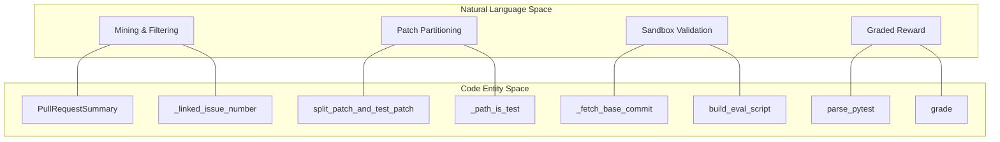
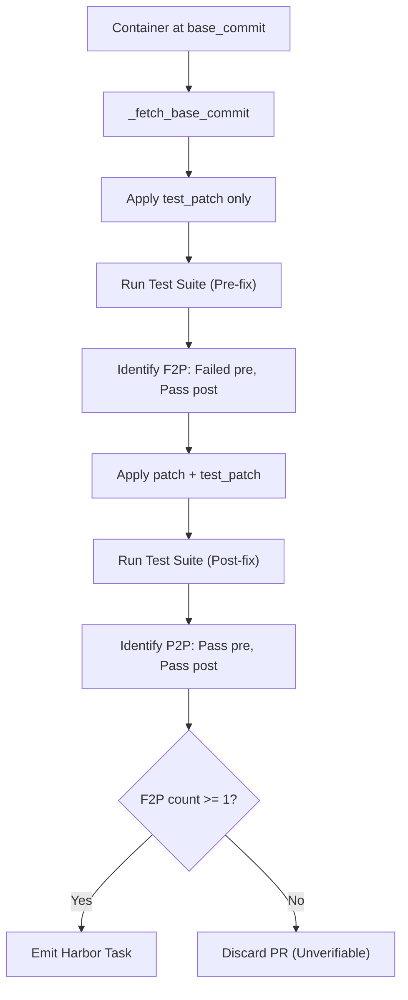

<!-- source: DeepWiki mcp.deepwiki.com · repo huggingface/Repo2RLEnv · page 3.2 pr_runtime Pipeline · fetched 2026-10-26 -->

# pr_runtime Pipeline

Relevant source files

The following files were used as context for generating this wiki page:

- [.gitignore](.gitignore)
- [src/repo2rlenv/emitter/harbor.py](src/repo2rlenv/emitter/harbor.py)
- [src/repo2rlenv/log_parsers/pytest_parser.py](src/repo2rlenv/log_parsers/pytest_parser.py)
- [src/repo2rlenv/pipelines/_pr_runtime_verifier.py](src/repo2rlenv/pipelines/_pr_runtime_verifier.py)
- [src/repo2rlenv/pipelines/cve_patches.py](src/repo2rlenv/pipelines/cve_patches.py)
- [src/repo2rlenv/pipelines/pr_diff.py](src/repo2rlenv/pipelines/pr_diff.py)
- [src/repo2rlenv/pipelines/pr_runtime.py](src/repo2rlenv/pipelines/pr_runtime.py)
- [src/repo2rlenv/pipelines/pr_runtime_validate.py](src/repo2rlenv/pipelines/pr_runtime_validate.py)
- [src/repo2rlenv/reward.py](src/repo2rlenv/reward.py)
- [tests/test_emitter.py](tests/test_emitter.py)
- [tests/test_log_parsers.py](tests/test_log_parsers.py)
- [tests/test_pipeline_pr_runtime.py](tests/test_pipeline_pr_runtime.py)
- [tests/test_pr_runtime_verifier.py](tests/test_pr_runtime_verifier.py)
- [tests/test_pytest_node_ids.py](tests/test_pytest_node_ids.py)

This page details the implementation, data flow, and verification mechanics of the `pr_runtime` pipeline (`src/repo2rlenv/pipelines/pr_runtime.py`), which performs sandbox-verified Pull Request (PR) mining (SWE-bench-style) [src/repo2rlenv/pipelines/pr_runtime.py:1]().

## Overview and Purpose

The `pr_runtime` pipeline provides sandbox-verified PR mining by combining GitHub/GitLab PR metadata pulling, unified diff splitting, containerized two-stage oracle validation, and graded test execution rewards [src/repo2rlenv/pipelines/pr_runtime.py:3-11](). Unlike text-only pipelines like `pr_diff` [src/repo2rlenv/pipelines/pr_diff.py:1](), `pr_runtime` requires a working Docker environment produced by the bootstrap phase (`requires_bootstrap=True`) to validate that candidate tests fail before the fix and pass after it [src/repo2rlenv/pipelines/pr_runtime.py:13-15]().

### Pipeline Lifecycle
1.  **Mining**: Pull PR metadata and unified diffs via `gh pr list` / `gh pr diff` or GitLab equivalents [src/repo2rlenv/pipelines/pr_runtime.py:4-48]().
2.  **Splitting**: Partition the unified diff into source code (`patch`) and test code (`test_patch`) using keyword-on-path heuristics [src/repo2rlenv/pipelines/pr_runtime.py:5-6]().
3.  **Oracle Validation**: Run the bootstrap container twice via `src/repo2rlenv/pipelines/pr_runtime_validate.py` (once with `test_patch` only to establish Fail-to-Pass tests, and once with both patches to establish Pass-to-Pass tests) [src/repo2rlenv/pipelines/pr_runtime.py:7-9]().
4.  **Task Emission**: Emit a Harbor-compliant task directory via `src/repo2rlenv/emitter/harbor.py` containing `environment/Dockerfile`, `tests/test.sh`, and `solution/patch.diff` [src/repo2rlenv/pipelines/pr_runtime.py:10-11]().

### System Component Mapping
The following diagram connects the conceptual components of the `pr_runtime` pipeline to their concrete code entities.

Title: "Logic to Code Mapping: pr_runtime Pipeline"

Sources: [src/repo2rlenv/pipelines/pr_runtime.py:48-85](), [src/repo2rlenv/pipelines/pr_runtime_validate.py:46-121](), [src/repo2rlenv/pipelines/_pr_runtime_verifier.py:32-140]()

---

## Patch Splitting and Heuristics

Separating the solution patch from the test patch is handled by `split_patch_and_test_patch` [tests/test_pipeline_pr_runtime.py:30]().

*   **Path Classification**: A diff hunk is classified as a test patch if its file path contains test indicators (`tests`, `test`, `e2e`, `testing`) or filename markers (`_test.go`, `.spec.ts`) [tests/test_pipeline_pr_runtime.py:101-108]().
*   **False Positive Defense**: Documentation paths (e.g. `docs/testing.md`) and non-test source files containing substrings like `testing` (e.g. `src/click/testing.py`) are strictly filtered out [tests/test_pipeline_pr_runtime.py:113-119]().
*   **Git Clean Management**: During workspace resets, `git clean -fdx` preserves essential dependency and build directories (`node_modules`, `target`, `vendor`, `.venv`, `.tox`, `.gradle`) so test suites can run without re-installing environment dependencies [src/repo2rlenv/pipelines/pr_runtime.py:69-77]().

Sources: [tests/test_pipeline_pr_runtime.py:30-125](), [src/repo2rlenv/pipelines/pr_runtime.py:69-77]()

---

## Sandbox Validation and Oracle Logic

Validation executes inside a `DockerSandbox` instance (`src/repo2rlenv/pipelines/pr_runtime_validate.py`) to discover the exact Fail-to-Pass (F2P) and Pass-to-Pass (P2P) test sets [src/repo2rlenv/pipelines/pr_runtime_validate.py:1-11]().

### Validation Sequence
Title: "Sandbox Validation Sequence"

Sources: [src/repo2rlenv/pipelines/pr_runtime_validate.py:1-11](), [src/repo2rlenv/pipelines/pr_runtime_validate.py:121-161]()

### Anti-Tamper and Evaluation Guards
The `build_eval_script` function creates the execution script embedded in `tests/test.sh`, which enforces:
*   Pre- and post-test workspace reset via `git checkout` to prevent state pollution [tests/test_pipeline_pr_runtime.py:139-140]().
*   Safe directory registration (`git config --global --add safe.directory /workspace`) to bypass container permission restrictions [tests/test_pipeline_pr_runtime.py:143]().
*   Exit code capture (`TEST_EXIT_CODE=$?`) prior to cleanup so verification verdicts are preserved [tests/test_pipeline_pr_runtime.py:167-184]().
*   Network egress restrictions via `egress_guard_compose` [src/repo2rlenv/pipelines/pr_runtime.py:54]().

Sources: [tests/test_pipeline_pr_runtime.py:130-198](), [src/repo2rlenv/pipelines/pr_runtime.py:54]()

---

## Graded Reward Calculation

To provide a denser RL gradient than binary pass/fail evaluation, tasks include an embedded standalone verifier (`src/repo2rlenv/pipelines/_pr_runtime_verifier.py`) [src/repo2rlenv/pipelines/_pr_runtime_verifier.py:1-25]().

### Reward Schema and Metrics
The verifier parses test runner outputs (supporting `pytest`, `go test`, `cargo test`, and `jest`/`vitest`) and computes [src/repo2rlenv/pipelines/_pr_runtime_verifier.py:70-180]():

$$\text{f2p\_rate} = \frac{\text{F2P tests passed}}{\text{total F2P tests}}$$

$$\text{p2p\_rate} = \frac{\text{P2P tests passed}}{\text{total P2P tests}}$$

$$\text{reward} = \text{f2p\_rate} \times \text{p2p\_rate}$$

*   **`resolved`**: Evaluates to `True` if all F2P and P2P tests pass (matching strict SWE-bench criteria) [src/repo2rlenv/pipelines/_pr_runtime_verifier.py:36]().
*   **`command_resolved`**: Ensures the test command exited with `0` and no untracked test failures occurred [tests/test_pr_runtime_verifier.py:174-180]().

Sources: [src/repo2rlenv/pipelines/_pr_runtime_verifier.py:27-52](), [tests/test_pr_runtime_verifier.py:70-137]()

---

## Instruction Synthesis and Leak Prevention

To prevent agents from bypassing the task via solution leaks in PR descriptions, `pr_runtime` processes instructions using `_linked_issue_number` and `_strip_info_leak` [src/repo2rlenv/pipelines/pr_runtime.py:132-143]().

| Mechanism | Implementation Detail |
| :--- | :--- |
| **Issue Sourcing** | Pulls the bug report from the linked GitHub Issue body rather than the fix PR when available [src/repo2rlenv/pipelines/pr_runtime.py:132-135](). |
| **Leak Stripping** | Removes 40-character commit SHAs, PR/issue/commit URLs, and cross-reference patterns via `_LEAK_PATTERNS` [src/repo2rlenv/pipelines/pr_runtime.py:100-129](). |
| **Noise Filtering** | Drops boilerplate sections (e.g., "Checklist", "How to test", "Changelog") using `_BODY_NOISE_HEADER_RE` [src/repo2rlenv/pipelines/pr_runtime.py:91-97](). |
| **Length Limiting** | Truncates instructions to `_MAX_BODY_CHARS` (4000 characters) to prevent long essays from dominating context windows [src/repo2rlenv/pipelines/pr_runtime.py:151](). |

Sources: [src/repo2rlenv/pipelines/pr_runtime.py:83-151]()

---

