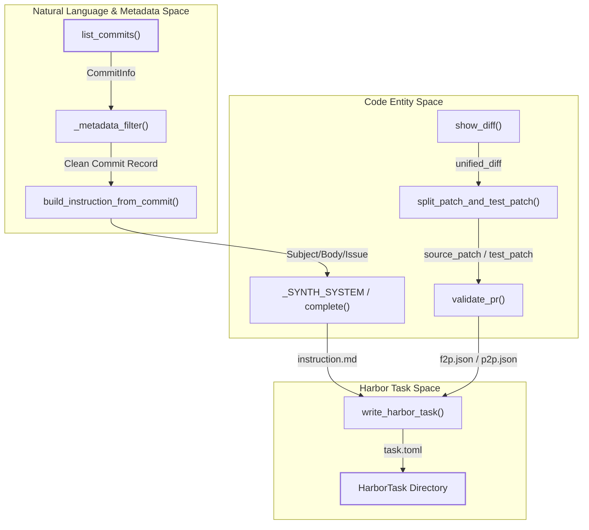
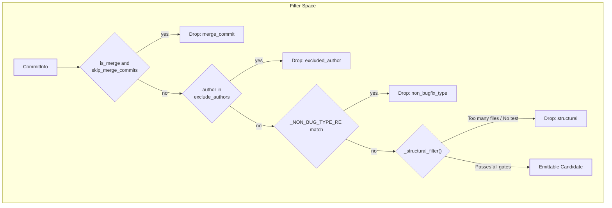

<!-- source: DeepWiki mcp.deepwiki.com · repo huggingface/Repo2RLEnv · page 3.3 commit_runtime Pipeline · fetched 2026-10-26 -->

# commit_runtime Pipeline

Relevant source files

The following files were used as context for generating this wiki page:

- [docs/pipelines/commit_runtime.md](docs/pipelines/commit_runtime.md)
- [docs/pipelines/pr_runtime.md](docs/pipelines/pr_runtime.md)
- [docs/release_notes/v0.8.3/findings-commit_runtime.md](docs/release_notes/v0.8.3/findings-commit_runtime.md)
- [src/repo2rlenv/git_local.py](src/repo2rlenv/git_local.py)
- [src/repo2rlenv/pipelines/commit_runtime.py](src/repo2rlenv/pipelines/commit_runtime.py)
- [tests/test_pipeline_commit_runtime.py](tests/test_pipeline_commit_runtime.py)

The `commit_runtime` pipeline implements commit-level mining for RL environment synthesis, bypassing PR lists by walking the git log directly [src/repo2rlenv/pipelines/commit_runtime.py:3-10](). Inspired by the SWE-GEN curation approach from R2E-Gym, this pipeline targets repositories that do not use PR workflows (such as direct-to-main or squash-merge styles) and yields candidate pools 3–10× larger than PR-based mining [docs/pipelines/commit_runtime.md:3-34](). As of version 0.8.4, it is stable and incorporates mandatory LLM-based or issue-backed instruction synthesis to produce leak-free, symptom-focused problem statements [docs/pipelines/commit_runtime.md:5-11]().

Sources: `src/repo2rlenv/pipelines/commit_runtime.py:1-32`, `docs/pipelines/commit_runtime.md:3-34`

## Implementation Overview and System Architecture

The pipeline uses `repo2rlenv.git_local.list_commits` to walk deep git logs (`clone_depth=200` by default), applies metadata and structural filters to `CommitInfo` objects, splits commits into source patches and test patches via `split_patch_and_test_patch`, and validates candidates inside the shared bootstrap container using `pr_runtime`'s harness [src/repo2rlenv/pipelines/commit_runtime.py:37-66](), [src/repo2rlenv/git_local.py:91-120]().

### Diagram: Commit-to-Task Synthesis Flow

Sources: `src/repo2rlenv/pipelines/commit_runtime.py:34-66`, `src/repo2rlenv/git_local.py:91-120`, `docs/pipelines/commit_runtime.md:35-51`

## Mining, Metadata, and Structural Filtering

To control noise from raw commit histories, `CommitRuntimePipeline` executes multi-stage filtering before invoking any sandbox resources [docs/pipelines/commit_runtime.md:39-47]().

### Metadata Filtering (`_metadata_filter`)
The metadata layer inspects `CommitInfo` attributes [src/repo2rlenv/git_local.py:28-39]() to discard non-actionable commits [src/repo2rlenv/pipelines/commit_runtime.py:301-335]():
* **Merge Rejection:** Skips merge commits (`len(parents) > 1`) when `skip_merge_commits` is set [src/repo2rlenv/git_local.py:41-43](), [src/repo2rlenv/pipelines/commit_runtime.py:303-305]().
* **Bot Exclusion:** Drops commits authored by automated accounts matching `exclude_authors` [src/repo2rlenv/pipelines/commit_runtime.py:306-308]().
* **Message Length Gate:** Rejects short subjects/bodies falling below `min_message_words` (default 5) [src/repo2rlenv/pipelines/commit_runtime.py:311-313]().
* **Conventional-Commit Type Gate:** Explicitly rejects non-bugfix types (`chore:`, `docs:`, `feat:`, `refactor:`, `style:`, `test:`, `ci:`, `build:`, `perf:`, `revert:`) via `_NON_BUG_TYPE_RE` [src/repo2rlenv/pipelines/commit_runtime.py:92-95]().
* **Bugfix Signal Enforcement:** Requires a positive bugfix signal: either a `fix:` prefix, a `Closes #N` / `Fixes #N` issue trailer, or a bugfix keyword (`bug`, `regression`, `crash`, `broken`, `fail`, etc.) [src/repo2rlenv/pipelines/commit_runtime.py:97-104]().

### Structural Filtering
Once `show_diff()` extracts the unified diff [src/repo2rlenv/git_local.py:157-170](), structural rules apply [src/repo2rlenv/pipelines/commit_runtime.py:338-368]():
* **Scope Control:** Skips commits touching more than `max_source_files_per_commit` (default 10) to avoid sweeping refactors [src/repo2rlenv/spec/options.py:112-113]().
* **Test Function Requirement:** Requires at least one new test function via `require_new_test_funcs` [src/repo2rlenv/pipelines/commit_runtime.py:361-364]().

### Diagram: Metadata and Structural Filtering Pipeline

Sources: `src/repo2rlenv/pipelines/commit_runtime.py:89-105`, `src/repo2rlenv/git_local.py:28-50`, `src/repo2rlenv/spec/options.py:102-123`, `tests/test_pipeline_commit_runtime.py:110-188`

## Instruction Synthesis and LLM Refinement

Because raw commit messages frequently leak solution details, function names, or file paths, `build_instruction_from_commit` uses a multi-tier sourcing and synthesis strategy [src/repo2rlenv/pipelines/commit_runtime.py:143-164]().

1. **Linked Issue Priority:** If a commit contains a `Closes #N` or `Fixes #N` trailer, the pipeline fetches the GitHub issue body via `github.fetch_issue` (reused from `pr_runtime`) to serve as the problem statement [src/repo2rlenv/pipelines/commit_runtime.py:159-162]().
2. **Commit Message Fallback:** If no issue is linked, the pipeline falls back to the commit subject and body, stripping conventional-commit prefixes via `_strip_commit_prefix` and removing issue trailers via `_CLOSES_RE` [src/repo2rlenv/pipelines/commit_runtime.py:78-87](), [src/repo2rlenv/pipelines/commit_runtime.py:163-164]().
3. **Information Leak Stripping & Reflow:** Text is passed through `_strip_info_leak` and `_reflow_pr_body` to remove cross-references, PR links, and template boilerplate [src/repo2rlenv/pipelines/commit_runtime.py:160-164]().
4. **LLM Synthesis (`synthesize_with_llm`):** When enabled, `_SYNTH_SYSTEM` guides an LLM call via `complete()` to rewrite the problem description into a symptom-focused bug report [src/repo2rlenv/pipelines/commit_runtime.py:49](), [src/repo2rlenv/pipelines/commit_runtime.py:115-130]().

Sources: `src/repo2rlenv/pipelines/commit_runtime.py:75-164`, `docs/pipelines/commit_runtime.md:5-11`, `docs/release_notes/v0.8.3/findings-commit_runtime.md:31-36`

## Sandbox Validation and Graded Reward

`commit_runtime` executes validation inside the bootstrapped Docker container by reusing the `pr_runtime` harness [src/repo2rlenv/pipelines/commit_runtime.py:51-66]().

### Validation Execution Flow
* **Pre-fix Test Run:** Test files are checked out to `base_commit`, `test_patch` is applied via `git apply --reject`, and the test suite executes to identify the `FAIL_TO_PASS` test set [docs/pipelines/pr_runtime.md:59-71]().
* **Post-fix Test Run:** The gold source patch is applied, and the test suite executes again to confirm test resolution and establish the `PASS_TO_PASS` regression set [docs/pipelines/pr_runtime.md:59-71]().
* **Graded Reward Emitting:** Emits a graded reward structure calculated as `reward = f2p_rate × p2p_rate`, recording structured verification outcomes in `/logs/verifier/reward.json` and `/logs/verifier/reward.txt` [docs/pipelines/commit_runtime.md:14](), [docs/pipelines/pr_runtime.md:5-10]().
* **Reward Calibration Metadata:** Populates `[metadata.repo2env.reward_calibration]` with `f2p_count`, `p2p_count`, `source_files`, `loc_changed`, and a bucketed `difficulty` score [docs/release_notes/v0.8.3/findings-commit_runtime.md:50-52]().

Sources: `src/repo2rlenv/pipelines/commit_runtime.py:51-66`, `docs/pipelines/pr_runtime.md:5-71`, `docs/release_notes/v0.8.3/findings-commit_runtime.md:50-64`

## Configuration Schema (`CommitRuntimeOptions`)

The behavior of `CommitRuntimePipeline` is governed by the `CommitRuntimeOptions` model [src/repo2rlenv/spec/options.py:102-123]().

| Option | Type | Default | Description |
| :--- | :--- | :--- | :--- |
| `limit` | `int` | `50` | Maximum candidate commits to walk from the git log. |
| `clone_depth` | `int` | `200` | Git clone history depth (`--depth N`). |
| `min_message_words` | `int` | `5` | Minimum word count required in commit message. |
| `max_source_files_per_commit` | `int` | `10` | Maximum source files touched before rejecting sweeping refactors. |
| `require_new_test_funcs` | `bool` | `True` | Enforces that commits introduce at least one new test function. |
| `synthesize_with_llm` | `bool` | `True` | Rewrites raw commit/issue text into leak-free problem statements. |
| `max_pass_to_pass` | `int` | `50` | Caps the regression set size to mitigate flaky reward risk. |
| `validation_timeout_sec` | `int` | `600` | Timeout threshold for sandbox test execution runs. |

Sources: `src/repo2rlenv/spec/options.py:102-123`, `docs/pipelines/commit_runtime.md:53-74`

---

