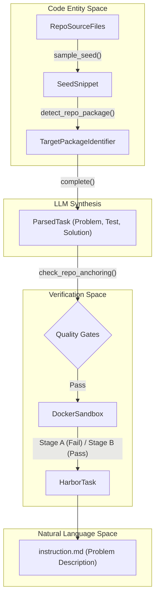
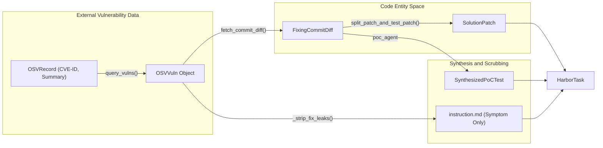

<!-- source: DeepWiki mcp.deepwiki.com · repo huggingface/Repo2RLEnv · page 3.4 Experimental Pipelines · fetched 2026-10-26 -->

# Experimental Pipelines

Relevant source files

The following files were used as context for generating this wiki page:

- [docs/pipelines/code_instruct.md](docs/pipelines/code_instruct.md)
- [docs/pipelines/cve_patches.md](docs/pipelines/cve_patches.md)
- [docs/pipelines/equivalence_tests.md](docs/pipelines/equivalence_tests.md)
- [docs/rfcs/0004-code-instruct.md](docs/rfcs/0004-code-instruct.md)
- [docs/rfcs/0005-equivalence-tests.md](docs/rfcs/0005-equivalence-tests.md)
- [src/repo2rlenv/osv.py](src/repo2rlenv/osv.py)
- [src/repo2rlenv/pipelines/_eval_script.py](src/repo2rlenv/pipelines/_eval_script.py)
- [src/repo2rlenv/pipelines/_function_extractor.py](src/repo2rlenv/pipelines/_function_extractor.py)
- [src/repo2rlenv/pipelines/_oss_instruct.py](src/repo2rlenv/pipelines/_oss_instruct.py)
- [src/repo2rlenv/pipelines/_poc_agent.py](src/repo2rlenv/pipelines/_poc_agent.py)
- [src/repo2rlenv/pipelines/code_instruct.py](src/repo2rlenv/pipelines/code_instruct.py)
- [src/repo2rlenv/pipelines/equivalence_tests.py](src/repo2rlenv/pipelines/equivalence_tests.py)
- [tests/test_oss_instruct_gates.py](tests/test_oss_instruct_gates.py)
- [tests/test_oss_instruct_helpers.py](tests/test_oss_instruct_helpers.py)
- [tests/test_pipeline_code_instruct.py](tests/test_pipeline_code_instruct.py)
- [tests/test_pipeline_cve_patches.py](tests/test_pipeline_cve_patches.py)
- [tests/test_pipeline_equivalence_tests.py](tests/test_pipeline_equivalence_tests.py)

Experimental pipelines represent synthesis strategies that are currently in a beta or research state. Unlike stable runtime pipelines (`pr_runtime`, `commit_runtime`), these pipelines synthesize tasks from scratch using LLMs, target specialized data sources like security vulnerabilities, apply AST-level code mutations, or reconstruct historical repository states.

---

## 1. Code Instruct (`code_instruct`)

### Purpose
The `code_instruct` pipeline implements a Magicoder OSS-Instruct style recipe, anchored to a specific target repository and verified by execution [src/repo2rlenv/pipelines/code_instruct.py:1-20](). Rather than sampling from a global open-source corpus, it seeds tasks using real snippets from the target repository's codebase.

### Options
*   `limit`: Maximum number of emitted tasks (default: `50`) [docs/pipelines/code_instruct.md:116-116]().
*   `seed_min_loc` / `seed_max_loc`: Size constraints for sampled seed snippet windows (default: `30` / `200`) [docs/pipelines/code_instruct.md:117-117]().
*   `max_attempts_per_seed`: Number of retries permitted when an LLM synthesis draft fails quality gates (default: `3`) [docs/pipelines/code_instruct.md:119-119]().
*   `llm_temperature`: Temperature parameter for problem and test synthesis (default: `0.7`) [docs/pipelines/code_instruct.md:120-120]().

### Verification Gates
1.  **Repo-Anchoring Gate**: AST scan of `task_module.py` ensuring the solution imports and uses the target package [src/repo2rlenv/pipelines/_oss_instruct.py:331-345](), [docs/rfcs/0004-code-instruct.md:67-67]().
2.  **Symbol-Collision Gate**: Rejects tasks defining top-level symbols that collide with existing repository symbols, preventing "grep-and-re-export" cheats [src/repo2rlenv/pipelines/_oss_instruct.py:356-368](), [docs/rfcs/0004-code-instruct.md:68-68]().
3.  **Test-Strength Gate**: Rejects weak tests having fewer than 3 non-trivial assertions or missing `pytest.raises` checks on error conditions [src/repo2rlenv/pipelines/_oss_instruct.py:377-400](), [docs/rfcs/0004-code-instruct.md:69-69]().
4.  **Sandbox Execution Stages**:
    *   **Stage A**: The synthesized test must FAIL when run against the base repository without the oracle [src/repo2rlenv/pipelines/code_instruct.py:8-9](), [docs/pipelines/code_instruct.md:104-104]().
    *   **Stage B**: The test must PASS when the LLM-authored oracle (`task_module.py`) is applied [src/repo2rlenv/pipelines/code_instruct.py:10-11](), [docs/pipelines/code_instruct.md:105-105]().

**Diagram: Code Instruct Natural Language to Code Entity Mapping**

Sources: [src/repo2rlenv/pipelines/code_instruct.py:1-36](), [src/repo2rlenv/pipelines/_oss_instruct.py:34-76](), [docs/rfcs/0004-code-instruct.md:52-72]()

---

## 2. Equivalence Tests (`equivalence_tests`)

### Purpose
Inspired by R2E, this pipeline extracts real Python functions from the repository, freezes them as reference oracles, and asks an LLM to write differential equivalence tests comparing a candidate implementation against the oracle [src/repo2rlenv/pipelines/equivalence_tests.py:1-21]().

### Options
*   `limit`: Maximum emitted tasks (default: `50`) [docs/pipelines/equivalence_tests.md:124-124]().
*   `min_loc` / `max_loc`: Body LOC range for extracted function candidates (default: `5` / `60`) [docs/pipelines/equivalence_tests.md:125-125]().
*   `max_attempts_per_function`: Retries allowed per extracted function candidate upon failure (default: `3`) [docs/rfcs/0005-equivalence-tests.md:58-58]().
*   `llm_temperature`: Generation temperature for test synthesis (default: `0.5`) [docs/pipelines/equivalence_tests.md:128-128]().

### Verification Gates
1.  **Function Purity & Self-Containment**: Rejects functions whose bodies reference names outside stdlib, own arguments, or a strict allowlist [src/repo2rlenv/pipelines/_function_extractor.py:178-213](), [docs/rfcs/0005-equivalence-tests.md:59-59]().
2.  **Importability Pre-flight**: Compiles the baked module stub locally via `is_module_importable` before sandbox execution [docs/rfcs/0005-equivalence-tests.md:61-61]().
3.  **Test-Strength Gate**: Enforces $\ge 5$ distinct test functions referencing both `<name>` and `reference_<name>` [docs/pipelines/equivalence_tests.md:56-56](), [docs/rfcs/0005-equivalence-tests.md:63-63]().
4.  **Two-Stage Verification**:
    *   **Stage A (Stub)**: Candidate `<name>` is stubbed to raise `NotImplementedError`; test must FAIL [docs/pipelines/equivalence_tests.md:111-111]().
    *   **Stage B (Oracle)**: Candidate `<name>` equals `reference_<name>`; test must PASS [docs/pipelines/equivalence_tests.md:112-112]().

Sources: [src/repo2rlenv/pipelines/equivalence_tests.py:1-21](), [docs/pipelines/equivalence_tests.md:48-74](), [docs/rfcs/0005-equivalence-tests.md:27-34]()

---

## 3. CVE Patches (`cve_patches`)

### Purpose
Maps Open Source Vulnerabilities (OSV) records to fixing commits in the target repository, replays the pre-fix state in a sandbox, and emits a Harbor task whose oracle is the upstream security patch [src/repo2rlenv/pipelines/cve_patches.py:1-5]().

### Options
*   `osv_ecosystem`: Target package ecosystem (`PyPI`, `npm`, etc.) [docs/pipelines/cve_patches.md:100-100]().
*   `min_severity`: Minimum severity threshold (`low`, `medium`, `high`, `critical`) [docs/pipelines/cve_patches.md:102-102]().
*   `synthesize_poc_test`: LLM agent synthesizes a regression test when the CVE commit lacks one (default: `True`) [docs/pipelines/cve_patches.md:104-104]().
*   `poc_agent_max_spend_usd`: Per-CVE budget cap for agentic PoC synthesis (default: `$1.50`) [docs/pipelines/cve_patches.md:106-106]().

### Verification Gates
1.  **OSV Reference Validation**: Requires matching GitHub commit URLs in the advisory references [docs/pipelines/cve_patches.md:58-61]().
2.  **F2P/P2P Oracle Validation**: Reuses `pr_runtime` evaluation to ensure fail-to-pass and pass-to-pass criteria are met [src/repo2rlenv/pipelines/cve_patches.py:66-70]().
3.  **Anti-Contamination & Egress Guards**: Strips CVE IDs and fix URLs from instructions, scrubs git history past the base commit, and blackholes package registries in `docker-compose.yaml` [docs/pipelines/cve_patches.md:82-90]().

**Diagram: CVE Vulnerability to Harbor Task Flow**

Sources: [src/repo2rlenv/pipelines/cve_patches.py:1-11](), [docs/pipelines/cve_patches.md:24-40](), [src/repo2rlenv/osv.py:1-60]()

---

## 4. Mutation and Repo Mutate (`mutation` / `repo_mutate`)

### Purpose
Applies AST or repository-level mutations to source files to inject controlled defects, generating debugging and code-repair tasks.

### Options
*   `max_tests_broken`: Upper bound on the number of tests broken by a mutation to ensure localized impact.
*   `mutation_operators`: Allowed AST mutation operators (e.g., operator replacement, conditional inversion).

### Verification Gates
*   **Test Failure Gate**: The mutation must break at least one existing test in the suite.
*   **Collection Cleanliness Gate**: The mutated code must compile and collect tests without syntax or import errors.

Sources: [docs/rfcs/0004-code-instruct.md:13-17]()

---

## 5. Repo Reconstruct (`repo_reconstruct`)

### Purpose
Reconstructs historical repository states or multi-module layouts across incremental project milestones to build complex workspace-level reasoning environments.

### Options
*   `milestone_commits`: Explicit list or step count of git commit milestones to materialize.
*   `include_submodules`: Whether to retain and check out nested repository submodules.

### Verification Gates
*   **Milestone Compile Check**: Each reconstructed state must successfully build or pass basic workspace integrity checks.

Sources: [src/repo2rlenv/bootstrap/runner.py:1-50]()

---

## 6. PR to Env (`pr_to_env`)

### Purpose
Converts arbitrary merged pull requests from external sources into self-contained Harbor environments, extracting diffs, metadata, and test artifacts without requiring strict PR template schemas.

### Options
*   `source_prs`: List of specific PR URLs or search queries to ingest.
*   `fallback_test_runner`: Default test runner command if none is specified in project config.

### Verification Gates
*   **Diff Applicability**: The PR patch must apply cleanly to the base commit without rejection hunks.

Sources: [src/repo2rlenv/pipelines/base.py:1-40]()

---

## 7. Terminal Synth (`terminal_synth`)

### Purpose
Generates interactive command-line interface (CLI) or terminal-based agent challenges (supporting recipes like `terminalworld`, `cli-gym`, and `endless-terminals`) [docs/README.md:1-20]().

### Options
*   `cli_entrypoint`: Primary command binary or script exposed to the agent.
*   `interaction_timeout_sec`: Maximum duration permitted for terminal state validation scripts.

### Verification Gates
*   **Command Availability**: The target CLI tool must be successfully installed and executable within the bootstrap container path.

Sources: [src/repo2rlenv/spec/options.py:1-100]()

---

## 8. Task Evolve (`task_evolve`)

### Purpose
Iteratively improves, expands, or mutates existing Harbor tasks using automated agentic feedback loops (Tasksmith workflow stages) to increase task complexity or eliminate ambiguity [docs/README.md:1-30]().

### Options
*   `evolution_rounds`: Number of recursive refinement passes per task.
*   `target_difficulty`: Desired benchmark difficulty tier for the evolved task.

### Verification Gates
*   **Regression Check**: Evolved verifier suites must continue to pass cleanly against the gold solution while failing on baseline stubs.

Sources: [src/repo2rlenv/spec/input.py:1-80]()

---

## 9. Env Repair (`env_repair`)

### Purpose
Diagnoses and automatically repairs broken bootstrap containers, dependency lockfile mismatches, or failing verification test suites across mined datasets [docs/README.md:1-20]().

### Options
*   `auto_patch_deps`: Automatically inject missing package dependencies or lockfile updates.
*   `repair_llm_model`: LLM model identifier utilized for generating container fix patches.

### Verification Gates
*   **Smoke Gate Verification**: The repaired environment must successfully complete container initialization and pass the bootstrap smoke test [src/repo2rlenv/bootstrap/runner.py:1-80]().

Sources: [src/repo2rlenv/bootstrap/runner.py:1-80]()

---

