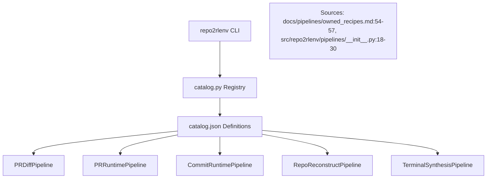
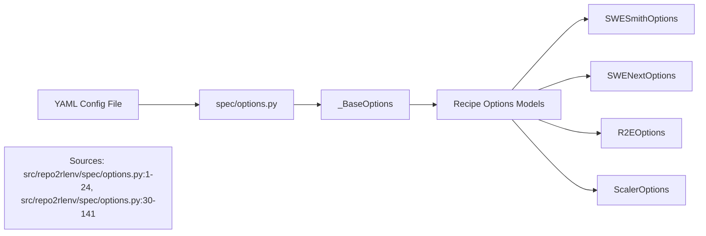

<!-- source: DeepWiki mcp.deepwiki.com · repo huggingface/Repo2RLEnv · page 3.5 Owned Research Recipes · fetched 2026-10-26 -->

# Owned Research Recipes

<details>
<summary>Relevant source files</summary>

The following files were used as context for generating this wiki page:

- [docs/pipelines/learner_runtime.md](docs/pipelines/learner_runtime.md)
- [docs/pipelines/owned_recipes.md](docs/pipelines/owned_recipes.md)
- [examples/owned-endless-terminals.yaml](examples/owned-endless-terminals.yaml)
- [examples/owned-r2e-gym.yaml](examples/owned-r2e-gym.yaml)
- [examples/owned-swe-flow.yaml](examples/owned-swe-flow.yaml)
- [examples/owned-swe-gen.yaml](examples/owned-swe-gen.yaml)
- [examples/owned-swe-next.yaml](examples/owned-swe-next.yaml)
- [src/repo2rlenv/pipelines/__init__.py](src/repo2rlenv/pipelines/__init__.py)
- [src/repo2rlenv/spec/options.py](src/repo2rlenv/spec/options.py)

</details>


## Purpose and Scope
This page documents the `recipes/` subsystem within Repo2RLEnv, detailing the recipe catalog (`catalog.json` / `catalog.py`), CLI discovery tools (`repo2rlenv pipelines list` and `repo2rlenv pipelines describe`), how research recipes layer onto base pipeline families via configuration options, and implementation walkthroughs for all 14 owned research recipes (SWE-smith, SWE-gen, SWE-Flow, R2E, R2E-Gym, SWE-Next, CLI-Gym, SETA, DataArc, TMax, TerminalWorld, Endless Terminals, and SCALER).

---

## 1. Recipe Catalog and Discovery

The recipe subsystem decouples research-specific generation strategies from core execution pipelines. The pipeline family defines the execution engine (e.g., `pr_runtime`, `commit_runtime`, `repo_reconstruct`), while the recipe configuration selects specialized filters, prompt templates, and evaluation hooks.

The catalog can be queried via the CLI interface to inspect available recipes, their underlying pipelines, and configurable parameters:
```bash
repo2rlenv pipelines list
repo2rlenv pipelines describe repo_mutate --recipe swe_smith --json
```[docs/pipelines/owned_recipes.md:54-57]()


Sources: docs/pipelines/owned_recipes.md:54-57, src/repo2rlenv/pipelines/__init__.py:18-30

---

## 2. Recipe Layering and Pipeline Options

Recipes layer onto pipelines by binding specialized Pydantic option models from `src/repo2rlenv/spec/recipe_options.py` into the main specification parser. These options control parameters such as source paths, test paths, timeout bounds, and model temperature.


Sources: src/repo2rlenv/spec/options.py:1-24, src/repo2rlenv/spec/options.py:30-141

For example, the `swe_next` recipe layers onto the `pr_runtime` pipeline, utilizing `SWENextOptions` to configure environment images and test timeouts:

```yaml
source:
  kind: repository
  repo:
    url: more-itertools/more-itertools
    ref: 9ed3dbb0ae527230cd156d91d0af305478558fba
    access: public
pipeline:
  name: pr_runtime
  recipe: swe_next
  options:
    source_paths:
    - more_itertools
    test_paths:
    - tests
    base_image: python:3.11-slim
    target: 20
    max_candidates: 80
    test_timeout_sec: 120
```[examples/owned-swe-next.yaml:1-19]()
Sources: examples/owned-swe-next.yaml:1-19

---

## 3. Walkthroughs of Owned Research Recipes

The codebase implements 14 research-inspired recipes across different input domains and verification patterns.

| Recipe | Pipeline Name / Recipe Identifier | Input Type | Verification Shape |
|---|---|---|---|
| SWE-smith | `repo_mutate / swe_smith` | Healthy Python repository | Tests pass with non-empty identities (binary 0/1) [docs/pipelines/owned_recipes.md:35-133]() |
| SWE-gen | `pr_to_env / swe_gen` | Explicit merged PR URLs | Tests pass with non-empty identities (binary 0/1) [docs/pipelines/owned_recipes.md:36-133]() |
| SWE-Flow | `repo_reconstruct / swe_flow` | Healthy Python repository | Tests pass with non-empty identities (binary 0/1) [docs/pipelines/owned_recipes.md:37-133]() |
| R2E | `equivalence_tests / r2e` | Documented repository functions | Tests pass with non-empty identities (binary 0/1) [docs/pipelines/owned_recipes.md:38-133]() |
| SWE-Next | `pr_runtime / swe_next` | Repository PR history | Tests pass with non-empty identities (binary 0/1) [docs/pipelines/owned_recipes.md:39-133]() |
| R2E-Gym | `commit_runtime / r2e_gym` | First-parent git history | Tests pass with non-empty identities (binary 0/1) [docs/pipelines/owned_recipes.md:40-133]() |
| CLI-Gym | `env_repair / cli_gym` | Healthy development environment | Environment restoration and protected source check (binary 0/1) [docs/pipelines/owned_recipes.md:41-135]() |
| SETA Seed2Synth | `terminal_synth / seta_seed2synth` | Question/answer records | Generated pytest verification (binary 0/1) [docs/pipelines/owned_recipes.md:42-134]() |
| SETA Evol | `task_evolve / seta_evol` | Owned Harbor parents | Generated pytest verification (binary 0/1) [docs/pipelines/owned_recipes.md:43-134]() |
| DataArc | `terminal_synth / dataarc` | Harbor seed tasks | Generated pytest verification (binary 0/1) [docs/pipelines/owned_recipes.md:44-134]() |
| TMax | `terminal_synth / tmax` | Legacy taxonomy sampler | Generated pytest verification (binary 0/1) [docs/pipelines/owned_recipes.md:45-134]() |
| Endless Terminals | `terminal_synth / endless_terminals` | Category/complexity sampler | Generated pytest verification (binary 0/1) [docs/pipelines/owned_recipes.md:46-134]() |
| TerminalWorld | `terminal_reconstruct / terminalworld` | Metadata and text transcript | Replayed solution validation (binary 0/1) [docs/pipelines/owned_recipes.md:47-134]() |
| SCALER | `reasoning_synth / scaler` | Released family JSON | Answer evaluation against reference program [docs/pipelines/owned_recipes.md:48-134]() |

Sources: docs/pipelines/owned_recipes.md:33-49, docs/pipelines/owned_recipes.md:131-135

---

## 4. Task Bundle Structure and Verification

Generated tasks follow a standardized Harbor directory structure, separating learner instructions, environment specifications, hidden reference solutions, and trusted test runners [docs/pipelines/owned_recipes.md:111-125]().

```text
<task-name>/
  instruction.md             # Learner request
  task.toml                  # Harbor runtime, resources and artifacts
  environment/
    Dockerfile               # Starting state and build-time dependencies
  solution/
    solve.sh                 # Private reference entrypoint
  tests/
    test.sh                  # Trusted verifier entrypoint
```[docs/pipelines/owned_recipes.md:112-124]()
Sources: docs/pipelines/owned_recipes.md:111-125

---

