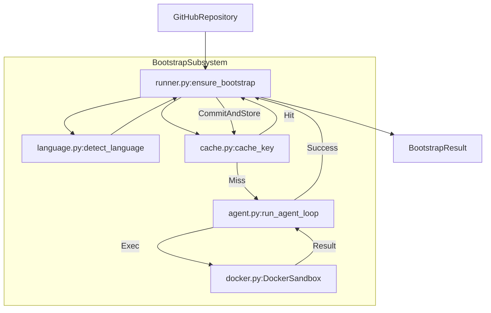
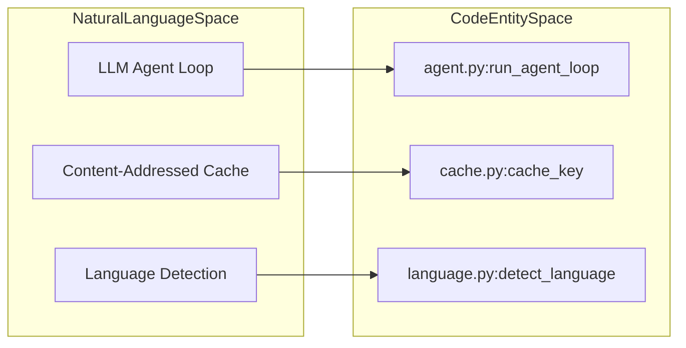

<!-- source: DeepWiki mcp.deepwiki.com · repo huggingface/Repo2RLEnv · page 4 Bootstrap System · fetched 2026-10-26 -->

# Bootstrap System

Relevant source files

The following files were used as context for generating this wiki page:

- [docs/reference/BOOTSTRAP.md](docs/reference/BOOTSTRAP.md)
- [docs/reference/ENV.md](docs/reference/ENV.md)
- [src/repo2rlenv/bootstrap/__init__.py](src/repo2rlenv/bootstrap/__init__.py)
- [src/repo2rlenv/bootstrap/cache.py](src/repo2rlenv/bootstrap/cache.py)

The **Bootstrap System** is a core subsystem of `repo2rlenv` designed to solve the "environment problem" in RL for software engineering. To verify a generated task, one needs a Docker image where the repository's build system and test suite are fully functional. Because manual Dockerfile creation for every repository is unscalable, the bootstrap system employs an LLM-driven agent to explore the codebase, install dependencies, and validate the environment [docs/reference/BOOTSTRAP.md:3-19]().

Everything is **local-first**, running against the machine's Docker daemon, though the resulting task directories are portable to cloud sandboxes like E2B or Modal [docs/reference/BOOTSTRAP.md:3-5](). This system is required for all pipelines that execute code (e.g., `pr_runtime`, `commit_runtime`) but is skipped for text-only pipelines like `pr_diff` [docs/reference/BOOTSTRAP.md:20-20]().

### High-Level Workflow

The bootstrap process follows a detection, agent loop, validation, and caching lifecycle:
1.  **Detection**: The system identifies the repository's primary language and build configuration.
2.  **Agent Loop**: A ReAct-style agent executes shell commands in a live container, iterating until a smoke test passes [src/repo2rlenv/bootstrap/__init__.py:1-10]().
3.  **Persistence**: The container is committed to a local Docker image and cached via content-addressing for future use [docs/reference/ENV.md:11-15]().

### System Component Interaction
The following diagram illustrates how high-level components interact to map natural language requirements and repository structures to containerized code entities.

**Bootstrap Orchestration Flow**

**Sources:** [src/repo2rlenv/bootstrap/__init__.py:1-32](), [src/repo2rlenv/bootstrap/cache.py:47-82](), [docs/reference/BOOTSTRAP.md:3-19]()

---

## 4.1 Bootstrap Agent and Runner

The **Agent and Runner** represent the intelligence and orchestration layer of the bootstrapping process. The `ensure_bootstrap` function acts as the primary entry point, coordinating language detection heuristics, prompt template injection, and LLM-driven shell execution [src/repo2rlenv/bootstrap/__init__.py:1-10](). 

The subsystem utilizes a ReAct-style loop inside `agent.py` where an LLM inspects workspace files, executes commands, and verifies environment health against language-specific preset prompts [docs/reference/BOOTSTRAP.md:22-38](). Every run is bounded by strict cost guardrails (`max_llm_spend_usd`) and iteration caps to prevent runaway loops [docs/reference/BOOTSTRAP.md:83-88]().

For details, see [Bootstrap Agent and Runner](#4.1).

**Sources:** [src/repo2rlenv/bootstrap/__init__.py:1-32](), [docs/reference/BOOTSTRAP.md:22-88]()

---

## 4.2 Bootstrap Cache and Docker Integration

The **Cache and Docker Integration** layer manages sandbox container lifecycles, content-addressed storage, and image persistence [src/repo2rlenv/bootstrap/cache.py:47-63](). Using `DockerSandbox`, the system executes commands and tracks modifications within isolated container environments.

Successfully built environments are serialized into `BootstrapResult` structures and stored under the cache root (`R2E_CACHE_DIR`), keyed by repository identity, commit hash, and configuration options [docs/reference/ENV.md:9-15](). This ensures expensive environment generation runs occur at most once per unique repo-commit state.

For details, see [Bootstrap Cache and Docker Integration](#4.2).

**Sources:** [src/repo2rlenv/bootstrap/cache.py:47-82](), [docs/reference/ENV.md:9-15]()

---

### Data Mapping: Natural Language to Code Entities
This diagram bridges high-level bootstrap concepts and natural language operations to the concrete code entities within the codebase.

**Natural Language to Code Entity Bridge**

**Sources:** [src/repo2rlenv/bootstrap/agent.py:1-175](), [src/repo2rlenv/bootstrap/cache.py:47-63](), [src/repo2rlenv/bootstrap/__init__.py:1-32]()

---

