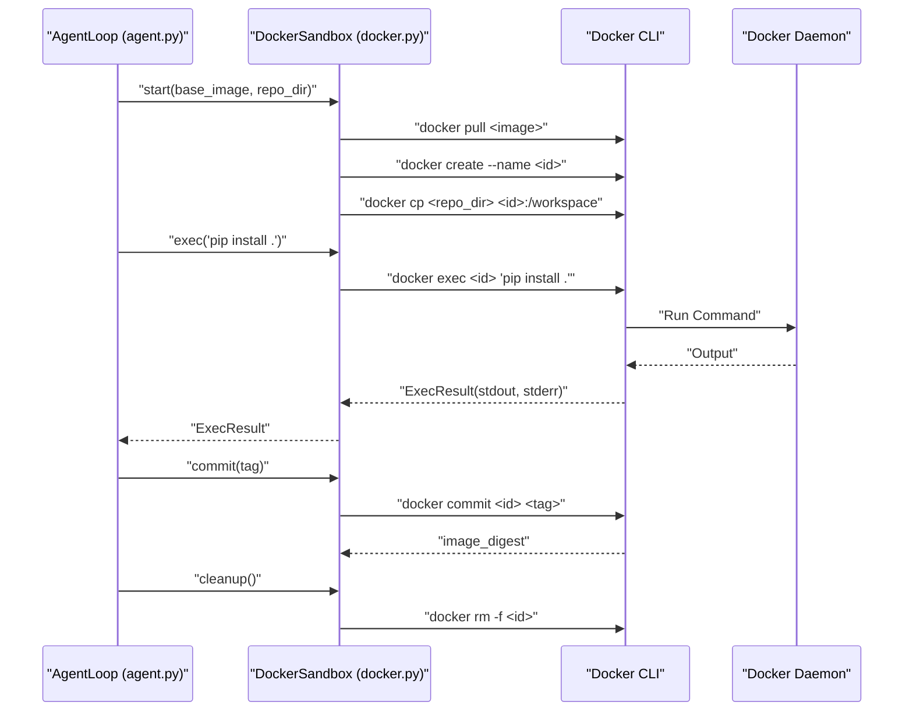
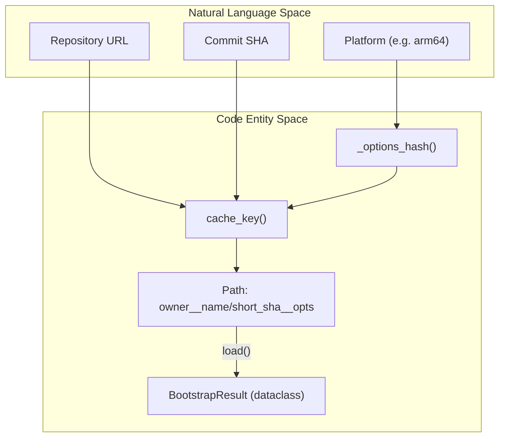
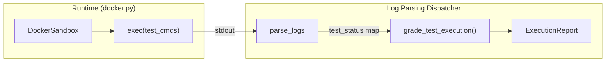

<!-- source: DeepWiki mcp.deepwiki.com · repo huggingface/Repo2RLEnv · page 4.2 Bootstrap Cache and Docker Integration · fetched 2026-10-26 -->

# Bootstrap Cache and Docker Integration

Relevant source files

The following files were used as context for generating this wiki page:

- [src/repo2rlenv/bootstrap/__init__.py](src/repo2rlenv/bootstrap/__init__.py)
- [src/repo2rlenv/bootstrap/cache.py](src/repo2rlenv/bootstrap/cache.py)
- [src/repo2rlenv/bootstrap/docker.py](src/repo2rlenv/bootstrap/docker.py)
- [src/repo2rlenv/bootstrap/runner.py](src/repo2rlenv/bootstrap/runner.py)
- [src/repo2rlenv/github.py](src/repo2rlenv/github.py)
- [tests/test_bootstrap_cache.py](tests/test_bootstrap_cache.py)
- [tests/test_e2e_public.py](tests/test_e2e_public.py)

The bootstrap system ensures that every repository has a functional, reproducible Docker environment. This page details the mechanics of the `DockerSandbox` abstraction, content-addressed caching via `cache.py`, the `docker cp` and `docker commit` workflow, and the `BootstrapResult` data structure.

---

## Docker Integration and Sandbox Lifecycle

Repo2RLEnv interacts with Docker via a thin wrapper around the CLI rather than using `docker-py`. This design choice, implemented in `src/repo2rlenv/bootstrap/docker.py`, ensures consistency with how Harbor's own executors invoke Docker and keeps dependencies lightweight [src/repo2rlenv/bootstrap/docker.py:1-6]().

### The DockerSandbox Abstraction

The `DockerSandbox` class manages a long-lived container where the bootstrap agent executes its discovery loop. Unlike standard CI runners that use bind mounts, Repo2RLEnv uses `docker cp` to inject the repository into the container [src/repo2rlenv/bootstrap/docker.py:205-237](). This prevents permission issues and ensures that the final `docker commit` captures the full state of the environment, including installed dependencies and build artifacts [src/repo2rlenv/bootstrap/docker.py:313-333]().

| Method | Role | Implementation Detail |
| :--- | :--- | :--- |
| `start()` | Initializes container | Pulls base image, creates container with `tail -f /dev/null`, and copies repo via `docker cp` [src/repo2rlenv/bootstrap/docker.py:206-237](). |
| `exec()` | Command execution | Wraps `docker exec`. Captures stdout/stderr and duration in an `ExecResult` [src/repo2rlenv/bootstrap/docker.py:257-283](). |
| `commit()` | Image persistence | Freezes the container state into a new image with a unique tag [src/repo2rlenv/bootstrap/docker.py:313-333](). |
| `cleanup()` | Resource management | Stops and removes the container [src/repo2rlenv/bootstrap/docker.py:335-342](). |

### Docker Integration Flow

The following diagram illustrates the interaction between `DockerSandbox` and the host system during a bootstrap session, bridging natural language operation intent to `docker.py` code entities.

**Sandbox Execution Flow**

Sources: [src/repo2rlenv/bootstrap/docker.py:198-342](), [src/repo2rlenv/bootstrap/__init__.py:1-6]()

---

## Content-Addressed Caching

Bootstrap results are cached on the local filesystem to avoid redundant LLM usage and expensive build cycles. The cache is keyed by the repository, the git reference, and a hash of configuration options that affect the environment's identity.

### Cache Directory Structure
The cache is organized under a root directory (defaulting to `./envs`) using the layout implemented in `src/repo2rlenv/bootstrap/cache.py`:
` <cache_dir>/<owner>__<name>/<short_commit>[__<opts_hash>]/ ` 

*   **bootstrap.json**: The serialized `BootstrapResult` [src/repo2rlenv/bootstrap/cache.py:77]().
*   **Dockerfile**: A reconstructed Dockerfile generated from the agent's successful commands [src/repo2rlenv/bootstrap/cache.py:79-80]().
*   **transcript.jsonl**: The full ReAct agent trace for debugging [src/repo2rlenv/bootstrap/cache.py:8]().

### Option Hashing
To prevent a build for `linux/amd64` from satisfying a request for `linux/arm64`, the `_options_hash()` function computes a stable 8-character hash of fields such as `platform`, `base_image`, and `user_dockerfile` [src/repo2rlenv/bootstrap/cache.py:30-44]().

**Cache Resolution Flow**

Sources: [src/repo2rlenv/bootstrap/cache.py:30-62](), [src/repo2rlenv/bootstrap/spec.py:21-46]()

---

## Data Structures

### BootstrapResult
The `BootstrapResult` is the primary artifact of the bootstrap process, defined in `src/repo2rlenv/bootstrap/spec.py`. Once the `image_digest` is set, the environment is considered fully reproducible [src/repo2rlenv/bootstrap/spec.py:21-27]().

| Field | Type | Description |
| :--- | :--- | :--- |
| `image_digest` | `str` | The immutable SHA256 of the committed Docker image [src/repo2rlenv/bootstrap/spec.py:29](). |
| `language` | `LanguageHint` | Detected language (e.g., `PYTHON`, `GO`, `RUST`) [src/repo2rlenv/bootstrap/spec.py:31](). |
| `rebuild_cmds` | `list[str]` | Commands needed to re-apply build after code changes [src/repo2rlenv/bootstrap/spec.py:34](). |
| `test_cmds` | `list[str]` | Commands to execute the repository's test suite [src/repo2rlenv/bootstrap/spec.py:35](). |
| `smoke_passed` | `bool` | Whether the environment passed validation during bootstrap [src/repo2rlenv/bootstrap/spec.py:36](). |
| `llm_cost_estimate_usd` | `float` | Cumulative cost of agent turns [src/repo2rlenv/bootstrap/spec.py:40](). |

### ExecResult
Every command run inside `DockerSandbox` returns an `ExecResult`, which includes the exit code and captured streams [src/repo2rlenv/bootstrap/docker.py:26-30](). The `truncated()` method formats large logs (e.g., failed build outputs) for inclusion in LLM prompts without exceeding context limits [src/repo2rlenv/bootstrap/docker.py:36-44]().

Sources: [src/repo2rlenv/bootstrap/spec.py:21-46](), [src/repo2rlenv/bootstrap/docker.py:25-44]()

---

## Verification and Log Parsing

The bootstrap process concludes with a verification step where the `test_cmds` are executed in a fresh container started from the newly committed image [src/repo2rlenv/bootstrap/spec.py:36]().

While the bootstrap system focuses on environment health, it provides the foundation for reward calculation logic in synthesis pipelines. These pipelines use specialized parsers to transform raw Docker logs into structured pass/fail reports for individual test cases.

**Verification and Parsing Flow**

Sources: [src/repo2rlenv/bootstrap/spec.py:36-40](), [src/repo2rlenv/bootstrap/docker.py:257-283]()

---

