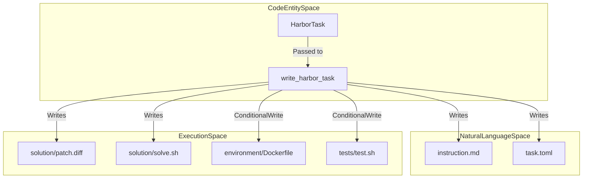
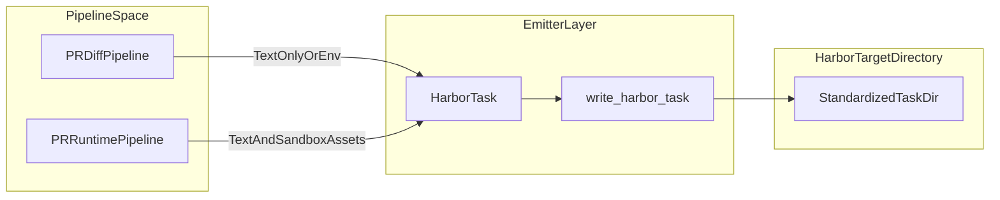

<!-- source: DeepWiki mcp.deepwiki.com · repo huggingface/Repo2RLEnv · page 5 Task Emission and Harbor Spec · fetched 2026-10-26 -->

# Task Emission and Harbor Spec

<details>
<summary>Relevant source files</summary>

The following files were used as context for generating this wiki page:

- [.gitignore](.gitignore)
- [docs/reference/API.md](docs/reference/API.md)
- [docs/reference/SPEC.md](docs/reference/SPEC.md)
- [src/repo2rlenv/emitter/harbor.py](src/repo2rlenv/emitter/harbor.py)
- [src/repo2rlenv/pipelines/pr_runtime_validate.py](src/repo2rlenv/pipelines/pr_runtime_validate.py)
- [src/repo2rlenv/validation.py](src/repo2rlenv/validation.py)
- [tests/test_emitter.py](tests/test_emitter.py)
- [tests/test_validation.py](tests/test_validation.py)

</details>


This page provides a high-level overview of how **Repo2RLEnv** transforms synthesized pipeline results into standardized, executable task directories. By adhering to the **Harbor** specification, datasets produced by this framework are immediately compatible with downstream RL training harnesses, agent evaluation platforms, and sandbox runtimes [src/repo2rlenv/emitter/harbor.py:1-32]().

The emission process acts as the bridge between the **Synthesis Pipelines** (which generate raw code diffs and instructions) and the **Distribution Layer** (which packages them for the Hugging Face Hub) [src/repo2rlenv/emitter/harbor.py:75-164]().

For a detailed breakdown of the task dataclasses, layout, content hashes, and the `[metadata.repo2env]` extension table, see [Harbor Emitter and Task Structure](#5.1).

Sources: `src/repo2rlenv/emitter/harbor.py:1-164`

---

## Harbor Task Structure

Every pipeline in Repo2RLEnv eventually calls the Harbor emitter to materialize a task directory on disk [src/repo2rlenv/emitter/harbor.py:75-78](). A Harbor task is a self-contained directory containing everything needed to prompt an agent and verify its solution.

### Directory Layout
The emitter creates a structured layout for each task depending on whether it is a lite (text-only) task or a sandbox-required runtime task [src/repo2rlenv/emitter/harbor.py:3-10]():

```text
<dataset>/<task_id>/
├── task.toml                # Metadata, configuration, and [metadata.repo2env]
├── instruction.md           # The natural language problem description
├── solution/
│   ├── patch.diff           # The ground-truth "oracle" solution
│   └── solve.sh             # Script to apply the patch (for Harbor's oracle agent)
├── environment/             # (Optional) Environment definition
│   └── Dockerfile           # Created for runtime or "env-enabled" lite tasks
└── tests/                   # (Optional) Validation logic
    ├── test.sh              # The primary entrypoint for evaluation
    ├── verifier.py          # Graded verifier for pr_runtime
    ├── f2p.json             # Fail-to-Pass test list
    └── p2p.json             # Pass-to-Pass test list
```

### The `task.toml` Spec
The `task.toml` file follows the Harbor 1.0 schema but includes a critical extension table: `[metadata.repo2env]` [src/repo2rlenv/emitter/harbor.py:123-137](). This table stores provenance data such as the `pipeline` used, `spec_version`, and a deterministic `content_hash` for versioning [src/repo2rlenv/emitter/harbor.py:81-85]().

For details on the dataclass and directory layout, see [Harbor Emitter and Task Structure](#5.1).

Sources: `src/repo2rlenv/emitter/harbor.py:45-64`, `src/repo2rlenv/emitter/harbor.py:75-138`, `tests/test_emitter.py:34-42`

---

## Diagram: From Pipeline Result to Harbor Filesystem

This diagram bridges the code entity space (`HarborTask` and `write_harbor_task`) with the natural language and execution space files emitted under the Harbor specification.



Sources: `src/repo2rlenv/emitter/harbor.py:45-64`, `src/repo2rlenv/emitter/harbor.py:75-164`, `tests/test_emitter.py:34-102`

---

## Reward Mechanisms and Log Parsers

Repo2RLEnv supports two primary modes of evaluation, which are reflected in the emitted task metadata:

1. **Diff Similarity (Lite Path):** Used primarily by `pr_diff`. It calculates a reward based on the structural and textual overlap between the agent's proposed diff and the `patch.diff` oracle [src/repo2rlenv/emitter/harbor.py:91]().
2. **Test Execution (Runtime Path):** Used by `pr_runtime` and `commit_runtime`. It executes the agent's code inside a container and uses polyglot log parsers to determine if the agent fixed the specific failing tests (F2P) without breaking existing ones (P2P) [src/repo2rlenv/pipelines/pr_runtime_validate.py:1-16]().

### Log Parsing Dispatcher
The system includes a dispatcher, `parse_logs`, which identifies the test runner used during the validation phase and applies the corresponding heuristic parser to extract test statuses [src/repo2rlenv/pipelines/pr_runtime_validate.py:24-25]().

For details on similarity scoring, reward schemas, and the polyglot log parsers, see [Reward Functions and Log Parsers](#5.2).

Sources: `src/repo2rlenv.emitter/harbor.py:88-94`, `src/repo2rlenv/pipelines/pr_runtime_validate.py:1-37`

---

## Validation and Contamination Guards

To ensure tasks are structurally sound before packaging, Repo2RLEnv provides structural, deep, and oracle validation checks through `validation.validate_task` [src/repo2rlenv/validation.py:1-90](). Additionally, environment guards (`_env_guard.py`) scrub git history, enforce egress rules in compose files, and strip instruction info-leaks.

For details on static checks, finding severity levels, and contamination defenses, see [Validation and Contamination Guards](#5.3).

Sources: `src/repo2rlenv/validation.py:1-90`, `tests/test_validation.py:1-40`

---

## Diagram: Pipeline to Emitter Mapping

This diagram illustrates how various pipelines map their synthesis outputs into the unified `HarborTask` data structure prior to disk materialization.



Sources: `src/repo2rlenv/emitter/harbor.py:45-164`, `tests/test_emitter.py:34-121`

---

## Child Pages
- [Harbor Emitter and Task Structure](#5.1) — Detailed documentation on the `HarborTask` dataclass, `write_harbor_task`, task directory layouts, content hashes, and the `[metadata.repo2env]` extension table.
- [Reward Functions and Log Parsers](#5.2) — Technical documentation covering diff-similarity rewards, graded F2P/P2P test-execution rewards, and polyglot log parsers with the `parse_logs` dispatcher.
- [Validation and Contamination Guards](#5.3) — Documentation on structural, deep, and oracle validation checks in `validation.py`, git history scrubbing, egress guards, and instruction leak stripping.

---

