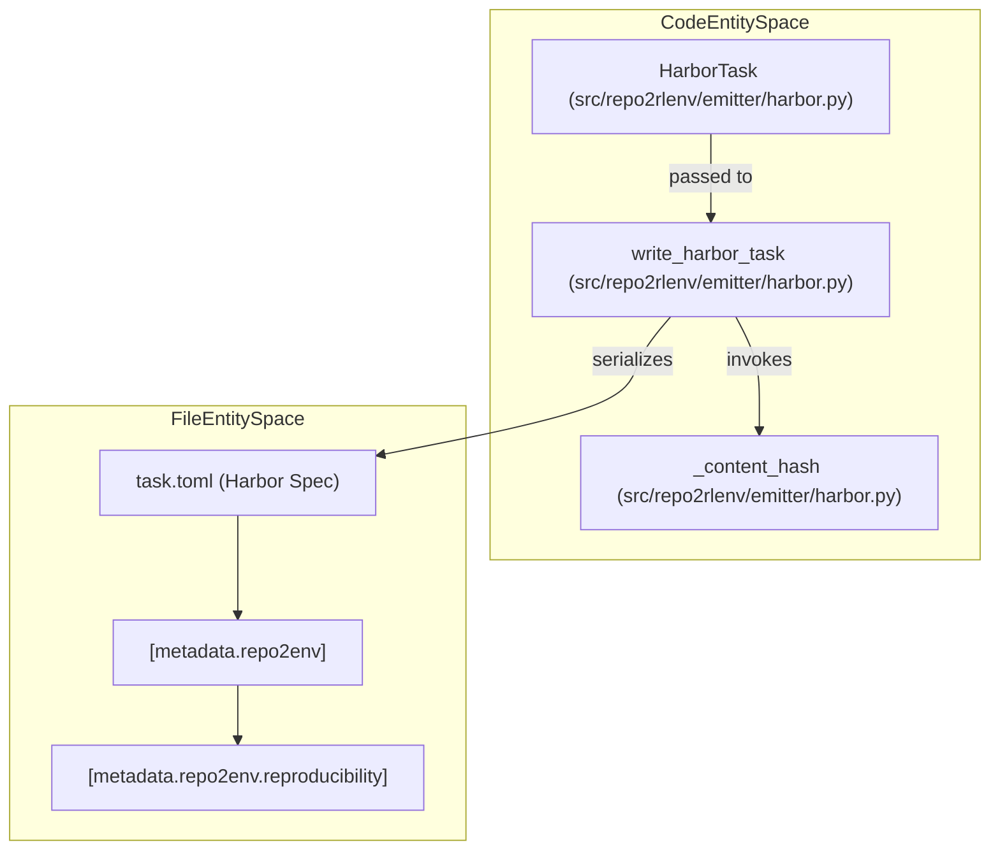
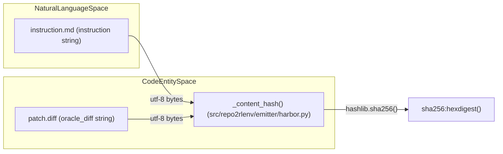

<!-- source: DeepWiki mcp.deepwiki.com · repo huggingface/Repo2RLEnv · page 5.1 Harbor Emitter and Task Structure · fetched 2026-10-26 -->

# Harbor Emitter and Task Structure

<details>
<summary>Relevant source files</summary>

The following files were used as context for generating this wiki page:

- [.gitignore](.gitignore)
- [docs/reference/API.md](docs/reference/API.md)
- [docs/reference/SPEC.md](docs/reference/SPEC.md)
- [src/repo2rlenv/emitter/harbor.py](src/repo2rlenv/emitter/harbor.py)
- [src/repo2rlenv/pipelines/pr_runtime_validate.py](src/repo2rlenv/pipelines/pr_runtime_validate.py)
- [src/repo2rlenv/validation.py](src/repo2rlenv/validation.py)
- [tests/test_emitter.py](tests/test_emitter.py)
- [tests/test_validation.py](tests/test_validation.py)

</details>


The **Harbor Emitter** is the final stage of the Repo2RLEnv synthesis pipeline, implemented in `[src/repo2rlenv/emitter/harbor.py]()`. It transforms internal pipeline results into standardized, portable task directories compatible with the Harbor Framework `[src/repo2rlenv/emitter/harbor.py:1-32]`. By adhering to this specification, Repo2RLEnv datasets can be consumed by any Harbor-compatible runtime, agent harness, or RL framework without modification `[src/repo2rlenv/emitter/harbor.py:15-28]()`.

## The `HarborTask` Dataclass

The `HarborTask` dataclass acts as the intermediate representation between a synthesis pipeline and the filesystem `[src/repo2rlenv/emitter/harbor.py:45-64]()`. It captures metadata, instructions, and environment requirements.

| Field | Type | Description |
|---|---|---|
| `name` | `str` | The filesystem-safe slug for the task (e.g., `owner__repo-123`) `[src/repo2rlenv/emitter/harbor.py:47-47]()`. |
| `org` | `str` | The organization name for the Harbor namespace `[src/repo2rlenv/emitter/harbor.py:48-48]()`. |
| `description` | `str` | Task description `[src/repo2rlenv/emitter/harbor.py:49-49]()`. |
| `instruction` | `str` | The natural language prompt for the agent (Markdown) `[src/repo2rlenv/emitter/harbor.py:50-50]()`. |
| `oracle_diff` | `str` | The canonical solution patch (unified diff) `[src/repo2rlenv/emitter/harbor.py:51-51]()`. |
| `repo2env` | `dict` | Extension table for provenance and pipeline-specific metadata `[src/repo2rlenv/emitter/harbor.py:52-52]()`. |
| `environment_dockerfile`| `str \| None` | Optional Dockerfile content for sandbox-required tasks `[src/repo2rlenv/emitter/harbor.py:59-59]()`. |
| `test_script` | `str \| None` | Optional `test.sh` content for verifying agent submissions `[src/repo2rlenv/emitter/harbor.py:60-60]()`. |
| `aux_files` | `dict` | Mapping of relative paths to content for extra files (e.g., `tests/f2p.json`) `[src/repo2rlenv/emitter/harbor.py:64-64]()`. |

Sources: `[src/repo2rlenv/emitter/harbor.py:45-64]()`

## Task Directory Layout

The `write_harbor_task` function materializes the `HarborTask` into a specific directory structure under `dest_dir` `[src/repo2rlenv/emitter/harbor.py:75-78]()`. The layout varies based on whether the task is a text-only "lite" task or a sandbox-required runtime task `[src/repo2rlenv/emitter/harbor.py:3-10]()`.

### Structure Overview
```text
<dataset_root>/<task_id>/
├── task.toml                # Task metadata and [metadata.repo2env]
├── instruction.md           # The agent prompt
├── solution/
│   ├── patch.diff           # The ground-truth oracle patch
│   └── solve.sh             # Execution shim to apply patch.diff
├── environment/             # [Optional] Present for runtime tasks
│   └── Dockerfile           # Environment definition
└── tests/                   # [Optional] Present for runtime tasks
    ├── test.sh              # The main verification script
    └── <aux_files>          # e.g., verifier.py, f2p.json, p2p.json
```
Sources: `[src/repo2rlenv/emitter/harbor.py:75-170]`, `[tests/test_emitter.py:26-33]()`

### Component Detail
*   **`solution/solve.sh`**: Harbor's oracle agent executes this script to place the container working tree in the fixed state `[src/repo2rlenv/emitter/harbor.py:148-151]()`. The emitter automatically writes this script to apply `patch.diff` using `git apply` `[src/repo2rlenv/emitter/harbor.py:152-163]()`.
*   **`tests/`**: For tasks requiring test execution, the emitter writes the `test_script` to `tests/test.sh` with executable permissions `[src/repo2rlenv/emitter/harbor.py:91-95]`, `[src/repo2rlenv/emitter/harbor.py:164-164]()`. Auxiliary files such as `tests/f2p.json` and `tests/p2p.json` are written via `aux_files` `[src/repo2rlenv/emitter/harbor.py:64-64]()`.
*   **Anti-Contamination**: Runtime environments may include an egress-guarded network configuration via `docker-compose.yaml` to prevent unauthorized external requests during evaluation `[src/repo2rlenv/pipelines/_env_guard.py:70-87]()`, `[tests/test_validation.py:85-86]()`.

Sources: `[src/repo2rlenv/emitter/harbor.py:148-164]()`, `[src/repo2rlenv/pipelines/_env_guard.py:70-87]()`

## Metadata and `[metadata.repo2env]`

Repo2RLEnv extends Harbor's `task.toml` specification by injecting a namespaced `[metadata.repo2env]` subtable, preserving full compatibility with standard Harbor parsers `[src/repo2rlenv/emitter/harbor.py:15-28]`, `[src/repo2rlenv/emitter/harbor.py:129-134]()`.

### Data Flow: Emitter to Harbor Spec
This diagram connects natural language and pipeline inputs to code entities within `write_harbor_task()` and the resulting `task.toml` schema.

Title: "HarborTaskToTaskTomlMapping"

Sources: `[src/repo2rlenv/emitter/harbor.py:45-138]()`, `[tests/test_emitter.py:43-58]()`

### Key Metadata Fields
*   **`content_hash`**: A deterministic SHA-256 hash computed over the instruction and oracle diff `[src/repo2rlenv/emitter/harbor.py:67-72]()`.
*   **`reward_kinds`**: Declares evaluation signals, defaulting to `["diff_similarity"]` for lite tasks and `["test_execution", "diff_similarity"]` when a `test_script` is present `[src/repo2rlenv/emitter/harbor.py:91-94]()`.
*   **`reproducibility`**: A subtable (v0.2.0+) describing environment recreation parameters `[src/repo2rlenv/emitter/harbor.py:82-85]`, `[src/repo2rlenv/emitter/harbor.py:110-115]()`.
    *   **`mode`**: Set to `local_only` upon initial emission `[src/repo2rlenv/emitter/harbor.py:111-111]()`, and updated to `registry` or `inline_dockerfile` during publication `[docs/reference/SPEC.md:135-135]()`.
    *   **`image_ref`**: OCI image reference extracted from the Dockerfile's `FROM` directive `[src/repo2rlenv/emitter/harbor.py:102-113]()`.

Sources: `[src/repo2rlenv/emitter/harbor.py:67-115]()`, `[docs/reference/SPEC.md:134-146]()`

## Content Hash and Determinism

The helper function `_content_hash` computes a stable content identifier to ensure task deduplication and tracking regardless of task naming variations `[src/repo2rlenv/emitter/harbor.py:67-72]`, `[tests/test_emitter.py:80-86]()`.

Title: "ContentHashGeneration"

Sources: `[src/repo2rlenv/emitter/harbor.py:67-72]()`, `[tests/test_emitter.py:80-86]()`

## Reproducibility and Image Rewriting

When emitting runtime tasks, `write_harbor_task` inspects the first `FROM` instruction in `environment_dockerfile` using regex matching to populate the `reproducibility` subtable with a `local_only` mode indicator `[src/repo2rlenv/emitter/harbor.py:100-115]`. During the distribution phase (`repo2rlenv push`), these local image references are resolved against remote OCI registries and updated in-place within `task.toml` `[docs/reference/SPEC.md:134-140]`, `[src/repo2rlenv/emitter/harbor.py:97-100]()`.

Sources: `[src/repo2rlenv/emitter/harbor.py:97-115]()`, `[docs/reference/SPEC.md:134-140]()`

---

