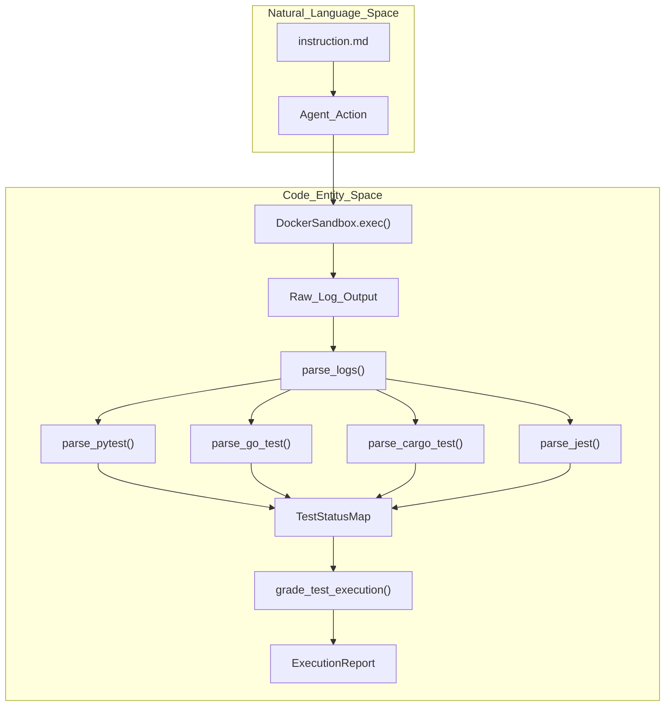
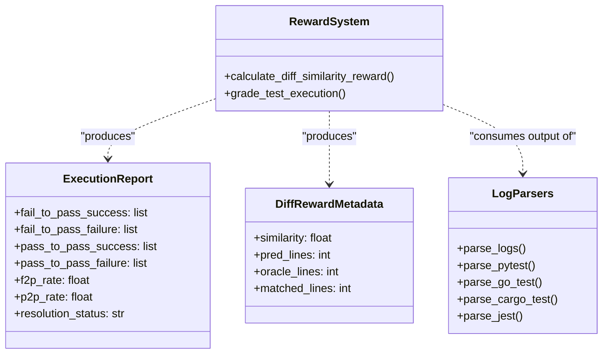

<!-- source: DeepWiki mcp.deepwiki.com · repo huggingface/Repo2RLEnv · page 5.2 Reward Functions and Log Parsers · fetched 2026-10-26 -->

# Reward Functions and Log Parsers

Relevant source files

The following files were used as context for generating this wiki page:

- [docs/reference/REWARD_SCHEMA.md](docs/reference/REWARD_SCHEMA.md)
- [src/repo2rlenv/log_parsers/__init__.py](src/repo2rlenv/log_parsers/__init__.py)
- [src/repo2rlenv/log_parsers/cargo_parser.py](src/repo2rlenv/log_parsers/cargo_parser.py)
- [src/repo2rlenv/log_parsers/go_parser.py](src/repo2rlenv/log_parsers/go_parser.py)
- [src/repo2rlenv/log_parsers/jest_parser.py](src/repo2rlenv/log_parsers/jest_parser.py)
- [src/repo2rlenv/log_parsers/pytest_parser.py](src/repo2rlenv/log_parsers/pytest_parser.py)
- [src/repo2rlenv/pipelines/_pr_runtime_verifier.py](src/repo2rlenv/pipelines/_pr_runtime_verifier.py)
- [src/repo2rlenv/reward.py](src/repo2rlenv/reward.py)
- [tests/test_grading.py](tests/test_grading.py)
- [tests/test_log_parsers.py](tests/test_log_parsers.py)
- [tests/test_log_parsers_polyglot.py](tests/test_log_parsers_polyglot.py)
- [tests/test_pytest_node_ids.py](tests/test_pytest_node_ids.py)
- [tests/test_reward.py](tests/test_reward.py)

This page documents the mechanisms used by Repo2RLEnv to evaluate model-generated code and test outputs. It covers the two primary reward calculation strategies—textual similarity for diff-based tasks and graded F2P/P2P test-execution for runtime-verified tasks—alongside the reward schema and the polyglot log parsing system (`parse_logs`) that extracts test statuses across multiple languages.

## Reward Mechanisms

Repo2RLEnv implements two primary reward calculation approaches depending on whether the task pipeline executes code in a sandbox or relies purely on static diff comparison.

### Diff Similarity Reward (`pr_diff`)
For pipelines like `pr_diff` that do not execute code in a sandbox environment, the system calculates a reward based on the sequence similarity between the predicted patch and the oracle patch [src/repo2rlenv/reward.py:64-94](). 

The reward calculation proceeds as follows:
1. **Normalization**: Volatile metadata (hunk line numbers, git indices, and timestamps) is stripped via `_normalize_diff` to focus comparison purely on code logic changes [src/repo2rlenv/reward.py:45-61]().
2. **Comparison**: It invokes Python's standard `difflib.SequenceMatcher` to compute a ratio in the range `[0, 1]` [src/repo2rlenv/reward.py:85-86]().
3. **Metadata**: It returns a `DiffRewardMetadata` record containing similarity scores, line counts, and parse diagnostics [src/repo2rlenv/reward.py:37-43]().

Sources: [src/repo2rlenv/reward.py:1-95](), [tests/test_reward.py:1-79]()

### Graded Test Execution Reward (`pr_runtime` and `commit_runtime`)
For runtime-verified tasks, the system uses a SWE-bench-style grading harness executed inside the container by `_pr_runtime_verifier.py` and evaluated via `grade_test_execution` [src/repo2rlenv/reward.py:135-160](). Tests are partitioned into two oracle sets:
*   **Fail-to-Pass (F2P)**: Tests that failed prior to the fix but must pass after the agent's patch.
*   **Pass-to-Pass (P2P)**: Tests that passed prior to the fix and must remain passing (regression guards).

The dense training reward is calculated as:
$$\text{reward} = f2p\_rate \times p2p\_rate$$
Where:
*   $f2p\_rate = \frac{\text{\# F2P tests passed}}{\text{total F2P tests}}$ [src/repo2rlenv/_pr_runtime_verifier.py:32]()
*   $p2p\_rate = \frac{\text{\# P2P tests passed}}{\text{total P2P tests}}$ (defaults to $1.0$ if no P2P tests exist) [src/repo2rlenv/_pr_runtime_verifier.py:33]()

Sources: [src/repo2rlenv/reward.py:98-160](), [src/repo2rlenv/pipelines/_pr_runtime_verifier.py:1-52](), [tests/test_grading.py:1-76]()

---

## Reward Schema

Every task emitted writes its evaluation outcomes to `/logs/verifier/` inside the container after execution [docs/reference/REWARD_SCHEMA.md:3-6]().

| File | Status | Description |
| :--- | :---: | :--- |
| `/logs/verifier/reward.txt` | ✅ | Single float scalar (e.g., `0.842731`) read directly by Harbor as the primary training signal [docs/reference/REWARD_SCHEMA.md:12](). |
| `/logs/verifier/reward.json` (or `reward-details.json`) | Pipeline-dependent | Full structured breakdown including component weights, test tallies (`f2p_total`, `p2p_total`), and resolution booleans (`resolved`, `command_resolved`) [docs/reference/REWARD_SCHEMA.md:13, 80-98]() |

Sources: [docs/reference/REWARD_SCHEMA.md:1-174]()

---

## Polyglot Log Parsers and Dispatcher

The log parsing subsystem transforms raw terminal stdout/stderr from test runners into a structured dictionary mapping `{test_name -> status}`, where status $\in \{$`PASSED`, `FAILED`, `SKIPPED`, `ERROR`$\}$ [src/repo2rlenv/log_parsers/__init__.py:1-4]().

### The Dispatcher: `parse_logs`
The central dispatcher function `parse_logs` inspects the task's recorded `test_cmds` to identify the runner using `_detect_runner`, falling back to the `language` hint if necessary [src/repo2rlenv/log_parsers/__init__.py:46-114]().

### Supported Ecosystems

| Language / Ecosystem | Parser Function | Implementation Strategy |
| :--- | :--- | :--- |
| **Python (pytest)** | `parse_pytest` | Parses both verbose progress lines (`test_a PASSED [25%]` and summary lines with last-write-wins semantics) [src/repo2rlenv/log_parsers/pytest_parser.py:49-104]() |
| **Go (`go test -v`)** | `parse_go_test` | Matches `--- PASS:`, `--- FAIL:`, and `--- SKIP:` marker lines, correctly capturing indented subtest paths (`TestX/subY`) [src/repo2rlenv/log_parsers/go_parser.py:41-67]() |
| **Rust (`cargo test`)** | `parse_cargo_test` | Matches libtest `test <name> ... ok/FAILED/ignored` lines [src/repo2rlenv/log_parsers/cargo_parser.py:40-65]() |
| **Node.js (Jest, Mocha, Vitest)** | `parse_jest` | Tracks Unicode check/cross/circle glyphs (`✓`, `✕`, `○`) and rebuilds fully qualified test names using indentation tracking of `describe` block scopes [src/repo2rlenv/log_parsers/jest_parser.py:69-141]() |

Sources: [src/repo2rlenv/log_parsers/__init__.py:1-114](), [src/repo2rlenv/log_parsers/pytest_parser.py:1-104](), [src/repo2rlenv/log_parsers/go_parser.py:1-67](), [src/repo2rlenv/log_parsers/cargo_parser.py:1-65](), [src/repo2rlenv/log_parsers/jest_parser.py:1-141]()

---

## Data Flow and Architecture

The following diagrams bridge natural language task definitions to code entity execution and evaluation logic.

### Runtime Validation and Grading Flow

Sources: [src/repo2rlenv/log_parsers/__init__.py:74-114](), [src/repo2rlenv/reward.py:135-160](), [docs/reference/REWARD_SCHEMA.md:71-114]()

### Reward and Parser Entity Relationship

Sources: [src/repo2rlenv/reward.py:37-160](), [src/repo2rlenv/log_parsers/__init__.py:12-20]()

---

